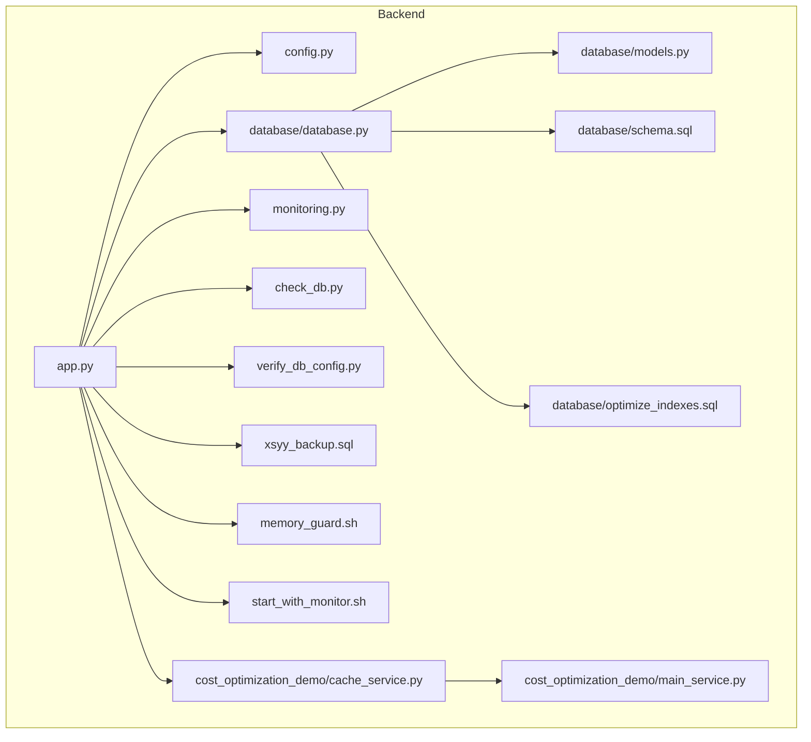
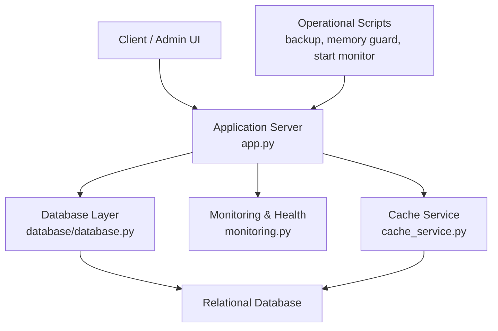
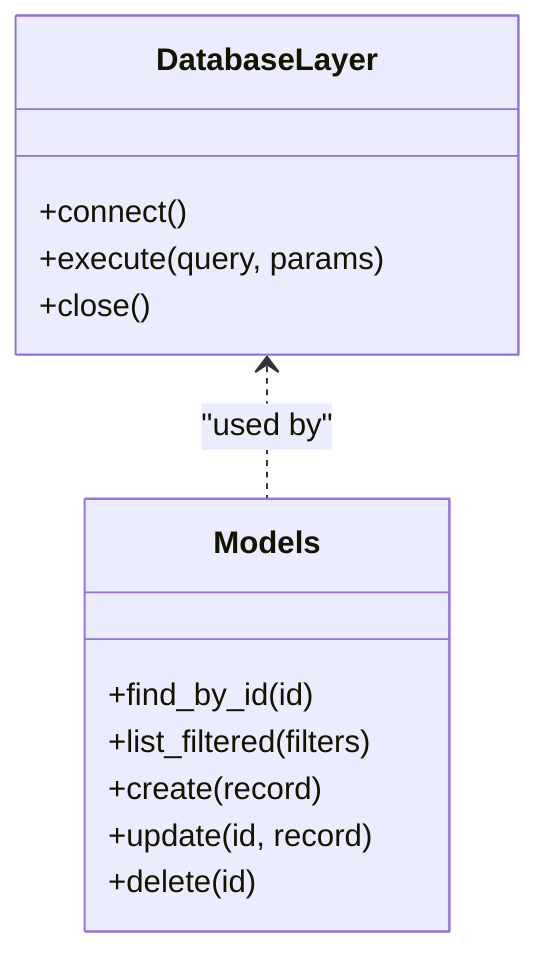
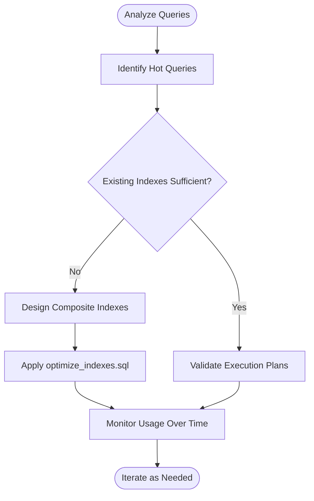
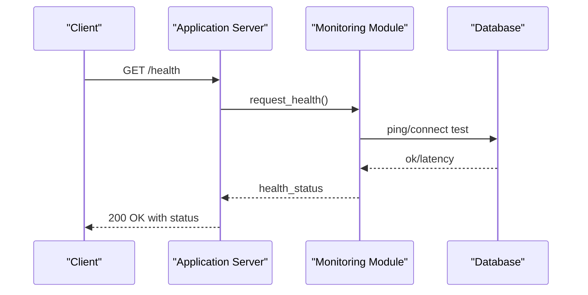
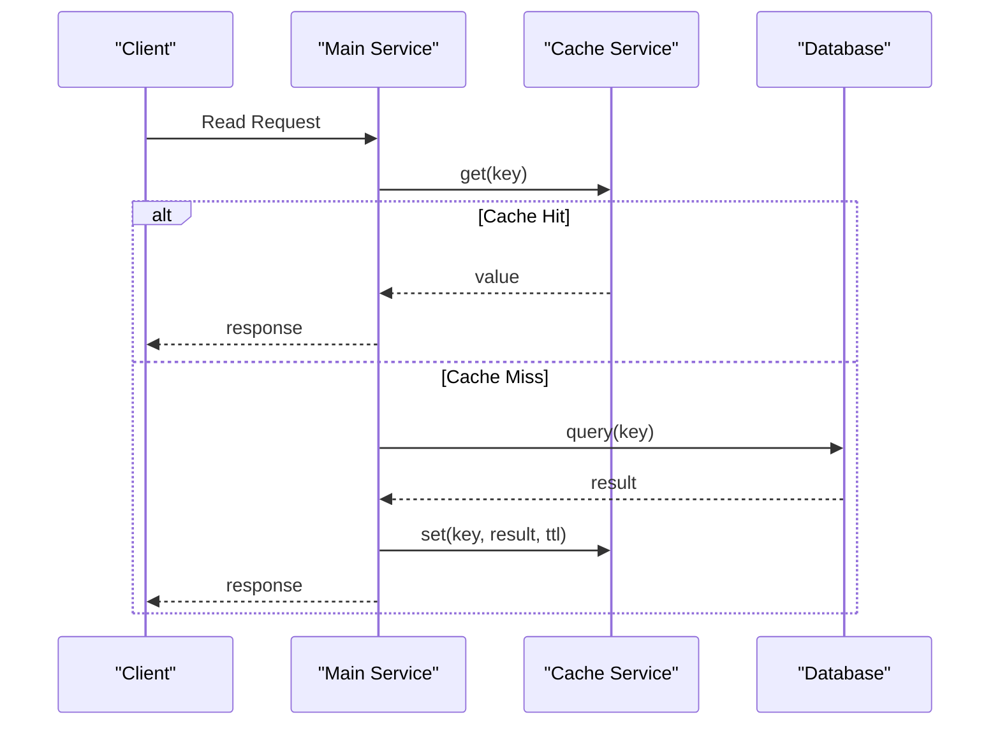
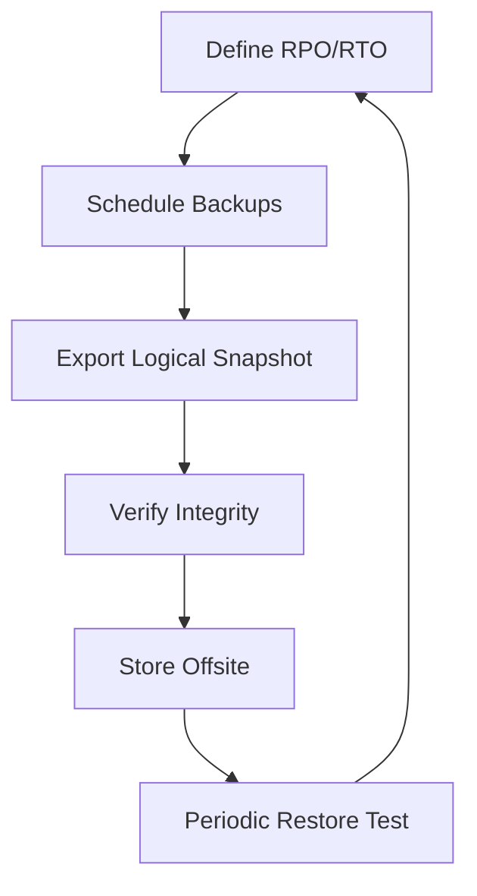
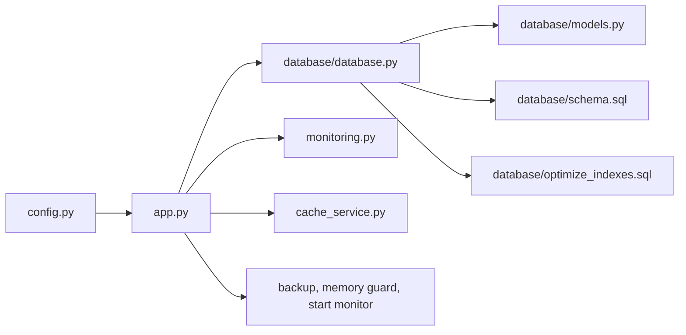

# Performance Optimization & Monitoring

<cite>
**Referenced Files in This Document**
- [PERFORMANCE_OPTIMIZATION.md](file://backend/PERFORMANCE_OPTIMIZATION.md)
- [monitoring.py](file://backend/monitoring.py)
- [database/database.py](file://backend/database/database.py)
- [database/models.py](file://backend/database/models.py)
- [database/schema.sql](file://backend/database/schema.sql)
- [database/optimize_indexes.sql](file://backend/database/optimize_indexes.sql)
- [config.py](file://backend/config.py)
- [app.py](file://backend/app.py)
- [check_db.py](file://backend/check_db.py)
- [verify_db_config.py](file://backend/verify_db_config.py)
- [xsyy_backup.sql](file://backend/xsyy_backup.sql)
- [memory_guard.sh](file://backend/memory_guard.sh)
- [start_with_monitor.sh](file://backend/start_with_monitor.sh)
- [cost_optimization_demo/cache_service.py](file://backend/cost_optimization_demo/cache_service.py)
- [cost_optimization_demo/main_service.py](file://backend/cost_optimization_demo/main_service.py)
</cite>

## Table of Contents
1. Introduction
2. Project Structure
3. Core Components
4. Architecture Overview
5. Detailed Component Analysis
6. Dependency Analysis
7. Performance Considerations
8. Troubleshooting Guide
9. Conclusion
10. Appendices

## Introduction
This document provides a comprehensive guide to database performance optimization and monitoring for the project. It covers indexing strategies, query optimization techniques, connection pool tuning, performance monitoring tools, metrics collection, bottleneck identification, slow query analysis, index optimization, health checks, backup and recovery procedures, disaster recovery planning, data integrity verification, scaling considerations (read/write splitting), caching strategies, memory management, storage optimization, resource utilization monitoring, and troubleshooting guides for common performance issues.

## Project Structure
The backend organizes database-related code under a dedicated module and includes scripts for schema management, index optimization, monitoring, and operational utilities. Key areas include:
- Database layer: models, schema, migrations, and index optimization scripts
- Application entry point and configuration
- Monitoring and health check utilities
- Caching demo for read-heavy workloads
- Operational scripts for backups and memory guard

**Diagram sources**
- [app.py](file://backend/app.py)
- [config.py](file://backend/config.py)
- [database/database.py](file://backend/database/database.py)
- [database/models.py](file://backend/database/models.py)
- [database/schema.sql](file://backend/database/schema.sql)
- [database/optimize_indexes.sql](file://backend/database/optimize_indexes.sql)
- [monitoring.py](file://backend/monitoring.py)
- [check_db.py](file://backend/check_db.py)
- [verify_db_config.py](file://backend/verify_db_config.py)
- [xsyy_backup.sql](file://backend/xsyy_backup.sql)
- [memory_guard.sh](file://backend/memory_guard.sh)
- [start_with_monitor.sh](file://backend/start_with_monitor.sh)
- [cost_optimization_demo/cache_service.py](file://backend/cost_optimization_demo/cache_service.py)
- [cost_optimization_demo/main_service.py](file://backend/cost_optimization_demo/main_service.py)

**Section sources**
- [PERFORMANCE_OPTIMIZATION.md](file://backend/PERFORMANCE_OPTIMIZATION.md)
- [database/database.py](file://backend/database/database.py)
- [database/models.py](file://backend/database/models.py)
- [database/schema.sql](file://backend/database/schema.sql)
- [database/optimize_indexes.sql](file://backend/database/optimize_indexes.sql)
- [monitoring.py](file://backend/monitoring.py)
- [config.py](file://backend/config.py)
- [app.py](file://backend/app.py)
- [check_db.py](file://backend/check_db.py)
- [verify_db_config.py](file://backend/verify_db_config.py)
- [xsyy_backup.sql](file://backend/xsyy_backup.sql)
- [memory_guard.sh](file://backend/memory_guard.sh)
- [start_with_monitor.sh](file://backend/start_with_monitor.sh)
- [cost_optimization_demo/cache_service.py](file://backend/cost_optimization_demo/cache_service.py)
- [cost_optimization_demo/main_service.py](file://backend/cost_optimization_demo/main_service.py)

## Core Components
- Database layer and ORM-like models: centralizes connection handling, queries, and schema usage.
- Schema and index definitions: declarative SQL for tables and indexes; separate script for index optimization.
- Monitoring and health checks: exposes metrics and health endpoints or utilities to validate connectivity and performance.
- Configuration: environment-driven settings for database connections, pooling, timeouts, and feature flags.
- Caching service: demonstrates cache integration patterns for read-heavy paths.
- Operational scripts: backup artifacts, memory guard, and startup with monitoring.

Key responsibilities:
- Connection lifecycle and pool tuning via configuration and database client setup.
- Query construction and execution through the database module.
- Index strategy maintenance via SQL scripts.
- Observability via monitoring utilities and health checks.
- Resilience via backups and recovery procedures.

**Section sources**
- [database/database.py](file://backend/database/database.py)
- [database/models.py](file://backend/database/models.py)
- [database/schema.sql](file://backend/database/schema.sql)
- [database/optimize_indexes.sql](file://backend/database/optimize_indexes.sql)
- [monitoring.py](file://backend/monitoring.py)
- [config.py](file://backend/config.py)
- [cost_optimization_demo/cache_service.py](file://backend/cost_optimization_demo/cache_service.py)
- [cost_optimization_demo/main_service.py](file://backend/cost_optimization_demo/main_service.py)

## Architecture Overview
The application integrates a relational database with an application server that uses a database client configured for connection pooling and timeouts. Monitoring and health checks are embedded to expose system status and performance signals. A caching layer is available for read-heavy operations.

**Diagram sources**
- [app.py](file://backend/app.py)
- [database/database.py](file://backend/database/database.py)
- [monitoring.py](file://backend/monitoring.py)
- [cost_optimization_demo/cache_service.py](file://backend/cost_optimization_demo/cache_service.py)

## Detailed Component Analysis

### Database Layer and Models
Responsibilities:
- Establish and manage connections using configuration parameters.
- Provide query helpers and model abstractions for common operations.
- Enforce schema expectations defined in SQL files.

Optimization focus:
- Use appropriate indexes defined in schema and optimize_indexes scripts.
- Tune connection pool size, timeouts, and retry policies based on workload.
- Avoid N+1 queries by batching or joining where suitable.

**Diagram sources**
- [database/database.py](file://backend/database/database.py)
- [database/models.py](file://backend/database/models.py)

**Section sources**
- [database/database.py](file://backend/database/database.py)
- [database/models.py](file://backend/database/models.py)

### Schema and Index Strategy
- Schema definition: tables and relationships declared in SQL.
- Index optimization: dedicated script to add or refine indexes for hot paths.

Recommendations:
- Align indexes with frequent WHERE, JOIN, ORDER BY, and GROUP BY clauses.
- Prefer composite indexes for multi-column filters.
- Periodically review index usage and remove unused indexes.

**Diagram sources**
- [database/schema.sql](file://backend/database/schema.sql)
- [database/optimize_indexes.sql](file://backend/database/optimize_indexes.sql)

**Section sources**
- [database/schema.sql](file://backend/database/schema.sql)
- [database/optimize_indexes.sql](file://backend/database/optimize_indexes.sql)

### Monitoring and Health Checks
Capabilities:
- Expose health endpoints or utilities to verify database connectivity and latency.
- Collect metrics such as query duration, error rates, and connection pool saturation.
- Integrate with external observability systems if needed.

**Diagram sources**
- [monitoring.py](file://backend/monitoring.py)
- [check_db.py](file://backend/check_db.py)
- [verify_db_config.py](file://backend/verify_db_config.py)

**Section sources**
- [monitoring.py](file://backend/monitoring.py)
- [check_db.py](file://backend/check_db.py)
- [verify_db_config.py](file://backend/verify_db_config.py)

### Configuration and Connection Pool Tuning
Configuration aspects:
- Host, port, credentials, and database name.
- Pool size, max overflow, idle timeout, and statement timeout.
- Retry/backoff policies and SSL/TLS options.

Tuning guidelines:
- Set pool size proportional to CPU cores and expected concurrency.
- Adjust timeouts to fail fast under load and avoid long-hanging requests.
- Enable prepared statements and reuse connections where supported.

**Section sources**
- [config.py](file://backend/config.py)
- [database/database.py](file://backend/database/database.py)

### Caching Strategies
Patterns:
- Cache frequently read data with TTL-based invalidation.
- Use cache-first reads with fallback to database on miss.
- Invalidate or update cache on write paths.

Integration points:
- Cache service interacts with main service logic and database layer.

**Diagram sources**
- [cost_optimization_demo/cache_service.py](file://backend/cost_optimization_demo/cache_service.py)
- [cost_optimization_demo/main_service.py](file://backend/cost_optimization_demo/main_service.py)

**Section sources**
- [cost_optimization_demo/cache_service.py](file://backend/cost_optimization_demo/cache_service.py)
- [cost_optimization_demo/main_service.py](file://backend/cost_optimization_demo/main_service.py)

### Backup and Recovery Procedures
Procedures:
- Use provided backup artifact to export logical snapshots.
- Schedule regular backups and retain versions per retention policy.
- Test restore procedures periodically to ensure recoverability.

**Diagram sources**
- [xsyy_backup.sql](file://backend/xsyy_backup.sql)

**Section sources**
- [xsyy_backup.sql](file://backend/xsyy_backup.sql)

### Memory Management and Resource Utilization
Tools:
- Memory guard script monitors and protects against excessive memory usage.
- Startup with monitoring script enables runtime observability.

Guidelines:
- Set process-level limits and OOM protection.
- Monitor heap and GC behavior if applicable.
- Right-size container or VM resources based on observed usage.

**Section sources**
- [memory_guard.sh](file://backend/memory_guard.sh)
- [start_with_monitor.sh](file://backend/start_with_monitor.sh)

## Dependency Analysis
High-level dependencies between components:
- Application depends on configuration, database layer, monitoring, and optional caching.
- Database layer depends on schema and index definitions.
- Operational scripts support deployment and maintenance tasks.

**Diagram sources**
- [config.py](file://backend/config.py)
- [app.py](file://backend/app.py)
- [database/database.py](file://backend/database/database.py)
- [database/models.py](file://backend/database/models.py)
- [database/schema.sql](file://backend/database/schema.sql)
- [database/optimize_indexes.sql](file://backend/database/optimize_indexes.sql)
- [monitoring.py](file://backend/monitoring.py)
- [cost_optimization_demo/cache_service.py](file://backend/cost_optimization_demo/cache_service.py)
- [memory_guard.sh](file://backend/memory_guard.sh)
- [start_with_monitor.sh](file://backend/start_with_monitor.sh)

**Section sources**
- [config.py](file://backend/config.py)
- [app.py](file://backend/app.py)
- [database/database.py](file://backend/database/database.py)
- [database/models.py](file://backend/database/models.py)
- [database/schema.sql](file://backend/database/schema.sql)
- [database/optimize_indexes.sql](file://backend/database/optimize_indexes.sql)
- [monitoring.py](file://backend/monitoring.py)
- [cost_optimization_demo/cache_service.py](file://backend/cost_optimization_demo/cache_service.py)
- [memory_guard.sh](file://backend/memory_guard.sh)
- [start_with_monitor.sh](file://backend/start_with_monitor.sh)

## Performance Considerations
Indexing strategies:
- Add indexes for high-cardinality filter columns and join keys.
- Use composite indexes for multi-column predicates.
- Review and prune unused indexes to reduce write overhead.

Query optimization techniques:
- Prefer selective predicates and avoid functions on indexed columns.
- Limit result sets and use pagination.
- Batch writes and minimize round trips.

Connection pool tuning:
- Size pools based on concurrency and database capacity.
- Configure timeouts to prevent resource exhaustion.
- Monitor pool saturation and adjust accordingly.

Monitoring and metrics:
- Track query latency percentiles, error rates, and throughput.
- Observe connection pool utilization and wait times.
- Alert on anomalies and degradation thresholds.

Bottleneck identification:
- Use slow query logs and execution plans.
- Profile application-side hotspots and I/O waits.
- Correlate metrics with infrastructure utilization.

Scaling considerations:
- Read/write splitting: route reads to replicas and writes to primary.
- Horizontal scaling: shard or partition large tables when necessary.
- Caching: place caches close to consumers to reduce DB pressure.

Memory and storage:
- Tune buffer/cache sizes to fit working set.
- Compress cold data and archive historical records.
- Monitor disk I/O and choose appropriate storage classes.

[No sources needed since this section provides general guidance]

## Troubleshooting Guide
Common issues and resolutions:
- Slow queries: analyze execution plans, add or adjust indexes, rewrite queries.
- Connection pool exhaustion: increase pool size, tune timeouts, identify leaks.
- High CPU or I/O: offload reads to replicas, enable caching, optimize queries.
- Memory pressure: apply memory guard, adjust process/container limits, profile allocations.
- Data inconsistency: run integrity checks, reconcile from backups, audit change logs.

Health checks and diagnostics:
- Use health endpoints and database connectivity tests.
- Validate configuration before deployment.
- Maintain runbooks for incident response and rollback.

**Section sources**
- [monitoring.py](file://backend/monitoring.py)
- [check_db.py](file://backend/check_db.py)
- [verify_db_config.py](file://backend/verify_db_config.py)
- [memory_guard.sh](file://backend/memory_guard.sh)

## Conclusion
Effective database performance optimization combines thoughtful indexing, efficient queries, well-tuned connection pools, robust monitoring, and disciplined operations. By integrating caching where appropriate, planning for scale, and maintaining strong backup and recovery practices, the system can deliver reliable performance under varying loads. Continuous measurement and iteration are essential to sustain optimal performance over time.

[No sources needed since this section summarizes without analyzing specific files]

## Appendices
- Reference documents and scripts:
  - Performance overview and recommendations: [PERFORMANCE_OPTIMIZATION.md](file://backend/PERFORMANCE_OPTIMIZATION.md)
  - Database layer and models: [database/database.py](file://backend/database/database.py), [database/models.py](file://backend/database/models.py)
  - Schema and index optimization: [database/schema.sql](file://backend/database/schema.sql), [database/optimize_indexes.sql](file://backend/database/optimize_indexes.sql)
  - Monitoring and health: [monitoring.py](file://backend/monitoring.py), [check_db.py](file://backend/check_db.py), [verify_db_config.py](file://backend/verify_db_config.py)
  - Configuration: [config.py](file://backend/config.py)
  - Caching demo: [cost_optimization_demo/cache_service.py](file://backend/cost_optimization_demo/cache_service.py), [cost_optimization_demo/main_service.py](file://backend/cost_optimization_demo/main_service.py)
  - Backup artifact: [xsyy_backup.sql](file://backend/xsyy_backup.sql)
  - Operational scripts: [memory_guard.sh](file://backend/memory_guard.sh), [start_with_monitor.sh](file://backend/start_with_monitor.sh)