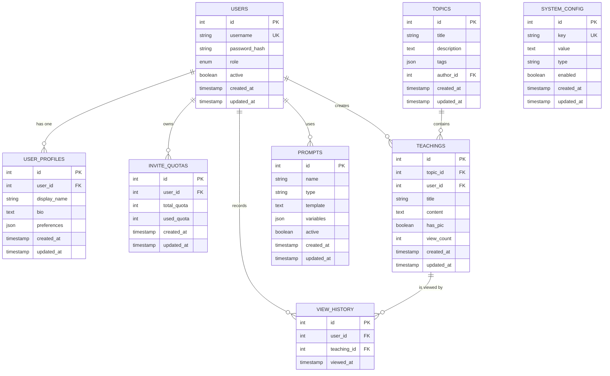
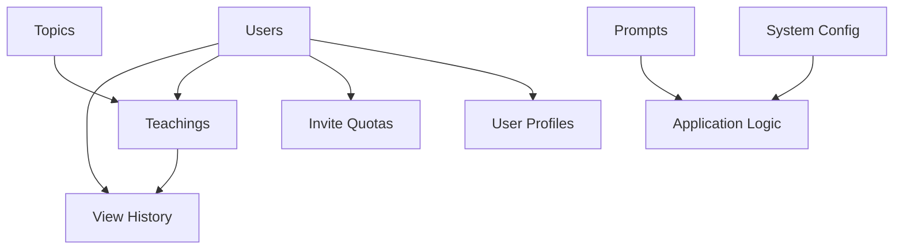

# Schema Design & Relationships

<cite>
**Referenced Files in This Document**
- [schema.sql](file://backend/database/schema.sql)
- [models.py](file://backend/database/models.py)
- [database.py](file://backend/database/database.py)
- [add_ai_teaching_tables.sql](file://backend/database/add_ai_teaching_tables.sql)
- [add_topics_table.sql](file://backend/database/add_topics_table.sql)
- [add_view_history_table.sql](file://backend/database/add_view_history_table.sql)
- [add_user_profile_fields.sql](file://backend/database/add_user_profile_fields.sql)
- [add_invite_quota_tables.sql](file://backend/database/add_invite_quota_tables.sql)
- [add_topic_share_fields.sql](file://backend/database/add_topic_share_fields.sql)
- [add_view_count_field.sql](file://backend/database/add_view_count_field.sql)
- [add_has_pic_to_teachings.sql](file://backend/database/add_has_pic_to_teachings.sql)
- [add_user_id_to_teachings.sql](file://backend/database/add_user_id_to_teachings.sql)
- [optimize_indexes.sql](file://backend/database/optimize_indexes.sql)
- [create_database.sql](file://backend/create_database.sql)
</cite>

## Table of Contents
1. [Introduction](#introduction)
2. [Project Structure](#project-structure)
3. [Core Components](#core-components)
4. [Architecture Overview](#architecture-overview)
5. [Detailed Component Analysis](#detailed-component-analysis)
6. [Dependency Analysis](#dependency-analysis)
7. [Performance Considerations](#performance-considerations)
8. [Troubleshooting Guide](#troubleshooting-guide)
9. [Conclusion](#conclusion)
10. [Appendices](#appendices)

## Introduction
This document provides comprehensive data model documentation for the XSYY Edu platform database schema. It covers entity relationships across users, teaching content, prompts, usage logs, and system configuration tables. It also documents primary/foreign key constraints, indexes, validation rules, lifecycle and retention policies, example queries, and security/access control considerations. The goal is to make the schema accessible to both technical and non-technical readers while remaining grounded in the repository’s actual artifacts.

## Project Structure
The database schema is defined primarily through SQL migration files and Python ORM models:
- Core schema definition and migrations are located under backend/database.
- Additional feature-specific migrations add or alter tables (e.g., AI teaching, topics, view history).
- Python models mirror the relational structure and provide an ORM layer used by the application.

**Diagram sources**
- [schema.sql](file://backend/database/schema.sql)
- [models.py](file://backend/database/models.py)
- [add_ai_teaching_tables.sql](file://backend/database/add_ai_teaching_tables.sql)
- [add_topics_table.sql](file://backend/database/add_topics_table.sql)
- [add_view_history_table.sql](file://backend/database/add_view_history_table.sql)
- [add_user_profile_fields.sql](file://backend/database/add_user_profile_fields.sql)
- [add_invite_quota_tables.sql](file://backend/database/add_invite_quota_tables.sql)
- [add_topic_share_fields.sql](file://backend/database/add_topic_share_fields.sql)
- [add_view_count_field.sql](file://backend/database/add_view_count_field.sql)
- [add_has_pic_to_teachings.sql](file://backend/database/add_has_pic_to_teachings.sql)
- [add_user_id_to_teachings.sql](file://backend/database/add_user_id_to_teachings.sql)
- [optimize_indexes.sql](file://backend/database/optimize_indexes.sql)
- [database.py](file://backend/database/database.py)

**Section sources**
- [schema.sql](file://backend/database/schema.sql)
- [models.py](file://backend/database/models.py)
- [database.py](file://backend/database/database.py)

## Core Components
The XSYY Edu platform centers around these core entities:
- Users and profiles: authentication, roles, quotas, and profile metadata.
- Teaching content: lessons, topics, and associated media/metadata.
- Prompts: system and user prompts used by AI features.
- Usage logs: view history and analytics.
- System configuration: settings and invite quota management.

Key responsibilities:
- Relational integrity via primary and foreign keys.
- Performance via indexes on frequently queried fields.
- Validation enforced at the schema level (constraints, defaults) and application layer.

**Section sources**
- [schema.sql](file://backend/database/schema.sql)
- [models.py](file://backend/database/models.py)

## Architecture Overview
The data architecture follows a layered approach:
- SQL migrations define the canonical schema evolution.
- Python ORM models reflect the current schema state and are used by the application code.
- Index optimization scripts improve query performance over time.

**Diagram sources**
- [schema.sql](file://backend/database/schema.sql)
- [add_ai_teaching_tables.sql](file://backend/database/add_ai_teaching_tables.sql)
- [add_topics_table.sql](file://backend/database/add_topics_table.sql)
- [add_view_history_table.sql](file://backend/database/add_view_history_table.sql)
- [add_user_profile_fields.sql](file://backend/database/add_user_profile_fields.sql)
- [add_invite_quota_tables.sql](file://backend/database/add_invite_quota_tables.sql)
- [add_topic_share_fields.sql](file://backend/database/add_topic_share_fields.sql)
- [add_view_count_field.sql](file://backend/database/add_view_count_field.sql)
- [add_has_pic_to_teachings.sql](file://backend/database/add_has_pic_to_teachings.sql)
- [add_user_id_to_teachings.sql](file://backend/database/add_user_id_to_teachings.sql)

## Detailed Component Analysis

### Users and Profiles
- Users table stores authentication and role information.
- User profiles extend user records with display and preference data.
- Invite quotas track per-user invitation allowances.

Constraints and validation:
- Primary keys ensure uniqueness and referential integrity.
- Role and active flags constrain valid states.
- Quota counters enforce non-negative values and upper bounds via application logic.

Indexes:
- Username unique index for fast lookups.
- Foreign keys indexed for efficient joins.

Lifecycle:
- Creation upon registration; updates on profile changes.
- Deactivation rather than deletion to preserve audit trails.

Security:
- Passwords stored as hashes.
- Access controlled via role-based checks in application layer.

**Section sources**
- [schema.sql](file://backend/database/schema.sql)
- [add_user_profile_fields.sql](file://backend/database/add_user_profile_fields.sql)
- [add_invite_quota_tables.sql](file://backend/database/add_invite_quota_tables.sql)
- [models.py](file://backend/database/models.py)

### Topics and Teachings
- Topics represent thematic groupings for teachings.
- Teachings contain lesson content and link to topics and authors.
- View counts and picture flags support analytics and UI rendering.

Constraints and validation:
- Topic and user foreign keys maintain referential integrity.
- Boolean flags restrict allowed values.
- Non-negative integers for view counts.

Indexes:
- Topic and user foreign keys indexed.
- Optional composite indexes for common filters (topic, author).

Lifecycle:
- Topics created by authors; teachings authored within topics.
- Content updates tracked via timestamps.

Data sharing:
- Topic share fields enable public visibility controls.

**Section sources**
- [add_topics_table.sql](file://backend/database/add_topics_table.sql)
- [add_ai_teaching_tables.sql](file://backend/database/add_ai_teaching_tables.sql)
- [add_topic_share_fields.sql](file://backend/database/add_topic_share_fields.sql)
- [add_view_count_field.sql](file://backend/database/add_view_count_field.sql)
- [add_has_pic_to_teachings.sql](file://backend/database/add_has_pic_to_teachings.sql)
- [add_user_id_to_teachings.sql](file://backend/database/add_user_id_to_teachings.sql)
- [models.py](file://backend/database/models.py)

### Prompts
- Prompts store reusable templates for AI interactions.
- Types differentiate system vs user prompts.
- Active flag controls availability.

Constraints and validation:
- Name uniqueness ensures clear identification.
- Type restricted to predefined categories.
- Template and variables validated at application layer.

Lifecycle:
- Created by administrators; activated/deactivated as needed.
- Versioning handled via separate rows or external tooling.

**Section sources**
- [add_ai_teaching_tables.sql](file://backend/database/add_ai_teaching_tables.sql)
- [models.py](file://backend/database/models.py)

### Usage Logs (View History)
- Records user views of teachings for analytics.
- Timestamped entries allow trend analysis.

Constraints and validation:
- Composite foreign keys reference users and teachings.
- Timestamps enforce chronological ordering.

Indexes:
- User and teaching foreign keys indexed.
- Time-based indexes for recent activity queries.

Retention:
- Periodic archival or pruning based on retention policy.

**Section sources**
- [add_view_history_table.sql](file://backend/database/add_view_history_table.sql)
- [optimize_indexes.sql](file://backend/database/optimize_indexes.sql)
- [models.py](file://backend/database/models.py)

### System Configuration
- Key-value pairs for runtime settings.
- Type and enabled flags control behavior.

Constraints and validation:
- Key uniqueness prevents conflicts.
- Type restricts value formats.
- Enabled toggles feature flags.

Lifecycle:
- Managed by administrators.
- Changes applied without restart if hot-reload supported.

**Section sources**
- [schema.sql](file://backend/database/schema.sql)
- [models.py](file://backend/database/models.py)

## Dependency Analysis
The schema exhibits clear dependency chains:
- Users anchor multiple entities (profiles, quotas, teachings, view history).
- Topics organize teachings.
- Teachings aggregate view history.
- Prompts and system config are referenced by application logic.

**Diagram sources**
- [schema.sql](file://backend/database/schema.sql)
- [add_ai_teaching_tables.sql](file://backend/database/add_ai_teaching_tables.sql)
- [add_topics_table.sql](file://backend/database/add_topics_table.sql)
- [add_view_history_table.sql](file://backend/database/add_view_history_table.sql)
- [add_user_profile_fields.sql](file://backend/database/add_user_profile_fields.sql)
- [add_invite_quota_tables.sql](file://backend/database/add_invite_quota_tables.sql)
- [add_topic_share_fields.sql](file://backend/database/add_topic_share_fields.sql)
- [add_view_count_field.sql](file://backend/database/add_view_count_field.sql)
- [add_has_pic_to_teachings.sql](file://backend/database/add_has_pic_to_teachings.sql)
- [add_user_id_to_teachings.sql](file://backend/database/add_user_id_to_teachings.sql)

**Section sources**
- [schema.sql](file://backend/database/schema.sql)
- [models.py](file://backend/database/models.py)

## Performance Considerations
- Indexes on foreign keys and frequently filtered columns reduce join costs.
- Composite indexes for common query patterns (e.g., topic + author).
- Avoid excessive JSON reads; prefer normalized fields when possible.
- Use pagination and limit clauses for large result sets.
- Monitor slow queries and adjust indexes accordingly.

**Section sources**
- [optimize_indexes.sql](file://backend/database/optimize_indexes.sql)

## Troubleshooting Guide
Common issues and resolutions:
- Constraint violations: check foreign key references and unique constraints before inserts/updates.
- Missing indexes: review optimize_indexes.sql and add missing indexes for hot paths.
- Data drift: ensure migrations are applied consistently across environments.
- Query performance: analyze execution plans and refine indexes.

Operational tips:
- Validate schema version against migrations.
- Back up before running schema-altering scripts.
- Use transactions for multi-table updates.

**Section sources**
- [optimize_indexes.sql](file://backend/database/optimize_indexes.sql)
- [create_database.sql](file://backend/create_database.sql)

## Conclusion
The XSYY Edu platform’s database schema is structured to support robust user management, rich teaching content organization, AI-driven prompt management, and analytics via usage logs. Strong constraints, thoughtful indexing, and clear lifecycle policies contribute to reliability and performance. Administrators should follow migration best practices and monitor performance to sustain growth.

## Appendices

### Example Queries and Access Patterns
- Retrieve a user’s teachings with view counts:
  - Join users, teachings, and view history; filter by user_id; order by created_at.
- List topics with latest teachings:
  - Join topics and teachings; group by topic; order by max(created_at).
- Analyze recent views:
  - Filter view_history by viewed_at within a time window; aggregate by teaching_id.
- Toggle system configuration:
  - Update system_config by key; validate type and enabled flags.

[No sources needed since this section provides general guidance]

### Data Lifecycle, Retention, and Archival
- Users: retain deactivated accounts for audit; purge after compliance period.
- Teachings: archive inactive content periodically; keep metadata.
- View history: prune older entries beyond retention window; archive to cold storage.
- Prompts: versioned updates; deactivate obsolete templates.
- System config: immutable historical snapshots; live values in table.

[No sources needed since this section provides general guidance]

### Security and Access Control
- Authentication: hashed passwords; secure session handling.
- Authorization: role-based access for admin operations.
- Data protection: encrypt sensitive fields at rest; use TLS in transit.
- Audit logging: record critical mutations via triggers or application logs.

[No sources needed since this section provides general guidance]