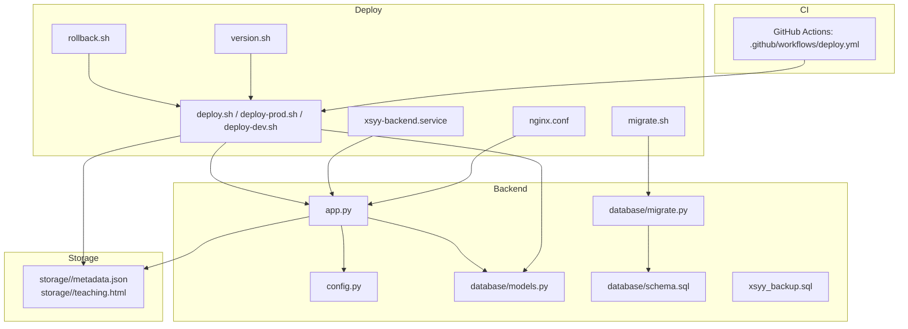
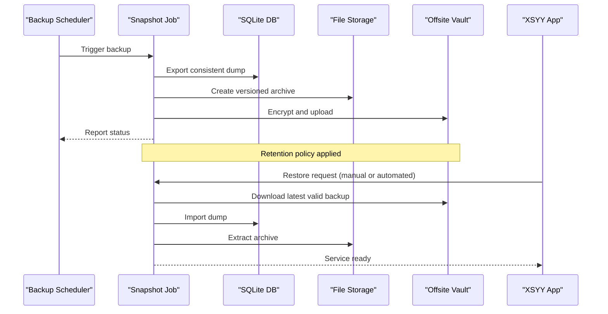
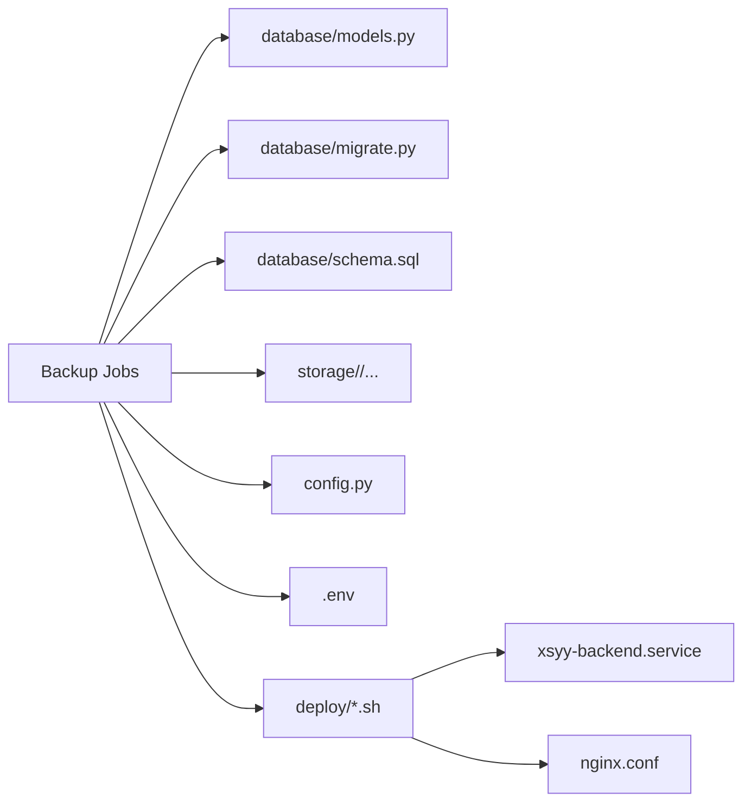

# Backup & Disaster Recovery

<cite>
**Referenced Files in This Document**
- [backend/database/schema.sql](file://backend/database/schema.sql)
- [backend/database/models.py](file://backend/database/models.py)
- [backend/database/migrate.py](file://backend/database/migrate.py)
- [backend/app.py](file://backend/app.py)
- [backend/config.py](file://backend/config.py)
- [backend/env.example](file://backend/env.example)
- [backend/xsyy_backup.sql](file://backend/xsyy_backup.sql)
- [backend/check_db.py](file://backend/check_db.py)
- [backend/verify_db_config.py](file://backend/verify_db_config.py)
- [backend/cleanup_storage.py](file://backend/utils/cleanup_storage.py)
- [backend/prompt/backup/classification_user_prompt_v0.txt](file://backend/prompt/backup/classification_user_prompt_v0.txt)
- [backend/prompt/backup/teaching_system_prompt.txt](file://backend/prompt/backup/teaching_system_prompt.txt)
- [storage/.../metadata.json](file://storage/02f5efec-416c-4a17-9bf2-7ebea80cf178/metadata.json)
- [deploy/deploy.sh](file://deploy/deploy.sh)
- [deploy/deploy-prod.sh](file://deploy/deploy-prod.sh)
- [deploy/deploy-dev.sh](file://deploy/deploy-dev.sh)
- [deploy/rollback.sh](file://deploy/rollback.sh)
- [deploy/nginx.conf](file://deploy/nginx.conf)
- [deploy/xsyy-backend.service](file://deploy/xsyy-backend.service)
- [deploy/migrate.sh](file://deploy/migrate.sh)
- [deploy/version.sh](file://deploy/version.sh)
- [.github/workflows/deploy.yml](file://.github/workflows/deploy.yml)
</cite>

## Table of Contents
1. Introduction
2. Project Structure
3. Core Components
4. Architecture Overview
5. Detailed Component Analysis
6. Dependency Analysis
7. Performance Considerations
8. Troubleshooting Guide
9. Conclusion
10. Appendices

## Introduction
This document defines the backup and disaster recovery strategy for the XSYY Edu platform. It covers automated backups for the SQLite database, file storage system, and configuration files; incremental vs full backup approaches; retention policies; offsite storage; export/import procedures; data consistency verification; point-in-time recovery techniques; disaster recovery playbooks for complete failure, corruption, and natural disasters; encryption and secure transfer; compliance considerations; RTO/RPO guidelines; testing procedures; cloud integration; versioned backups; and automated restoration workflows.

## Project Structure
The XSYY Edu platform uses:
- SQLite as the primary relational store with schema and migrations under backend/database.
- A flat-file storage area under storage/, where each asset has a UUID-named directory containing metadata.json and teaching.html (and optional artifacts).
- Configuration via environment variables and Python config modules.
- Deployment scripts under deploy/ and CI workflow under .github/workflows.

**Diagram sources**
- [backend/app.py](file://backend/app.py)
- [backend/config.py](file://backend/config.py)
- [backend/database/models.py](file://backend/database/models.py)
- [backend/database/migrate.py](file://backend/database/migrate.py)
- [backend/database/schema.sql](file://backend/database/schema.sql)
- [backend/xsyy_backup.sql](file://backend/xsyy_backup.sql)
- [storage/02f5efec-416c-4a17-9bf2-7ebea80cf178/metadata.json](file://storage/02f5efec-416c-4a17-9bf2-7ebea80cf178/metadata.json)
- [deploy/deploy.sh](file://deploy/deploy.sh)
- [deploy/deploy-prod.sh](file://deploy/deploy-prod.sh)
- [deploy/deploy-dev.sh](file://deploy/deploy-dev.sh)
- [deploy/rollback.sh](file://deploy/rollback.sh)
- [deploy/migrate.sh](file://deploy/migrate.sh)
- [deploy/version.sh](file://deploy/version.sh)
- [deploy/xsyy-backend.service](file://deploy/xsyy-backend.service)
- [deploy/nginx.conf](file://deploy/nginx.conf)
- [.github/workflows/deploy.yml](file://.github/workflows/deploy.yml)

**Section sources**
- [backend/database/schema.sql](file://backend/database/schema.sql)
- [backend/database/models.py](file://backend/database/models.py)
- [backend/database/migrate.py](file://backend/database/migrate.py)
- [backend/app.py](file://backend/app.py)
- [backend/config.py](file://backend/config.py)
- [backend/env.example](file://backend/env.example)
- [backend/xsyy_backup.sql](file://backend/xsyy_backup.sql)
- [storage/02f5efec-416c-4a17-9bf2-7ebea80cf178/metadata.json](file://storage/02f5efec-416c-4a17-9bf2-7ebea80cf178/metadata.json)
- [deploy/deploy.sh](file://deploy/deploy.sh)
- [deploy/deploy-prod.sh](file://deploy/deploy-prod.sh)
- [deploy/deploy-dev.sh](file://deploy/deploy-dev.sh)
- [deploy/rollback.sh](file://deploy/rollback.sh)
- [deploy/migrate.sh](file://deploy/migrate.sh)
- [deploy/version.sh](file://deploy/version.sh)
- [deploy/xsyy-backend.service](file://deploy/xsyy-backend.service)
- [deploy/nginx.conf](file://deploy/nginx.conf)
- [.github/workflows/deploy.yml](file://.github/workflows/deploy.yml)

## Core Components
- Database layer: SQLite-backed ORM models and migration utilities define the persistent schema and evolution path.
- File storage: UUID-based directories under storage/ hold content assets and per-item metadata.
- Configuration: Environment-driven settings and application-level config module control runtime behavior.
- Deployment: Shell scripts orchestrate build, migration, service restart, and rollback.
- CI: GitHub Actions workflow triggers deployment pipelines.

Key responsibilities for backup and DR:
- Ensure consistent snapshots of SQLite and storage.
- Version and retain backups securely.
- Provide reliable restore paths to meet RTO/RPO targets.
- Validate integrity post-backup and pre-restore.

**Section sources**
- [backend/database/models.py](file://backend/database/models.py)
- [backend/database/migrate.py](file://backend/database/migrate.py)
- [backend/app.py](file://backend/app.py)
- [backend/config.py](file://backend/config.py)
- [backend/env.example](file://backend/env.example)
- [deploy/deploy.sh](file://deploy/deploy.sh)
- [deploy/deploy-prod.sh](file://deploy/deploy-prod.sh)
- [deploy/deploy-dev.sh](file://deploy/deploy-dev.sh)
- [deploy/rollback.sh](file://deploy/rollback.sh)
- [deploy/migrate.sh](file://deploy/migrate.sh)
- [deploy/version.sh](file://deploy/version.sh)
- [deploy/xsyy-backend.service](file://deploy/xsyy-backend.service)
- [deploy/nginx.conf](file://deploy/nginx.conf)
- [.github/workflows/deploy.yml](file://.github/workflows/deploy.yml)

## Architecture Overview
The backup and recovery architecture integrates three pillars:
- Data snapshotting: Consistent dumps of SQLite and tarballs of storage/.
- Offsite replication: Encrypted copies to remote object storage or another server.
- Automated restore: Scripts to rebuild services from latest valid backups with integrity checks.

[No sources needed since this diagram shows conceptual workflow, not actual code structure]

## Detailed Component Analysis

### Database Backup and Restore
- Strategy: Use consistent SQLite exports. For zero-downtime hot backups, consider enabling WAL mode and using a transactional dump approach.
- Artifacts: The repository includes an example SQL backup artifact and schema definitions that guide import/export.
- Migrations: Apply schema changes via migration utilities before restoring to ensure compatibility.

Recommended procedures:
- Full backup: Export entire database to a timestamped SQL file.
- Incremental backup: If WAL is enabled, capture checkpointed state and periodically ship WAL segments.
- Restore: Stop writes if necessary, import the SQL dump, then run migrations to align schema.

Integrity checks:
- Verify checksums of exported files.
- Run a lightweight query set against the restored database to validate critical tables.

**Section sources**
- [backend/database/schema.sql](file://backend/database/schema.sql)
- [backend/database/migrate.py](file://backend/database/migrate.py)
- [backend/xsyy_backup.sql](file://backend/xsyy_backup.sql)
- [backend/check_db.py](file://backend/check_db.py)
- [backend/verify_db_config.py](file://backend/verify_db_config.py)

### File Storage Backup and Restore
- Strategy: Archive storage/ into versioned archives. Each item directory contains metadata.json and teaching.html; preserve both.
- Incremental option: Use tooling that supports change detection (e.g., rsync with hard links or object storage versioning).
- Restore: Extract archives back to storage/ and verify metadata completeness.

Consistency:
- Ensure no active writes during snapshot or use atomic rename strategies.
- Validate counts and checksums of key files after restore.

**Section sources**
- [storage/02f5efec-416c-4a17-9bf2-7ebea80cf178/metadata.json](file://storage/02f5efec-416c-4a17-9bf2-7ebea80cf178/metadata.json)
- [backend/utils/cleanup_storage.py](file://backend/utils/cleanup_storage.py)

### Configuration and Secrets Backup
- Scope: Environment variables (.env), application config, and any local secrets.
- Security: Treat these as sensitive; encrypt at rest and in transit.
- Restore: Rehydrate environment and config prior to service start.

**Section sources**
- [backend/config.py](file://backend/config.py)
- [backend/env.example](file://backend/env.example)

### Prompt Assets Backup
- Scope: System and user prompts used by AI features are part of application state.
- Strategy: Include prompt directories in versioned archives.

**Section sources**
- [backend/prompt/backup/classification_user_prompt_v0.txt](file://backend/prompt/backup/classification_user_prompt_v0.txt)
- [backend/prompt/backup/teaching_system_prompt.txt](file://backend/prompt/backup/teaching_system_prompt.txt)

### Deployment Integration
- Deploy scripts orchestrate builds, migrations, and service restarts. Integrate backup hooks around deployments to minimize risk windows.
- Rollback script enables quick revert to previous known-good state.

**Section sources**
- [deploy/deploy.sh](file://deploy/deploy.sh)
- [deploy/deploy-prod.sh](file://deploy/deploy-prod.sh)
- [deploy/deploy-dev.sh](file://deploy/deploy-dev.sh)
- [deploy/rollback.sh](file://deploy/rollback.sh)
- [deploy/migrate.sh](file://deploy/migrate.sh)
- [deploy/version.sh](file://deploy/version.sh)
- [deploy/xsyy-backend.service](file://deploy/xsyy-backend.service)
- [deploy/nginx.conf](file://deploy/nginx.conf)

### CI/CD Integration
- GitHub Actions workflow can trigger backup jobs and deployment steps.
- Use secrets management for credentials to offsite storage.

**Section sources**
- [.github/workflows/deploy.yml](file://.github/workflows/deploy.yml)

## Dependency Analysis
The following diagram maps how backup-related components depend on core application modules and deployment scripts.

**Diagram sources**
- [backend/database/models.py](file://backend/database/models.py)
- [backend/database/migrate.py](file://backend/database/migrate.py)
- [backend/database/schema.sql](file://backend/database/schema.sql)
- [backend/config.py](file://backend/config.py)
- [backend/env.example](file://backend/env.example)
- [deploy/deploy.sh](file://deploy/deploy.sh)
- [deploy/deploy-prod.sh](file://deploy/deploy-prod.sh)
- [deploy/deploy-dev.sh](file://deploy/deploy-dev.sh)
- [deploy/xsyy-backend.service](file://deploy/xsyy-backend.service)
- [deploy/nginx.conf](file://deploy/nginx.conf)

**Section sources**
- [backend/database/models.py](file://backend/database/models.py)
- [backend/database/migrate.py](file://backend/database/migrate.py)
- [backend/database/schema.sql](file://backend/database/schema.sql)
- [backend/config.py](file://backend/config.py)
- [backend/env.example](file://backend/env.example)
- [deploy/deploy.sh](file://deploy/deploy.sh)
- [deploy/deploy-prod.sh](file://deploy/deploy-prod.sh)
- [deploy/deploy-dev.sh](file://deploy/deploy-dev.sh)
- [deploy/xsyy-backend.service](file://deploy/xsyy-backend.service)
- [deploy/nginx.conf](file://deploy/nginx.conf)

## Performance Considerations
- Prefer off-hours scheduling for full backups to reduce contention.
- Use incremental backups for frequent snapshots to limit I/O overhead.
- Compress and stream archives directly to offsite storage to save disk space and time.
- Enable database WAL mode for reduced locking during reads and safer hot backups.
- Parallelize uploads to offsite storage when supported by the target.

[No sources needed since this section provides general guidance]

## Troubleshooting Guide
Common issues and mitigations:
- Corrupted SQLite file: Restore from last verified backup; re-run migrations; validate with integrity checks.
- Missing storage items: Compare inventory against metadata manifests; re-extract from archives.
- Permission errors during restore: Ensure service account has write access to storage/ and DB paths.
- Migration conflicts: Align schema versions before importing data; apply migrations in order.

Verification utilities:
- Database connectivity and basic sanity checks.
- Config validation helpers.

**Section sources**
- [backend/check_db.py](file://backend/check_db.py)
- [backend/verify_db_config.py](file://backend/verify_db_config.py)

## Conclusion
A robust backup and disaster recovery program for XSYY Edu combines consistent database snapshots, versioned file archives, encrypted offsite replication, and tested restore procedures. By defining clear RTO/RPO targets, automating backups and restores, and regularly validating integrity, the platform can withstand failures, corruption, and catastrophic events while maintaining business continuity.

[No sources needed since this section summarizes without analyzing specific files]

## Appendices

### Backup Strategies and Policies
- Full backups: Daily complete snapshots of database and storage.
- Incremental backups: Hourly or more frequent deltas for storage; periodic WAL shipping for database.
- Retention: Keep daily for 7 days, weekly for 4 weeks, monthly for 6 months; rotate automatically.
- Offsite: Replicate to a separate region or provider with encryption at rest and in transit.

### Encryption and Secure Transfer
- Encrypt archives with strong symmetric encryption before upload.
- Use TLS for all transfers; manage keys via a secrets manager.
- Sign artifacts and verify signatures upon restore.

### Compliance Requirements
- Classify data sensitivity; apply appropriate controls.
- Maintain audit logs of backup and restore operations.
- Ensure data residency requirements are met when selecting offsite locations.

### RTO and RPO Guidelines
- RPO: Target ≤ 1 hour for production (incremental + WAL shipping).
- RTO: Target ≤ 2 hours for partial failures; ≤ 4 hours for full site recovery.
- Adjust based on business impact and SLAs.

### Testing Procedures
- Monthly restore drills to a staging environment.
- Automated integrity checks post-backup and pre-restore.
- Chaos exercises simulating node loss and data corruption.

### Cloud Storage Integration
- Use object storage with versioning enabled.
- Implement lifecycle policies for tiering and expiration.
- Automate uploads and downloads via CLI or SDKs.

### Point-in-Time Recovery Techniques
- With WAL-enabled SQLite, combine base backup with sequential WAL segments to recover to a chosen timestamp.
- For file storage, use versioned objects to roll back to a specific revision.

### Automated Restoration Workflows
- Orchestrate download, decrypt, verify, import, migrate, and restart steps.
- Gate automation behind approval gates for production restores.

### Disaster Recovery Playbooks
- Complete system failure: Stand up new hosts, restore DB and storage, reconfigure services, validate health.
- Data corruption: Identify earliest good snapshot, restore to that point, replay recent increments if available.
- Natural disaster: Failover to secondary region using replicated backups and DNS failover.

### Key Script Paths for Implementation
- Backup scheduler and job logic: implement alongside existing deploy scripts.
- Restore orchestrator: integrate with rollback and migrate scripts.
- Health checks: leverage existing check and verify utilities.

**Section sources**
- [deploy/deploy.sh](file://deploy/deploy.sh)
- [deploy/deploy-prod.sh](file://deploy/deploy-prod.sh)
- [deploy/deploy-dev.sh](file://deploy/deploy-dev.sh)
- [deploy/rollback.sh](file://deploy/rollback.sh)
- [deploy/migrate.sh](file://deploy/migrate.sh)
- [deploy/version.sh](file://deploy/version.sh)
- [deploy/xsyy-backend.service](file://deploy/xsyy-backend.service)
- [deploy/nginx.conf](file://deploy/nginx.conf)
- [backend/check_db.py](file://backend/check_db.py)
- [backend/verify_db_config.py](file://backend/verify_db_config.py)