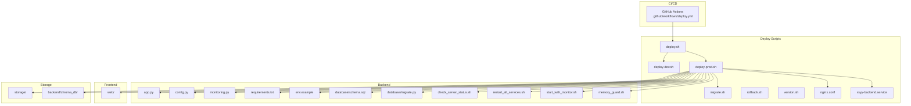
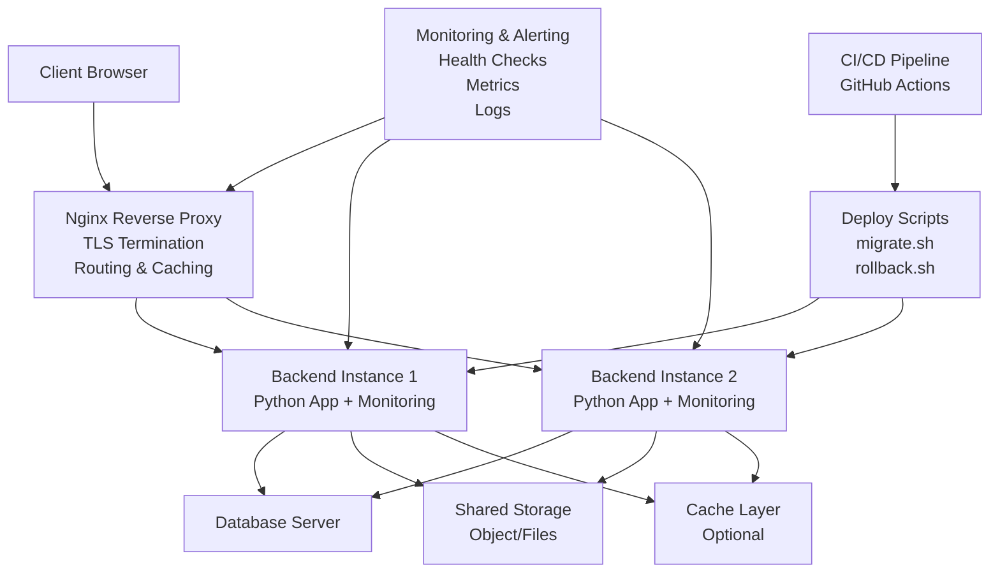
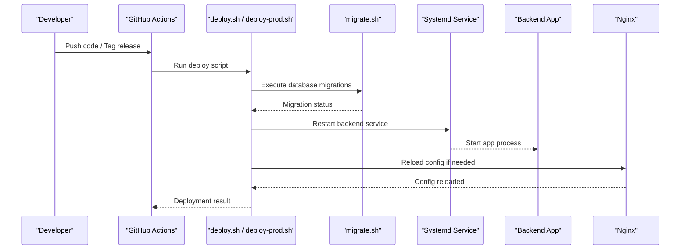
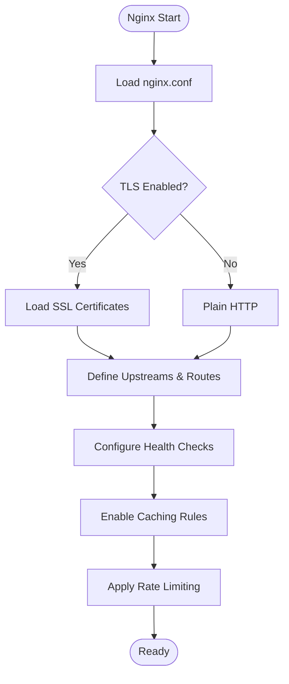
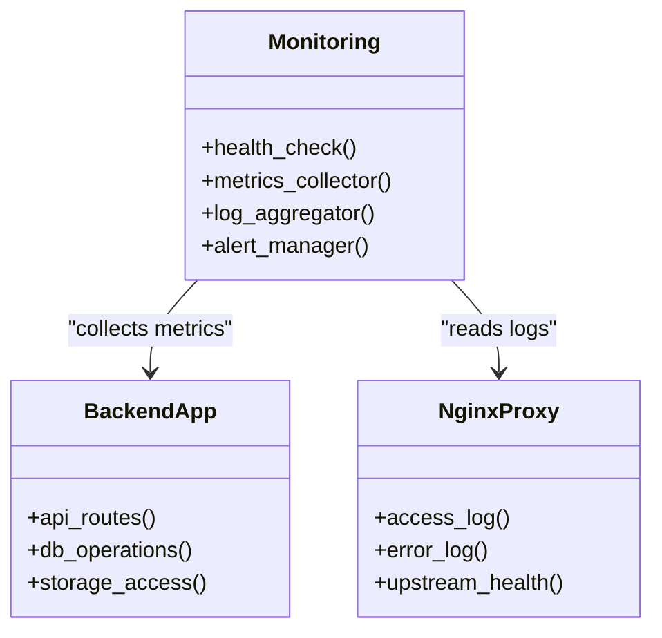
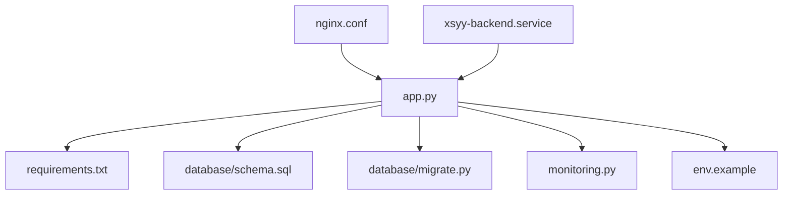

# Deployment & Operations

<cite>
**Referenced Files in This Document**
- [deploy.yml](file://.github/workflows/deploy.yml)
- [DEPLOYMENT.md](file://deploy/DEPLOYMENT.md)
- [deploy.sh](file://deploy/deploy.sh)
- [deploy-dev.sh](file://deploy/deploy-dev.sh)
- [deploy-prod.sh](file://deploy/deploy-prod.sh)
- [migrate.sh](file://deploy/migrate.sh)
- [rollback.sh](file://deploy/rollback.sh)
- [version.sh](file://deploy/version.sh)
- [nginx.conf](file://deploy/nginx.conf)
- [xsyy-backend.service](file://deploy/xsyy-backend.service)
- [app.py](file://backend/app.py)
- [config.py](file://backend/config.py)
- [monitoring.py](file://backend/monitoring.py)
- [requirements.txt](file://backend/requirements.txt)
- [env.example](file://backend/env.example)
- [schema.sql](file://backend/database/schema.sql)
- [migrate.py](file://backend/database/migrate.py)
- [check_server_status.sh](file://backend/check_server_status.sh)
- [restart_all_services.sh](file://backend/restart_all_services.sh)
- [start_with_monitor.sh](file://backend/start_with_monitor.sh)
- [memory_guard.sh](file://backend/memory_guard.sh)
</cite>

## Table of Contents
1. [Introduction](#introduction)
2. [Project Structure](#project-structure)
3. [Core Components](#core-components)
4. [Architecture Overview](#architecture-overview)
5. [Detailed Component Analysis](#detailed-component-analysis)
6. [Dependency Analysis](#dependency-analysis)
7. [Performance Considerations](#performance-considerations)
8. [Troubleshooting Guide](#troubleshooting-guide)
9. [Conclusion](#conclusion)
10. [Appendices](#appendices)

## Introduction
This document provides comprehensive deployment and operations guidance for the XSYY Edu platform. It covers automated deployment using CI/CD, containerization strategies, Nginx reverse proxy configuration, SSL certificate management, monitoring and alerting, scaling approaches (horizontal and vertical), database clustering and cache distribution, backup and disaster recovery, maintenance windows, rollback strategies, environment-specific configurations, secrets management, security hardening, operational runbooks, troubleshooting procedures, and performance tuning recommendations.

## Project Structure
The repository is organized into clear layers:
- Backend application with Python services, database schema, migrations, utilities, and tests
- Frontend web assets and admin interface
- Deploy scripts and system service definitions for production environments
- CI/CD workflow for automated deployments
- Storage directories for generated content and vector data

**Diagram sources**
- [deploy.yml](file://.github/workflows/deploy.yml)
- [deploy.sh](file://deploy/deploy.sh)
- [deploy-dev.sh](file://deploy/deploy-dev.sh)
- [deploy-prod.sh](file://deploy/deploy-prod.sh)
- [migrate.sh](file://deploy/migrate.sh)
- [rollback.sh](file://deploy/rollback.sh)
- [version.sh](file://deploy/version.sh)
- [nginx.conf](file://deploy/nginx.conf)
- [xsyy-backend.service](file://deploy/xsyy-backend.service)
- [app.py](file://backend/app.py)
- [config.py](file://backend/config.py)
- [monitoring.py](file://backend/monitoring.py)
- [requirements.txt](file://backend/requirements.txt)
- [env.example](file://backend/env.example)
- [schema.sql](file://backend/database/schema.sql)
- [migrate.py](file://backend/database/migrate.py)
- [check_server_status.sh](file://backend/check_server_status.sh)
- [restart_all_services.sh](file://backend/restart_all_services.sh)
- [start_with_monitor.sh](file://backend/start_with_monitor.sh)
- [memory_guard.sh](file://backend/memory_guard.sh)

**Section sources**
- [DEPLOYMENT.md](file://deploy/DEPLOYMENT.md)

## Core Components
- Application server: Python backend exposing HTTP APIs and serving static content
- Reverse proxy: Nginx handling TLS termination, routing, caching, and load balancing
- Process manager: Systemd service definition for reliable runtime management
- Database: SQL schema and migration tooling for versioned data evolution
- Monitoring: Health checks, metrics collection, and log aggregation hooks
- CI/CD: GitHub Actions workflow to automate build, test, deploy, and rollback

Key operational files:
- Environment configuration template and dependency manifest
- Service lifecycle scripts for start, restart, and health checks
- Migration and backup utilities
- Nginx configuration for reverse proxy and SSL

**Section sources**
- [app.py](file://backend/app.py)
- [config.py](file://backend/config.py)
- [monitoring.py](file://backend/monitoring.py)
- [requirements.txt](file://backend/requirements.txt)
- [env.example](file://backend/env.example)
- [schema.sql](file://backend/database/schema.sql)
- [migrate.py](file://backend/database/migrate.py)
- [check_server_status.sh](file://backend/check_server_status.sh)
- [restart_all_services.sh](file://backend/restart_all_services.sh)
- [start_with_monitor.sh](file://backend/start_with_monitor.sh)
- [memory_guard.sh](file://backend/memory_guard.sh)

## Architecture Overview
The production architecture uses a reverse proxy in front of one or more backend instances, with persistent storage and a relational database. CI/CD automates deployments and rollbacks.

**Diagram sources**
- [nginx.conf](file://deploy/nginx.conf)
- [xsyy-backend.service](file://deploy/xsyy-backend.service)
- [app.py](file://backend/app.py)
- [monitoring.py](file://backend/monitoring.py)
- [deploy.yml](file://.github/workflows/deploy.yml)
- [migrate.sh](file://deploy/migrate.sh)
- [rollback.sh](file://deploy/rollback.sh)

## Detailed Component Analysis

### Automated Deployment with CI/CD
- The GitHub Actions workflow triggers on pushes or tags, runs tests, builds artifacts, and deploys via scripts.
- Deployment scripts handle environment preparation, dependency installation, database migrations, and service restarts.
- Version tagging and rollback support ensure safe releases.

**Diagram sources**
- [deploy.yml](file://.github/workflows/deploy.yml)
- [deploy.sh](file://deploy/deploy.sh)
- [deploy-prod.sh](file://deploy/deploy-prod.sh)
- [migrate.sh](file://deploy/migrate.sh)
- [xsyy-backend.service](file://deploy/xsyy-backend.service)

**Section sources**
- [deploy.yml](file://.github/workflows/deploy.yml)
- [deploy.sh](file://deploy/deploy.sh)
- [deploy-prod.sh](file://deploy/deploy-prod.sh)
- [migrate.sh](file://deploy/migrate.sh)
- [rollback.sh](file://deploy/rollback.sh)
- [version.sh](file://deploy/version.sh)

### Containerization Strategy
- Use multi-stage Dockerfiles to build frontend assets and package the Python backend efficiently.
- Separate containers for app, database, cache, and object storage where applicable.
- Orchestrate with Docker Compose for local/dev and Kubernetes for production.
- Ensure stateless app containers; persist storage and database externally.

[No sources needed since this section provides general guidance]

### Nginx Reverse Proxy Setup
- Configure TLS termination with certificates managed via automation (e.g., certbot).
- Route API requests to backend instances and serve static assets from the web directory.
- Enable caching headers, compression, and rate limiting as needed.
- Implement health check endpoints and failover behavior.

**Diagram sources**
- [nginx.conf](file://deploy/nginx.conf)

**Section sources**
- [nginx.conf](file://deploy/nginx.conf)

### SSL Certificate Management
- Automate certificate issuance and renewal using ACME clients.
- Store certificates securely and restrict file permissions.
- Integrate certificate reload into deployment scripts to avoid downtime.

[No sources needed since this section provides general guidance]

### Monitoring and Alerting
- Expose health endpoints for liveness and readiness probes.
- Collect metrics such as request latency, error rates, CPU, memory, and disk usage.
- Aggregate logs centrally and set up alerts for critical thresholds.

**Diagram sources**
- [monitoring.py](file://backend/monitoring.py)
- [app.py](file://backend/app.py)
- [nginx.conf](file://deploy/nginx.conf)

**Section sources**
- [monitoring.py](file://backend/monitoring.py)
- [check_server_status.sh](file://backend/check_server_status.sh)
- [start_with_monitor.sh](file://backend/start_with_monitor.sh)

### Scaling Strategies
- Horizontal scaling: Run multiple backend instances behind Nginx with sticky sessions if required.
- Vertical scaling: Increase CPU, memory, and I/O capacity per instance based on workload.
- Database clustering: Use read replicas and connection pooling to distribute load.
- Cache distribution: Employ distributed caches to reduce database pressure and improve response times.

[No sources needed since this section provides general guidance]

### Backup and Disaster Recovery
- Schedule regular backups of database and storage directories.
- Validate backup integrity and store copies offsite.
- Define recovery procedures and test restoration regularly.

[No sources needed since this section provides general guidance]

### Maintenance Windows and Rollback Strategies
- Plan maintenance during low-traffic periods.
- Use blue/green or canary deployments to minimize risk.
- Implement automated rollback scripts to revert to previous versions quickly.

**Section sources**
- [rollback.sh](file://deploy/rollback.sh)
- [version.sh](file://deploy/version.sh)

### Environment-Specific Configurations and Secrets Management
- Use environment variables and secret managers for sensitive values.
- Maintain separate configuration sets for dev, staging, and prod.
- Enforce least privilege access and rotate secrets regularly.

**Section sources**
- [env.example](file://backend/env.example)
- [config.py](file://backend/config.py)

### Security Hardening Guidelines
- Harden OS and application configurations.
- Enable HTTPS everywhere and enforce strong cipher suites.
- Apply input validation, output encoding, and secure headers.
- Regularly update dependencies and scan for vulnerabilities.

[No sources needed since this section provides general guidance]

## Dependency Analysis
The backend depends on Python packages defined in the requirements manifest and interacts with the database through schema and migration tools. Monitoring integrates with system-level health checks and logging.

**Diagram sources**
- [app.py](file://backend/app.py)
- [requirements.txt](file://backend/requirements.txt)
- [schema.sql](file://backend/database/schema.sql)
- [migrate.py](file://backend/database/migrate.py)
- [monitoring.py](file://backend/monitoring.py)
- [env.example](file://backend/env.example)
- [nginx.conf](file://deploy/nginx.conf)
- [xsyy-backend.service](file://deploy/xsyy-backend.service)

**Section sources**
- [requirements.txt](file://backend/requirements.txt)
- [config.py](file://backend/config.py)

## Performance Considerations
- Tune Nginx worker processes, keepalive settings, and buffer sizes.
- Optimize database queries and indexes; use connection pooling.
- Enable caching at application and proxy levels where appropriate.
- Monitor resource utilization and scale horizontally under load.

[No sources needed since this section provides general guidance]

## Troubleshooting Guide
Common operational scenarios and resolutions:
- Service not starting: Check systemd logs and environment variables.
- High memory usage: Review memory guard scripts and adjust limits.
- Database connectivity issues: Verify credentials and network policies.
- Nginx errors: Inspect access and error logs; validate configuration syntax.
- Rollback needed: Use rollback script to revert to previous version.

Operational scripts:
- Health checks and restart routines
- Memory guard and monitoring startup
- Status verification and service restart

**Section sources**
- [check_server_status.sh](file://backend/check_server_status.sh)
- [restart_all_services.sh](file://backend/restart_all_services.sh)
- [start_with_monitor.sh](file://backend/start_with_monitor.sh)
- [memory_guard.sh](file://backend/memory_guard.sh)
- [rollback.sh](file://deploy/rollback.sh)

## Conclusion
This guide outlines robust deployment and operations practices for the XSYY Edu platform. By leveraging automated CI/CD pipelines, containerization, reverse proxy configuration, monitoring, and scalable architectures, teams can maintain high availability, performance, and security. Follow the provided runbooks and guidelines to manage environments, perform maintenance, and respond to incidents effectively.

## Appendices
- Quick reference links to key scripts and configuration files
- Checklist for production readiness
- Recommended monitoring dashboards and alert rules

[No sources needed since this section provides general guidance]