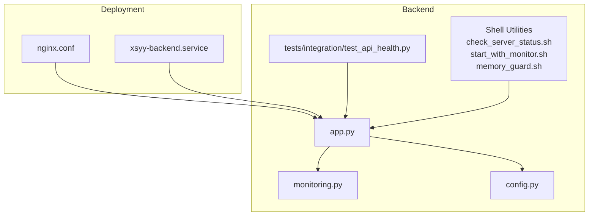
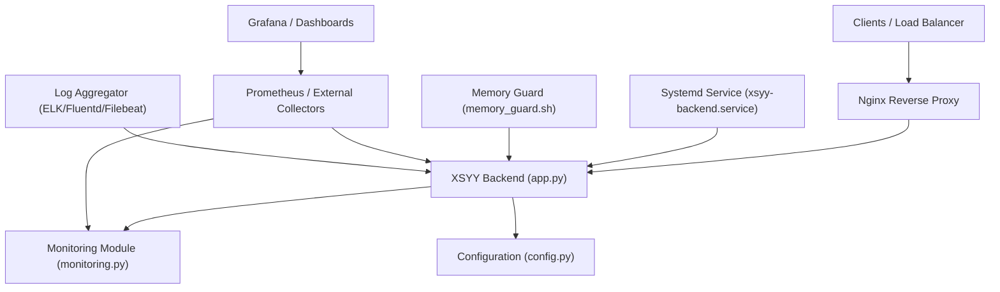
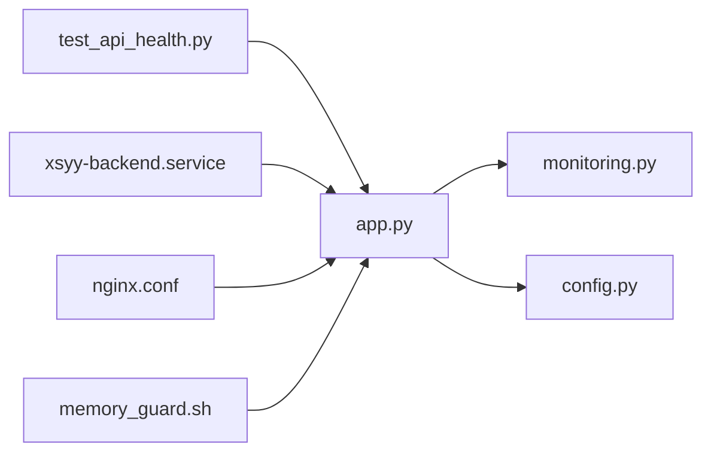

# Monitoring & Alerting

<cite>
**Referenced Files in This Document**
- [app.py](file://backend/app.py)
- [monitoring.py](file://backend/monitoring.py)
- [config.py](file://backend/config.py)
- [test_api_health.py](file://backend/tests/integration/test_api_health.py)
- [check_server_status.sh](file://backend/check_server_status.sh)
- [start_with_monitor.sh](file://backend/start_with_monitor.sh)
- [memory_guard.sh](file://backend/memory_guard.sh)
- [PERFORMANCE_OPTIMIZATION.md](file://backend/PERFORMANCE_OPTIMIZATION.md)
- [nginx.conf](file://deploy/nginx.conf)
- [xsyy-backend.service](file://deploy/xsyy-backend.service)
</cite>

## Table of Contents
1. [Introduction](#introduction)
2. [Project Structure](#project-structure)
3. [Core Components](#core-components)
4. [Architecture Overview](#architecture-overview)
5. [Detailed Component Analysis](#detailed-component-analysis)
6. [Dependency Analysis](#dependency-analysis)
7. [Performance Considerations](#performance-considerations)
8. [Troubleshooting Guide](#troubleshooting-guide)
9. [Conclusion](#conclusion)
10. [Appendices](#appendices)

## Introduction
This document provides comprehensive monitoring and alerting guidance for the XSYY Edu platform. It covers built-in health checks, performance metrics collection, system resource monitoring, logging strategies, APM integration options, custom metric definitions, dashboard creation, alerting rules, notification channels, escalation procedures, memory management and garbage collection tuning, capacity planning, and operational runbooks for common incidents and performance degradation scenarios.

## Project Structure
The monitoring-related capabilities are implemented primarily in the backend application and deployment scripts:
- Application-level health endpoints and metrics exposure are defined in the main application module and a dedicated monitoring module.
- Configuration for monitoring behavior is centralized in the configuration module.
- Integration tests validate health endpoint behavior.
- Shell utilities assist with process supervision, startup with monitoring, and memory guardrails.
- Deployment artifacts include an Nginx reverse proxy configuration and a systemd service unit to manage the backend process.

**Diagram sources**
- [app.py](file://backend/app.py)
- [monitoring.py](file://backend/monitoring.py)
- [config.py](file://backend/config.py)
- [test_api_health.py](file://backend/tests/integration/test_api_health.py)
- [check_server_status.sh](file://backend/check_server_status.sh)
- [start_with_monitor.sh](file://backend/start_with_monitor.sh)
- [memory_guard.sh](file://backend/memory_guard.sh)
- [nginx.conf](file://deploy/nginx.conf)
- [xsyy-backend.service](file://deploy/xsyy-backend.service)

**Section sources**
- [app.py](file://backend/app.py)
- [monitoring.py](file://backend/monitoring.py)
- [config.py](file://backend/config.py)
- [test_api_health.py](file://backend/tests/integration/test_api_health.py)
- [check_server_status.sh](file://backend/check_server_status.sh)
- [start_with_monitor.sh](file://backend/start_with_monitor.sh)
- [memory_guard.sh](file://backend/memory_guard.sh)
- [nginx.conf](file://deploy/nginx.conf)
- [xsyy-backend.service](file://deploy/xsyy-backend.service)

## Core Components
- Health Check Endpoints: The application exposes HTTP endpoints to report liveness/readiness and basic status information. These are validated by integration tests to ensure consistent behavior across environments.
- Metrics Exposure: A dedicated monitoring module defines metrics collection and export points that can be scraped by external systems such as Prometheus.
- Configuration: Centralized configuration controls feature toggles, thresholds, and paths used by monitoring components.
- Process Supervision and Startup: Systemd service unit manages lifecycle; shell helpers start the app with monitoring enabled and enforce memory guardrails.
- Reverse Proxy: Nginx routes traffic to the backend and can expose additional observability endpoints (e.g., access logs).

Key responsibilities:
- Health endpoints provide quick checks for orchestration and load balancers.
- Metrics endpoints enable time-series collection for dashboards and alerts.
- Logging is structured and configurable to support aggregation and analysis.
- Memory guard scripts prevent uncontrolled growth by restarting or signaling processes when thresholds are exceeded.

**Section sources**
- [app.py](file://backend/app.py)
- [monitoring.py](file://backend/monitoring.py)
- [config.py](file://backend/config.py)
- [test_api_health.py](file://backend/tests/integration/test_api_health.py)
- [xsyy-backend.service](file://deploy/xsyy-backend.service)
- [start_with_monitor.sh](file://backend/start_with_monitor.sh)
- [memory_guard.sh](file://backend/memory_guard.sh)

## Architecture Overview
The monitoring architecture integrates application-level endpoints with external collectors and visualization tools.

**Diagram sources**
- [app.py](file://backend/app.py)
- [monitoring.py](file://backend/monitoring.py)
- [config.py](file://backend/config.py)
- [xsyy-backend.service](file://deploy/xsyy-backend.service)
- [memory_guard.sh](file://backend/memory_guard.sh)
- [nginx.conf](file://deploy/nginx.conf)

## Detailed Component Analysis

### Health Check Endpoints
- Purpose: Provide liveness/readiness signals for orchestrators and load balancers.
- Behavior: Return standard HTTP status codes indicating healthy/unhealthy states; may include minimal metadata for diagnostics.
- Validation: Integration tests assert expected responses and error conditions.

Operational notes:
- Use readiness checks before routing production traffic.
- Combine with liveness probes to trigger restarts on unrecoverable failures.

**Section sources**
- [app.py](file://backend/app.py)
- [test_api_health.py](file://backend/tests/integration/test_api_health.py)

### Metrics Collection and Export
- Scope: Application-level counters, gauges, histograms for request rates, latencies, errors, and business KPIs.
- Export: Exposed via HTTP endpoint suitable for scraping by Prometheus or compatible collectors.
- Customization: Metrics can be extended through the monitoring module to capture domain-specific events.

Best practices:
- Avoid high-cardinality labels to prevent cardinality explosion.
- Prefer delta-based counters and histogram buckets tuned to latency distributions.

**Section sources**
- [monitoring.py](file://backend/monitoring.py)
- [app.py](file://backend/app.py)

### Logging Strategy and Rotation
- Structured Logging: Emit JSON-formatted logs with consistent fields (timestamp, level, service, trace_id where applicable).
- Aggregation: Forward logs to a central aggregator (e.g., Filebeat + Elasticsearch + Kibana) or ship directly to cloud logging services.
- Rotation: Configure log rotation at the OS level (e.g., logrotate) or within the logging framework to manage disk usage.

Recommendations:
- Include correlation IDs to trace requests across services.
- Separate stdout/stderr from application logs if using containerized deployments.

**Section sources**
- [app.py](file://backend/app.py)
- [nginx.conf](file://deploy/nginx.conf)

### System Resource Monitoring
- CPU/Memory/Disk/I/O: Monitor via host-level exporters (node_exporter) and container metrics (cAdvisor) when applicable.
- Process-Level: Track Python process metrics (GC pauses, heap size) using runtime introspection or APM agents.
- Alerts: Define thresholds for sustained high CPU, memory pressure, disk saturation, and I/O wait.

**Section sources**
- [PERFORMANCE_OPTIMIZATION.md](file://backend/PERFORMANCE_OPTIMIZATION.md)

### Memory Management and Garbage Collection Tuning
- Monitoring: Track RSS, heap allocations, GC frequency/duration, and fragmentation.
- Tuning: Adjust Python GC thresholds and environment variables based on workload characteristics.
- Guardrails: Use memory guard scripts to detect leaks and perform safe restarts or scaling actions.

Runbook highlights:
- If memory grows monotonically without recovery, investigate object retention and connection pools.
- Tune GC settings to reduce pause times during peak loads.

**Section sources**
- [memory_guard.sh](file://backend/memory_guard.sh)
- [PERFORMANCE_OPTIMIZATION.md](file://backend/PERFORMANCE_OPTIMIZATION.md)

### APM Integration Options
- Option A: Lightweight instrumentation via the monitoring module exposing Prometheus-compatible metrics.
- Option B: Full APM agent integration (e.g., OpenTelemetry, commercial APM) for distributed tracing and deeper insights.
- Tracing: Propagate trace context headers across HTTP calls to correlate spans.

Implementation tips:
- Start with metrics and logs; add tracing once baseline observability is stable.
- Ensure sampling strategies balance visibility and overhead.

**Section sources**
- [monitoring.py](file://backend/monitoring.py)
- [app.py](file://backend/app.py)

### Dashboard Creation
- Metrics Dashboards: Build Grafana panels for request rate, error rate, latency percentiles, and resource utilization.
- Log Dashboards: Create Kibana visualizations for error trends, slow queries, and user journeys.
- SLOs: Visualize availability and latency targets with burn-rate indicators.

Guidance:
- Group panels by service and environment.
- Use templating for multi-instance views.

[No sources needed since this section provides general guidance]

### Alerting Rules and Notification Channels
- Rule Types: Error rate spikes, latency p95/p99 exceedances, memory/CPU thresholds, disk saturation, database connectivity issues.
- Channels: Email, Slack, PagerDuty, webhook integrations.
- Escalation: Tiered alerts with auto-escalation after repeated violations or sustained durations.

Operational considerations:
- Avoid alert fatigue by tuning thresholds and grouping related alerts.
- Include actionable context in alert messages (links to dashboards, runbooks).

[No sources needed since this section provides general guidance]

### Operational Runbooks
Common incidents:
- High Error Rate: Inspect recent deployments, dependency outages, and upstream timeouts; check logs and traces.
- Latency Spikes: Review DB query performance, cache hit ratios, and external API response times.
- Memory Growth: Identify leaking objects, long-lived connections, or unbounded caches; consider graceful restarts.
- Disk Saturation: Rotate logs, archive old data, and expand storage; verify cleanup jobs.

Capacity planning:
- Baseline current resource usage under typical and peak loads.
- Model growth trajectories and plan autoscaling policies accordingly.

[No sources needed since this section provides general guidance]

## Dependency Analysis
The following diagram shows key dependencies among monitoring-related components.

**Diagram sources**
- [app.py](file://backend/app.py)
- [monitoring.py](file://backend/monitoring.py)
- [config.py](file://backend/config.py)
- [test_api_health.py](file://backend/tests/integration/test_api_health.py)
- [xsyy-backend.service](file://deploy/xsyy-backend.service)
- [nginx.conf](file://deploy/nginx.conf)
- [memory_guard.sh](file://backend/memory_guard.sh)

**Section sources**
- [app.py](file://backend/app.py)
- [monitoring.py](file://backend/monitoring.py)
- [config.py](file://backend/config.py)
- [test_api_health.py](file://backend/tests/integration/test_api_health.py)
- [xsyy-backend.service](file://deploy/xsyy-backend.service)
- [nginx.conf](file://deploy/nginx.conf)
- [memory_guard.sh](file://backend/memory_guard.sh)

## Performance Considerations
- Instrumentation Overhead: Keep metrics collection lightweight; avoid synchronous I/O in hot paths.
- Histogram Buckets: Choose bucket boundaries aligned with SLI targets to minimize cardinality while preserving accuracy.
- Log Volume: Sample noisy logs and aggregate at the edge to reduce ingestion costs.
- GC Tuning: Balance throughput and latency by adjusting GC thresholds based on observed pause times.

[No sources needed since this section provides general guidance]

## Troubleshooting Guide
- Health Endpoint Failures: Verify route registration and dependency health; review test coverage for expected behaviors.
- Missing Metrics: Confirm scrape endpoints are reachable and not blocked by firewall or reverse proxy rules.
- Log Gaps: Ensure log rotation is configured and file permissions allow writers; check aggregator connectivity.
- Memory Alerts: Analyze heap snapshots and GC logs; use memory guard script outputs to guide restart decisions.

**Section sources**
- [test_api_health.py](file://backend/tests/integration/test_api_health.py)
- [monitoring.py](file://backend/monitoring.py)
- [memory_guard.sh](file://backend/memory_guard.sh)

## Conclusion
By combining built-in health checks, structured logging, and extensible metrics, the XSYY Edu platform establishes a solid foundation for observability. Extending with external collectors (Prometheus/Grafana/ELK), defining robust alerting rules, and maintaining clear runbooks ensures reliable operations and rapid incident resolution. Continuous capacity planning and GC tuning further enhance stability under varying workloads.

[No sources needed since this section summarizes without analyzing specific files]

## Appendices

### Setup Guides for External Tools
- Prometheus:
  - Add scrape configs for the application’s metrics endpoint and node exporter.
  - Validate targets and rule evaluation in the Prometheus UI.
- Grafana:
  - Connect to Prometheus as a data source.
  - Import prebuilt dashboards and customize panels for XSYY Edu KPIs.
- ELK Stack:
  - Deploy Filebeat to tail application logs and forward to Elasticsearch.
  - Create Kibana indices and visualizations for error tracking and search.

[No sources needed since this section provides general guidance]

### Example Metric Definitions (Conceptual)
- Request Counters: total_requests, requests_by_endpoint, requests_by_status
- Latency Histograms: request_duration_seconds
- Business Gauges: active_sessions, queued_tasks
- Resource Gauges: process_memory_bytes, gc_count, gc_pause_seconds

[No sources needed since this section provides general guidance]

### Startup and Supervision Notes
- Use the provided service unit to manage process lifecycle and automatic restarts.
- Start the application with monitoring enabled via the helper script to ensure metrics are exposed early.
- Employ the memory guard script to enforce safety limits and mitigate runaway memory growth.

**Section sources**
- [xsyy-backend.service](file://deploy/xsyy-backend.service)
- [start_with_monitor.sh](file://backend/start_with_monitor.sh)
- [memory_guard.sh](file://backend/memory_guard.sh)