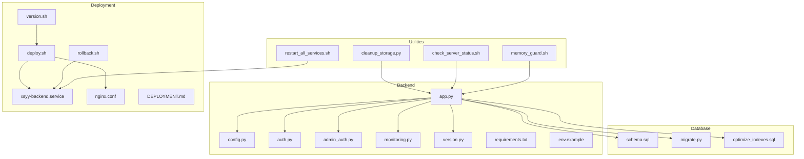
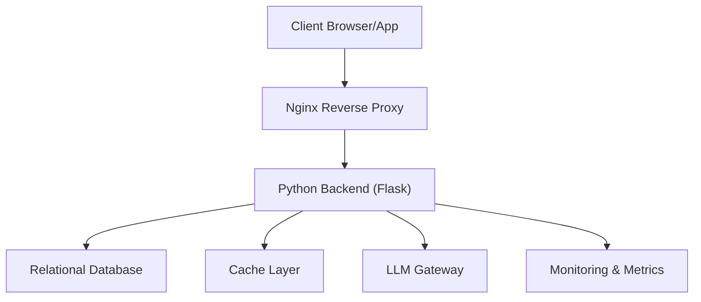
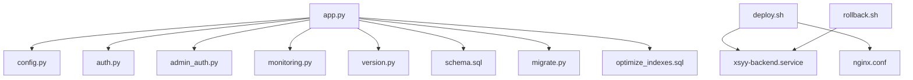

# Operational Procedures

<cite>
**Referenced Files in This Document**
- [app.py](file://backend/app.py)
- [config.py](file://backend/config.py)
- [auth.py](file://backend/auth.py)
- [admin_auth.py](file://backend/admin_auth.py)
- [monitoring.py](file://backend/monitoring.py)
- [version.py](file://backend/version.py)
- [requirements.txt](file://backend/requirements.txt)
- [env.example](file://backend/env.example)
- [schema.sql](file://backend/database/schema.sql)
- [migrate.py](file://backend/database/migrate.py)
- [optimize_indexes.sql](file://backend/database/optimize_indexes.sql)
- [cleanup_storage.py](file://backend/utils/cleanup_storage.py)
- [xsyy-backend.service](file://deploy/xsyy-backend.service)
- [nginx.conf](file://deploy/nginx.conf)
- [deploy.sh](file://deploy/deploy.sh)
- [rollback.sh](file://deploy/rollback.sh)
- [version.sh](file://deploy/version.sh)
- [restart_all_services.sh](file://backend/restart_all_services.sh)
- [check_server_status.sh](file://backend/check_server_status.sh)
- [memory_guard.sh](file://backend/memory_guard.sh)
- [DEPLOYMENT.md](file://deploy/DEPLOYMENT.md)
- [PERFORMANCE_OPTIMIZATION.md](file://backend/PERFORMANCE_OPTIMIZATION.md)
- [users.json](file://backend/users/users.json)
- [verification_codes.json](file://backend/users/verification_codes.json)
- [invite_quota_api.py](file://backend/invite_quota_api.py)
- [ai_teacher_route.py](file://backend/ai_teacher_route.py)
- [gateway_llm.py](file://backend/gateway_llm.py)
- [cost_optimization_demo/main_service.py](file://backend/cost_optimization_demo/main_service.py)
- [cost_optimization_demo/cache_service.py](file://backend/cost_optimization_demo/cache_service.py)
</cite>

## Table of Contents
1. [Introduction](#introduction)
2. [Project Structure](#project-structure)
3. [Core Components](#core-components)
4. [Architecture Overview](#architecture-overview)
5. [Detailed Component Analysis](#detailed-component-analysis)
6. [Dependency Analysis](#dependency-analysis)
7. [Performance Considerations](#performance-considerations)
8. [Troubleshooting Guide](#troubleshooting-guide)
9. [Conclusion](#conclusion)
10. [Appendices](#appendices)

## Introduction
This document provides operational procedures for the XSYY Edu platform, covering routine maintenance, version management, user administration, security operations, performance tuning, incident response, change management, and monitoring/reporting. It is intended for system administrators, DevOps engineers, and support staff who manage day-to-day operations and ensure platform stability and security.

## Project Structure
The repository contains a Python backend, deployment scripts, Nginx configuration, database schema and migrations, utilities for storage cleanup, and frontend assets. Key operational artifacts include service definitions, deployment and rollback scripts, and monitoring helpers.

**Diagram sources**
- [app.py](file://backend/app.py)
- [config.py](file://backend/config.py)
- [auth.py](file://backend/auth.py)
- [admin_auth.py](file://backend/admin_auth.py)
- [monitoring.py](file://backend/monitoring.py)
- [version.py](file://backend/version.py)
- [requirements.txt](file://backend/requirements.txt)
- [env.example](file://backend/env.example)
- [schema.sql](file://backend/database/schema.sql)
- [migrate.py](file://backend/database/migrate.py)
- [optimize_indexes.sql](file://backend/database/optimize_indexes.sql)
- [xsyy-backend.service](file://deploy/xsyy-backend.service)
- [nginx.conf](file://deploy/nginx.conf)
- [deploy.sh](file://deploy/deploy.sh)
- [rollback.sh](file://deploy/rollback.sh)
- [version.sh](file://deploy/version.sh)
- [cleanup_storage.py](file://backend/utils/cleanup_storage.py)
- [restart_all_services.sh](file://backend/restart_all_services.sh)
- [check_server_status.sh](file://backend/check_server_status.sh)
- [memory_guard.sh](file://backend/memory_guard.sh)
- [DEPLOYMENT.md](file://deploy/DEPLOYMENT.md)

**Section sources**
- [DEPLOYMENT.md](file://deploy/DEPLOYMENT.md)
- [PERFORMANCE_OPTIMIZATION.md](file://backend/PERFORMANCE_OPTIMIZATION.md)

## Core Components
- Application server: The main Flask application entry point orchestrates routes, middleware, and integrations.
- Configuration: Centralized environment-driven configuration with secure defaults and external secrets.
- Authentication and authorization: User authentication flows and admin access control.
- Monitoring: Health checks, metrics exposure, and logging hooks.
- Versioning: Runtime version reporting and build metadata.
- Database: Schema definition, migration tooling, and index optimization.
- Deployment: Service unit file, Nginx reverse proxy, and scripted deployments/rollbacks.
- Utilities: Storage cleanup, restart orchestration, status checks, and memory guard.

Operational implications:
- Service lifecycle is managed via systemd (service unit).
- Reverse proxy handles TLS termination and static assets.
- Migrations are applied during deployment or maintenance windows.
- Monitoring endpoints provide health and basic metrics for dashboards.

**Section sources**
- [app.py](file://backend/app.py)
- [config.py](file://backend/config.py)
- [auth.py](file://backend/auth.py)
- [admin_auth.py](file://backend/admin_auth.py)
- [monitoring.py](file://backend/monitoring.py)
- [version.py](file://backend/version.py)
- [schema.sql](file://backend/database/schema.sql)
- [migrate.py](file://backend/database/migrate.py)
- [optimize_indexes.sql](file://backend/database/optimize_indexes.sql)
- [xsyy-backend.service](file://deploy/xsyy-backend.service)
- [nginx.conf](file://deploy/nginx.conf)

## Architecture Overview
The platform uses a typical web architecture: clients connect through Nginx, which proxies requests to the Python backend. The backend interacts with a relational database and optional external services (e.g., LLM gateway). Monitoring and administrative tools assist operators.

**Diagram sources**
- [nginx.conf](file://deploy/nginx.conf)
- [app.py](file://backend/app.py)
- [monitoring.py](file://backend/monitoring.py)
- [gateway_llm.py](file://backend/gateway_llm.py)

## Detailed Component Analysis

### Service Lifecycle and Maintenance
- Restart services: Use the provided restart script to gracefully stop and start the backend and related processes.
- Check status: Use the status checker to verify process health, ports, and dependencies.
- Memory guard: A watchdog script monitors memory usage and can restart services when thresholds are exceeded.

Recommended procedures:
- Before restarts, drain connections via Nginx if needed.
- Verify database connectivity post-restart.
- Confirm monitoring endpoints respond.

**Section sources**
- [restart_all_services.sh](file://backend/restart_all_services.sh)
- [check_server_status.sh](file://backend/check_server_status.sh)
- [memory_guard.sh](file://backend/memory_guard.sh)
- [xsyy-backend.service](file://deploy/xsyy-backend.service)

### Database Cleanup and Optimization
- Schema and migrations: Apply schema changes using the migration tool; review migration files before execution.
- Index optimization: Run index optimization SQL to improve query performance on hot paths.
- Storage cleanup: Remove orphaned or expired storage artifacts to reclaim disk space.

Operational steps:
- Back up the database prior to migrations.
- Validate migration success and run integrity checks.
- Schedule periodic storage cleanup jobs.

**Section sources**
- [schema.sql](file://backend/database/schema.sql)
- [migrate.py](file://backend/database/migrate.py)
- [optimize_indexes.sql](file://backend/database/optimize_indexes.sql)
- [cleanup_storage.py](file://backend/utils/cleanup_storage.py)

### Log Rotation and Disk Space Management
- Logs: Ensure application logs are rotated by the OS log rotation tool (e.g., logrotate) configured for the backend’s log directory.
- Disk space: Monitor disk usage and set alerts; clean temporary files and old artifacts regularly.
- Storage directories: Purge unused teaching content and preview images as part of routine maintenance.

Best practices:
- Configure log rotation policies with retention limits.
- Implement automated cleanup tasks for temp and cache directories.
- Track disk usage trends and capacity planning.

[No sources needed since this section provides general guidance]

### Version Management and Update Rollout
- Version reporting: The backend exposes runtime version information for verification after updates.
- Deployment: Use the deployment script to pull code, install dependencies, apply migrations, and restart services.
- Rollback: Use the rollback script to revert to the previous release quickly.

Rollout strategy:
- Deploy to staging first; validate health and key workflows.
- Perform production rollout during scheduled maintenance windows.
- Keep rollback artifacts available for immediate recovery.

**Section sources**
- [version.py](file://backend/version.py)
- [deploy.sh](file://deploy/deploy.sh)
- [rollback.sh](file://deploy/rollback.sh)
- [DEPLOYMENT.md](file://deploy/DEPLOYMENT.md)

### User Administration and Quota Management
- User data: Admin interfaces and APIs manage users, roles, and quotas.
- Verification codes: Temporary codes stored for account verification flows.
- Invite quotas: API endpoints handle invite-based quota allocation and tracking.

Administrative tasks:
- Create, update, and deactivate accounts.
- Adjust quotas and permissions based on policy.
- Audit user activity via logs and admin dashboards.

**Section sources**
- [users.json](file://backend/users/users.json)
- [verification_codes.json](file://backend/users/verification_codes.json)
- [invite_quota_api.py](file://backend/invite_quota_api.py)

### Security Operations
- Certificates: Renew TLS certificates at Nginx and reload configuration.
- Access control: Review and update admin authentication and authorization rules.
- Audit logs: Regularly review access logs and error logs for anomalies.

Security checklist:
- Rotate secrets and keys per policy.
- Enforce least privilege for service accounts.
- Monitor failed login attempts and suspicious patterns.

**Section sources**
- [nginx.conf](file://deploy/nginx.conf)
- [auth.py](file://backend/auth.py)
- [admin_auth.py](file://backend/admin_auth.py)

### Performance Tuning and Cache Management
- Caching: Utilize cache services to reduce load on databases and external APIs.
- Cost optimization demo: Demonstrates caching strategies and request throttling.
- Indexes: Optimize frequently used queries with appropriate indexes.

Tuning steps:
- Profile slow endpoints and add caching where appropriate.
- Tune connection pools and timeouts for DB and external services.
- Monitor cache hit rates and adjust TTLs.

**Section sources**
- [cost_optimization_demo/cache_service.py](file://backend/cost_optimization_demo/cache_service.py)
- [cost_optimization_demo/main_service.py](file://backend/cost_optimization_demo/main_service.py)
- [optimize_indexes.sql](file://backend/database/optimize_indexes.sql)
- [PERFORMANCE_OPTIMIZATION.md](file://backend/PERFORMANCE_OPTIMIZATION.md)

### Incident Response and Error Investigation
- Health checks: Use monitoring endpoints to detect failures early.
- Logging: Centralize logs and correlate errors across components.
- Escalation: Define clear escalation paths for critical incidents.

Investigation workflow:
- Identify symptoms via dashboards and alerts.
- Collect logs and metrics around the time of failure.
- Reproduce issues in staging if necessary; apply fixes and monitor.

**Section sources**
- [monitoring.py](file://backend/monitoring.py)
- [check_server_status.sh](file://backend/check_server_status.sh)

### Change Management and Deployment Windows
- Change approval: Document changes, risks, and rollback plans.
- Deployment windows: Schedule updates during low-traffic periods.
- Communication: Notify stakeholders of planned maintenance and incidents.

Procedures:
- Prepare deployment checklist and validation steps.
- Execute deployment and monitor health indicators.
- Communicate outcomes and lessons learned.

**Section sources**
- [DEPLOYMENT.md](file://deploy/DEPLOYMENT.md)

### Monitoring Dashboards, KPIs, and Reporting
- Dashboards: Visualize uptime, latency, error rates, and resource utilization.
- KPIs: Track request throughput, database query performance, cache hit ratios, and storage growth.
- Reporting: Generate periodic reports for capacity planning and compliance.

Implementation tips:
- Expose metrics endpoints from the backend.
- Aggregate logs and metrics into a central observability stack.
- Set alert thresholds based on SLOs.

**Section sources**
- [monitoring.py](file://backend/monitoring.py)

## Dependency Analysis
The backend depends on configuration, authentication, monitoring, database schema/migrations, and external services. Deployment relies on Nginx and systemd.

**Diagram sources**
- [app.py](file://backend/app.py)
- [config.py](file://backend/config.py)
- [auth.py](file://backend/auth.py)
- [admin_auth.py](file://backend/admin_auth.py)
- [monitoring.py](file://backend/monitoring.py)
- [version.py](file://backend/version.py)
- [schema.sql](file://backend/database/schema.sql)
- [migrate.py](file://backend/database/migrate.py)
- [optimize_indexes.sql](file://backend/database/optimize_indexes.sql)
- [nginx.conf](file://deploy/nginx.conf)
- [xsyy-backend.service](file://deploy/xsyy-backend.service)
- [deploy.sh](file://deploy/deploy.sh)
- [rollback.sh](file://deploy/rollback.sh)

**Section sources**
- [requirements.txt](file://backend/requirements.txt)

## Performance Considerations
- Connection pooling: Tune database and external service client pools to match workload.
- Caching: Enable response caching for idempotent reads; invalidate caches on writes.
- Query optimization: Add indexes and avoid N+1 queries; use pagination.
- Resource limits: Set CPU and memory limits for the backend process.
- Monitoring: Continuously track latency percentiles and error rates.

[No sources needed since this section provides general guidance]

## Troubleshooting Guide
Common issues and resolutions:
- Service not responding: Check systemd status, port bindings, and logs.
- Database connectivity errors: Verify credentials, network reachability, and firewall rules.
- High memory usage: Investigate leaks, increase limits, or restart via memory guard.
- TLS errors: Inspect certificate validity and Nginx configuration.

Diagnostic steps:
- Use status checkers and health endpoints.
- Review application and system logs.
- Validate configurations and environment variables.

**Section sources**
- [check_server_status.sh](file://backend/check_server_status.sh)
- [memory_guard.sh](file://backend/memory_guard.sh)
- [nginx.conf](file://deploy/nginx.conf)

## Conclusion
This guide consolidates operational procedures for maintaining XSYY Edu’s availability, security, and performance. By following standardized routines for maintenance, updates, user administration, security, and incident response, operators can ensure reliable service delivery and rapid recovery from issues.

## Appendices

### Routine Maintenance Checklist
- Restart services during maintenance windows.
- Apply database migrations with backups.
- Rotate logs and clean storage artifacts.
- Verify monitoring and alerting.

### Update Rollout Steps
- Test in staging.
- Deploy to production with rollback plan.
- Monitor health and roll back if needed.

### Security Operations Checklist
- Renew certificates and reload Nginx.
- Review access controls and audit logs.
- Rotate secrets per policy.

### Performance Tuning Checklist
- Profile and optimize slow endpoints.
- Tune caches and indexes.
- Set resource limits and monitor KPIs.

[No sources needed since this section provides general guidance]