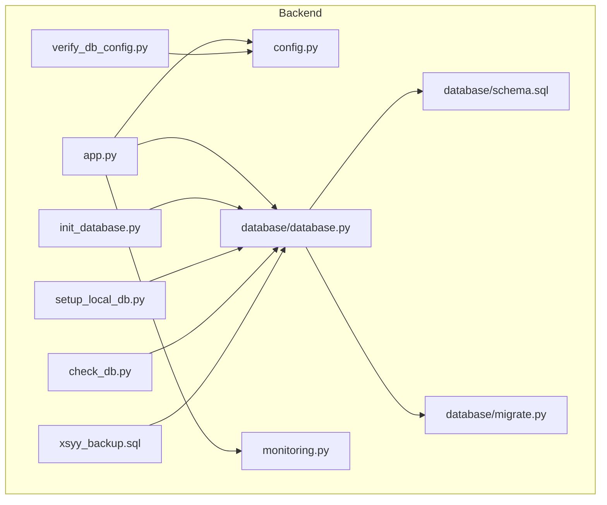
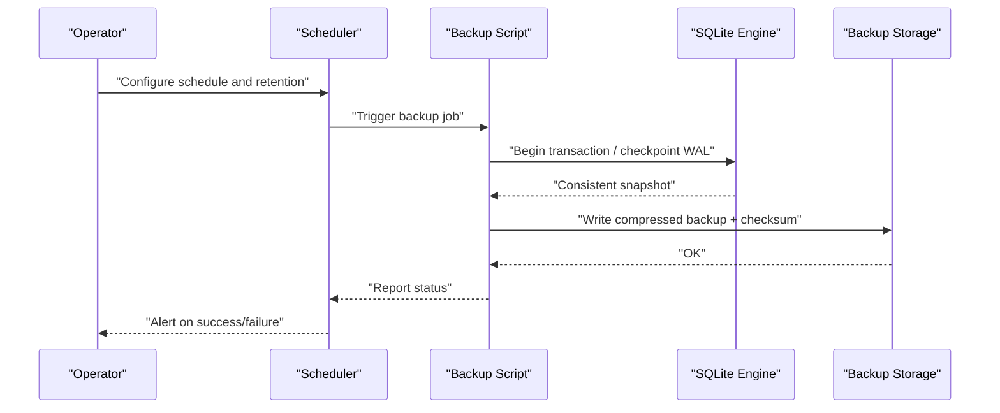
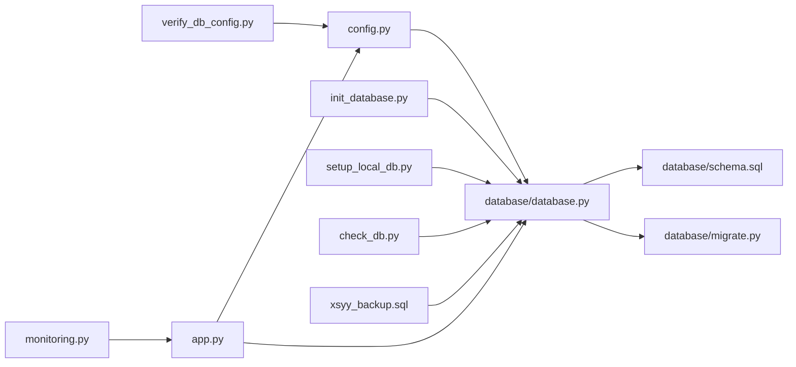

# Backup & Recovery

<cite>
**Referenced Files in This Document**
- [check_db.py](file://backend/check_db.py)
- [verify_db_config.py](file://backend/verify_db_config.py)
- [xsyy_backup.sql](file://backend/xsyy_backup.sql)
- [database.py](file://backend/database/database.py)
- [config.py](file://backend/config.py)
- [schema.sql](file://backend/database/schema.sql)
- [migrate.py](file://backend/database/migrate.py)
- [init_database.py](file://backend/init_database.py)
- [setup_local_db.py](file://backend/setup_local_db.py)
- [monitoring.py](file://backend/monitoring.py)
- [app.py](file://backend/app.py)
</cite>

## Table of Contents
1. [Introduction](#introduction)
2. [Project Structure](#project-structure)
3. [Core Components](#core-components)
4. [Architecture Overview](#architecture-overview)
5. [Detailed Component Analysis](#detailed-component-analysis)
6. [Dependency Analysis](#dependency-analysis)
7. [Performance Considerations](#performance-considerations)
8. [Troubleshooting Guide](#troubleshooting-guide)
9. [Conclusion](#conclusion)
10. [Appendices](#appendices)

## Introduction
This document provides comprehensive backup and recovery guidance for the XSYY Edu platform’s SQLite-based database. It covers automated backup strategies using built-in SQLite capabilities and custom scripts, integrity verification workflows, disaster recovery procedures, point-in-time recovery options, monitoring and alerting, scheduling and retention policies, and regular recovery testing practices.

## Project Structure
The XSYY Edu backend organizes database-related code under backend/database and includes utilities for initialization, migration, and schema management. Key artifacts relevant to backup and recovery include:
- Database configuration and connection handling
- Schema definitions and migrations
- Backup SQL artifact
- Integrity check and configuration verification utilities
- Monitoring helpers

**Diagram sources**
- [app.py](file://backend/app.py)
- [config.py](file://backend/config.py)
- [monitoring.py](file://backend/monitoring.py)
- [database.py](file://backend/database/database.py)
- [schema.sql](file://backend/database/schema.sql)
- [migrate.py](file://backend/database/migrate.py)
- [init_database.py](file://backend/init_database.py)
- [setup_local_db.py](file://backend/setup_local_db.py)
- [check_db.py](file://backend/check_db.py)
- [verify_db_config.py](file://backend/verify_db_config.py)
- [xsyy_backup.sql](file://backend/xsyy_backup.sql)

**Section sources**
- [app.py](file://backend/app.py)
- [config.py](file://backend/config.py)
- [monitoring.py](file://backend/monitoring.py)
- [database.py](file://backend/database/database.py)
- [schema.sql](file://backend/database/schema.sql)
- [migrate.py](file://backend/database/migrate.py)
- [init_database.py](file://backend/init_database.py)
- [setup_local_db.py](file://backend/setup_local_db.py)
- [check_db.py](file://backend/check_db.py)
- [verify_db_config.py](file://backend/verify_db_config.py)
- [xsyy_backup.sql](file://backend/xsyy_backup.sql)

## Core Components
- Database configuration and connection management: centralized configuration and connection setup used across the application.
- Schema and migrations: declarative schema and migration utilities to evolve the database safely.
- Backup artifact: a prebuilt SQL dump used as a baseline or reference backup.
- Integrity and configuration checks: utilities to validate database health and configuration correctness.
- Monitoring: helpers to collect metrics and support alerting.

Operational implications:
- Use consistent configuration for all backup and restore operations.
- Prefer transactional backups when possible to ensure consistency.
- Validate backups after creation and before restoration.

**Section sources**
- [config.py](file://backend/config.py)
- [database.py](file://backend/database/database.py)
- [schema.sql](file://backend/database/schema.sql)
- [migrate.py](file://backend/database/migrate.py)
- [xsyy_backup.sql](file://backend/xsyy_backup.sql)
- [check_db.py](file://backend/check_db.py)
- [verify_db_config.py](file://backend/verify_db_config.py)
- [monitoring.py](file://backend/monitoring.py)

## Architecture Overview
The XSYY Edu platform uses SQLite as its primary data store. Backups can be produced via:
- Application-level SQL dumps (e.g., xsyy_backup.sql)
- File-level snapshots of the SQLite database file
- Transactional backups leveraging SQLite’s WAL mode and checkpointing

Recovery paths include:
- Full restore from a known-good SQL dump
- Point-in-time recovery using WAL segments combined with a base backup
- Configuration-driven reinitialization for non-production environments

[No sources needed since this diagram shows conceptual workflow, not actual code structure]

## Detailed Component Analysis

### Database Configuration and Connection Management
- Centralized configuration defines database path, connection parameters, and optional WAL settings.
- Connection module initializes connections and may apply pragmas for durability and performance.
- Ensure all backup and restore processes use the same configuration values to avoid inconsistencies.

Best practices:
- Keep database path and connection parameters in a single source of truth.
- Avoid concurrent writes during backups; prefer read-only or WAL checkpoints.

**Section sources**
- [config.py](file://backend/config.py)
- [database.py](file://backend/database/database.py)

### Schema and Migrations
- Declarative schema is defined in a SQL file and applied through migration utilities.
- Migration scripts enable safe evolution of the database while preserving data.
- For disaster recovery, ensure the target environment applies the correct schema version before restoring data.

Operational notes:
- Always run migrations against a fresh database or after a full restore.
- Version control schema and migration scripts to maintain traceability.

**Section sources**
- [schema.sql](file://backend/database/schema.sql)
- [migrate.py](file://backend/database/migrate.py)

### Initialization and Local Setup
- Initialization scripts set up the database and seed initial state for development or staging.
- Local setup utilities help bootstrap a working environment quickly.

Use cases:
- Rapid recovery in non-production environments.
- Testing restore procedures without impacting production data.

**Section sources**
- [init_database.py](file://backend/init_database.py)
- [setup_local_db.py](file://backend/setup_local_db.py)

### Backup Artifact
- A prebuilt SQL dump exists as a baseline backup artifact.
- Useful for quick restores, bootstrapping test environments, or validating restore pipelines.

Guidelines:
- Treat this artifact as a reference; do not rely solely on it for production continuity.
- Combine with recent incremental backups for minimal data loss.

**Section sources**
- [xsyy_backup.sql](file://backend/xsyy_backup.sql)

### Integrity Verification Tools
- check_db.py: validates database integrity and reports issues.
- verify_db_config.py: ensures configuration aligns with expected database settings.

Recommended usage:
- Run integrity checks after backups and before restores.
- Integrate verification into CI/CD and scheduled jobs.

**Section sources**
- [check_db.py](file://backend/check_db.py)
- [verify_db_config.py](file://backend/verify_db_config.py)

### Monitoring and Alerting
- monitoring.py provides helpers to collect metrics and support alerting.
- Track database size, write latency, checkpoint frequency, and error rates.

Integration ideas:
- Export metrics to a time-series store.
- Configure alerts for anomalies like failed backups, large growth spikes, or high lock contention.

**Section sources**
- [monitoring.py](file://backend/monitoring.py)

### Application Entry Point
- app.py orchestrates services and depends on configuration and database modules.
- Ensure graceful shutdown and flush operations to minimize risk during backups.

**Section sources**
- [app.py](file://backend/app.py)

## Dependency Analysis
The following diagram highlights how core components depend on each other for backup and recovery operations.

**Diagram sources**
- [config.py](file://backend/config.py)
- [database.py](file://backend/database/database.py)
- [schema.sql](file://backend/database/schema.sql)
- [migrate.py](file://backend/database/migrate.py)
- [init_database.py](file://backend/init_database.py)
- [setup_local_db.py](file://backend/setup_local_db.py)
- [check_db.py](file://backend/check_db.py)
- [verify_db_config.py](file://backend/verify_db_config.py)
- [xsyy_backup.sql](file://backend/xsyy_backup.sql)
- [app.py](file://backend/app.py)
- [monitoring.py](file://backend/monitoring.py)

**Section sources**
- [config.py](file://backend/config.py)
- [database.py](file://backend/database/database.py)
- [schema.sql](file://backend/database/schema.sql)
- [migrate.py](file://backend/database/migrate.py)
- [init_database.py](file://backend/init_database.py)
- [setup_local_db.py](file://backend/setup_local_db.py)
- [check_db.py](file://backend/check_db.py)
- [verify_db_config.py](file://backend/verify_db_config.py)
- [xsyy_backup.sql](file://backend/xsyy_backup.sql)
- [app.py](file://backend/app.py)
- [monitoring.py](file://backend/monitoring.py)

## Performance Considerations
- Enable WAL mode to reduce locking and allow consistent reads during backups.
- Periodically checkpoint WAL to limit unbounded growth.
- Schedule backups during low-traffic windows to minimize impact.
- Compress backups and offload to remote storage to reduce local disk pressure.
- Monitor database file size and growth rate to plan capacity.

[No sources needed since this section provides general guidance]

## Troubleshooting Guide
Common issues and resolutions:
- Backup fails due to locks: ensure no active transactions hold long-running locks; consider shortening request timeouts or pausing writes briefly.
- Restored database has schema mismatch: apply migrations before restoring data.
- Integrity errors detected: run integrity checks, identify corrupted pages, and restore from the last known-good backup.
- Configuration drift: use configuration verification tool to detect mismatches between runtime config and expected settings.

Verification steps:
- After backup: run integrity checks and compare checksums.
- Before restore: validate configuration and schema compatibility.
- After restore: run application smoke tests and verify critical data.

**Section sources**
- [check_db.py](file://backend/check_db.py)
- [verify_db_config.py](file://backend/verify_db_config.py)
- [migrate.py](file://backend/database/migrate.py)

## Conclusion
A robust backup and recovery strategy for XSYY Edu combines consistent SQL dumps, file-level snapshots, and WAL-based point-in-time recovery. Pair these with automated integrity checks, configuration validation, and proactive monitoring to ensure reliability. Regularly test restores and refine schedules and retention policies based on observed growth and operational needs.

[No sources needed since this section summarizes without analyzing specific files]

## Appendices

### Automated Backup Strategies
- SQL dump approach:
  - Generate a consistent SQL dump using application-level export or SQLite utilities.
  - Include schema and data; compress and upload to secure storage.
- File-level snapshot:
  - Copy the SQLite database file when idle or after a WAL checkpoint.
  - Suitable for fast restores but requires careful handling of concurrent writes.
- WAL-based incremental recovery:
  - Maintain base backup plus WAL segments for point-in-time recovery.
  - Replay WAL to recover to a specific timestamp.

Scheduling and retention:
- Frequency: hourly or daily depending on data change rate and RPO targets.
- Retention: keep daily backups for 7–14 days, weekly for 4–8 weeks, monthly for 6–12 months.
- Offsite replication: mirror backups to another region or cloud bucket.

Testing recovery:
- Quarterly restore drills to a staging environment.
- Validate data integrity and application functionality post-restore.

Monitoring and alerting:
- Track backup success/failure, duration, and size trends.
- Alert on failures, unusually large growth, or missing recent backups.

[No sources needed since this section provides general guidance]