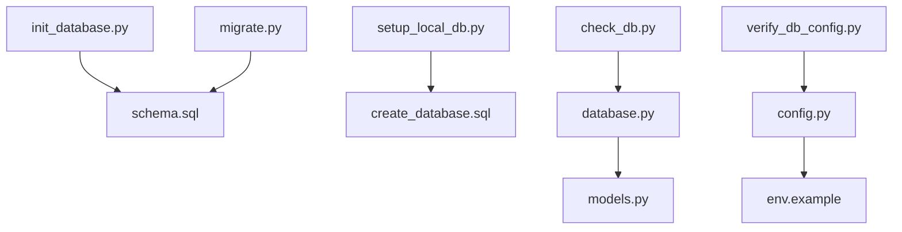
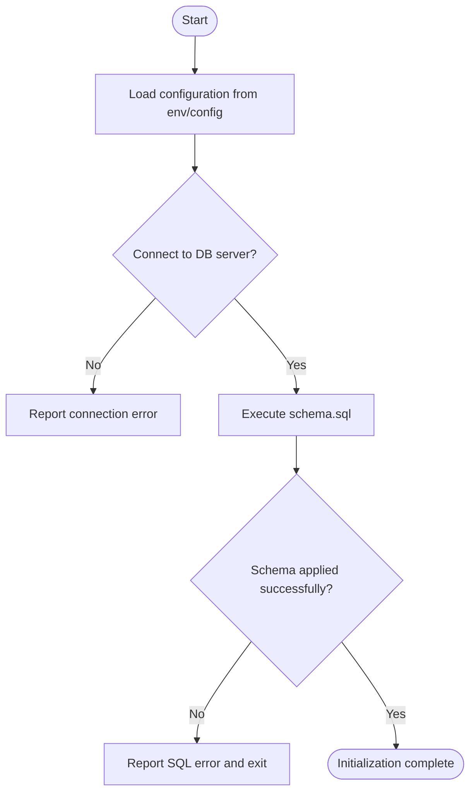
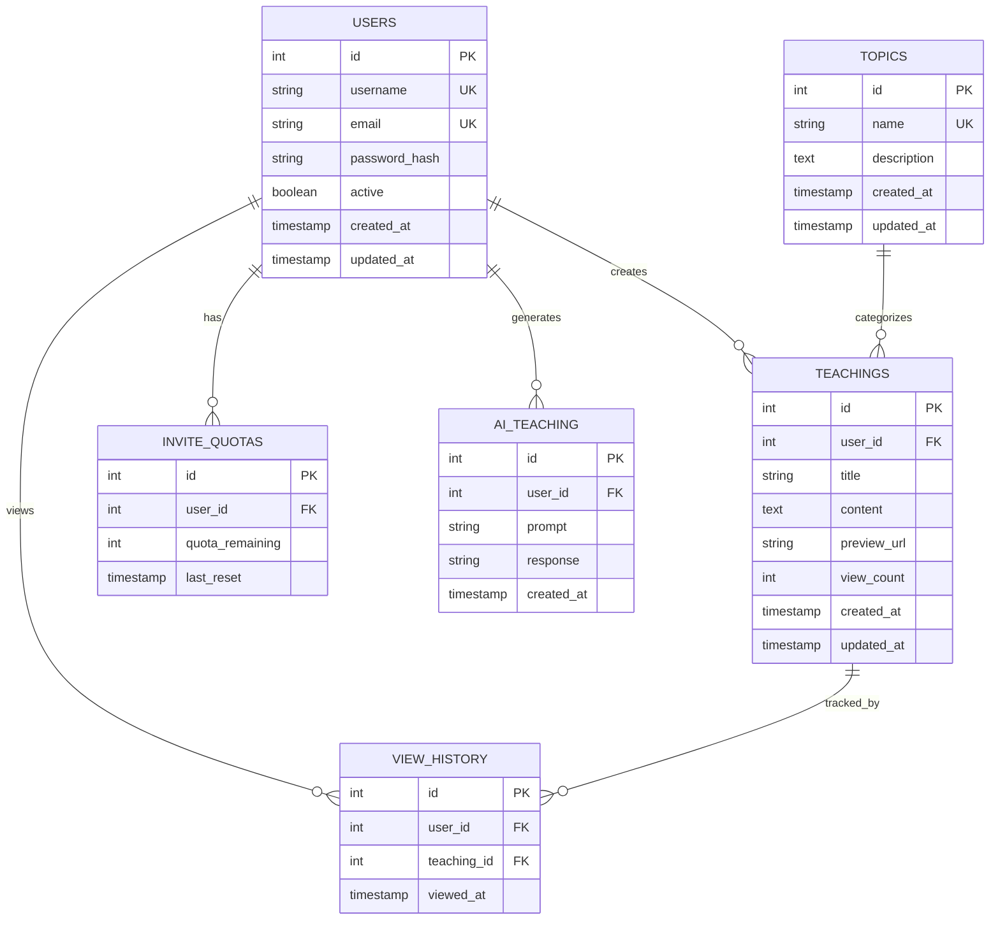
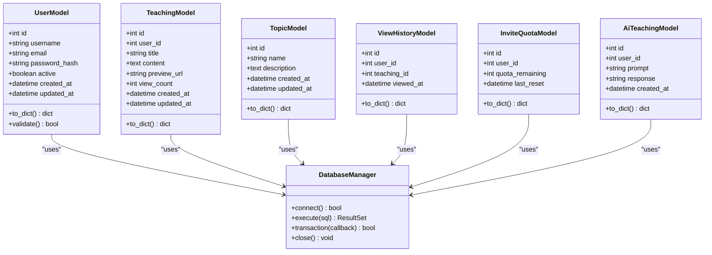
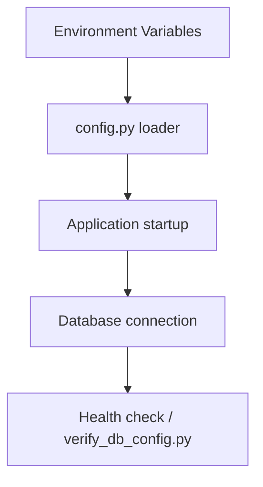
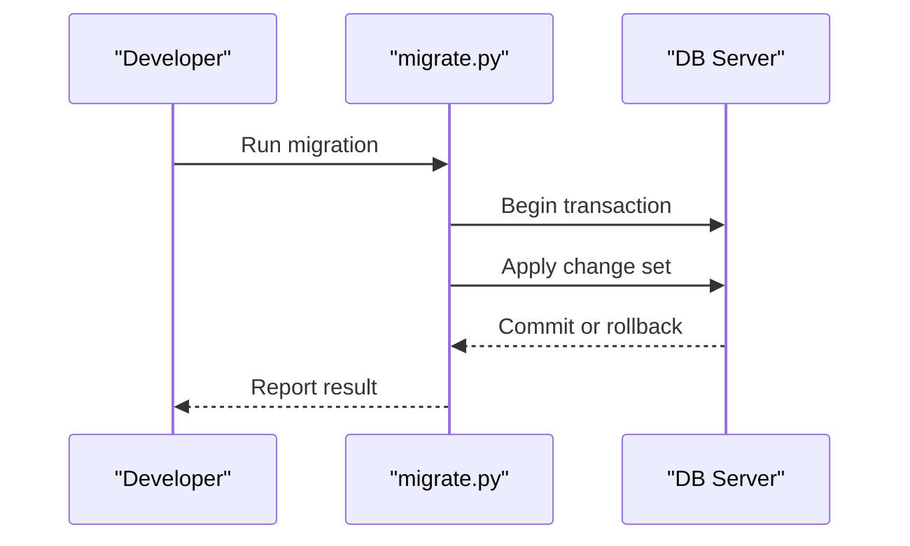
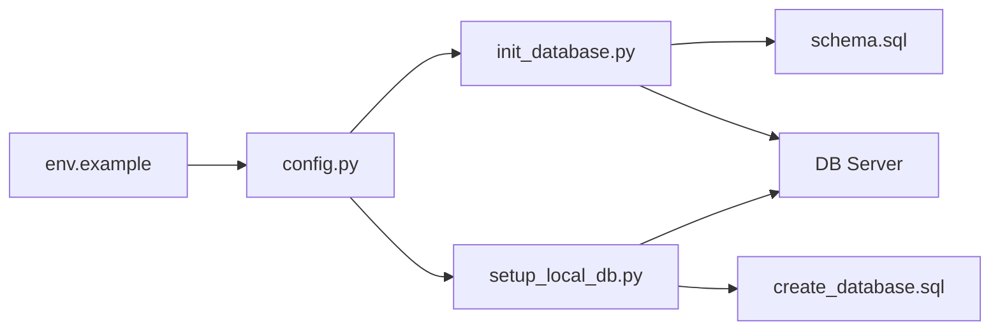

# Database Initialization

<cite>
**Referenced Files in This Document**
- [init_database.py](file://backend/init_database.py)
- [setup_local_db.py](file://backend/setup_local_db.py)
- [schema.sql](file://backend/database/schema.sql)
- [database.py](file://backend/database/database.py)
- [models.py](file://backend/database/models.py)
- [config.py](file://backend/config.py)
- [env.example](file://backend/env.example)
- [check_db.py](file://backend/check_db.py)
- [verify_db_config.py](file://backend/verify_db_config.py)
- [migrate.py](file://backend/database/migrate.py)
- [create_database.sql](file://backend/create_database.sql)
</cite>

## Table of Contents
1. [Introduction](#introduction)
2. [Project Structure](#project-structure)
3. [Core Components](#core-components)
4. [Architecture Overview](#architecture-overview)
5. [Detailed Component Analysis](#detailed-component-analysis)
6. [Dependency Analysis](#dependency-analysis)
7. [Performance Considerations](#performance-considerations)
8. [Troubleshooting Guide](#troubleshooting-guide)
9. [Conclusion](#conclusion)
10. [Appendices](#appendices)

## Introduction
This document explains how to initialize the XSYY Edu platform database from scratch. It covers:
- Step-by-step setup using init_database.py and setup_local_db.py
- Schema structure defined in schema.sql, including tables, relationships, indexes, and constraints
- Environment-specific configuration options, connection parameters, and credentials
- Troubleshooting for common initialization errors, permission issues, and connection problems
- Examples for development, testing, and production deployments

The goal is to help you set up a reliable, secure, and repeatable database environment across all deployment scenarios.

## Project Structure
Database-related code and scripts are primarily located under backend/database and backend. Key files include:
- Initialization scripts: init_database.py, setup_local_db.py
- Schema definition: schema.sql
- ORM models and DB utilities: models.py, database.py
- Configuration and environment: config.py, env.example
- Validation and diagnostics: check_db.py, verify_db_config.py
- Migration helpers: migrate.py
- Initial database creation helper: create_database.sql



**Diagram sources**
- [init_database.py](file://backend/init_database.py)
- [setup_local_db.py](file://backend/setup_local_db.py)
- [schema.sql](file://backend/database/schema.sql)
- [create_database.sql](file://backend/create_database.sql)
- [config.py](file://backend/config.py)
- [env.example](file://backend/env.example)
- [database.py](file://backend/database/database.py)
- [models.py](file://backend/database/models.py)
- [check_db.py](file://backend/check_db.py)
- [verify_db_config.py](file://backend/verify_db_config.py)
- [migrate.py](file://backend/database/migrate.py)

**Section sources**
- [init_database.py](file://backend/init_database.py)
- [setup_local_db.py](file://backend/setup_local_db.py)
- [schema.sql](file://backend/database/schema.sql)
- [create_database.sql](file://backend/create_database.sql)
- [config.py](file://backend/config.py)
- [env.example](file://backend/env.example)
- [database.py](file://backend/database/database.py)
- [models.py](file://backend/database/models.py)
- [check_db.py](file://backend/check_db.py)
- [verify_db_config.py](file://backend/verify_db_config.py)
- [migrate.py](file://backend/database/migrate.py)

## Core Components
- init_database.py: Orchestrates initial database setup, applies schema.sql, and ensures required objects exist.
- setup_local_db.py: Creates a local development database and seeds it with minimal data for quick start.
- schema.sql: Defines the canonical schema (tables, columns, keys, indexes, constraints).
- database.py: Provides connection management and utility functions used by application modules.
- models.py: ORM model definitions that reflect the schema.
- config.py and env.example: Centralized configuration loading and environment variables for DB credentials and connection parameters.
- check_db.py and verify_db_config.py: Diagnostic tools to validate connectivity and configuration correctness.
- migrate.py: Helper to apply incremental changes or migrations against the existing schema.
- create_database.sql: SQL script to create the target database instance when needed.

**Section sources**
- [init_database.py](file://backend/init_database.py)
- [setup_local_db.py](file://backend/setup_local_db.py)
- [schema.sql](file://backend/database/schema.sql)
- [database.py](file://backend/database/database.py)
- [models.py](file://backend/database/models.py)
- [config.py](file://backend/config.py)
- [env.example](file://backend/env.example)
- [check_db.py](file://backend/check_db.py)
- [verify_db_config.py](file://backend/verify_db_config.py)
- [migrate.py](file://backend/database/migrate.py)
- [create_database.sql](file://backend/create_database.sql)

## Architecture Overview
The initialization flow connects environment configuration, database drivers, and schema artifacts to produce a ready-to-use database.

```mermaid
sequenceDiagram
participant Dev as "Developer"
participant Init as "init_database.py"
participant Srv as "DB Server"
participant Schema as "schema.sql"
participant Local as "setup_local_db.py"
participant Create as "create_database.sql"
Dev->>Init : Run initialization
Init->>Srv : Connect using config.env settings
Init->>Schema : Execute schema statements
Schema-->>Init : Schema applied
Init-->>Dev : Success or error details
Dev->>Local : Run local setup
Local->>Create : Create database if missing
Local->>Srv : Connect and seed minimal data
Local-->>Dev : Local DB ready
```

**Diagram sources**
- [init_database.py](file://backend/init_database.py)
- [schema.sql](file://backend/database/schema.sql)
- [setup_local_db.py](file://backend/setup_local_db.py)
- [create_database.sql](file://backend/create_database.sql)
- [config.py](file://backend/config.py)
- [env.example](file://backend/env.example)

## Detailed Component Analysis

### Initialization Scripts
- init_database.py
  - Purpose: Apply the canonical schema and ensure baseline state.
  - Typical steps: Load configuration, connect to DB server, execute schema.sql, report status.
  - Error handling: Captures connection failures, permission errors, and SQL exceptions; prints actionable messages.
- setup_local_db.py
  - Purpose: Prepare a local development database quickly.
  - Typical steps: Ensure database exists via create_database.sql, connect, optionally seed sample data.
  - Safety checks: Avoids overwriting existing databases unless explicitly requested.



**Diagram sources**
- [init_database.py](file://backend/init_database.py)
- [schema.sql](file://backend/database/schema.sql)
- [config.py](file://backend/config.py)
- [env.example](file://backend/env.example)

**Section sources**
- [init_database.py](file://backend/init_database.py)
- [setup_local_db.py](file://backend/setup_local_db.py)
- [create_database.sql](file://backend/create_database.sql)

### Schema Definition (schema.sql)
- Tables: All core entities are defined here, including users, teachings, topics, view history, invite quotas, AI teaching tables, and related metadata.
- Relationships: Foreign keys link child tables to parent entities (e.g., user_id references users, topic_id references topics).
- Indexes: Performance-critical columns are indexed (e.g., foreign keys, frequently filtered fields).
- Constraints: Primary keys, unique constraints, and not-null rules enforce data integrity.
- Best practices: Use consistent naming, explicit types, and default values where appropriate.



**Diagram sources**
- [schema.sql](file://backend/database/schema.sql)

**Section sources**
- [schema.sql](file://backend/database/schema.sql)

### ORM Models and Database Utilities
- models.py: Reflects schema entities as Python classes with attributes mapping to columns.
- database.py: Manages connections, sessions, and provides helper methods for queries and transactions.



**Diagram sources**
- [models.py](file://backend/database/models.py)
- [database.py](file://backend/database/database.py)

**Section sources**
- [models.py](file://backend/database/models.py)
- [database.py](file://backend/database/database.py)

### Configuration and Environment
- config.py: Loads environment variables and provides typed accessors for DB settings.
- env.example: Template for required environment variables such as host, port, database name, user, password, and driver-specific options.

Key configuration items typically include:
- DB_HOST, DB_PORT, DB_NAME, DB_USER, DB_PASSWORD
- Connection pool size, timeout, SSL flags
- Driver selection (e.g., MySQL, PostgreSQL)
- Logging level and debug toggles



**Diagram sources**
- [config.py](file://backend/config.py)
- [env.example](file://backend/env.example)
- [verify_db_config.py](file://backend/verify_db_config.py)

**Section sources**
- [config.py](file://backend/config.py)
- [env.example](file://backend/env.example)
- [verify_db_config.py](file://backend/verify_db_config.py)

### Migration Helpers
- migrate.py: Applies incremental changes to the schema after initial setup.
- Usage: Run migration scripts in order to evolve the schema without losing data.



**Diagram sources**
- [migrate.py](file://backend/database/migrate.py)

**Section sources**
- [migrate.py](file://backend/database/migrate.py)

## Dependency Analysis
The initialization process depends on configuration, schema, and database connectivity.



**Diagram sources**
- [env.example](file://backend/env.example)
- [config.py](file://backend/config.py)
- [init_database.py](file://backend/init_database.py)
- [setup_local_db.py](file://backend/setup_local_db.py)
- [schema.sql](file://backend/database/schema.sql)
- [create_database.sql](file://backend/create_database.sql)

**Section sources**
- [config.py](file://backend/config.py)
- [env.example](file://backend/env.example)
- [init_database.py](file://backend/init_database.py)
- [setup_local_db.py](file://backend/setup_local_db.py)
- [schema.sql](file://backend/database/schema.sql)
- [create_database.sql](file://backend/create_database.sql)

## Performance Considerations
- Indexing strategy: Ensure foreign keys and frequently filtered columns are indexed as defined in schema.sql.
- Connection pooling: Tune pool size and timeouts in config.py based on workload.
- Bulk operations: Use batched inserts during seeding to reduce round-trips.
- Query patterns: Prefer parameterized queries and avoid N+1 lookups in ORM usage.
- Monitoring: Use check_db.py and verify_db_config.py to detect slow connections or misconfiguration early.

[No sources needed since this section provides general guidance]

## Troubleshooting Guide
Common issues and resolutions:
- Connection refused or authentication failed
  - Verify DB_HOST, DB_PORT, DB_NAME, DB_USER, DB_PASSWORD in env.example and loaded environment.
  - Confirm network reachability and firewall rules.
  - Use verify_db_config.py to validate configuration and connectivity.
- Permission denied on database or schema objects
  - Ensure the DB user has CREATE, ALTER, INSERT, SELECT, UPDATE, DELETE privileges.
  - Re-run init_database.py with elevated permissions if necessary.
- Schema conflicts or duplicate objects
  - Drop and recreate the database using create_database.sql before re-running init_database.py.
  - Check for partial migrations and run migrate.py to reconcile state.
- Slow initialization or timeouts
  - Increase connection timeouts in config.py.
  - Validate disk I/O and DB server performance.
- Local vs remote discrepancies
  - Use setup_local_db.py for local dev; use init_database.py for staging/prod environments.
  - Keep env.example synchronized across environments.

Diagnostic tools:
- check_db.py: Quick connectivity and basic health checks.
- verify_db_config.py: Validates environment variables and connection parameters.

**Section sources**
- [check_db.py](file://backend/check_db.py)
- [verify_db_config.py](file://backend/verify_db_config.py)
- [create_database.sql](file://backend/create_database.sql)
- [init_database.py](file://backend/init_database.py)
- [setup_local_db.py](file://backend/setup_local_db.py)

## Conclusion
By following the steps outlined in this document, you can reliably initialize the XSYY Edu platform database across development, testing, and production environments. The combination of init_database.py and setup_local_db.py, along with schema.sql and robust configuration management, ensures a consistent and maintainable database foundation. Use the troubleshooting guide and diagnostic tools to resolve issues quickly and keep your deployments healthy.

[No sources needed since this section summarizes without analyzing specific files]

## Appendices

### Environment-Specific Setup Examples
- Development
  - Use setup_local_db.py to create a local database and seed minimal data.
  - Configure env.example with localhost settings and relaxed security for rapid iteration.
- Testing
  - Use init_database.py to apply schema.sql to an isolated test database.
  - Reset the database between test runs using create_database.sql.
- Production
  - Use init_database.py with hardened credentials and strict permissions.
  - Enable SSL and connection pooling in config.py; monitor with check_db.py and verify_db_config.py.

[No sources needed since this section provides general guidance]