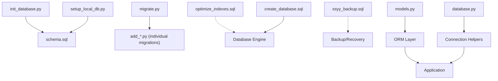
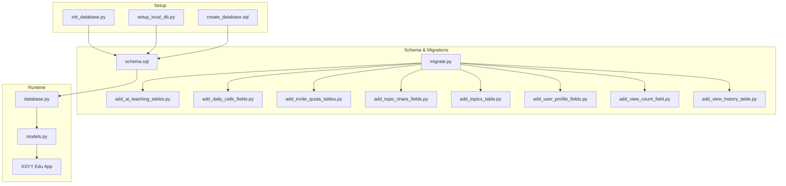
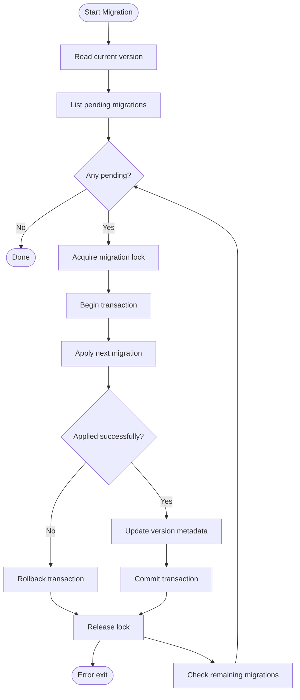
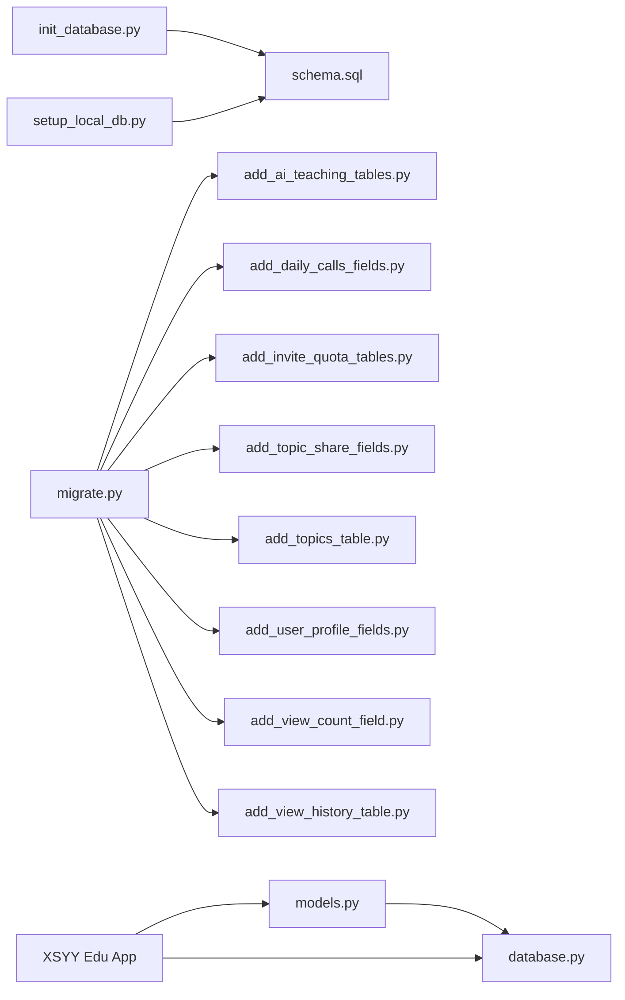

# Database Setup & Migration

<cite>
**Referenced Files in This Document**
- [init_database.py](file://backend/init_database.py)
- [setup_local_db.py](file://backend/setup_local_db.py)
- [schema.sql](file://backend/database/schema.sql)
- [migrate.py](file://backend/database/migrate.py)
- [database.py](file://backend/database/database.py)
- [models.py](file://backend/database/models.py)
- [add_ai_teaching_tables.py](file://backend/database/add_ai_teaching_tables.py)
- [add_daily_calls_fields.py](file://backend/database/add_daily_calls_fields.py)
- [add_invite_quota_tables.py](file://backend/database/add_invite_quota_tables.py)
- [add_topic_share_fields.py](file://backend/database/add_topic_share_fields.py)
- [add_topics_table.py](file://backend/database/add_topics_table.py)
- [add_user_profile_fields.py](file://backend/database/add_user_profile_fields.py)
- [add_view_count_field.py](file://backend/database/add_view_count_field.py)
- [add_view_history_table.py](file://backend/database/add_view_history_table.py)
- [optimize_indexes.sql](file://backend/database/optimize_indexes.sql)
- [create_database.sql](file://backend/create_database.sql)
- [xsyy_backup.sql](file://backend/xsyy_backup.sql)
- [PERFORMANCE_OPTIMIZATION.md](file://backend/PERFORMANCE_OPTIMIZATION.md)
</cite>

## Table of Contents
1. [Introduction](#introduction)
2. [Project Structure](#project-structure)
3. [Core Components](#core-components)
4. [Architecture Overview](#architecture-overview)
5. [Detailed Component Analysis](#detailed-component-analysis)
6. [Dependency Analysis](#dependency-analysis)
7. [Performance Considerations](#performance-considerations)
8. [Troubleshooting Guide](#troubleshooting-guide)
9. [Conclusion](#conclusion)
10. [Appendices](#appendices)

## Introduction
This document explains how to set up and migrate the XSYY Edu platform database. It covers initial database creation using provided scripts, the schema structure, migration versioning, backward compatibility, rollback procedures, backup and recovery strategies, performance optimization techniques, monitoring setup, and troubleshooting for common issues.

## Project Structure
The database-related assets are primarily located under backend/database and a few root-level files:
- Initial setup scripts: init_database.py, setup_local_db.py
- Schema definition: schema.sql
- Migration engine and individual migrations: migrate.py and add_*.py files
- SQL utilities: optimize_indexes.sql, create_database.sql
- Backup artifact: xsyy_backup.sql
- ORM models and DB connection helpers: models.py, database.py
- Performance guidance: PERFORMANCE_OPTIMIZATION.md

[No sources needed since this diagram shows conceptual workflow, not actual code structure]

## Core Components
- Initialization scripts:
  - init_database.py: Creates the database and applies the base schema.
  - setup_local_db.py: Sets up a local development database with seed data or defaults.
- Schema definition:
  - schema.sql: Defines core tables, indexes, and constraints used by the application.
- Migration system:
  - migrate.py: Orchestrates applying pending migrations and tracks versions.
  - add_*.py: Individual migration scripts that implement incremental changes.
- Utilities:
  - optimize_indexes.sql: Index tuning statements for improved query performance.
  - create_database.sql: Optional script to create the database instance if needed.
  - xsyy_backup.sql: Example full backup snapshot for recovery.
- Runtime integration:
  - models.py: ORM model definitions aligned with schema.
  - database.py: Connection management and helper functions used by the app.

**Section sources**
- [init_database.py](file://backend/init_database.py)
- [setup_local_db.py](file://backend/setup_local_db.py)
- [schema.sql](file://backend/database/schema.sql)
- [migrate.py](file://backend/database/migrate.py)
- [add_ai_teaching_tables.py](file://backend/database/add_ai_teaching_tables.py)
- [add_daily_calls_fields.py](file://backend/database/add_daily_calls_fields.py)
- [add_invite_quota_tables.py](file://backend/database/add_invite_quota_tables.py)
- [add_topic_share_fields.py](file://backend/database/add_topic_share_fields.py)
- [add_topics_table.py](file://backend/database/add_topics_table.py)
- [add_user_profile_fields.py](file://backend/database/add_user_profile_fields.py)
- [add_view_count_field.py](file://backend/database/add_view_count_field.py)
- [add_view_history_table.py](file://backend/database/add_view_history_table.py)
- [optimize_indexes.sql](file://backend/database/optimize_indexes.sql)
- [create_database.sql](file://backend/create_database.sql)
- [xsyy_backup.sql](file://backend/xsyy_backup.sql)
- [models.py](file://backend/database/models.py)
- [database.py](file://backend/database/database.py)

## Architecture Overview
The database layer is composed of:
- Initialization and setup scripts that bootstrap the environment.
- A declarative schema file defining the canonical structure.
- A migration engine that applies ordered, versioned changes.
- ORM models and connection helpers consumed by the application.

**Diagram sources**
- [init_database.py](file://backend/init_database.py)
- [setup_local_db.py](file://backend/setup_local_db.py)
- [create_database.sql](file://backend/create_database.sql)
- [schema.sql](file://backend/database/schema.sql)
- [migrate.py](file://backend/database/migrate.py)
- [add_ai_teaching_tables.py](file://backend/database/add_ai_teaching_tables.py)
- [add_daily_calls_fields.py](file://backend/database/add_daily_calls_fields.py)
- [add_invite_quota_tables.py](file://backend/database/add_invite_quota_tables.py)
- [add_topic_share_fields.py](file://backend/database/add_topic_share_fields.py)
- [add_topics_table.py](file://backend/database/add_topics_table.py)
- [add_user_profile_fields.py](file://backend/database/add_user_profile_fields.py)
- [add_view_count_field.py](file://backend/database/add_view_count_field.py)
- [add_view_history_table.py](file://backend/database/add_view_history_table.py)
- [database.py](file://backend/database/database.py)
- [models.py](file://backend/database/models.py)

## Detailed Component Analysis

### Initialization Scripts
- init_database.py
  - Purpose: Create the database (if required) and apply the base schema from schema.sql.
  - Typical flow: Connect to DB server -> Create database -> Execute schema.sql -> Verify connectivity.
- setup_local_db.py
  - Purpose: Prepare a local development database, optionally seeding default records and ensuring dev-friendly settings.
  - Typical flow: Ensure DB exists -> Apply schema -> Insert seed data -> Confirm readiness.

Operational notes:
- Ensure credentials and target database name are configured before running.
- Run initialization only once per environment; subsequent runs should use migrations.

**Section sources**
- [init_database.py](file://backend/init_database.py)
- [setup_local_db.py](file://backend/setup_local_db.py)
- [schema.sql](file://backend/database/schema.sql)

### Schema Definition
- schema.sql
  - Contains the canonical table definitions, primary keys, foreign keys, indexes, and constraints.
  - Acts as the baseline for fresh installations and reference for migrations.

Best practices:
- Keep schema.sql idempotent-friendly where possible.
- Use consistent naming conventions for tables and columns.
- Define appropriate indexes early to avoid expensive re-indexing later.

**Section sources**
- [schema.sql](file://backend/database/schema.sql)

### Migration System
- migrate.py
  - Purpose: Discover pending migrations, execute them in order, and track applied versions.
  - Versioning: Each migration is identified by a unique version string or number; the engine ensures no duplicates and correct ordering.
  - Execution: Applies SQL or Python-based operations atomically when possible.

Individual migrations:
- add_ai_teaching_tables.py
- add_daily_calls_fields.py
- add_invite_quota_tables.py
- add_topic_share_fields.py
- add_topics_table.py
- add_user_profile_fields.py
- add_view_count_field.py
- add_view_history_table.py

Migration lifecycle:
- Author a new migration with a unique version identifier.
- Implement forward changes (CREATE/ALTER/DROP).
- Include backward-compatible logic where feasible.
- Test on a staging database before production.

Rollback strategy:
- Maintain reverse operations within each migration or provide dedicated rollback scripts.
- For destructive changes, ensure backups exist prior to execution.

Backward compatibility considerations:
- Avoid removing or renaming columns without deprecation phases.
- Introduce optional fields with sensible defaults.
- Use conditional checks before altering existing structures.

**Diagram sources**
- [migrate.py](file://backend/database/migrate.py)
- [add_ai_teaching_tables.py](file://backend/database/add_ai_teaching_tables.py)
- [add_daily_calls_fields.py](file://backend/database/add_daily_calls_fields.py)
- [add_invite_quota_tables.py](file://backend/database/add_invite_quota_tables.py)
- [add_topic_share_fields.py](file://backend/database/add_topic_share_fields.py)
- [add_topics_table.py](file://backend/database/add_topics_table.py)
- [add_user_profile_fields.py](file://backend/database/add_user_profile_fields.py)
- [add_view_count_field.py](file://backend/database/add_view_count_field.py)
- [add_view_history_table.py](file://backend/database/add_view_history_table.py)

**Section sources**
- [migrate.py](file://backend/database/migrate.py)
- [add_ai_teaching_tables.py](file://backend/database/add_ai_teaching_tables.py)
- [add_daily_calls_fields.py](file://backend/database/add_daily_calls_fields.py)
- [add_invite_quota_tables.py](file://backend/database/add_invite_quota_tables.py)
- [add_topic_share_fields.py](file://backend/database/add_topic_share_fields.py)
- [add_topics_table.py](file://backend/database/add_topics_table.py)
- [add_user_profile_fields.py](file://backend/database/add_user_profile_fields.py)
- [add_view_count_field.py](file://backend/database/add_view_count_field.py)
- [add_view_history_table.py](file://backend/database/add_view_history_table.py)

### ORM Models and Connection Helpers
- models.py
  - Provides ORM classes mapped to schema tables.
  - Ensures type safety and simplifies queries across the application.
- database.py
  - Manages connections, pooling, retries, and helper methods used by models and services.

Integration:
- Application code imports models and uses database helpers to perform CRUD operations.
- Connection parameters are typically loaded from configuration or environment variables.

**Section sources**
- [models.py](file://backend/database/models.py)
- [database.py](file://backend/database/database.py)

## Dependency Analysis
High-level dependencies among database components:
- Initialization scripts depend on schema.sql.
- Migration engine depends on individual migration scripts and version metadata.
- ORM models depend on schema structure and connection helpers.
- Application depends on ORM and connection helpers.

**Diagram sources**
- [init_database.py](file://backend/init_database.py)
- [setup_local_db.py](file://backend/setup_local_db.py)
- [schema.sql](file://backend/database/schema.sql)
- [migrate.py](file://backend/database/migrate.py)
- [add_ai_teaching_tables.py](file://backend/database/add_ai_teaching_tables.py)
- [add_daily_calls_fields.py](file://backend/database/add_daily_calls_fields.py)
- [add_invite_quota_tables.py](file://backend/database/add_invite_quota_tables.py)
- [add_topic_share_fields.py](file://backend/database/add_topic_share_fields.py)
- [add_topics_table.py](file://backend/database/add_topics_table.py)
- [add_user_profile_fields.py](file://backend/database/add_user_profile_fields.py)
- [add_view_count_field.py](file://backend/database/add_view_count_field.py)
- [add_view_history_table.py](file://backend/database/add_view_history_table.py)
- [models.py](file://backend/database/models.py)
- [database.py](file://backend/database/database.py)

**Section sources**
- [init_database.py](file://backend/init_database.py)
- [setup_local_db.py](file://backend/setup_local_db.py)
- [schema.sql](file://backend/database/schema.sql)
- [migrate.py](file://backend/database/migrate.py)
- [models.py](file://backend/database/models.py)
- [database.py](file://backend/database/database.py)

## Performance Considerations
- Index optimization:
  - Review and apply index recommendations from optimize_indexes.sql after analyzing slow queries.
- Query patterns:
  - Prefer selective filters and avoid SELECT * in hot paths.
  - Use pagination and limit clauses for large result sets.
- Connection management:
  - Tune connection pool sizes based on workload and concurrency.
- Storage layout:
  - Partition large tables if necessary (e.g., view history).
- Monitoring:
  - Enable slow query logs and metrics collection.
  - Track key KPIs: query latency, throughput, lock waits, and replication lag (if applicable).

For detailed guidance, refer to:
- [PERFORMANCE_OPTIMIZATION.md](file://backend/PERFORMANCE_OPTIMIZATION.md)
- [optimize_indexes.sql](file://backend/database/optimize_indexes.sql)

**Section sources**
- [optimize_indexes.sql](file://backend/database/optimize_indexes.sql)
- [PERFORMANCE_OPTIMIZATION.md](file://backend/PERFORMANCE_OPTIMIZATION.md)

## Troubleshooting Guide
Common issues and resolutions:
- Connection failures:
  - Validate host, port, username, password, and database name.
  - Check firewall rules and network reachability.
  - Ensure the database service is running and accepting connections.
- Permission errors:
  - Confirm the user has CREATE, ALTER, DROP privileges during setup/migration.
  - Restrict permissions post-setup for security.
- Migration conflicts:
  - If a migration fails mid-execution, verify transactional behavior and retry after fixing the issue.
  - Inspect version metadata to avoid duplicate applications.
- Schema drift:
  - Compare current schema against schema.sql to detect manual changes.
  - Re-run initialization on a clean environment to validate baseline.
- Performance regressions:
  - Analyze slow query logs and apply recommended indexes.
  - Monitor connection pool saturation and adjust sizing.

Useful artifacts:
- [create_database.sql](file://backend/create_database.sql): Recreate database instance if needed.
- [xsyy_backup.sql](file://backend/xsyy_backup.sql): Restore from a known-good snapshot.

**Section sources**
- [create_database.sql](file://backend/create_database.sql)
- [xsyy_backup.sql](file://backend/xsyy_backup.sql)

## Conclusion
The XSYY Edu platform’s database layer combines clear initialization scripts, a declarative schema, and a robust migration system. By following the outlined processes for setup, migration, backup, performance tuning, and troubleshooting, teams can maintain a reliable and scalable data layer across environments.

## Appendices

### Quick Start Checklist
- Install and configure the database server.
- Run init_database.py to create the database and apply schema.sql.
- For local development, run setup_local_db.py to seed defaults.
- Apply all pending migrations using migrate.py.
- Validate connectivity via models.py and database.py.
- Apply index optimizations from optimize_indexes.sql as needed.
- Perform a backup using xsyy_backup.sql as a baseline.

**Section sources**
- [init_database.py](file://backend/init_database.py)
- [setup_local_db.py](file://backend/setup_local_db.py)
- [schema.sql](file://backend/database/schema.sql)
- [migrate.py](file://backend/database/migrate.py)
- [optimize_indexes.sql](file://backend/database/optimize_indexes.sql)
- [xsyy_backup.sql](file://backend/xsyy_backup.sql)
- [models.py](file://backend/database/models.py)
- [database.py](file://backend/database/database.py)