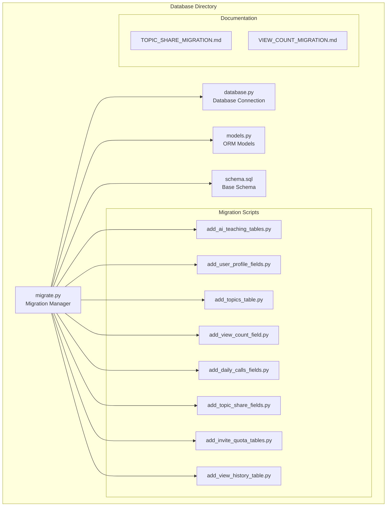
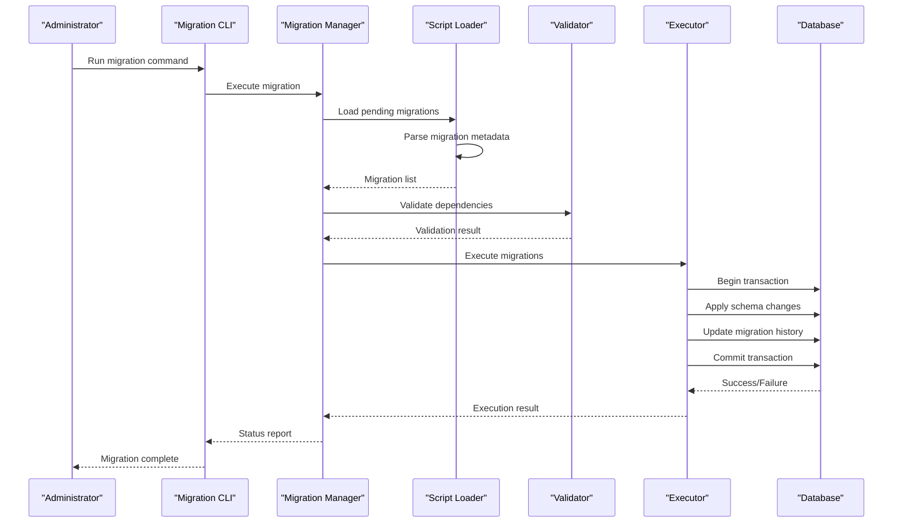
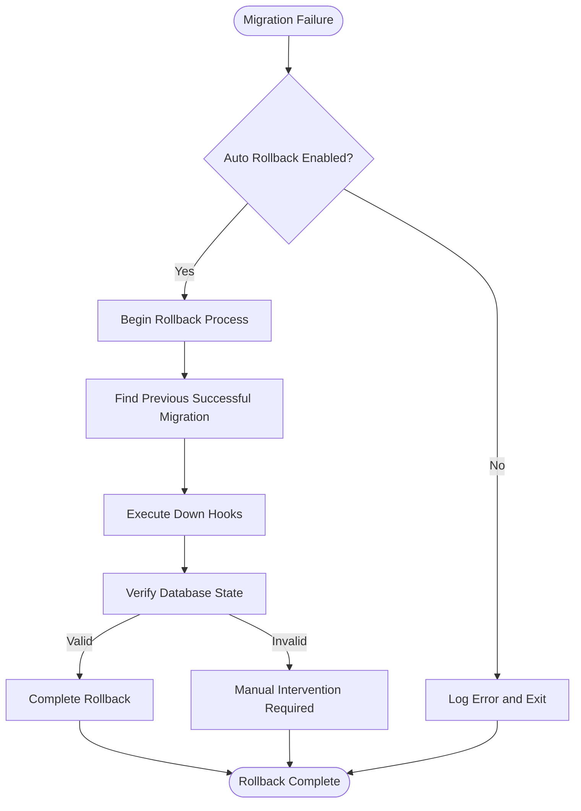
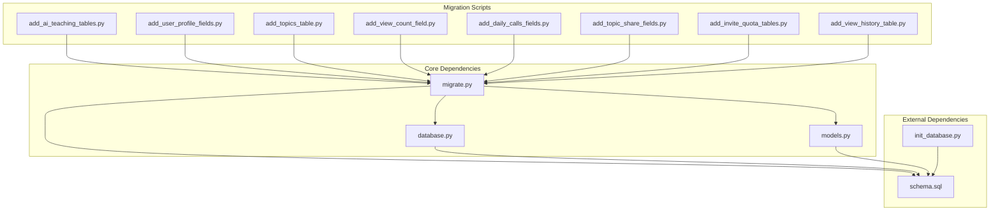

# Migration Management

<cite>
**Referenced Files in This Document**
- [migrate.py](file://backend/database/migrate.py)
- [database.py](file://backend/database/database.py)
- [models.py](file://backend/database/models.py)
- [schema.sql](file://backend/database/schema.sql)
- [add_ai_teaching_tables.py](file://backend/database/add_ai_teaching_tables.py)
- [add_user_profile_fields.py](file://backend/database/add_user_profile_fields.py)
- [add_topics_table.py](file://backend/database/add_topics_table.py)
- [add_view_count_field.py](file://backend/database/add_view_count_field.py)
- [add_daily_calls_fields.py](file://backend/database/add_daily_calls_fields.py)
- [add_topic_share_fields.py](file://backend/database/add_topic_share_fields.py)
- [add_invite_quota_tables.py](file://backend/database/add_invite_quota_tables.py)
- [add_view_history_table.py](file://backend/database/add_view_history_table.py)
- [TOPIC_SHARE_MIGRATION.md](file://backend/database/TOPIC_SHARE_MIGRATION.md)
- [VIEW_COUNT_MIGRATION.md](file://backend/database/VIEW_COUNT_MIGRATION.md)
- [init_database.py](file://backend/init_database.py)
</cite>

## Table of Contents
1. [Introduction](#introduction)
2. [Project Structure](#project-structure)
3. [Core Components](#core-components)
4. [Architecture Overview](#architecture-overview)
5. [Detailed Component Analysis](#detailed-component-analysis)
6. [Dependency Analysis](#dependency-analysis)
7. [Performance Considerations](#performance-considerations)
8. [Troubleshooting Guide](#troubleshooting-guide)
9. [Conclusion](#conclusion)
10. [Appendices](#appendices)

## Introduction

The XSYY Edu platform implements a comprehensive database migration system designed to manage schema evolution and data transformations throughout the application lifecycle. This migration system provides version control for database structures, ensures consistency across different deployment environments, and maintains backward compatibility while supporting complex data transformations.

The migration framework is built around a centralized migration manager that coordinates the execution of individual migration scripts, tracks their versions, and handles dependencies between migrations. This approach enables safe, repeatable, and auditable database changes that are essential for production deployments.

## Project Structure

The migration system is organized within the `backend/database` directory, following a clear separation of concerns:



**Diagram sources**
- [migrate.py](file://backend/database/migrate.py)
- [database.py](file://backend/database/database.py)
- [models.py](file://backend/database/models.py)
- [schema.sql](file://backend/database/schema.sql)

**Section sources**
- [migrate.py](file://backend/database/migrate.py)
- [database.py](file://backend/database/database.py)

## Core Components

The migration system consists of several key components that work together to provide a robust database versioning solution:

### Migration Manager (migrate.py)
The central orchestrator responsible for:
- Scanning and loading migration scripts
- Tracking migration versions and execution status
- Managing dependency resolution between migrations
- Executing migrations in the correct order
- Handling rollback operations
- Maintaining migration history

### Database Connection Layer (database.py)
Provides:
- Database connection management
- Transaction handling
- Error recovery mechanisms
- Connection pooling for performance

### Model Definitions (models.py)
Defines:
- ORM model classes
- Table relationships
- Field constraints and validations
- Data type mappings

### Base Schema (schema.sql)
Contains:
- Initial database structure
- Common table definitions
- Index definitions
- Default data seeds

**Section sources**
- [migrate.py](file://backend/database/migrate.py)
- [database.py](file://backend/database/database.py)
- [models.py](file://backend/database/models.py)
- [schema.sql](file://backend/database/schema.sql)

## Architecture Overview

The migration system follows a layered architecture pattern that separates concerns and promotes maintainability:



**Diagram sources**
- [migrate.py](file://backend/database/migrate.py)
- [database.py](file://backend/database/database.py)

The architecture emphasizes:
- **Separation of Concerns**: Each component has a specific responsibility
- **Transaction Safety**: All migrations run within transactions for atomicity
- **Error Recovery**: Comprehensive error handling and rollback capabilities
- **Audit Trail**: Complete logging of all migration activities
- **Dependency Management**: Automatic resolution of migration dependencies

## Detailed Component Analysis

### Migration Script Structure

Each migration script follows a standardized format that includes metadata, forward migration logic, and optional rollback functionality:

#### Standard Migration Template
```python
class Migration:
    def __init__(self):
        self.version = "X.Y.Z"
        self.description = "Description of changes"
        self.dependencies = ["previous_version"]
        self.up_hooks = []
        self.down_hooks = []
    
    def up(self):
        """Forward migration logic"""
        pass
    
    def down(self):
        """Rollback migration logic"""
        pass
    
    def validate(self):
        """Pre-execution validation"""
        return True
```

#### Example Migration Pattern
```python
# Adding a new table
def create_users_table():
    # Create table definition
    # Add indexes
    # Set default values
    pass

# Modifying existing columns
def alter_user_columns():
    # Add new columns
    # Modify existing columns
    # Handle data conversion
    pass

# Data cleanup operations
def cleanup_data():
    # Remove duplicates
    # Fix inconsistent data
    # Archive old records
    pass
```

### Versioning Strategy

The system implements semantic versioning for migrations:

| Version Component | Purpose | Example |
|-------------------|---------|---------|
| Major (X) | Breaking changes | X.0.0 |
| Minor (Y) | New features | 0.Y.0 |
| Patch (Z) | Bug fixes | 0.0.Z |

Version tracking ensures:
- **Idempotency**: Migrations can be run multiple times safely
- **Dependency Resolution**: Correct ordering of dependent migrations
- **Rollback Support**: Ability to revert to previous versions
- **Compatibility Checking**: Validation against target database versions

### Dependency Management

Migrations can declare dependencies on other migrations to ensure proper execution order:

```python
class Migration:
    def __init__(self):
        self.dependencies = [
            "20231201_add_user_profile",
            "20231202_add_topics_table"
        ]
```

Dependency resolution algorithm:
1. Build dependency graph from all migrations
2. Detect circular dependencies
3. Generate topological sort for execution order
4. Validate all dependencies are satisfied

**Section sources**
- [add_ai_teaching_tables.py](file://backend/database/add_ai_teaching_tables.py)
- [add_user_profile_fields.py](file://backend/database/add_user_profile_fields.py)
- [add_topics_table.py](file://backend/database/add_topics_table.py)
- [add_view_count_field.py](file://backend/database/add_view_count_field.py)

### Rollback Procedures

The migration system supports both automatic and manual rollback operations:

#### Automatic Rollback


**Diagram sources**
- [migrate.py](file://backend/database/migrate.py)

#### Manual Rollback Commands
- `rollback latest`: Revert the most recent migration
- `rollback <version>`: Revert to a specific version
- `rollback all`: Revert all migrations to base state

### Data Transformation Patterns

Common data transformation patterns implemented in the migration system:

#### Column Modification
```python
def modify_column_migration():
    # Add new column with default value
    # Copy data from existing column
    # Drop original column
    # Rename new column
    pass
```

#### Data Cleanup Operations
```python
def cleanup_migration():
    # Remove duplicate records
    # Normalize data formats
    # Archive obsolete data
    # Update foreign key references
    pass
```

#### Conditional Logic
```python
def conditional_migration():
    # Check current schema version
    # Apply changes based on conditions
    # Handle missing tables/columns gracefully
    pass
```

**Section sources**
- [add_daily_calls_fields.py](file://backend/database/add_daily_calls_fields.py)
- [add_topic_share_fields.py](file://backend/database/add_topic_share_fields.py)

## Dependency Analysis

The migration system maintains careful dependency relationships between components:



**Diagram sources**
- [migrate.py](file://backend/database/migrate.py)
- [database.py](file://backend/database/database.py)
- [models.py](file://backend/database/models.py)
- [schema.sql](file://backend/database/schema.sql)

Key dependency characteristics:
- **Low Coupling**: Migration scripts depend only on the migration framework
- **High Cohesion**: Related functionality grouped within modules
- **Interface Stability**: Stable interfaces between components
- **Circular Dependency Prevention**: Careful design to avoid circular imports

**Section sources**
- [migrate.py](file://backend/database/migrate.py)
- [database.py](file://backend/database/database.py)

## Performance Considerations

The migration system is designed with performance optimization in mind:

### Batch Operations
- **Bulk Inserts**: Group related data operations into single transactions
- **Index Optimization**: Create indexes after bulk data loads
- **Connection Pooling**: Reuse database connections for multiple operations

### Memory Management
- **Streaming Queries**: Process large datasets without loading entire result sets
- **Lazy Loading**: Load migration scripts only when needed
- **Garbage Collection**: Proper cleanup of temporary objects

### Concurrency Control
- **Lock Mechanisms**: Prevent concurrent migration executions
- **Transaction Isolation**: Ensure data consistency during migrations
- **Deadlock Prevention**: Careful ordering of database operations

### Monitoring and Metrics
- **Execution Time Tracking**: Monitor migration performance
- **Resource Usage**: Track memory and CPU consumption
- **Error Rate Monitoring**: Alert on failed migrations

## Troubleshooting Guide

### Common Issues and Solutions

#### Migration Order Problems
**Symptoms**: Migration fails due to missing dependencies
**Solution**: 
- Check dependency declarations in migration metadata
- Use `list pending` to verify execution order
- Manually resolve circular dependencies if present

#### Data Type Mismatches
**Symptoms**: Column modification failures
**Solution**:
- Verify data types match between source and target
- Use explicit casting functions for conversions
- Test with sample data before full migration

#### Performance Issues
**Symptoms**: Slow migration execution
**Solution**:
- Break large migrations into smaller chunks
- Use batch processing for large datasets
- Optimize queries with proper indexing

#### Rollback Failures
**Symptoms**: Inability to rollback migrations
**Solution**:
- Ensure down hooks are properly implemented
- Check for data dependencies that prevent rollback
- Use manual intervention for complex cases

### Debugging Techniques

#### Logging Configuration
```python
# Enable detailed logging
logging.basicConfig(level=logging.DEBUG)
logger = logging.getLogger('migration')
```

#### Diagnostic Commands
- `status`: Show current migration status
- `list pending`: Display pending migrations
- `validate`: Check migration integrity
- `simulate`: Preview migration effects

#### Recovery Procedures
1. **Backup Database**: Always create backups before migrations
2. **Check Logs**: Review migration logs for errors
3. **Manual Intervention**: Use direct SQL for complex recoveries
4. **Version Reset**: Reset to known good state if necessary

**Section sources**
- [TOPIC_SHARE_MIGRATION.md](file://backend/database/TOPIC_SHARE_MIGRATION.md)
- [VIEW_COUNT_MIGRATION.md](file://backend/database/VIEW_COUNT_MIGRATION.md)

## Conclusion

The XSYY Edu platform's migration system provides a robust, scalable, and maintainable solution for database versioning and data transformation. The architecture emphasizes safety, performance, and ease of use while providing comprehensive tooling for development and production environments.

Key benefits of the implementation include:
- **Reliability**: Transaction-based operations ensure data consistency
- **Flexibility**: Support for complex data transformations and conditional logic
- **Maintainability**: Clear separation of concerns and standardized patterns
- **Scalability**: Efficient handling of large datasets and complex schemas
- **Safety**: Comprehensive error handling and rollback capabilities

The system successfully addresses the challenges of database evolution in production environments while maintaining backward compatibility and supporting rapid development cycles.

## Appendices

### Best Practices for Writing Migrations

#### Safe Migration Development
1. **Test Thoroughly**: Always test migrations in development and staging environments
2. **Use Transactions**: Wrap all operations in transactions for atomicity
3. **Handle Errors Gracefully**: Implement proper error handling and logging
4. **Document Changes**: Include detailed descriptions of schema and data changes
5. **Validate Data**: Check data integrity before and after migrations

#### Performance Optimization
1. **Batch Operations**: Group related operations into single transactions
2. **Index Management**: Create indexes strategically to minimize impact
3. **Data Volume**: Handle large datasets with streaming and pagination
4. **Resource Monitoring**: Monitor memory and CPU usage during migrations

#### Backward Compatibility
1. **Gradual Changes**: Implement changes incrementally when possible
2. **Default Values**: Provide sensible defaults for new fields
3. **Conditional Logic**: Handle both old and new data formats
4. **Feature Flags**: Use flags to enable/disable new functionality

### Testing Approaches

#### Unit Testing
- Test individual migration functions
- Mock database operations
- Validate data transformations
- Check constraint satisfaction

#### Integration Testing
- Test complete migration workflows
- Verify database state after migrations
- Test rollback procedures
- Validate performance characteristics

#### Production Simulation
- Test with realistic data volumes
- Simulate failure scenarios
- Validate backup and recovery procedures
- Measure migration duration and resource usage