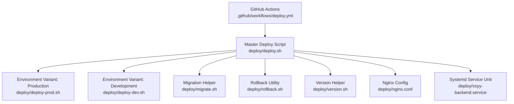
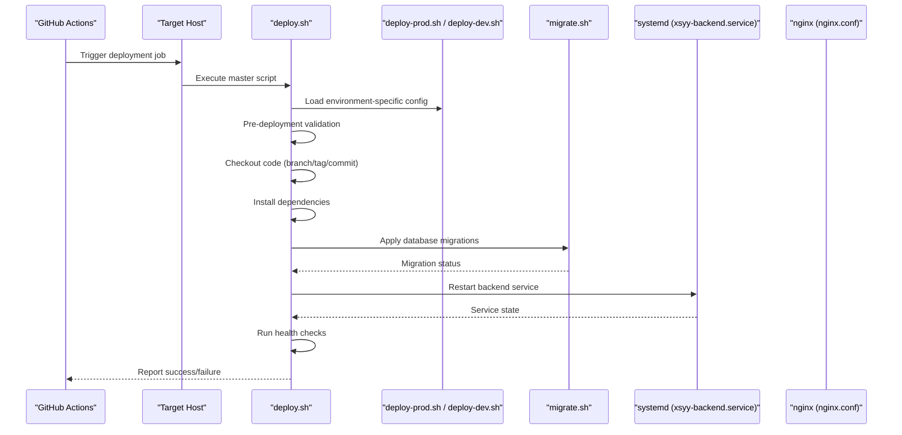
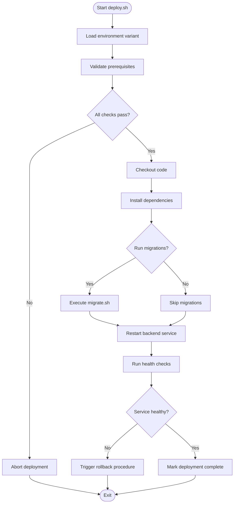
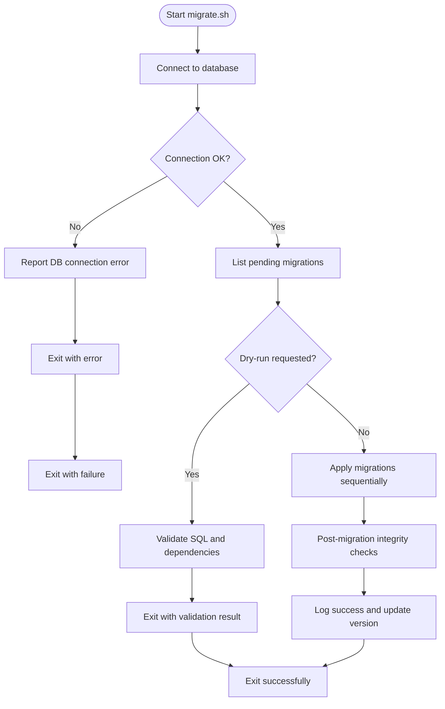
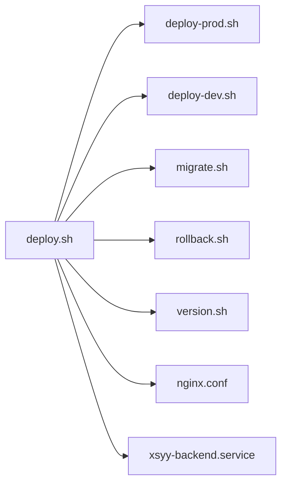

# Deployment Automation

<cite>
**Referenced Files in This Document**
- [deploy.sh](file://deploy/deploy.sh)
- [deploy-prod.sh](file://deploy/deploy-prod.sh)
- [deploy-dev.sh](file://deploy/deploy-dev.sh)
- [migrate.sh](file://deploy/migrate.sh)
- [rollback.sh](file://deploy/rollback.sh)
- [version.sh](file://deploy/version.sh)
- [nginx.conf](file://deploy/nginx.conf)
- [xsyy-backend.service](file://deploy/xsyy-backend.service)
- [DEPLOYMENT.md](file://deploy/DEPLOYMENT.md)
- [deploy.yml](file://.github/workflows/deploy.yml)
</cite>

## Table of Contents
1. [Introduction](#introduction)
2. [Project Structure](#project-structure)
3. [Core Components](#core-components)
4. [Architecture Overview](#architecture-overview)
5. [Detailed Component Analysis](#detailed-component-analysis)
6. [Dependency Analysis](#dependency-analysis)
7. [Performance Considerations](#performance-considerations)
8. [Troubleshooting Guide](#troubleshooting-guide)
9. [Conclusion](#conclusion)
10. [Appendices](#appendices)

## Introduction
This document explains the automated deployment system for the project, focusing on the master deploy script and its environment-specific variants. It covers the end-to-end workflow including code checkout, dependency installation, database migrations, service restart, and health checks. It also documents the migration tooling, pre-deployment validation, rollback procedures, and verification processes. Guidance is provided for customizing scripts across environments and troubleshooting common failures.

## Project Structure
The deployment automation is primarily implemented under the deploy directory, with supporting configuration files and a GitHub Actions workflow:
- Master and environment-specific deploy scripts
- Database migration helper
- Rollback utility
- Version helper
- Nginx reverse proxy configuration
- Systemd service unit for the backend
- GitHub Actions workflow to trigger deployments

**Diagram sources**
- [.github/workflows/deploy.yml:1-200](file://.github/workflows/deploy.yml#L1-L200)
- [deploy.sh:1-200](file://deploy/deploy.sh#L1-L200)
- [deploy-prod.sh:1-200](file://deploy/deploy-prod.sh#L1-L200)
- [deploy-dev.sh:1-200](file://deploy/deploy-dev.sh#L1-L200)
- [migrate.sh:1-200](file://deploy/migrate.sh#L1-L200)
- [rollback.sh:1-200](file://deploy/rollback.sh#L1-L200)
- [version.sh:1-200](file://deploy/version.sh#L1-L200)
- [nginx.conf:1-200](file://deploy/nginx.conf#L1-L200)
- [xsyy-backend.service:1-200](file://deploy/xsyy-backend.service#L1-L200)

**Section sources**
- [deploy.yml:1-200](file://.github/workflows/deploy.yml#L1-L200)
- [deploy.sh:1-200](file://deploy/deploy.sh#L1-L200)
- [DEPLOYMENT.md:1-200](file://deploy/DEPLOYMENT.md#L1-L200)

## Core Components
- Master deploy script (deploy.sh): Orchestrates the full deployment lifecycle, including pre-checks, code checkout, dependency installation, optional database migrations, service restart, and post-deploy health checks. It delegates environment-specific behavior to variant scripts.
- Environment variants (deploy-prod.sh, deploy-dev.sh): Provide environment-specific overrides such as target branch, feature flags, logging verbosity, and health check endpoints.
- Migration helper (migrate.sh): Applies schema updates and data migrations against the configured database.
- Rollback utility (rollback.sh): Reverts the running version to a previous known-good release and optionally rolls back database changes if supported by the migration set.
- Version helper (version.sh): Provides consistent version tagging and reporting used by deploy and rollback flows.
- Nginx configuration (nginx.conf): Reverse proxy settings that route traffic to the backend service; updated during deployment when needed.
- Systemd service unit (xsyy-backend.service): Defines how the backend process is managed by the OS service manager.

Key responsibilities:
- Pre-deployment validation: repository access, required tools, environment variables, disk space, port availability.
- Code checkout: pull specific commit or tag from the repository.
- Dependency installation: install backend dependencies and build artifacts as needed.
- Database migrations: run migrate.sh with appropriate flags per environment.
- Service restart: reload systemd unit and verify process state.
- Health checks: probe application endpoints to confirm readiness.

**Section sources**
- [deploy.sh:1-200](file://deploy/deploy.sh#L1-L200)
- [deploy-prod.sh:1-200](file://deploy/deploy-prod.sh#L1-L200)
- [deploy-dev.sh:1-200](file://deploy/deploy-dev.sh#L1-L200)
- [migrate.sh:1-200](file://deploy/migrate.sh#L1-L200)
- [rollback.sh:1-200](file://deploy/rollback.sh#L1-L200)
- [version.sh:1-200](file://deploy/version.sh#L1-L200)
- [nginx.conf:1-200](file://deploy/nginx.conf#L1-L200)
- [xsyy-backend.service:1-200](file://deploy/xsyy-backend.service#L1-L200)

## Architecture Overview
The deployment architecture integrates CI/CD with server-side automation:
- GitHub Actions triggers the deployment pipeline upon push or manual dispatch.
- The master deploy script runs on the target host, performing validation, checkout, build, migration, restart, and verification.
- Environment variants tailor behavior for production and development targets.
- Nginx serves as the reverse proxy fronting the backend service defined by the systemd unit.

**Diagram sources**
- [.github/workflows/deploy.yml:1-200](file://.github/workflows/deploy.yml#L1-L200)
- [deploy.sh:1-200](file://deploy/deploy.sh#L1-L200)
- [deploy-prod.sh:1-200](file://deploy/deploy-prod.sh#L1-L200)
- [deploy-dev.sh:1-200](file://deploy/deploy-dev.sh#L1-L200)
- [migrate.sh:1-200](file://deploy/migrate.sh#L1-L200)
- [xsyy-backend.service:1-200](file://deploy/xsyy-backend.service#L1-L200)
- [nginx.conf:1-200](file://deploy/nginx.conf#L1-L200)

## Detailed Component Analysis

### Master Deploy Script (deploy.sh)
Responsibilities:
- Parse arguments and load environment-specific overrides.
- Validate prerequisites (tools, permissions, environment variables).
- Determine target revision (branch, tag, commit).
- Perform code checkout into the deployment directory.
- Install dependencies and build artifacts.
- Optionally run database migrations via migrate.sh.
- Restart the backend service using systemd.
- Execute health checks against the application endpoint(s).
- Record deployment metadata and version information.

Operational flow:

**Diagram sources**
- [deploy.sh:1-200](file://deploy/deploy.sh#L1-L200)
- [migrate.sh:1-200](file://deploy/migrate.sh#L1-L200)
- [xsyy-backend.service:1-200](file://deploy/xsyy-backend.service#L1-L200)

**Section sources**
- [deploy.sh:1-200](file://deploy/deploy.sh#L1-L200)

### Environment Variants (deploy-prod.sh, deploy-dev.sh)
Purpose:
- Override defaults for environment-specific behavior.
- Define target branches/tags, logging levels, and health endpoints.
- Control whether migrations are mandatory or optional.
- Adjust resource constraints and timeouts.

Typical differences:
- Production: stricter validation, mandatory migrations, conservative timeouts, explicit health endpoints.
- Development: relaxed validation, optional migrations, verbose logging, faster feedback loops.

Customization examples:
- Set environment variables for different databases or storage paths.
- Toggle feature flags for experimental features.
- Configure distinct nginx configurations per environment.

**Section sources**
- [deploy-prod.sh:1-200](file://deploy/deploy-prod.sh#L1-L200)
- [deploy-dev.sh:1-200](file://deploy/deploy-dev.sh#L1-L200)

### Migration Helper (migrate.sh)
Responsibilities:
- Apply schema updates and data migrations against the configured database.
- Support dry-run mode for validation before applying changes.
- Generate migration logs and error reports.
- Integrate with version tracking to ensure idempotent operations.

Workflow:

**Diagram sources**
- [migrate.sh:1-200](file://deploy/migrate.sh#L1-L200)

**Section sources**
- [migrate.sh:1-200](file://deploy/migrate.sh#L1-L200)

### Rollback Utility (rollback.sh)
Responsibilities:
- Revert the running application version to a previously deployed artifact.
- Optionally roll back database changes if migration history supports it.
- Verify the rolled-back state through health checks.
- Log rollback actions and outcomes.

Process overview:
- Identify the target rollback version.
- Stop the current service.
- Restore the previous artifact and configuration.
- Restart the service and validate health.
- Update version records and notify stakeholders.

**Section sources**
- [rollback.sh:1-200](file://deploy/rollback.sh#L1-L200)

### Version Helper (version.sh)
Responsibilities:
- Provide consistent version tagging and reporting.
- Read and write version metadata used by deploy and rollback flows.
- Ensure atomic updates to version records.

Usage:
- Called by deploy.sh to record successful deployments.
- Used by rollback.sh to determine available versions.

**Section sources**
- [version.sh:1-200](file://deploy/version.sh#L1-L200)

### Nginx Configuration (nginx.conf)
Responsibilities:
- Reverse proxy configuration routing external requests to the backend service.
- SSL termination and security headers.
- Static asset serving and caching policies.

Integration:
- Updated during deployment when backend ports or paths change.
- Reloaded via systemctl or nginx commands after configuration changes.

**Section sources**
- [nginx.conf:1-200](file://deploy/nginx.conf#L1-L200)

### Systemd Service Unit (xsyy-backend.service)
Responsibilities:
- Define the backend process execution parameters.
- Manage automatic restarts and resource limits.
- Provide integration points for health checks and logging.

Integration:
- Restarted by deploy.sh after code and dependency updates.
- Monitored by the OS service manager for resilience.

**Section sources**
- [xsyy-backend.service:1-200](file://deploy/xsyy-backend.service#L1-L200)

## Dependency Analysis
The deployment system exhibits clear separation of concerns:
- Master script orchestrates the workflow and delegates specialized tasks.
- Environment variants encapsulate environment-specific logic.
- Migration and rollback utilities are independent but integrated by the master script.
- Nginx and systemd units are infrastructure components managed by the deployment process.

**Diagram sources**
- [deploy.sh:1-200](file://deploy/deploy.sh#L1-L200)
- [deploy-prod.sh:1-200](file://deploy/deploy-prod.sh#L1-L200)
- [deploy-dev.sh:1-200](file://deploy/deploy-dev.sh#L1-L200)
- [migrate.sh:1-200](file://deploy/migrate.sh#L1-L200)
- [rollback.sh:1-200](file://deploy/rollback.sh#L1-L200)
- [version.sh:1-200](file://deploy/version.sh#L1-L200)
- [nginx.conf:1-200](file://deploy/nginx.conf#L1-L200)
- [xsyy-backend.service:1-200](file://deploy/xsyy-backend.service#L1-L200)

**Section sources**
- [deploy.sh:1-200](file://deploy/deploy.sh#L1-L200)

## Performance Considerations
- Parallelize non-dependent steps where safe (e.g., fetching dependencies while validating environment).
- Use incremental builds and caches to reduce deployment time.
- Limit migration scope by targeting only pending changes.
- Tune health check intervals and timeouts based on expected startup times.
- Monitor resource usage during deployment to avoid overloading the host.

[No sources needed since this section provides general guidance]

## Troubleshooting Guide
Common issues and resolutions:
- Prerequisite failures: ensure required tools and permissions are present; review environment variables.
- Repository access errors: verify credentials and network connectivity; check branch/tag existence.
- Dependency installation failures: inspect package manager logs; validate network proxies and mirrors.
- Database migration errors: review migration logs; perform dry-run to validate SQL; ensure database connectivity and schema compatibility.
- Service restart failures: check systemd logs; verify process exit codes and resource limits.
- Health check failures: examine application logs; validate endpoints and timeouts; consider rolling back if necessary.

Operational tips:
- Enable verbose logging in development variants for faster diagnosis.
- Use dry-run modes for migrations and configuration changes.
- Maintain recent backups before major schema updates.
- Keep version records up to date to facilitate quick rollbacks.

**Section sources**
- [deploy.sh:1-200](file://deploy/deploy.sh#L1-L200)
- [migrate.sh:1-200](file://deploy/migrate.sh#L1-L200)
- [rollback.sh:1-200](file://deploy/rollback.sh#L1-L200)

## Conclusion
The deployment automation system provides a robust, modular approach to releasing software across environments. The master script coordinates validation, checkout, dependency management, migrations, service restart, and health checks, while environment variants tailor behavior for production and development. Migration and rollback utilities enhance safety and reliability. By following the customization and troubleshooting guidance, teams can maintain consistent, repeatable deployments with minimal risk.

[No sources needed since this section summarizes without analyzing specific files]

## Appendices

### Customization Examples
- Add a new environment:
  - Create a new variant script (e.g., deploy-staging.sh) mirroring existing variants.
  - Override environment-specific variables and health endpoints.
  - Update the master script to accept the new environment flag.
- Integrate additional services:
  - Extend the master script to restart auxiliary services after backend restart.
  - Add health checks for each service.
- Enhance migration capabilities:
  - Implement backward-compatible migration strategies.
  - Add rollback hooks for destructive data changes.

[No sources needed since this section provides general guidance]