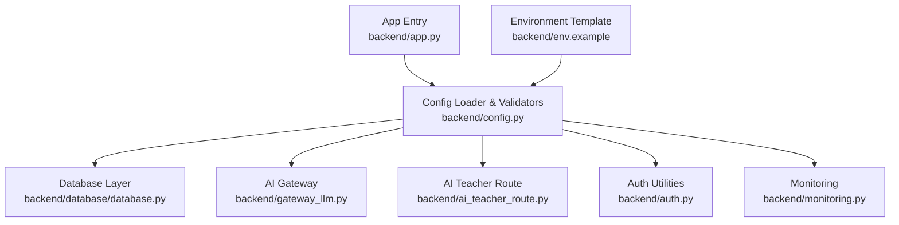
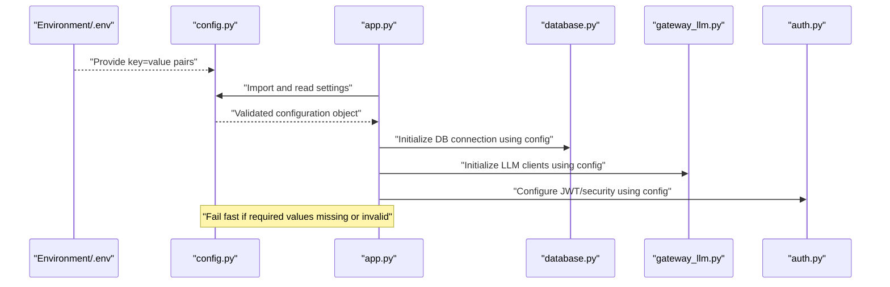
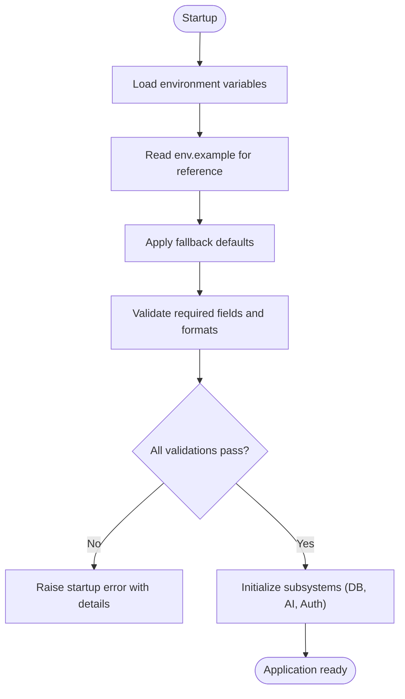
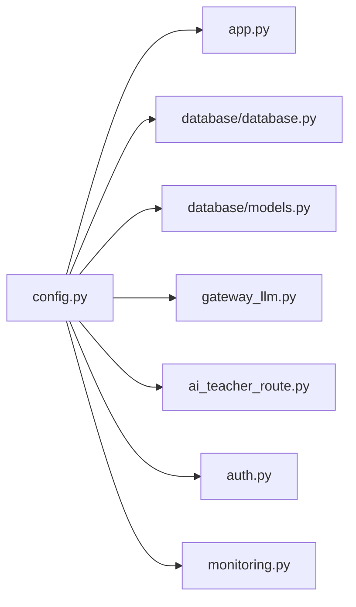

# Backend Environment Configuration

<cite>
**Referenced Files in This Document**
- [config.py](file://backend/config.py)
- [env.example](file://backend/env.example)
- [app.py](file://backend/app.py)
- [database.py](file://backend/database/database.py)
- [models.py](file://backend/database/models.py)
- [gateway_llm.py](file://backend/gateway_llm.py)
- [ai_teacher_route.py](file://backend/ai_teacher_route.py)
- [auth.py](file://backend/auth.py)
- [monitoring.py](file://backend/monitoring.py)
- [test_config.py](file://backend/tests/test_config.py)
</cite>

## Table of Contents
1. [Introduction](#introduction)
2. [Project Structure](#project-structure)
3. [Core Components](#core-components)
4. [Architecture Overview](#architecture-overview)
5. [Detailed Component Analysis](#detailed-component-analysis)
6. [Dependency Analysis](#dependency-analysis)
7. [Performance Considerations](#performance-considerations)
8. [Troubleshooting Guide](#troubleshooting-guide)
9. [Conclusion](#conclusion)
10. [Appendices](#appendices)

## Introduction
This document explains how the XSYY Edu backend loads, validates, and uses environment configuration. It focuses on:
- All environment variables defined in env.example
- How config.py reads and validates these values with fallback defaults
- Examples of .env files for development, staging, and production
- Validation mechanisms, error handling, and security best practices for sensitive values (API keys, database passwords)

The goal is to help developers and operators configure the system safely and reliably across environments.

## Project Structure
Configuration-related code and assets are primarily located under the backend directory:
- Configuration loader and validators: backend/config.py
- Example environment template: backend/env.example
- Application entrypoint that imports configuration: backend/app.py
- Database layer that consumes DB settings: backend/database/database.py, backend/database/models.py
- AI gateway and routes that consume LLM credentials: backend/gateway_llm.py, backend/ai_teacher_route.py
- Security utilities used by auth: backend/auth.py
- Monitoring and health checks that may depend on configuration: backend/monitoring.py
- Tests validating configuration behavior: backend/tests/test_config.py

**Diagram sources**
- [app.py](file://backend/app.py)
- [config.py](file://backend/config.py)
- [database.py](file://backend/database/database.py)
- [gateway_llm.py](file://backend/gateway_llm.py)
- [ai_teacher_route.py](file://backend/ai_teacher_route.py)
- [auth.py](file://backend/auth.py)
- [monitoring.py](file://backend/monitoring.py)
- [env.example](file://backend/env.example)

**Section sources**
- [config.py](file://backend/config.py)
- [env.example](file://backend/env.example)
- [app.py](file://backend/app.py)

## Core Components
- Configuration loader and validators: centralizes reading from environment variables, applies defaults, performs validation, and exposes typed accessors.
- Environment template: documents all supported variables with comments and example values.
- Consumers: application modules import configuration to initialize services (database, AI providers, storage paths, security).

Key responsibilities:
- Load variables from environment or .env file
- Provide typed getters with default fallbacks
- Validate required fields and formats
- Fail fast on invalid configurations during startup

**Section sources**
- [config.py](file://backend/config.py)
- [env.example](file://backend/env.example)

## Architecture Overview
The configuration architecture follows a single source of truth pattern:
- env.example defines the contract for all environment variables
- config.py implements loading and validation logic
- Modules import configuration at startup and use it to initialize subsystems

**Diagram sources**
- [config.py](file://backend/config.py)
- [app.py](file://backend/app.py)
- [database.py](file://backend/database/database.py)
- [gateway_llm.py](file://backend/gateway_llm.py)
- [auth.py](file://backend/auth.py)

## Detailed Component Analysis

### Configuration Loading and Validation (config.py)
- Loads environment variables and supports .env via standard Python patterns
- Provides typed getters with safe defaults where appropriate
- Validates critical settings (e.g., presence of API keys, valid URLs, non-empty secrets)
- Raises clear errors early if required configuration is missing or malformed

Typical behaviors:
- Missing required variables cause startup failure with descriptive messages
- Optional variables fall back to sensible defaults
- Sensitive values are never logged; only masked or omitted in diagnostics

Security considerations:
- Do not hardcode secrets in source
- Use environment-only injection for secrets
- Avoid printing secrets in logs or error traces

**Section sources**
- [config.py](file://backend/config.py)

### Environment Variables Reference (env.example)
The following categories are covered by the environment template:
- Database connections
  - Host, port, user, password, database name
  - Connection pool size and timeouts
- AI service credentials
  - Gemini API key and model settings
  - DeepSeek API key and model settings
- Storage paths
  - Local storage root path
  - Temporary upload directory
- Security settings
  - Secret key for signing tokens
  - Allowed origins for CORS
  - Token expiration times
- Logging and monitoring
  - Log level
  - Health check endpoints

How to use:
- Copy env.example to .env
- Fill in values per environment
- Ensure .env is excluded from version control

Validation expectations:
- Required fields must be present and non-empty
- URL-like fields must match expected patterns
- Numeric fields must parse correctly

**Section sources**
- [env.example](file://backend/env.example)

### Consumer Integration Points

#### Database Initialization (database.py, models.py)
- Reads DB host, port, user, password, and database name from configuration
- Establishes connection pools and sets timeouts based on config
- Uses models to interact with schema

Best practices:
- Rotate DB passwords regularly
- Use least-privilege DB accounts per environment
- Validate connectivity at startup

**Section sources**
- [database.py](file://backend/database/database.py)
- [models.py](file://backend/database/models.py)

#### AI Gateway and Routes (gateway_llm.py, ai_teacher_route.py)
- Initializes Gemini client with API key and model parameters
- Initializes DeepSeek client with API key and model parameters
- Routes handle requests and stream responses using configured providers

Operational notes:
- Configure rate limits and retries via provider SDK settings when available
- Monitor usage and costs through provider dashboards
- Handle provider-specific errors gracefully

**Section sources**
- [gateway_llm.py](file://backend/gateway_llm.py)
- [ai_teacher_route.py](file://backend/ai_teacher_route.py)

#### Authentication and Security (auth.py)
- Uses secret key to sign tokens
- Applies token expiration and refresh policies from configuration
- Enforces CORS allowed origins

Security guidance:
- Keep secret key unique per environment
- Store secrets in secure secret managers in production
- Restrict CORS to known domains

**Section sources**
- [auth.py](file://backend/auth.py)

#### Monitoring and Health Checks (monitoring.py)
- Exposes health endpoints that may depend on DB and AI connectivity
- Reports readiness/liveness based on configuration and runtime state

**Section sources**
- [monitoring.py](file://backend/monitoring.py)

### Configuration Flowchart

**Diagram sources**
- [config.py](file://backend/config.py)
- [env.example](file://backend/env.example)

## Dependency Analysis
Configuration consumers depend on config.py for consistent settings. The diagram shows direct dependencies:

**Diagram sources**
- [config.py](file://backend/config.py)
- [app.py](file://backend/app.py)
- [database.py](file://backend/database/database.py)
- [models.py](file://backend/database/models.py)
- [gateway_llm.py](file://backend/gateway_llm.py)
- [ai_teacher_route.py](file://backend/ai_teacher_route.py)
- [auth.py](file://backend/auth.py)
- [monitoring.py](file://backend/monitoring.py)

**Section sources**
- [config.py](file://backend/config.py)

## Performance Considerations
- Tune database pool sizes and timeouts according to workload
- Set appropriate log levels to reduce I/O overhead in production
- Cache provider client instances where possible to avoid repeated initialization
- Use connection reuse and keep-alive for external services

[No sources needed since this section provides general guidance]

## Troubleshooting Guide
Common issues and resolutions:
- Missing required environment variable: ensure .env contains all required keys; verify precedence of environment vs .env
- Invalid format (URLs, ports): correct syntax and ranges; validate with provided checks
- Startup failures due to validation: inspect error messages for exact field names
- Secrets not applied: confirm secret manager integration and process environment visibility

Verification steps:
- Run configuration tests to assert expected behavior
- Check health endpoints after startup to confirm subsystem readiness

**Section sources**
- [test_config.py](file://backend/tests/test_config.py)

## Conclusion
A robust configuration strategy ensures reliable operation across environments. By centralizing loading and validation in config.py, referencing env.example, and integrating securely with consumers, the XSYY Edu backend maintains clarity, safety, and operational stability. Follow the best practices outlined here to manage secrets, validate inputs, and troubleshoot effectively.

[No sources needed since this section summarizes without analyzing specific files]

## Appendices

### Example .env Templates

- Development
  - Use local database credentials
  - Enable verbose logging
  - Allow localhost origins
  - Use test API keys or placeholders

- Staging
  - Use staging database and network endpoints
  - Moderate logging level
  - Restrict CORS to staging domains
  - Use staging API keys with lower quotas

- Production
  - Use hardened database credentials and TLS
  - Minimal logging level
  - Strict CORS policy
  - Inject secrets via secure secret manager
  - Enable monitoring and alerting

[No sources needed since this section provides conceptual examples]