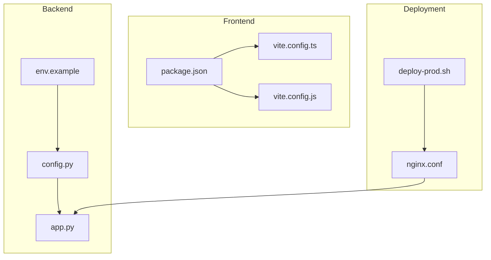
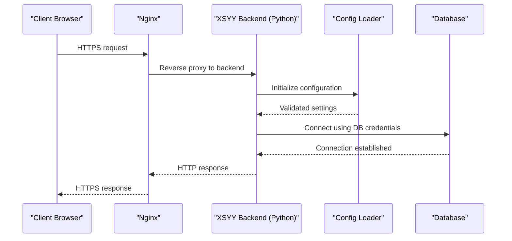
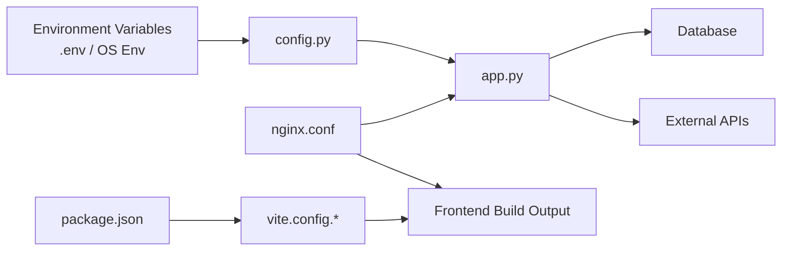

# Environment Configuration

<cite>
**Referenced Files in This Document**
- [env.example](file://backend/env.example)
- [config.py](file://backend/config.py)
- [app.py](file://backend/app.py)
- [nginx.conf](file://deploy/nginx.conf)
- [package.json](file://web/package.json)
- [vite.config.ts](file://web/vite.config.ts)
- [vite.config.js](file://web/vite.config.js)
- [deploy-prod.sh](file://deploy/deploy-prod.sh)
- [check-env.bat](file://backend/check-env.bat)
</cite>

## Table of Contents
1. [Introduction](#introduction)
2. [Project Structure](#project-structure)
3. [Core Components](#core-components)
4. [Architecture Overview](#architecture-overview)
5. [Detailed Component Analysis](#detailed-component-analysis)
6. [Dependency Analysis](#dependency-analysis)
7. [Performance Considerations](#performance-considerations)
8. [Troubleshooting Guide](#troubleshooting-guide)
9. [Conclusion](#conclusion)
10. [Appendices](#appendices)

## Introduction
This document provides comprehensive environment configuration guidance for the XSYY Edu platform. It covers:
- All environment variables defined in the backend env example, their purposes, defaults, and security considerations
- The centralized backend configuration module and how it loads environment-specific settings
- Nginx production configuration including SSL setup, reverse proxy, and performance tuning
- Frontend build configuration via package.json and Vite settings
- Example .env files for development, staging, and production
- Configuration validation and error handling mechanisms

## Project Structure
The XSYY Edu platform is organized into a Python backend and a TypeScript/Vite frontend with deployment tooling:
- Backend configuration and runtime are centered around a single config module that reads environment variables and initializes services
- Nginx serves as the reverse proxy and TLS terminator for production
- Frontend builds are driven by Vite and packaged through npm scripts

**Diagram sources**
- [config.py](file://backend/config.py)
- [app.py](file://backend/app.py)
- [env.example](file://backend/env.example)
- [package.json](file://web/package.json)
- [vite.config.ts](file://web/vite.config.ts)
- [vite.config.js](file://web/vite.config.js)
- [nginx.conf](file://deploy/nginx.conf)
- [deploy-prod.sh](file://deploy/deploy-prod.sh)

**Section sources**
- [env.example](file://backend/env.example)
- [config.py](file://backend/config.py)
- [app.py](file://backend/app.py)
- [package.json](file://web/package.json)
- [vite.config.ts](file://web/vite.config.ts)
- [vite.config.js](file://web/vite.config.js)
- [nginx.conf](file://deploy/nginx.conf)
- [deploy-prod.sh](file://deploy/deploy-prod.sh)

## Core Components
- Backend configuration loader: centralizes all environment-driven settings, validates presence/types, and exposes typed accessors to the application
- Nginx reverse proxy: terminates TLS, proxies to the backend, and applies performance/security headers
- Frontend build system: Vite-based pipeline configured via package.json scripts and Vite config files

Key responsibilities:
- Load and validate environment variables at startup
- Provide consistent configuration across modules
- Securely expose secrets only where needed
- Ensure reproducible builds with deterministic configs

**Section sources**
- [config.py](file://backend/config.py)
- [app.py](file://backend/app.py)
- [nginx.conf](file://deploy/nginx.conf)
- [package.json](file://web/package.json)
- [vite.config.ts](file://web/vite.config.ts)
- [vite.config.js](file://web/vite.config.js)

## Architecture Overview
At runtime, the backend reads environment variables from the process environment or .env files (if supported), validates them, and constructs configuration objects used throughout the app. Nginx sits in front, terminating HTTPS and forwarding requests to the backend service. The frontend is built separately and served statically by Nginx.

**Diagram sources**
- [nginx.conf](file://deploy/nginx.conf)
- [app.py](file://backend/app.py)
- [config.py](file://backend/config.py)

## Detailed Component Analysis

### Backend Configuration Module (config.py)
The centralized configuration module:
- Loads environment variables required for database connectivity, external APIs, caching, logging, and feature toggles
- Provides typed getters and default values
- Validates critical settings at import/initialization time
- Exposes a configuration object consumed by routes, services, and utilities

Typical categories of variables:
- Database connection parameters (host, port, user, password, name, pool size)
- External API keys and endpoints (e.g., LLM providers, storage backends)
- Security tokens (JWT secret, session cookie settings)
- Feature flags and limits (rate limiting, quotas)
- Logging and monitoring levels

Security considerations:
- Never hardcode secrets; always source from environment
- Enforce minimum complexity for passwords and token lengths
- Restrict allowed origins and CORS policies based on environment
- Use least-privilege credentials for database and storage

Validation and error handling:
- Missing required variables cause explicit startup errors
- Type coercion and range checks prevent misconfiguration
- Sensitive values are masked in logs

**Section sources**
- [config.py](file://backend/config.py)

### Application Initialization (app.py)
The application entrypoint:
- Initializes the configuration module before any route registration
- Sets up middleware (CORS, auth, rate limiting) based on configuration
- Registers health and diagnostic endpoints
- Starts the server with appropriate workers/timeouts per environment

Integration points:
- Database initialization uses configuration values
- External clients (LLM, storage) are constructed with validated settings
- Logging level and output destinations are set from configuration

**Section sources**
- [app.py](file://backend/app.py)

### Nginx Production Configuration (nginx.conf)
Nginx acts as the TLS terminator and reverse proxy:
- SSL/TLS termination with certificate paths and cipher suites
- Reverse proxy rules to forward API traffic to the backend
- Static asset serving for the frontend build output
- Performance tuning: gzip/brotli compression, buffering, keepalive, worker processes
- Security headers: HSTS, CSP, X-Frame-Options, Referrer-Policy
- Access and error logging for observability

Best practices:
- Pin TLS versions and prefer modern ciphers
- Enable OCSP stapling if available
- Configure client body size limits appropriately
- Separate upstreams for different environments when needed

**Section sources**
- [nginx.conf](file://deploy/nginx.conf)

### Frontend Build Configuration (package.json and Vite)
Build system overview:
- package.json defines scripts for development, building, and preview
- Vite configuration controls dev server, build targets, plugins, and optimization
- Environment variables can be exposed to the frontend via Vite’s env handling

Key aspects:
- Development server hot reload and proxy settings for local API calls
- Production build optimizations: minification, code splitting, tree-shaking
- Asset handling and path resolution for static resources
- Optional environment variable injection for non-sensitive UI behavior

Security note:
- Do not inject secrets into the frontend bundle; use backend-only variables

**Section sources**
- [package.json](file://web/package.json)
- [vite.config.ts](file://web/vite.config.ts)
- [vite.config.js](file://web/vite.config.js)

### Deployment Scripts
- deploy-prod.sh orchestrates production deployment steps such as pulling latest code, running migrations, rebuilding assets, and restarting services
- Ensures environment consistency and rollback readiness

**Section sources**
- [deploy-prod.sh](file://deploy/deploy-prod.sh)

## Dependency Analysis
Configuration dependencies flow from environment variables into the configuration module, which then influences application behavior and infrastructure components.

**Diagram sources**
- [config.py](file://backend/config.py)
- [app.py](file://backend/app.py)
- [nginx.conf](file://deploy/nginx.conf)
- [package.json](file://web/package.json)
- [vite.config.ts](file://web/vite.config.ts)
- [vite.config.js](file://web/vite.config.js)

**Section sources**
- [config.py](file://backend/config.py)
- [app.py](file://backend/app.py)
- [nginx.conf](file://deploy/nginx.conf)
- [package.json](file://web/package.json)
- [vite.config.ts](file://web/vite.config.ts)
- [vite.config.js](file://web/vite.config.js)

## Performance Considerations
- Backend:
  - Tune database connection pools and timeouts based on expected load
  - Adjust worker/process counts for the WSGI/ASGI server
  - Enable caching layers where applicable (in-memory or Redis)
- Nginx:
  - Enable gzip/brotli compression for text assets
  - Set appropriate proxy buffers and timeouts
  - Use keepalive connections to upstreams
- Frontend:
  - Leverage Vite’s code splitting and lazy loading
  - Minimize bundle size with selective imports
  - Cache-bust assets via hashed filenames

[No sources needed since this section provides general guidance]

## Troubleshooting Guide
Common issues and resolutions:
- Missing environment variables:
  - Validate required keys exist before starting the app
  - Use check-env.bat to verify critical variables locally
- Database connection failures:
  - Verify host, port, credentials, and network reachability
  - Check connection pool settings and max retries
- SSL/TLS errors:
  - Confirm certificate paths and permissions
  - Ensure correct domain names and DNS resolution
- Frontend build errors:
  - Clear node_modules and reinstall dependencies
  - Validate Vite config syntax and plugin compatibility

Error handling mechanisms:
- Centralized configuration validation raises descriptive errors on startup
- Health endpoints report component status (DB, external APIs)
- Structured logging captures configuration-related warnings and errors

**Section sources**
- [check-env.bat](file://backend/check-env.bat)
- [config.py](file://backend/config.py)
- [app.py](file://backend/app.py)

## Conclusion
A robust configuration strategy ensures XSYY Edu runs reliably across environments. By centralizing configuration, validating inputs, securing secrets, and tuning both backend and Nginx for performance, teams can maintain consistency and reduce operational risk. Follow the examples and best practices outlined here to configure development, staging, and production environments effectively.

[No sources needed since this section summarizes without analyzing specific files]

## Appendices

### Environment Variables Reference
Below is a categorized reference of environment variables typically defined in the backend env example. Replace placeholders with your actual values and ensure sensitive fields are managed securely.

- Database
  - DB_HOST: Hostname or IP of the database server
  - DB_PORT: Port number for database connections
  - DB_USER: Username for database authentication
  - DB_PASSWORD: Password for database authentication
  - DB_NAME: Database schema name
  - DB_POOL_SIZE: Maximum number of persistent connections
  - DB_TIMEOUT: Connection timeout in seconds
  - Security: Mask in logs; enforce strong passwords; restrict network access

- External APIs
  - API_KEY_LLM: Secret key for LLM provider
  - API_BASE_URL_LLM: Base URL for LLM API
  - STORAGE_BACKEND: Storage provider identifier
  - STORAGE_ACCESS_KEY: Access key for storage
  - STORAGE_SECRET_KEY: Secret key for storage
  - Security: Rotate regularly; scope to least privilege; never commit to repo

- Security and Sessions
  - JWT_SECRET: Signing secret for JWT tokens
  - SESSION_COOKIE_SECURE: Force secure cookies over HTTPS
  - CORS_ALLOWED_ORIGINS: Comma-separated list of allowed origins
  - Security: Use high-entropy secrets; validate origins strictly

- Application Settings
  - APP_ENV: Environment name (development, staging, production)
  - LOG_LEVEL: Logging verbosity (DEBUG, INFO, WARNING, ERROR)
  - RATE_LIMIT_ENABLED: Enable/disable rate limiting
  - RATE_LIMIT_REQUESTS: Max requests per window
  - RATE_LIMIT_WINDOW: Window duration in seconds

- Frontend Build Variables
  - VITE_API_BASE_URL: Base URL for frontend API calls
  - VITE_FEATURE_FLAGS: JSON string of feature toggles
  - Security: Only non-sensitive values should be injected into the frontend

Example .env templates:
- Development (.env.development):
  - DB_HOST=localhost
  - DB_PORT=5432
  - DB_USER=dev_user
  - DB_PASSWORD=dev_password
  - DB_NAME=xsyy_dev
  - APP_ENV=development
  - LOG_LEVEL=DEBUG
  - VITE_API_BASE_URL=http://localhost:8000

- Staging (.env.staging):
  - DB_HOST=staging-db.internal
  - DB_PORT=5432
  - DB_USER=staging_user
  - DB_PASSWORD=<strong-staging-password>
  - DB_NAME=xsyy_staging
  - APP_ENV=staging
  - LOG_LEVEL=INFO
  - VITE_API_BASE_URL=https://api.staging.xsyy.edu

- Production (.env.production):
  - DB_HOST=prod-db.internal
  - DB_PORT=5432
  - DB_USER=prod_user
  - DB_PASSWORD=<strong-prod-password>
  - DB_NAME=xsyy_prod
  - APP_ENV=production
  - LOG_LEVEL=WARNING
  - VITE_API_BASE_URL=https://api.xsyy.edu

[No sources needed since this section provides general guidance]

### Nginx Configuration Checklist
- SSL/TLS
  - Certificate and key paths configured correctly
  - Modern TLS versions enabled; weak ciphers disabled
  - HSTS header set with appropriate max-age
- Reverse Proxy
  - Upstream pointing to backend service address/port
  - Proxy headers forwarded (Host, X-Real-IP, X-Forwarded-Proto)
  - Timeouts tuned for long-running requests
- Performance
  - gzip/brotli enabled for text types
  - Worker processes aligned with CPU cores
  - Buffer sizes optimized for payload sizes
- Security
  - Security headers applied (X-Frame-Options, CSP, Referrer-Policy)
  - Rate limiting and request size limits configured
  - Access logs rotated and monitored

[No sources needed since this section provides general guidance]

### Frontend Build Notes
- Scripts
  - Development: start dev server with hot reload
  - Build: generate optimized production assets
  - Preview: serve built assets locally for testing
- Vite Settings
  - Define base path and public directory
  - Configure plugins for TypeScript, CSS processing, and optimization
  - Inject non-sensitive environment variables for UI behavior

[No sources needed since this section provides general guidance]