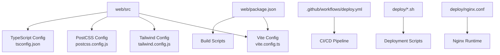
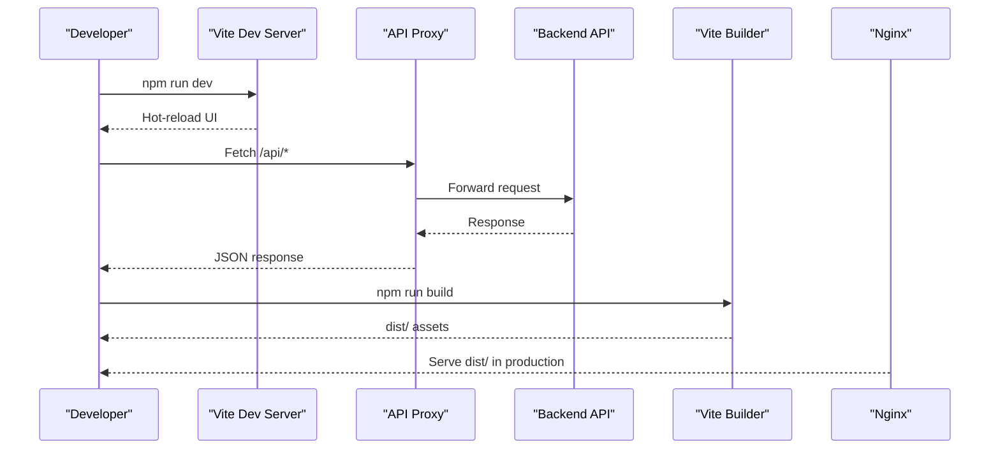
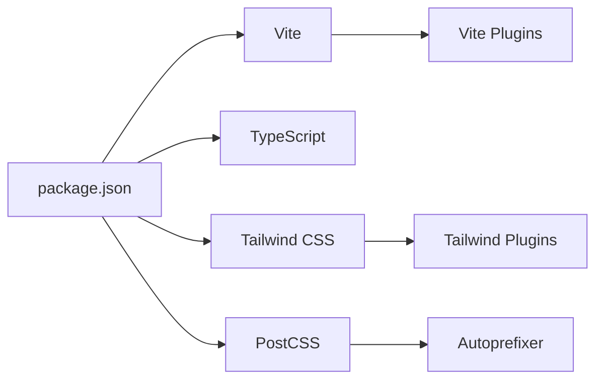

# Frontend Build Configuration

<cite>
**Referenced Files in This Document**
- [package.json](file://web/package.json)
- [vite.config.ts](file://web/vite.config.ts)
- [tailwind.config.js](file://web/tailwind.config.js)
- [tsconfig.json](file://web/tsconfig.json)
- [postcss.config.js](file://web/postcss.config.js)
- [deploy.yml](file://.github/workflows/deploy.yml)
- [deploy.sh](file://deploy/deploy.sh)
- [nginx.conf](file://deploy/nginx.conf)
</cite>

## Table of Contents
1. [Introduction](#introduction)
2. [Project Structure](#project-structure)
3. [Core Components](#core-components)
4. [Architecture Overview](#architecture-overview)
5. [Detailed Component Analysis](#detailed-component-analysis)
6. [Dependency Analysis](#dependency-analysis)
7. [Performance Considerations](#performance-considerations)
8. [Troubleshooting Guide](#troubleshooting-guide)
9. [Conclusion](#conclusion)

## Introduction
This document explains the frontend build configuration for the XSYY Edu platform. It covers package.json scripts, dependency management, Vite configuration (development server, build optimization, asset handling, proxy), Tailwind CSS customization, and TypeScript compilation settings. It also includes environment-specific configurations and deployment optimizations.

## Project Structure
The frontend lives under web/ and uses a modern stack:
- Vite as the build tool and dev server
- TypeScript for type-safe development
- Tailwind CSS with PostCSS for styling
- Node.js-based scripts for building and deployment

[No sources needed since this diagram shows conceptual workflow, not actual code structure]

## Core Components
- Package scripts define local development, building, and deployment workflows.
- Vite config centralizes dev server, proxying, optimization, and output settings.
- Tailwind config defines theme tokens and plugin usage.
- TypeScript config controls compilation targets and module resolution.
- CI/CD and deploy scripts automate builds and deployments.

**Section sources**
- [package.json](file://web/package.json)
- [vite.config.ts](file://web/vite.config.ts)
- [tailwind.config.js](file://web/tailwind.config.js)
- [tsconfig.json](file://web/tsconfig.json)
- [postcss.config.js](file://web/postcss.config.js)
- [deploy.yml](file://.github/workflows/deploy.yml)
- [deploy.sh](file://deploy/deploy.sh)
- [nginx.conf](file://deploy/nginx.conf)

## Architecture Overview
The frontend build pipeline transforms source code into optimized static assets served by Nginx. The dev server proxies API calls to the backend during development.

**Diagram sources**
- [vite.config.ts](file://web/vite.config.ts)
- [nginx.conf](file://deploy/nginx.conf)

## Detailed Component Analysis

### package.json: Scripts and Dependencies
- Scripts typically include:
  - Development: start dev server with hot reload
  - Build: create production-optimized bundle
  - Preview: serve built assets locally
  - Type-check: validate TypeScript without emitting files
  - Deploy-related commands for CI/CD
- Dependencies usually include:
  - Vite and plugins
  - TypeScript and ts-node
  - Tailwind CSS and PostCSS
  - React or framework libraries if applicable
  - Axios or fetch wrappers for API calls

Operational notes:
- Use environment variables via .env files loaded by Vite.
- Separate dev and prod dependencies where possible.
- Pin versions for reproducible builds.

**Section sources**
- [package.json](file://web/package.json)

### Vite Configuration: Dev Server, Build, Assets, Proxy
Key areas covered by vite.config.ts:
- Development server:
  - Host/port configuration
  - Open browser automatically
  - Enable HMR and inline CSS
- Build options:
  - Output directory (dist/)
  - Minification and sourcemaps
  - Chunk splitting and code splitting
  - Asset handling (images, fonts, SVGs)
  - Externalization of large dependencies
- Proxy settings:
  - Route /api requests to backend during dev
  - Handle CORS and cookie domains
- Environment variables:
  - Prefix with VITE_ for client-side access
  - Load from .env.development/.env.production

Common patterns:
- Conditional configs per mode (development vs production)
- Plugin chain for TypeScript, React, Tailwind integration
- Custom resolve aliases for imports

**Section sources**
- [vite.config.ts](file://web/vite.config.ts)

### Tailwind CSS Configuration: Styling and Theme
tailwind.config.js typically defines:
- Content paths to purge unused styles
- Theme extensions: colors, spacing, typography, breakpoints
- Plugins: forms, typography, animations
- Dark mode strategy
- Custom utilities and component classes

Best practices:
- Keep content globs precise to reduce build size
- Centralize design tokens in theme
- Use responsive and accessibility-friendly utilities

**Section sources**
- [tailwind.config.js](file://web/tailwind.config.js)

### PostCSS Configuration
postcss.config.js integrates Tailwind and other processors:
- Tailwind CSS plugin
- Autoprefixer for vendor prefixes
- Optional CSS minifier in production

Ensure order: tailwind -> autoprefixer -> minify.

**Section sources**
- [postcss.config.js](file://web/postcss.config.js)

### TypeScript Configuration
tsconfig.json controls compilation:
- Target and module settings
- Strictness flags for type safety
- Path aliases for cleaner imports
- JSX/React support if applicable
- Exclude node_modules and generated files

Recommendations:
- Enable strict mode for robust typing
- Use path mapping for consistent import resolution
- Separate app and node configs when needed

**Section sources**
- [tsconfig.json](file://web/tsconfig.json)

### CI/CD and Deployment
- GitHub Actions (.github/workflows/deploy.yml):
  - Checkout code
  - Install dependencies
  - Run tests and type checks
  - Build production assets
  - Upload artifacts or deploy to server
- Shell scripts (deploy/*.sh):
  - Pull latest code
  - Build frontend
  - Sync to web root
  - Restart services if needed
- Nginx (deploy/nginx.conf):
  - Serve static assets from dist/
  - Reverse proxy API routes to backend
  - Enable caching headers and compression

**Section sources**
- [deploy.yml](file://.github/workflows/deploy.yml)
- [deploy.sh](file://deploy/deploy.sh)
- [nginx.conf](file://deploy/nginx.conf)

## Dependency Analysis
Frontend dependencies are managed through package.json and resolved by the package manager. Typical categories:
- Build toolchain: Vite, TypeScript, PostCSS
- Styling: Tailwind CSS, plugins
- Runtime: framework libraries, API clients
- Tooling: ESLint, Prettier (optional)

**Diagram sources**
- [package.json](file://web/package.json)
- [vite.config.ts](file://web/vite.config.ts)
- [tailwind.config.js](file://web/tailwind.config.js)
- [postcss.config.js](file://web/postcss.config.js)

**Section sources**
- [package.json](file://web/package.json)

## Performance Considerations
- Code splitting:
  - Route-level lazy loading
  - Dynamic imports for heavy components
- Asset optimization:
  - Compress images (WebP/AVIF)
  - Inline critical CSS
  - Cache immutable assets with content hashes
- Bundle analysis:
  - Use Vite’s bundle analyzer to identify large chunks
- Dev experience:
  - Enable incremental builds
  - Limit unnecessary plugins in dev mode

[No sources needed since this section provides general guidance]

## Troubleshooting Guide
Common issues and resolutions:
- Port conflicts:
  - Change dev server port in Vite config
- Proxy failures:
  - Verify backend URL and CORS settings
  - Check network reachability from dev machine
- Tailwind not applying:
  - Ensure content paths include all template files
  - Rebuild after adding new class names
- TypeScript errors blocking build:
  - Fix strict mode violations
  - Add type declarations for third-party modules
- Large bundle size:
  - Externalize heavy libraries
  - Remove unused dependencies
- Deployment problems:
  - Validate nginx routing rules
  - Confirm environment variables are set on the server

**Section sources**
- [vite.config.ts](file://web/vite.config.ts)
- [tailwind.config.js](file://web/tailwind.config.js)
- [tsconfig.json](file://web/tsconfig.json)
- [nginx.conf](file://deploy/nginx.conf)

## Conclusion
XSYY Edu’s frontend build is centered around Vite with TypeScript and Tailwind CSS. The configuration emphasizes fast development, reliable builds, and efficient production assets. By following the documented patterns for scripts, environment variables, proxying, and deployment, teams can maintain a smooth workflow from local development to production.