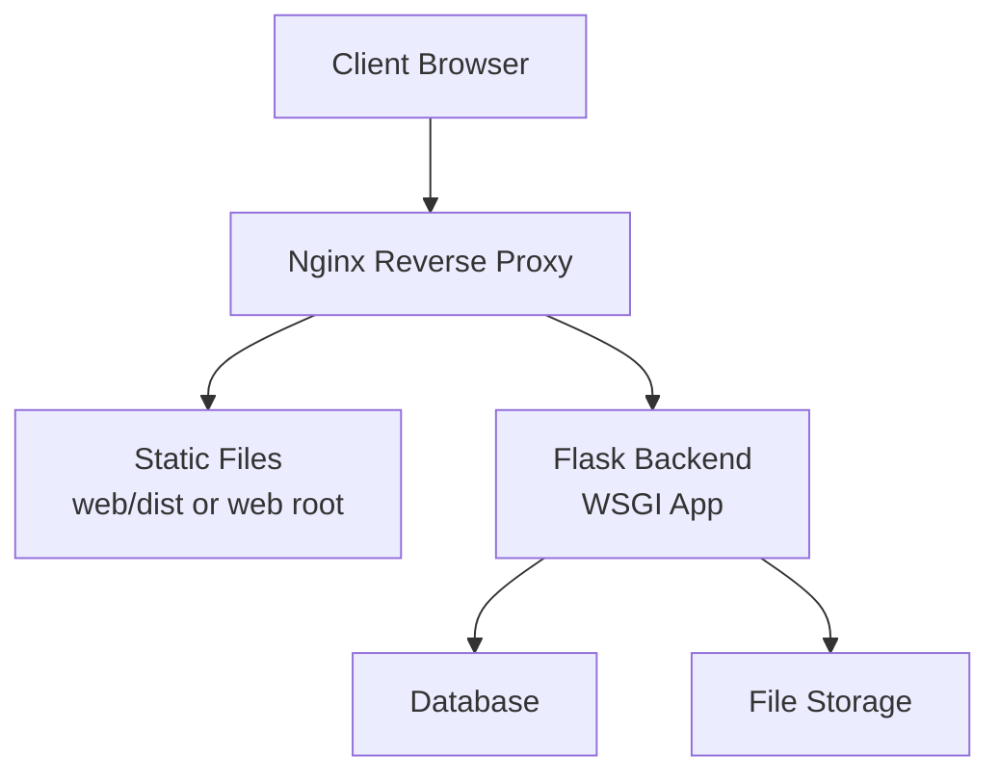
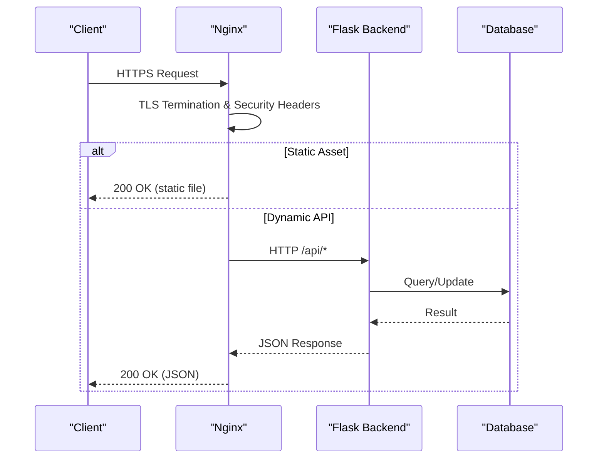
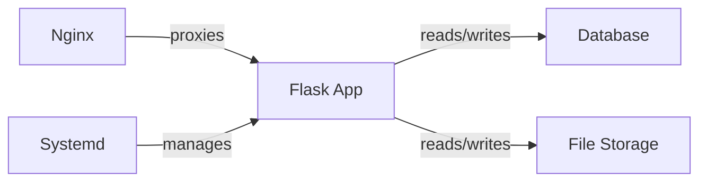

# Server & Proxy Configuration

<cite>
**Referenced Files in This Document**
- [nginx.conf](file://deploy/nginx.conf)
- [xsyy-backend.service](file://deploy/xsyy-backend.service)
- [DEPLOYMENT.md](file://deploy/DEPLOYMENT.md)
- [app.py](file://backend/app.py)
- [config.py](file://backend/config.py)
- [start.bat](file://backend/start.bat)
- [check_server_status.sh](file://backend/check_server_status.sh)
- [restart_all_services.sh](file://backend/restart_all_services.sh)
- [monitoring.py](file://backend/monitoring.py)
- [PERFORMANCE_OPTIMIZATION.md](file://backend/PERFORMANCE_OPTIMIZATION.md)
</cite>

## Table of Contents
1. [Introduction](#introduction)
2. [Project Structure](#project-structure)
3. [Core Components](#core-components)
4. [Architecture Overview](#architecture-overview)
5. [Detailed Component Analysis](#detailed-component-analysis)
6. [Dependency Analysis](#dependency-analysis)
7. [Performance Considerations](#performance-considerations)
8. [Troubleshooting Guide](#troubleshooting-guide)
9. [Conclusion](#conclusion)

## Introduction
This document provides production-grade guidance for configuring and operating the XSYY Edu platform’s server and proxy layer. It focuses on Nginx reverse proxy setup for the Flask backend, SSL/TLS configuration, static file serving, performance tuning, systemd service management, load balancing considerations, caching strategies, security headers, and troubleshooting common proxy issues. The content is derived from the repository’s deployment artifacts and backend application files to ensure accuracy and practical applicability.

## Project Structure
The relevant components for server and proxy configuration are primarily located under:
- deploy/: Deployment scripts, Nginx configuration, and systemd unit file
- backend/: Flask application entry point, configuration, startup scripts, monitoring, and performance notes

**Diagram sources**
- [nginx.conf](file://deploy/nginx.conf)
- [app.py](file://backend/app.py)

**Section sources**
- [DEPLOYMENT.md](file://deploy/DEPLOYMENT.md)
- [app.py](file://backend/app.py)

## Core Components
- Nginx reverse proxy configuration for routing API requests to the Flask backend and serving static assets efficiently.
- Systemd service definition for process supervision, auto-start, and logging.
- Flask application configuration and runtime parameters that influence proxy behavior (e.g., host/port, CORS, HTTPS handling).
- Monitoring and health endpoints used by Nginx and external tools.

Key files:
- Nginx configuration: [nginx.conf](file://deploy/nginx.conf)
- Systemd unit: [xsyy-backend.service](file://deploy/xsyy-backend.service)
- Flask app entry: [app.py](file://backend/app.py)
- App configuration: [config.py](file://backend/config.py)
- Health/status checks: [check_server_status.sh](file://backend/check_server_status.sh), [monitoring.py](file://backend/monitoring.py)

**Section sources**
- [nginx.conf](file://deploy/nginx.conf)
- [xsyy-backend.service](file://deploy/xsyy-backend.service)
- [app.py](file://backend/app.py)
- [config.py](file://backend/config.py)
- [check_server_status.sh](file://backend/check_server_status.sh)
- [monitoring.py](file://backend/monitoring.py)

## Architecture Overview
The production architecture uses Nginx as the public-facing reverse proxy. Nginx terminates TLS, serves static content, applies security headers, and proxies dynamic requests to the Flask backend running behind it. Systemd manages the backend process lifecycle.

**Diagram sources**
- [nginx.conf](file://deploy/nginx.conf)
- [app.py](file://backend/app.py)

**Section sources**
- [DEPLOYMENT.md](file://deploy/DEPLOYMENT.md)

## Detailed Component Analysis

### Nginx Reverse Proxy Configuration
Responsibilities:
- Terminate SSL/TLS with certificates
- Serve static files directly for performance
- Proxy API requests to the Flask backend over a local port or Unix socket
- Apply security headers and rate limiting
- Configure buffering and timeouts appropriate for long-running AI tasks

Key areas to review:
- Upstream definitions for the Flask backend
- Location blocks for static assets and API routes
- SSL certificate paths and protocols/ciphers
- Proxy headers forwarding client IP and scheme
- Buffering and timeout settings for streaming responses

Operational tips:
- Validate configuration before reload
- Use separate log files per site for easier debugging
- Ensure proper permissions for certificate files and static directories

**Section sources**
- [nginx.conf](file://deploy/nginx.conf)

### Systemd Service Configuration
Responsibilities:
- Manage the Flask backend process lifecycle (start, stop, restart)
- Ensure auto-start on boot
- Provide robust logging via journald
- Set resource limits and environment variables

Key areas to review:
- ExecStart path and arguments pointing to the Python virtualenv and app entry
- WorkingDirectory and EnvironmentFile for configuration
- Restart policies and watchdog settings
- User/group permissions and file access

Operational tips:
- Use a dedicated user for the backend process
- Pin Python version and dependencies in the virtualenv
- Monitor logs with journalctl and set up log rotation if needed

**Section sources**
- [xsyy-backend.service](file://deploy/xsyy-backend.service)

### Flask Backend Configuration and Runtime
Responsibilities:
- Bind to internal interfaces only when proxied by Nginx
- Handle CORS appropriately for admin and user clients
- Expose health and monitoring endpoints for probes
- Configure database connections and storage backends

Key areas to review:
- Host/port binding and debug mode toggles
- Secret keys and token configurations
- Database URL and connection pool settings
- File storage paths and permissions

Operational tips:
- Disable debug mode in production
- Use environment variables for secrets
- Enable structured logging for observability

**Section sources**
- [app.py](file://backend/app.py)
- [config.py](file://backend/config.py)

### Health Checks and Monitoring
Responsibilities:
- Provide lightweight endpoints for liveness/readiness probes
- Track metrics such as request counts, error rates, and latency
- Support automated restarts and alerting

Key areas to review:
- Health endpoint implementation and response format
- Metrics exposure compatible with Prometheus or similar tools
- Shell scripts for quick status checks and restarts

Operational tips:
- Keep health checks minimal and fast
- Integrate with external monitoring systems
- Use shell helpers for operational tasks

**Section sources**
- [monitoring.py](file://backend/monitoring.py)
- [check_server_status.sh](file://backend/check_server_status.sh)
- [restart_all_services.sh](file://backend/restart_all_services.sh)

### Startup Scripts and Automation
Responsibilities:
- Simplify local and CI/CD startup flows
- Ensure consistent environment setup

Key areas to review:
- Batch scripts for Windows development environments
- Cross-platform compatibility considerations

Operational tips:
- Prefer systemd-managed processes in production
- Use containerization where possible for consistency

**Section sources**
- [start.bat](file://backend/start.bat)

## Dependency Analysis
The proxy and backend interact through well-defined boundaries:
- Nginx depends on correct upstream configuration and valid SSL certificates
- Flask depends on environment variables, database connectivity, and storage permissions
- Systemd depends on correct ExecStart paths and environment files

**Diagram sources**
- [nginx.conf](file://deploy/nginx.conf)
- [xsyy-backend.service](file://deploy/xsyy-backend.service)
- [app.py](file://backend/app.py)

**Section sources**
- [nginx.conf](file://deploy/nginx.conf)
- [xsyy-backend.service](file://deploy/xsyy-backend.service)
- [app.py](file://backend/app.py)

## Performance Considerations
Recommendations based on the project’s optimization notes and best practices:
- Tune Nginx worker processes, connections, and buffer sizes for high concurrency
- Enable gzip/brotli compression for text-based responses
- Cache static assets with appropriate cache-control headers
- Adjust Flask WSGI server parameters (workers, threads) according to CPU cores and workload
- Use connection pooling for database and external services
- Implement request/response size limits to prevent abuse

Relevant references:
- Performance optimization guidelines: [PERFORMANCE_OPTIMIZATION.md](file://backend/PERFORMANCE_OPTIMIZATION.md)
- Nginx tuning parameters in: [nginx.conf](file://deploy/nginx.conf)
- Backend runtime configuration in: [config.py](file://backend/config.py)

**Section sources**
- [PERFORMANCE_OPTIMIZATION.md](file://backend/PERFORMANCE_OPTIMIZATION.md)
- [nginx.conf](file://deploy/nginx.conf)
- [config.py](file://backend/config.py)

## Troubleshooting Guide
Common proxy issues and resolutions:
- 502 Bad Gateway: Check backend process health, firewall rules, and upstream port/socket configuration
- 504 Gateway Timeout: Increase proxy timeouts for long-running AI tasks; verify backend responsiveness
- SSL handshake failures: Validate certificate paths, permissions, and protocol versions
- CORS errors: Ensure proper Access-Control-Allow-* headers and allowed origins
- Static asset 404s: Confirm root paths and file permissions

Diagnostic steps:
- Inspect Nginx error logs for upstream connection issues
- Verify systemd service status and recent logs
- Test backend health endpoints directly
- Validate environment variables and secrets

Operational utilities:
- Status check script: [check_server_status.sh](file://backend/check_server_status.sh)
- Restart helper: [restart_all_services.sh](file://backend/restart_all_services.sh)
- Deployment checklist and guidance: [DEPLOYMENT.md](file://deploy/DEPLOYMENT.md)

**Section sources**
- [check_server_status.sh](file://backend/check_server_status.sh)
- [restart_all_services.sh](file://backend/restart_all_services.sh)
- [DEPLOYMENT.md](file://deploy/DEPLOYMENT.md)

## Conclusion
By aligning Nginx reverse proxy configuration, systemd service management, and Flask backend settings with the repository’s deployment artifacts, you can achieve a secure, performant, and maintainable production environment for the XSYY Edu platform. Follow the referenced files for concrete configuration examples, apply the performance and security recommendations, and use the troubleshooting guide to resolve common issues quickly.