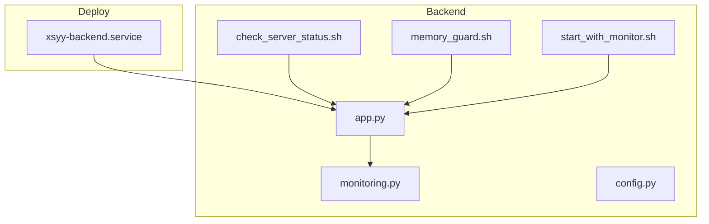
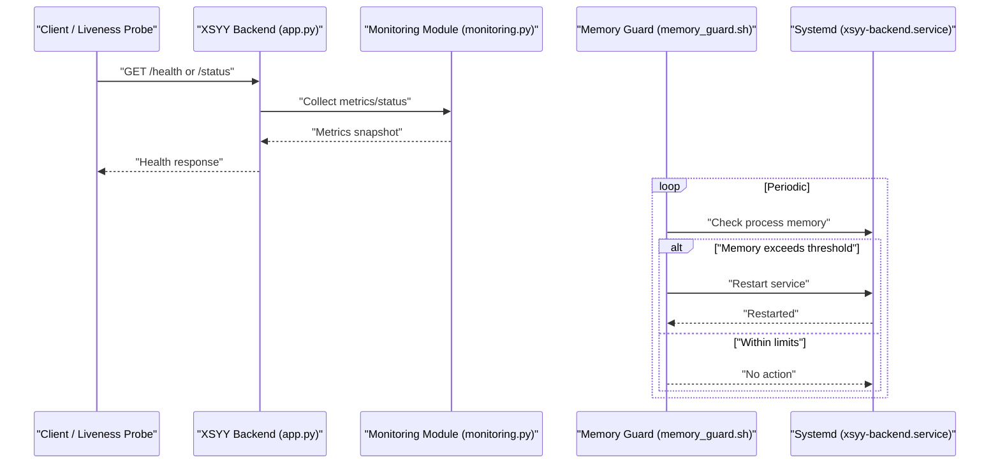
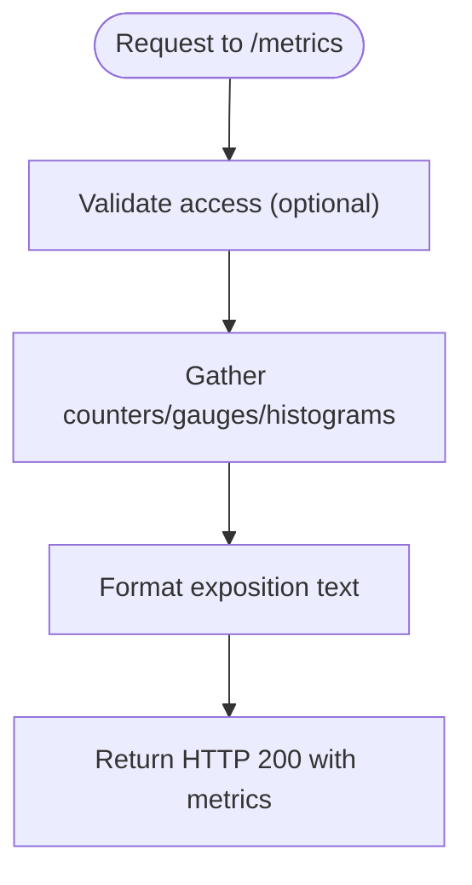
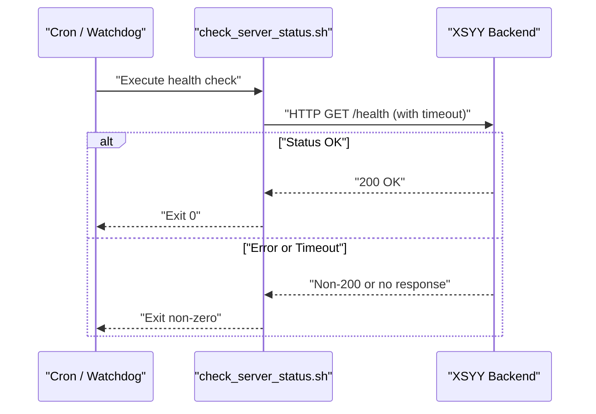
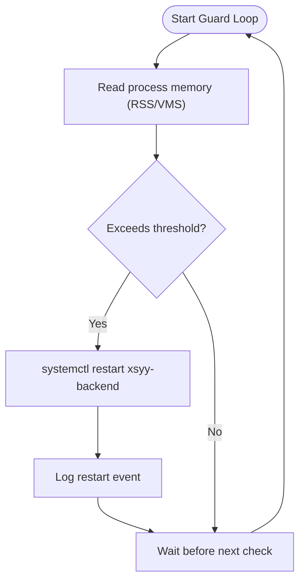
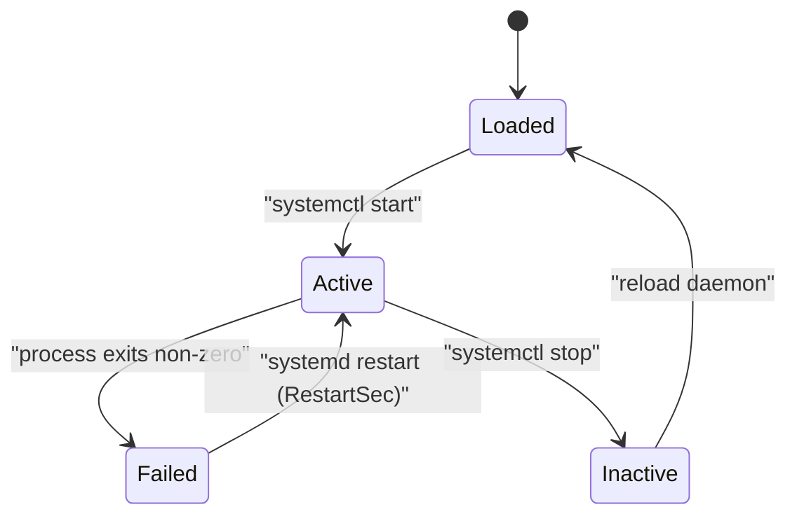
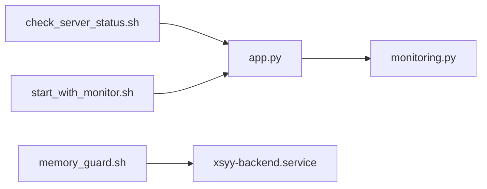

# Monitoring & Health Checks

<cite>
**Referenced Files in This Document**
- [monitoring.py](file://backend/monitoring.py)
- [check_server_status.sh](file://backend/check_server_status.sh)
- [memory_guard.sh](file://backend/memory_guard.sh)
- [xsyy-backend.service](file://deploy/xsyy-backend.service)
- [app.py](file://backend/app.py)
- [config.py](file://backend/config.py)
- [start_with_monitor.sh](file://backend/start_with_monitor.sh)
</cite>

## Table of Contents
1. [Introduction](#introduction)
2. [Project Structure](#project-structure)
3. [Core Components](#core-components)
4. [Architecture Overview](#architecture-overview)
5. [Detailed Component Analysis](#detailed-component-analysis)
6. [Dependency Analysis](#dependency-analysis)
7. [Performance Considerations](#performance-considerations)
8. [Troubleshooting Guide](#troubleshooting-guide)
9. [Conclusion](#conclusion)
10. [Appendices](#appendices)

## Introduction
This document explains the monitoring and health check capabilities of the XSYY Edu platform, focusing on:
- Built-in application metrics, performance tracking, and usage analytics exposed by the monitoring module
- Server status checking via a shell utility
- Memory protection mechanisms to prevent out-of-memory conditions
- Systemd service configuration for process management and automatic restarts
- Logging configuration and rotation strategies
- Integration patterns with external monitoring tools such as Prometheus and Grafana
- Alerting setup and dashboard configuration examples

The goal is to provide both operational guidance and technical depth so that operators can reliably monitor, troubleshoot, and scale the platform.

## Project Structure
The monitoring-related components are primarily located under backend/ and deploy/:
- Backend monitoring module and utilities
- Shell-based health checks and memory guard
- Systemd unit file for service lifecycle management
- Optional startup wrapper to enable monitoring endpoints

**Diagram sources**
- [monitoring.py](file://backend/monitoring.py)
- [check_server_status.sh](file://backend/check_server_status.sh)
- [memory_guard.sh](file://backend/memory_guard.sh)
- [app.py](file://backend/app.py)
- [config.py](file://backend/config.py)
- [start_with_monitor.sh](file://backend/start_with_monitor.sh)
- [xsyy-backend.service](file://deploy/xsyy-backend.service)

**Section sources**
- [monitoring.py](file://backend/monitoring.py)
- [check_server_status.sh](file://backend/check_server_status.sh)
- [memory_guard.sh](file://backend/memory_guard.sh)
- [app.py](file://backend/app.py)
- [config.py](file://backend/config.py)
- [start_with_monitor.sh](file://backend/start_with_monitor.sh)
- [xsyy-backend.service](file://deploy/xsyy-backend.service)

## Core Components
- Application monitoring module (metrics, performance, usage analytics)
- Server status checker script
- Memory guard script
- Systemd service definition
- Optional monitoring-enabled launcher

Key responsibilities:
- Expose metrics endpoints and collect runtime statistics
- Provide lightweight health checks for orchestration and load balancers
- Protect against memory exhaustion by monitoring and restarting processes
- Ensure reliable process lifecycle and auto-restart behavior
- Centralize logging and rotation strategy

**Section sources**
- [monitoring.py](file://backend/monitoring.py)
- [check_server_status.sh](file://backend/check_server_status.sh)
- [memory_guard.sh](file://backend/memory_guard.sh)
- [xsyy-backend.service](file://deploy/xsyy-backend.service)
- [start_with_monitor.sh](file://backend/start_with_monitor.sh)

## Architecture Overview
The monitoring architecture integrates application-level metrics, OS-level health checks, and system service management. The application exposes internal metrics and health endpoints; a watchdog script monitors memory and restarts if needed; systemd ensures resilience and manages logs.

**Diagram sources**
- [app.py](file://backend/app.py)
- [monitoring.py](file://backend/monitoring.py)
- [memory_guard.sh](file://backend/memory_guard.sh)
- [xsyy-backend.service](file://deploy/xsyy-backend.service)

## Detailed Component Analysis

### Application Monitoring Module (monitoring.py)
Responsibilities:
- Collect and expose application metrics (request counts, latency, error rates)
- Track performance indicators (CPU, memory, I/O)
- Aggregate usage analytics (feature usage, user activity)
- Provide structured data for external scrapers (Prometheus-compatible exposition format)

Operational notes:
- Metrics should be collected asynchronously to avoid request latency impact
- Use counters, gauges, and histograms appropriate to each metric type
- Expose a dedicated endpoint for scraping and a separate liveness/readiness endpoint for orchestration

Integration points:
- Application middleware or decorators to instrument requests
- Background collector to aggregate periodic metrics
- Optional exporter to push metrics to time-series backends

**Section sources**
- [monitoring.py](file://backend/monitoring.py)

#### Metrics Exposure Flow

**Diagram sources**
- [monitoring.py](file://backend/monitoring.py)

### Server Status Checking (check_server_status.sh)
Purpose:
- Verify whether the backend process is running and responsive
- Optionally probe HTTP health endpoints
- Exit with non-zero status when unhealthy for use by orchestrators or cron jobs

Typical checks:
- Process existence and PID validity
- TCP port reachability
- HTTP GET to a health endpoint with timeout and expected status code

Usage scenarios:
- Cron-based health polling
- Pre-deploy smoke tests
- External watchdog integration

**Section sources**
- [check_server_status.sh](file://backend/check_server_status.sh)

#### Health Check Sequence

**Diagram sources**
- [check_server_status.sh](file://backend/check_server_status.sh)
- [app.py](file://backend/app.py)

### Memory Protection (memory_guard.sh)
Purpose:
- Monitor the backend process memory usage
- Trigger a controlled restart when memory exceeds configured thresholds
- Prevent OOM kills and ensure graceful recovery

Mechanism:
- Read process RSS or virtual memory from OS interfaces
- Compare against thresholds defined in environment variables or config
- Use systemctl to restart the service safely

Safety considerations:
- Debounce restarts to avoid flapping
- Log restart events with timestamps and memory values
- Respect systemd restart policies to avoid loops

**Section sources**
- [memory_guard.sh](file://backend/memory_guard.sh)

#### Memory Guard Flow

**Diagram sources**
- [memory_guard.sh](file://backend/memory_guard.sh)
- [xsyy-backend.service](file://deploy/xsyy-backend.service)

### Systemd Service Configuration (xsyy-backend.service)
Responsibilities:
- Define how the backend process is started, stopped, and monitored
- Configure automatic restarts on failure
- Manage working directory, environment, and resource limits
- Integrate with journal for centralized logging

Key aspects:
- ExecStart pointing to the application entrypoint
- Restart=on-failure or always depending on policy
- RestartSec to control backoff between restarts
- User/Group for least privilege
- EnvironmentFile for secrets and configuration
- StandardOutput/StandardError to journal

Operational tips:
- Use RestartMaxDelaySec to cap restart frequency
- Set LimitNOFILE and other resource limits as needed
- Enable After=network.target to start after networking is ready

**Section sources**
- [xsyy-backend.service](file://deploy/xsyy-backend.service)

#### Service Lifecycle Diagram

**Diagram sources**
- [xsyy-backend.service](file://deploy/xsyy-backend.service)

### Monitoring Launcher (start_with_monitor.sh)
Purpose:
- Launch the backend with monitoring enabled
- Optionally set environment flags to activate metrics endpoints
- Serve as a bridge between systemd and application features

Usage:
- Replace ExecStart in systemd with this launcher when enabling monitoring
- Ensure required ports are open for metrics scraping

**Section sources**
- [start_with_monitor.sh](file://backend/start_with_monitor.sh)

## Dependency Analysis
High-level dependencies among monitoring components:
- app.py depends on monitoring.py for metrics and health data
- memory_guard.sh depends on systemd to restart the service
- check_server_status.sh depends on network connectivity and the health endpoint
- start_with_monitor.sh configures the application to expose monitoring endpoints

**Diagram sources**
- [app.py](file://backend/app.py)
- [monitoring.py](file://backend/monitoring.py)
- [memory_guard.sh](file://backend/memory_guard.sh)
- [check_server_status.sh](file://backend/check_server_status.sh)
- [xsyy-backend.service](file://deploy/xsyy-backend.service)
- [start_with_monitor.sh](file://backend/start_with_monitor.sh)

**Section sources**
- [app.py](file://backend/app.py)
- [monitoring.py](file://backend/monitoring.py)
- [memory_guard.sh](file://backend/memory_guard.sh)
- [check_server_status.sh](file://backend/check_server_status.sh)
- [xsyy-backend.service](file://deploy/xsyy-backend.service)
- [start_with_monitor.sh](file://backend/start_with_monitor.sh)

## Performance Considerations
- Keep metrics collection lightweight; prefer async aggregation and batch updates
- Avoid synchronous disk I/O in hot paths; write metrics to memory and flush periodically
- Use appropriate scrape intervals (e.g., 15–60 seconds) to balance freshness and overhead
- Tune memory guard thresholds based on observed baseline and peak usage
- Apply rate limiting on health and metrics endpoints to protect resources

[No sources needed since this section provides general guidance]

## Troubleshooting Guide
Common issues and resolutions:
- Health endpoint not reachable: verify firewall rules, bind address, and port exposure
- Metrics endpoint returns errors: confirm monitoring module initialization and permissions
- Frequent restarts: review memory guard thresholds and application memory leaks
- Logs missing or rotated incorrectly: validate journald settings and logrotate configuration
- High CPU during scraping: reduce scrape frequency or optimize metrics formatting

Actionable steps:
- Inspect systemd journal for recent restarts and errors
- Validate process memory trends using OS tools
- Test health and metrics endpoints locally with curl
- Review application logs for exceptions around health checks

**Section sources**
- [xsyy-backend.service](file://deploy/xsyy-backend.service)
- [memory_guard.sh](file://backend/memory_guard.sh)
- [check_server_status.sh](file://backend/check_server_status.sh)

## Conclusion
The XSYY Edu platform provides a cohesive monitoring and health check stack:
- Application-level metrics and analytics via the monitoring module
- Lightweight server status checks for orchestration and CI/CD
- Memory guard to maintain stability under load
- Robust systemd configuration for resilient operation
- Clear integration points for Prometheus and Grafana

Adopting these practices will improve observability, reliability, and operational efficiency.

[No sources needed since this section summarizes without analyzing specific files]

## Appendices

### Logging Configuration and Rotation
Recommendations:
- Route all logs to systemd journal for centralized collection
- Implement structured JSON logging for easier parsing
- Configure log rotation at the application level or via logrotate for large volumes
- Retain logs for compliance and debugging needs

Example logrotate snippet:
- File: /etc/logrotate.d/xsyy-backend
- Rotate daily, keep 14 days, compress, copytruncate

[No sources needed since this section provides general guidance]

### Prometheus Integration
Steps:
- Expose a /metrics endpoint from the application
- Add a Prometheus scrape job targeting the backend host and metrics port
- Set scrape_interval and timeouts appropriately
- Secure the endpoint with basic auth or network restrictions if needed

Prometheus scrape config example:
- job_name: "xsyy-backend"
- static_configs:
  - targets: ["localhost:PORT"]
- metrics_path: "/metrics"
- scrape_interval: "30s"

[No sources needed since this section provides general guidance]

### Grafana Dashboard Examples
Suggested panels:
- Request rate over time (rate of successful vs failed requests)
- Latency percentiles (p50, p95, p99)
- Error rate percentage
- Memory usage (RSS) and restart count
- Feature usage counters

Dashboard JSON import:
- Create a new dashboard
- Add panels using PromQL queries against xsyy-backend metrics
- Save and share with team

[No sources needed since this section provides general guidance]

### Alerting Rules
Examples:
- High error rate: increase alert when error_rate > threshold for 5 minutes
- Elevated latency: alert when p99 latency exceeds SLA target
- Memory pressure: alert when RSS exceeds safe threshold
- Service down: alert when health endpoint fails consecutive checks

Alertmanager routing:
- Group alerts by severity
- Notify Slack/email/pagerduty channels accordingly

[No sources needed since this section provides general guidance]