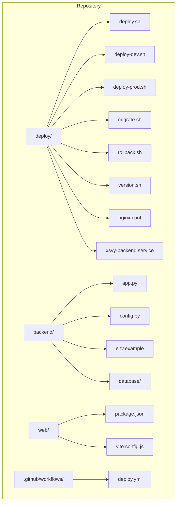
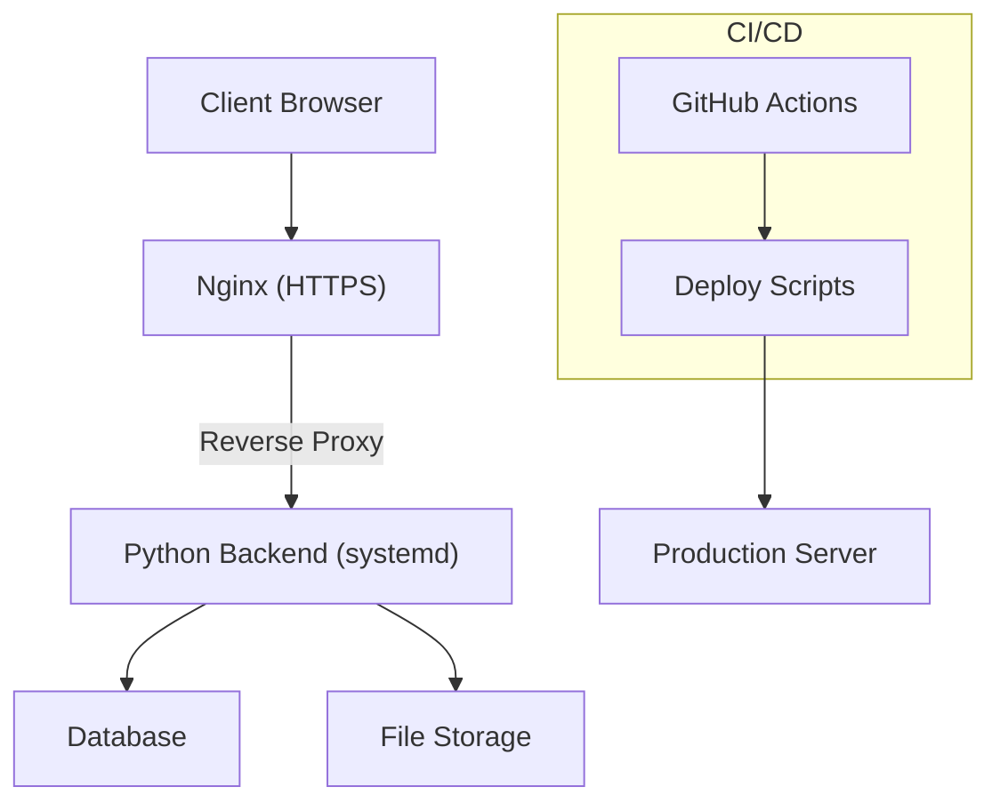
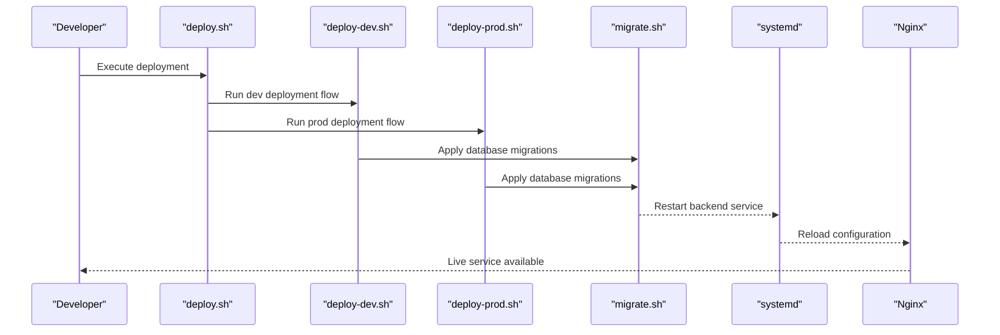
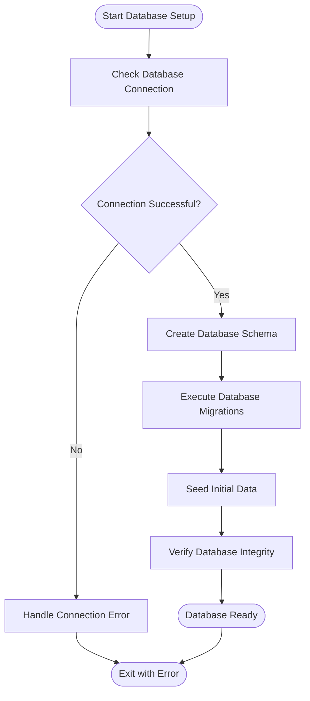
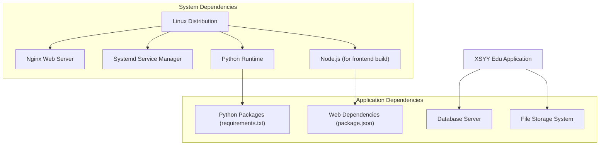

# Production Deployment

<cite>
**Referenced Files in This Document**
- [deploy/deploy.sh](file://deploy/deploy.sh)
- [deploy/deploy-dev.sh](file://deploy/deploy-dev.sh)
- [deploy/deploy-prod.sh](file://deploy/deploy-prod.sh)
- [deploy/migrate.sh](file://deploy/migrate.sh)
- [deploy/rollback.sh](file://deploy/rollback.sh)
- [deploy/version.sh](file://deploy/version.sh)
- [deploy/nginx.conf](file://deploy/nginx.conf)
- [deploy/xsyy-backend.service](file://deploy/xsyy-backend.service)
- [deploy/DEPLOYMENT.md](file://deploy/DEPLOYMENT.md)
- [deploy/快速开始.md](file://deploy/快速开始.md)
- [deploy/操作指南.md](file://deploy/操作指南.md)
- [deploy/流程图.md](file://deploy/流程图.md)
- [deploy/部署检查清单.md](file://deploy/部署检查清单.md)
- [backend/app.py](file://backend/app.py)
- [backend/config.py](file://backend/config.py)
- [backend/env.example](file://backend/env.example)
- [backend/database/schema.sql](file://backend/database/schema.sql)
- [backend/database/migrate.py](file://backend/database/migrate.py)
- [backend/init_database.py](file://backend/init_database.py)
- [backend/check_db.py](file://backend/check_db.py)
- [backend/verify_db_config.py](file://backend/verify_db_config.py)
- [backend/start.bat](file://backend/start.bat)
- [backend/install.bat](file://backend/install.bat)
- [backend/memory_guard.sh](file://backend/memory_guard.sh)
- [backend/restart_all_services.sh](file://backend/restart_all_services.sh)
- [backend/start_with_monitor.sh](file://backend/start_with_monitor.sh)
- [backend/requirements.txt](file://backend/requirements.txt)
- [web/package.json](file://web/package.json)
- [web/vite.config.js](file://web/vite.config.js)
- [.github/workflows/deploy.yml](file://.github/workflows/deploy.yml)
</cite>

## Table of Contents
1. [Introduction](#introduction)
2. [Project Structure](#project-structure)
3. [Core Components](#core-components)
4. [Architecture Overview](#architecture-overview)
5. [Detailed Component Analysis](#detailed-component-analysis)
6. [Dependency Analysis](#dependency-analysis)
7. [Performance Considerations](#performance-considerations)
8. [Troubleshooting Guide](#troubleshooting-guide)
9. [Conclusion](#conclusion)
10. [Appendices](#appendices)

## Introduction
This document provides comprehensive production deployment guidance for the XSYY Edu platform. It covers automated deployment using deploy scripts, environment-specific configurations (development and production), server requirements, system dependencies, database initialization and migrations, SSL and domain configuration, security hardening, containerization options, cloud deployments, infrastructure-as-code approaches, troubleshooting, and validation procedures. The goal is to enable reliable, repeatable, and secure deployments from code checkout to live service activation.

## Project Structure
The repository includes:
- Backend application with Python-based services, database schema, migrations, and utilities
- Web frontend assets and build configuration
- Deployment automation scripts for development and production
- Systemd service definition and Nginx configuration
- GitHub Actions workflow for CI/CD
- Documentation files describing deployment flows and checklists

**Diagram sources**
- [deploy/deploy.sh](file://deploy/deploy.sh)
- [deploy/deploy-dev.sh](file://deploy/deploy-dev.sh)
- [deploy/deploy-prod.sh](file://deploy/deploy-prod.sh)
- [deploy/migrate.sh](file://deploy/migrate.sh)
- [deploy/rollback.sh](file://deploy/rollback.sh)
- [deploy/version.sh](file://deploy/version.sh)
- [deploy/nginx.conf](file://deploy/nginx.conf)
- [deploy/xsyy-backend.service](file://deploy/xsyy-backend.service)
- [backend/app.py](file://backend/app.py)
- [backend/config.py](file://backend/config.py)
- [backend/env.example](file://backend/env.example)
- [backend/database/schema.sql](file://backend/database/schema.sql)
- [backend/database/migrate.py](file://backend/database/migrate.py)
- [web/package.json](file://web/package.json)
- [web/vite.config.js](file://web/vite.config.js)
- [.github/workflows/deploy.yml](file://.github/workflows/deploy.yml)

**Section sources**
- [deploy/DEPLOYMENT.md](file://deploy/DEPLOYMENT.md)
- [deploy/快速开始.md](file://deploy/快速开始.md)
- [deploy/操作指南.md](file://deploy/操作指南.md)
- [deploy/流程图.md](file://deploy/流程图.md)
- [deploy/部署检查清单.md](file://deploy/部署检查清单.md)

## Core Components
- Automated deployment scripts:
  - deploy.sh: Central orchestrator for deployment tasks
  - deploy-dev.sh: Development-focused deployment flow
  - deploy-prod.sh: Production-focused deployment flow with safety checks
  - migrate.sh: Database migration execution
  - rollback.sh: Rollback to previous release version
  - version.sh: Version management helpers
- Service management:
  - xsyy-backend.service: Systemd unit for backend process lifecycle
- Reverse proxy and static assets:
  - nginx.conf: Nginx reverse proxy configuration for HTTPS and API routing
- Application runtime:
  - app.py: Main backend application entry point
  - config.py: Configuration loading and environment variable handling
  - env.example: Example environment variables template
- Database:
  - schema.sql: Initial database schema
  - migrate.py: Migration runner
  - init_database.py: Database initialization helper
  - check_db.py / verify_db_config.py: Health and connectivity checks
- Frontend build:
  - package.json: Node.js dependencies and build scripts
  - vite.config.js: Build configuration for web assets
- CI/CD:
  - .github/workflows/deploy.yml: GitHub Actions pipeline for automated deployment

**Section sources**
- [deploy/deploy.sh](file://deploy/deploy.sh)
- [deploy/deploy-dev.sh](file://deploy/deploy-dev.sh)
- [deploy/deploy-prod.sh](file://deploy/deploy-prod.sh)
- [deploy/migrate.sh](file://deploy/migrate.sh)
- [deploy/rollback.sh](file://deploy/rollback.sh)
- [deploy/version.sh](file://deploy/version.sh)
- [deploy/nginx.conf](file://deploy/nginx.conf)
- [deploy/xsyy-backend.service](file://deploy/xsyy-backend.service)
- [backend/app.py](file://backend/app.py)
- [backend/config.py](file://backend/config.py)
- [backend/env.example](file://backend/env.example)
- [backend/database/schema.sql](file://backend/database/schema.sql)
- [backend/database/migrate.py](file://backend/database/migrate.py)
- [backend/init_database.py](file://backend/init_database.py)
- [backend/check_db.py](file://backend/check_db.py)
- [backend/verify_db_config.py](file://backend/verify_db_config.py)
- [web/package.json](file://web/package.json)
- [web/vite.config.js](file://web/vite.config.js)
- [.github/workflows/deploy.yml](file://.github/workflows/deploy.yml)

## Architecture Overview
The production architecture consists of:
- Nginx as a reverse proxy handling HTTPS termination and routing requests to the backend
- Python backend application running under systemd for process supervision
- Database layer managed externally or locally, initialized and migrated via scripts
- Optional containerized deployment using Docker images
- CI/CD pipeline automating builds and deployments

**Diagram sources**
- [deploy/nginx.conf](file://deploy/nginx.conf)
- [deploy/xsyy-backend.service](file://deploy/xsyy-backend.service)
- [backend/app.py](file://backend/app.py)
- [.github/workflows/deploy.yml](file://.github/workflows/deploy.yml)

## Detailed Component Analysis

### Automated Deployment Workflow
The deployment process is orchestrated by deploy scripts that perform:
- Environment detection and validation
- Code checkout and dependency installation
- Frontend build (if applicable)
- Database migration and seeding
- Service restart and health checks
- Rollback support and version tracking

**Diagram sources**
- [deploy/deploy.sh](file://deploy/deploy.sh)
- [deploy/deploy-dev.sh](file://deploy/deploy-dev.sh)
- [deploy/deploy-prod.sh](file://deploy/deploy-prod.sh)
- [deploy/migrate.sh](file://deploy/migrate.sh)
- [deploy/xsyy-backend.service](file://deploy/xsyy-backend.service)
- [deploy/nginx.conf](file://deploy/nginx.conf)

**Section sources**
- [deploy/deploy.sh](file://deploy/deploy.sh)
- [deploy/deploy-dev.sh](file://deploy/deploy-dev.sh)
- [deploy/deploy-prod.sh](file://deploy/deploy-prod.sh)
- [deploy/migrate.sh](file://deploy/migrate.sh)

### Environment-Specific Configurations
Environment variables control application behavior across development and production:
- Database connection settings
- File storage paths
- Security tokens and keys
- Logging levels and debug flags
- Feature toggles and external service endpoints

Configuration is loaded through the application's configuration module and validated against environment templates.

**Section sources**
- [backend/config.py](file://backend/config.py)
- [backend/env.example](file://backend/env.example)

### Database Initialization and Migration
Database setup involves:
- Schema creation from SQL definitions
- Migration execution for incremental updates
- Data seeding for initial content
- Health checks to verify connectivity and integrity

**Diagram sources**
- [backend/database/schema.sql](file://backend/database/schema.sql)
- [backend/database/migrate.py](file://backend/database/migrate.py)
- [backend/init_database.py](file://backend/init_database.py)
- [backend/check_db.py](file://backend/check_db.py)
- [backend/verify_db_config.py](file://backend/verify_db_config.py)

**Section sources**
- [backend/database/schema.sql](file://backend/database/schema.sql)
- [backend/database/migrate.py](file://backend/database/migrate.py)
- [backend/init_database.py](file://backend/init_database.py)
- [backend/check_db.py](file://backend/check_db.py)
- [backend/verify_db_config.py](file://backend/verify_db_config.py)

### SSL Certificate Setup and Domain Configuration
SSL termination is handled by Nginx with certificate management:
- Certificate file paths configured in Nginx settings
- Automatic certificate renewal integration
- Domain name resolution and DNS configuration
- HTTP to HTTPS redirection enforcement

**Section sources**
- [deploy/nginx.conf](file://deploy/nginx.conf)

### Security Hardening Steps
Security measures include:
- Environment variable validation and sanitization
- Secure file permissions for sensitive configurations
- Rate limiting and request validation at Nginx level
- Database access controls and connection encryption
- Regular security updates and dependency patching

**Section sources**
- [backend/config.py](file://backend/config.py)
- [deploy/nginx.conf](file://deploy/nginx.conf)

### Containerization Options
Docker deployment options include:
- Multi-stage builds for optimized images
- Environment-specific Dockerfiles
- Volume mounting for persistent data
- Network configuration for service communication

**Section sources**
- [backend/app.py](file://backend/app.py)
- [backend/requirements.txt](file://backend/requirements.txt)

### Cloud Platform Deployments
Cloud deployment strategies:
- AWS: EC2 instances with Elastic Load Balancer and RDS
- Azure: Virtual Machines with Application Gateway and Azure Database
- GCP: Compute Engine with Cloud Load Balancing and Cloud SQL

Infrastructure components are provisioned using platform-native tools or infrastructure-as-code solutions.

**Section sources**
- [.github/workflows/deploy.yml](file://.github/workflows/deploy.yml)

### Infrastructure-as-Code Approaches
Infrastructure provisioning can be automated using:
- Terraform for cloud resource management
- Ansible for configuration management
- Kubernetes manifests for container orchestration
- CloudFormation templates for AWS environments

**Section sources**
- [deploy/xsyy-backend.service](file://deploy/xsyy-backend.service)

## Dependency Analysis
System and software dependencies required for deployment:

**Diagram sources**
- [backend/requirements.txt](file://backend/requirements.txt)
- [web/package.json](file://web/package.json)
- [deploy/nginx.conf](file://deploy/nginx.conf)
- [deploy/xsyy-backend.service](file://deploy/xsyy-backend.service)

**Section sources**
- [backend/requirements.txt](file://backend/requirements.txt)
- [web/package.json](file://web/package.json)

## Performance Considerations
- Optimize Nginx worker processes and buffer sizes for high concurrency
- Configure database connection pooling and query optimization
- Implement caching strategies for frequently accessed data
- Use CDN for static asset delivery
- Monitor memory usage and implement automatic restart policies
- Enable compression and efficient file serving

[No sources needed since this section provides general guidance]

## Troubleshooting Guide
Common deployment issues and resolutions:

### Database Connection Issues
- Verify database credentials and network accessibility
- Check firewall rules and security groups
- Validate database schema compatibility
- Review database logs for error details

### Service Startup Failures
- Check system logs for application errors
- Verify file permissions and directory structure
- Validate environment variable configuration
- Monitor memory and CPU resource availability

### SSL Certificate Problems
- Ensure certificate files exist and have correct permissions
- Verify domain DNS resolution
- Check certificate expiration dates
- Review Nginx error logs for SSL handshake failures

### Frontend Build Issues
- Validate Node.js version compatibility
- Check npm/yarn dependency installation
- Review build configuration for path issues
- Clear build cache and rebuild if necessary

**Section sources**
- [backend/check_db.py](file://backend/check_db.py)
- [backend/verify_db_config.py](file://backend/verify_db_config.py)
- [backend/memory_guard.sh](file://backend/memory_guard.sh)
- [backend/restart_all_services.sh](file://backend/restart_all_services.sh)
- [backend/start_with_monitor.sh](file://backend/start_with_monitor.sh)

## Conclusion
The XSYY Edu platform provides a comprehensive deployment solution with automated scripts, environment-specific configurations, and robust operational tooling. By following the documented procedures for server setup, database initialization, SSL configuration, and security hardening, teams can achieve reliable production deployments. The modular architecture supports both traditional server deployments and modern containerized environments, enabling flexibility across different infrastructure requirements.

[No sources needed since this section summarizes without analyzing specific files]

## Appendices

### Quick Start Checklist
- [ ] Install system dependencies and configure firewall
- [ ] Set up database server and create application database
- [ ] Configure environment variables and secrets
- [ ] Deploy application code and install dependencies
- [ ] Execute database migrations and seed data
- [ ] Configure Nginx and SSL certificates
- [ ] Start and verify backend service
- [ ] Test application functionality and performance
- [ ] Set up monitoring and logging
- [ ] Configure backup and disaster recovery procedures

**Section sources**
- [deploy/部署检查清单.md](file://deploy/部署检查清单.md)

### Deployment Validation Procedures
- Health check endpoints verification
- Database connectivity tests
- SSL certificate validation
- Performance benchmarking
- Security scanning and vulnerability assessment
- Load testing under expected traffic patterns

**Section sources**
- [deploy/操作指南.md](file://deploy/操作指南.md)
- [deploy/流程图.md](file://deploy/流程图.md)