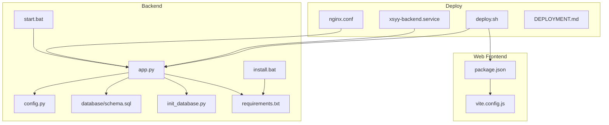
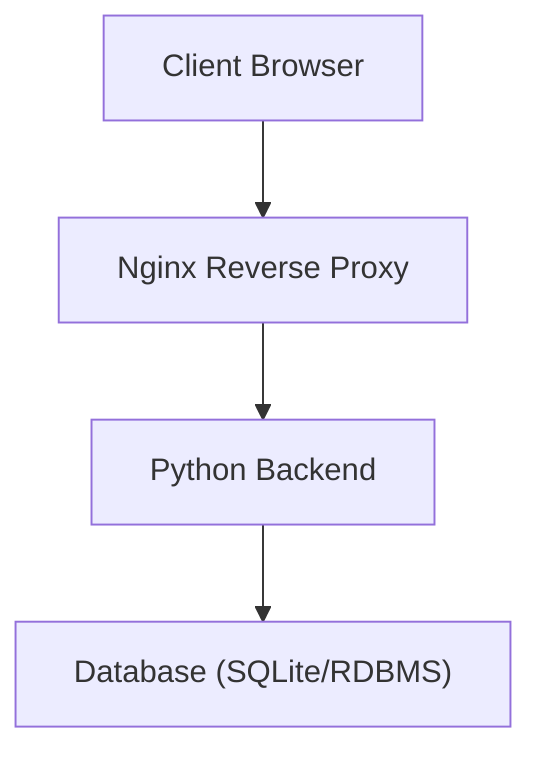
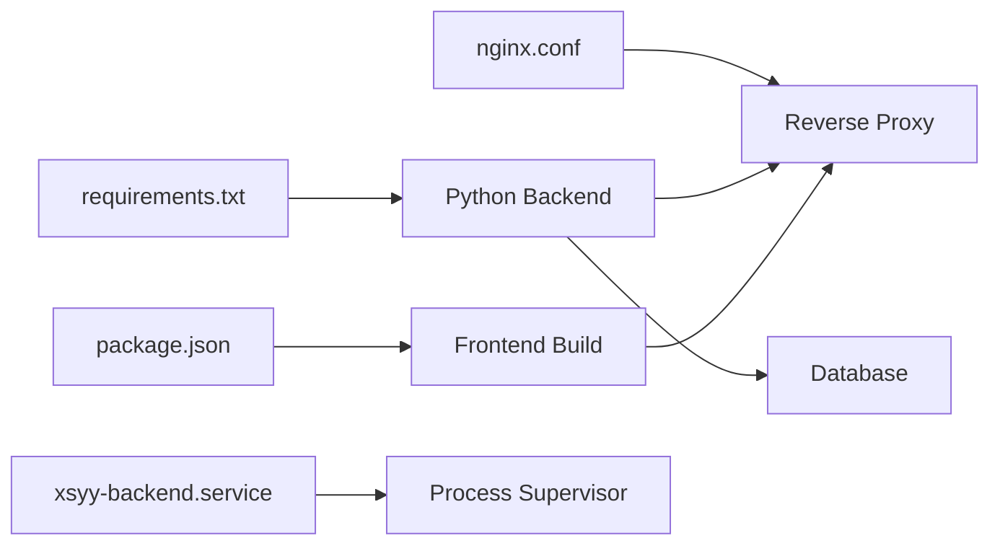

# Server Requirements & Installation

<cite>
**Referenced Files in This Document**
- [requirements.txt](file://backend/requirements.txt)
- [install.bat](file://backend/install.bat)
- [start.bat](file://backend/start.bat)
- [check-env.bat](file://backend/check-env.bat)
- [env.example](file://backend/env.example)
- [config.py](file://backend/config.py)
- [database/schema.sql](file://backend/database/schema.sql)
- [init_database.py](file://backend/init_database.py)
- [package.json](file://web/package.json)
- [vite.config.js](file://web/vite.config.js)
- [nginx.conf](file://deploy/nginx.conf)
- [xsyy-backend.service](file://deploy/xsyy-backend.service)
- [deploy.sh](file://deploy/deploy.sh)
- [DEPLOYMENT.md](file://deploy/DEPLOYMENT.md)
- [README.md](file://backend/README.md)
</cite>

## Table of Contents
1. [Introduction](#introduction)
2. [Project Structure](#project-structure)
3. [Core Components](#core-components)
4. [Architecture Overview](#architecture-overview)
5. [Detailed Component Analysis](#detailed-component-analysis)
6. [Dependency Analysis](#dependency-analysis)
7. [Performance Considerations](#performance-considerations)
8. [Troubleshooting Guide](#troubleshooting-guide)
9. [Conclusion](#conclusion)
10. [Appendices](#appendices)

## Introduction
This document provides comprehensive server requirements and installation guidance for the XSYY Edu platform. It covers minimum and recommended hardware specifications, supported operating systems, required software dependencies, Python and Node.js environment setup, system-level prerequisites, Windows automation scripts, Docker containerization options, cloud platform prerequisites, infrastructure provisioning templates, step-by-step installation guides for different deployment scenarios, and troubleshooting common issues.

## Project Structure
The repository is organized into backend (Python), web (frontend), deploy (system integration and deployment scripts), and storage directories. The backend includes application code, database schema and migrations, configuration, and utilities. The frontend uses a modern build pipeline with Vite and Tailwind CSS. Deployment assets include Nginx configuration and systemd service files.

**Diagram sources**
- [app.py](file://backend/app.py)
- [config.py](file://backend/config.py)
- [requirements.txt](file://backend/requirements.txt)
- [database/schema.sql](file://backend/database/schema.sql)
- [init_database.py](file://backend/init_database.py)
- [install.bat](file://backend/install.bat)
- [start.bat](file://backend/start.bat)
- [package.json](file://web/package.json)
- [vite.config.js](file://web/vite.config.js)
- [nginx.conf](file://deploy/nginx.conf)
- [xsyy-backend.service](file://deploy/xsyy-backend.service)
- [deploy.sh](file://deploy/deploy.sh)

**Section sources**
- [README.md](file://backend/README.md)

## Core Components
- Backend application: Python-based API server with configuration management, database initialization, and runtime entry points.
- Database layer: SQLite or external RDBMS via schema and migration scripts.
- Frontend: Web UI built with Vite and Tailwind; packaged artifacts are served by the backend or reverse proxy.
- Deployment: Nginx reverse proxy configuration and systemd service unit for Linux; Windows helper scripts for local development.

Key responsibilities:
- Configuration loading and environment validation.
- Database schema creation and initial data seeding.
- Serving static assets and API endpoints.
- Reverse proxying and TLS termination via Nginx.
- Process supervision via systemd on Linux.

**Section sources**
- [config.py](file://backend/config.py)
- [init_database.py](file://backend/init_database.py)
- [database/schema.sql](file://backend/database/schema.sql)
- [nginx.conf](file://deploy/nginx.conf)
- [xsyy-backend.service](file://deploy/xsyy-backend.service)

## Architecture Overview
The XSYY Edu platform follows a typical three-tier architecture:
- Client browsers access the frontend served by Nginx or directly by the backend during development.
- The backend exposes REST APIs and serves static assets.
- A database stores application data.

[No sources needed since this diagram shows conceptual workflow, not actual code structure]

## Detailed Component Analysis

### System Requirements
- Operating Systems:
  - Windows 10/11 for local development using provided batch scripts.
  - Linux distributions (e.g., Ubuntu 20.04+, Debian 11+) for production with systemd and Nginx.
- Hardware:
  - Minimum: 2 vCPU, 4 GB RAM, 20 GB disk (suitable for small teams or single-node dev).
  - Recommended: 4+ vCPU, 8+ GB RAM, 50+ GB SSD-backed disk (for moderate concurrent usage and AI features).
- Software Dependencies:
  - Python 3.9+ (recommended 3.10–3.12).
  - Node.js 18+ and npm/yarn for building the frontend.
  - Nginx for reverse proxy and static asset serving in production.
  - Optional: Docker and docker-compose for containerized deployments.

**Section sources**
- [DEPLOYMENT.md](file://deploy/DEPLOYMENT.md)

### Python Environment Setup
- Use the backend requirements file to install all Python dependencies.
- Create and activate a virtual environment before installing packages.
- Ensure your Python interpreter matches the version specified by the project.

Steps:
1. Install Python 3.9+.
2. Create a virtual environment in the backend directory.
3. Activate the virtual environment.
4. Install dependencies from the requirements file.

**Section sources**
- [requirements.txt](file://backend/requirements.txt)

### Node.js Frontend Build
- The frontend resides under web/ and uses Vite with Tailwind CSS.
- Install Node.js 18+ and use npm to install dependencies and build the frontend.

Steps:
1. Install Node.js 18+.
2. Navigate to web/.
3. Install dependencies using npm.
4. Build the frontend artifacts for production.

**Section sources**
- [package.json](file://web/package.json)
- [vite.config.js](file://web/vite.config.js)

### System-Level Dependencies
- Linux:
  - Install Nginx and configure it as a reverse proxy to the backend.
  - Create a systemd service unit to manage the backend process.
- Windows:
  - Use provided batch scripts to automate dependency installation and startup.

**Section sources**
- [nginx.conf](file://deploy/nginx.conf)
- [xsyy-backend.service](file://deploy/xsyy-backend.service)

### Database Initialization
- Initialize the database using the provided script and schema.
- For SQLite, ensure the storage path is writable.
- For remote databases, configure connection parameters via environment variables.

Steps:
1. Prepare the database (create user/schema if using an external RDBMS).
2. Run the initialization script to apply schema and seed data.
3. Verify connectivity and basic operations.

**Section sources**
- [database/schema.sql](file://backend/database/schema.sql)
- [init_database.py](file://backend/init_database.py)

### Windows Automation Scripts
- install.bat: Automates environment checks and dependency installation for Windows.
- start.bat: Starts the backend server with appropriate environment settings.
- check-env.bat: Validates Python, pip, and other prerequisites.

Usage:
- Open a Command Prompt as Administrator if required.
- Run install.bat to set up the environment.
- Run start.bat to launch the server.

**Section sources**
- [install.bat](file://backend/install.bat)
- [start.bat](file://backend/start.bat)
- [check-env.bat](file://backend/check-env.bat)

### Environment Configuration
- Copy env.example to .env and fill in required values such as database URLs, secrets, and feature flags.
- The backend loads configuration from environment variables and config modules.

Steps:
1. Copy env.example to .env.
2. Edit .env with correct values for your environment.
3. Ensure sensitive values are secured and not committed to version control.

**Section sources**
- [env.example](file://backend/env.example)
- [config.py](file://backend/config.py)

### Docker Containerization Options
- If available, use Docker to run the backend and frontend in containers.
- Typical steps:
  - Build the frontend artifacts first.
  - Build the backend image with pinned Python base image and dependencies.
  - Run containers with proper volume mounts for persistent storage and environment variables.
- Use docker-compose to orchestrate multiple services (backend, database, cache).

Note: Refer to any Dockerfiles or compose definitions present in the repository for exact commands.

[No sources needed since this section provides general guidance]

### Cloud Platform Prerequisites
- Choose a cloud provider (AWS, GCP, Azure) and provision:
  - Compute instance(s) meeting recommended specs.
  - Managed database service or self-hosted RDBMS.
  - Object storage for media/assets if applicable.
  - Domain name and DNS records pointing to the load balancer or VM IP.
- Configure firewall rules to allow HTTP/HTTPS traffic.
- Set up CI/CD pipelines to automate builds and deployments.

**Section sources**
- [DEPLOYMENT.md](file://deploy/DEPLOYMENT.md)

### Infrastructure Provisioning Templates
- Use IaC tools (Terraform, Pulumi, CloudFormation) to provision:
  - Virtual machines or managed instances.
  - Networking (VPC, subnets, security groups).
  - Databases and storage buckets.
  - Load balancers and SSL certificates.
- Integrate with deployment scripts to perform zero-downtime updates.

[No sources needed since this section provides general guidance]

### Step-by-Step Installation Guides

#### Local Development on Windows
1. Install Python 3.9+ and Node.js 18+.
2. Open Command Prompt in the repository root.
3. Run install.bat to set up Python dependencies.
4. Build the frontend:
   - cd web
   - npm install
   - npm run build
5. Start the backend:
   - cd ..\backend
   - start.bat
6. Access the application at http://localhost:8000 (or configured port).

**Section sources**
- [install.bat](file://backend/install.bat)
- [start.bat](file://backend/start.bat)
- [package.json](file://web/package.json)

#### Production on Linux with Nginx and systemd
1. Install system dependencies (Python, Node.js, Nginx).
2. Clone the repository and create a virtual environment in backend/.
3. Install Python dependencies from requirements.txt.
4. Build frontend artifacts in web/.
5. Configure Nginx using nginx.conf and enable the site.
6. Create a systemd service using xsyy-backend.service and enable it.
7. Initialize the database using init_database.py and schema.sql.
8. Start the service and verify health endpoints.

**Section sources**
- [nginx.conf](file://deploy/nginx.conf)
- [xsyy-backend.service](file://deploy/xsyy-backend.service)
- [init_database.py](file://backend/init_database.py)
- [database/schema.sql](file://backend/database/schema.sql)
- [requirements.txt](file://backend/requirements.txt)
- [package.json](file://web/package.json)

#### Containerized Deployment with Docker
1. Build frontend artifacts in web/.
2. Build backend image with pinned Python base and dependencies.
3. Run containers with environment variables from .env.
4. Mount persistent volumes for storage and database.
5. Expose ports and configure reverse proxy if needed.

[No sources needed since this section provides general guidance]

#### Automated Deployment Script
- Use deploy.sh to streamline deployment tasks such as pulling latest code, building frontend, installing dependencies, restarting services, and running migrations.

**Section sources**
- [deploy.sh](file://deploy/deploy.sh)

## Dependency Analysis
The backend depends on Python packages defined in requirements.txt. The frontend depends on Node.js packages defined in package.json. The deployment layer integrates Nginx and systemd.

**Diagram sources**
- [requirements.txt](file://backend/requirements.txt)
- [package.json](file://web/package.json)
- [nginx.conf](file://deploy/nginx.conf)
- [xsyy-backend.service](file://deploy/xsyy-backend.service)

**Section sources**
- [requirements.txt](file://backend/requirements.txt)
- [package.json](file://web/package.json)
- [nginx.conf](file://deploy/nginx.conf)
- [xsyy-backend.service](file://deploy/xsyy-backend.service)

## Performance Considerations
- Use SSD-backed storage for database and media assets.
- Enable caching layers (e.g., Redis) if supported by the application.
- Scale horizontally behind a load balancer for high concurrency.
- Monitor memory and CPU usage; adjust worker processes accordingly.
- Optimize frontend assets and enable compression in Nginx.

[No sources needed since this section provides general guidance]

## Troubleshooting Guide
Common installation issues and resolutions:
- Python dependency conflicts:
  - Ensure Python version compatibility and recreate virtual environments.
  - Pin versions in requirements.txt if necessary.
- Frontend build failures:
  - Verify Node.js version and clear node_modules/cache before reinstalling.
  - Check Vite configuration for missing plugins or paths.
- Database initialization errors:
  - Confirm database credentials and permissions.
  - Review schema.sql for required tables and constraints.
- Nginx reverse proxy misconfiguration:
  - Validate upstream directives and proxy headers.
  - Check logs for 502/504 errors indicating backend unavailability.
- systemd service not starting:
  - Inspect service logs and ensure executable paths are correct.
  - Verify environment variables are loaded from .env or systemd drop-ins.

**Section sources**
- [nginx.conf](file://deploy/nginx.conf)
- [xsyy-backend.service](file://deploy/xsyy-backend.service)
- [init_database.py](file://backend/init_database.py)
- [database/schema.sql](file://backend/database/schema.sql)
- [requirements.txt](file://backend/requirements.txt)
- [package.json](file://web/package.json)

## Conclusion
XSYY Edu can be deployed locally on Windows using batch scripts or in production on Linux with Nginx and systemd. Follow the environment setup steps, initialize the database, build the frontend, and configure the reverse proxy. For containerized and cloud deployments, leverage Docker and IaC templates to automate provisioning and scaling. Use the troubleshooting guide to resolve common issues quickly.

[No sources needed since this section summarizes without analyzing specific files]

## Appendices

### Quick Reference Checklist
- Install Python 3.9+ and Node.js 18+.
- Create virtual environment and install backend dependencies.
- Build frontend artifacts.
- Initialize database and configure environment variables.
- Configure Nginx and systemd (Linux) or use batch scripts (Windows).
- Start services and verify health endpoints.

**Section sources**
- [requirements.txt](file://backend/requirements.txt)
- [package.json](file://web/package.json)
- [init_database.py](file://backend/init_database.py)
- [nginx.conf](file://deploy/nginx.conf)
- [xsyy-backend.service](file://deploy/xsyy-backend.service)
- [install.bat](file://backend/install.bat)
- [start.bat](file://backend/start.bat)