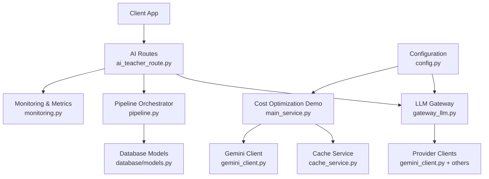
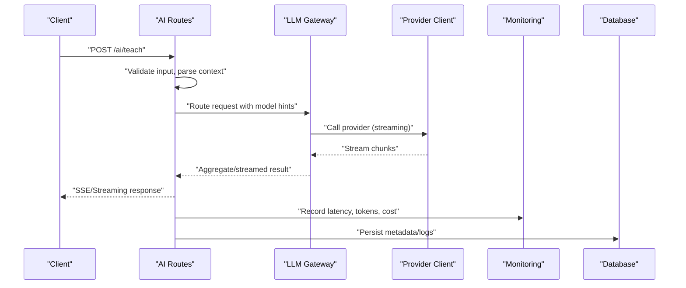
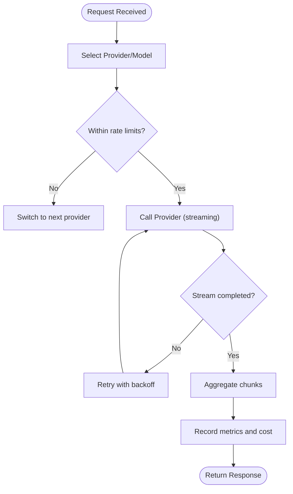
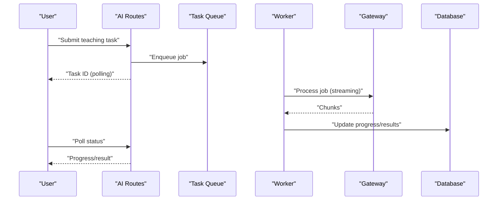
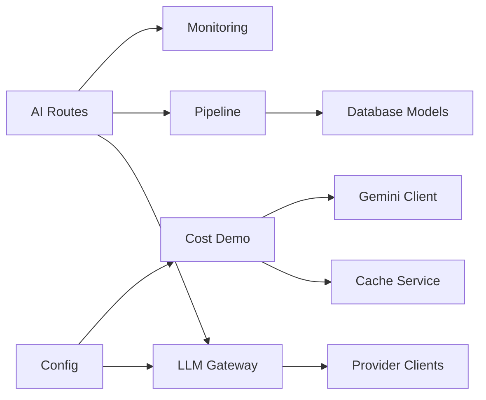

# AI Service Scaling

<cite>
**Referenced Files in This Document**
- [app.py](file://backend/app.py)
- [gateway_llm.py](file://backend/gateway_llm.py)
- [ai_teacher_route.py](file://backend/ai_teacher_route.py)
- [pipeline.py](file://backend/pipeline.py)
- [monitoring.py](file://backend/monitoring.py)
- [config.py](file://backend/config.py)
- [cost_optimization_demo/main_service.py](file://backend/cost_optimization_demo/main_service.py)
- [cost_optimization_demo/gemini_client.py](file://backend/cost_optimization_demo/gemini_client.py)
- [cost_optimization_demo/cache_service.py](file://backend/cost_optimization_demo/cache_service.py)
- [cost_optimization_demo/config.py](file://backend/cost_optimization_demo/config.py)
- [database/models.py](file://backend/database/models.py)
- [database/schema.sql](file://backend/database/schema.sql)
- [PERFORMANCE_OPTIMIZATION.md](file://backend/PERFORMANCE_OPTIMIZATION.md)
</cite>

## Table of Contents
1. [Introduction](#introduction)
2. [Project Structure](#project-structure)
3. [Core Components](#core-components)
4. [Architecture Overview](#architecture-overview)
5. [Detailed Component Analysis](#detailed-component-analysis)
6. [Dependency Analysis](#dependency-analysis)
7. [Performance Considerations](#performance-considerations)
8. [Troubleshooting Guide](#troubleshooting-guide)
9. [Conclusion](#conclusion)
10. [Appendices](#appendices)

## Introduction
This document provides comprehensive guidance for scaling the XSYY Edu platform’s AI services across multiple LLM providers, with a focus on multi-model routing, GPU resource allocation, request queuing, load distribution, failover handling, and cost optimization at scale. It also covers asynchronous processing patterns, batch request handling, rate limiting strategies, model-specific considerations (including Gemini and DeepSeek), memory management for large responses, streaming optimizations, timeout handling, and monitoring strategies for performance, cost tracking, and quality metrics.

## Project Structure
The AI service layer is implemented primarily in the backend Python application. Key modules include:
- API entry points and routes for AI features
- A unified LLM gateway for provider abstraction
- Pipeline orchestration for complex workflows
- Monitoring utilities for observability
- Cost optimization demo components demonstrating caching and client usage
- Database models and schema for persistence and analytics

**Diagram sources**
- [ai_teacher_route.py](file://backend/ai_teacher_route.py)
- [gateway_llm.py](file://backend/gateway_llm.py)
- [pipeline.py](file://backend/pipeline.py)
- [monitoring.py](file://backend/monitoring.py)
- [config.py](file://backend/config.py)
- [cost_optimization_demo/main_service.py](file://backend/cost_optimization_demo/main_service.py)
- [cost_optimization_demo/gemini_client.py](file://backend/cost_optimization_demo/gemini_client.py)
- [cost_optimization_demo/cache_service.py](file://backend/cost_optimization_demo/cache_service.py)
- [database/models.py](file://backend/database/models.py)

**Section sources**
- [app.py](file://backend/app.py)
- [ai_teacher_route.py](file://backend/ai_teacher_route.py)
- [gateway_llm.py](file://backend/gateway_llm.py)
- [pipeline.py](file://backend/pipeline.py)
- [monitoring.py](file://backend/monitoring.py)
- [config.py](file://backend/config.py)
- [cost_optimization_demo/main_service.py](file://backend/cost_optimization_demo/main_service.py)
- [cost_optimization_demo/gemini_client.py](file://backend/cost_optimization_demo/gemini_client.py)
- [cost_optimization_demo/cache_service.py](file://backend/cost_optimization_demo/cache_service.py)
- [database/models.py](file://backend/database/models.py)

## Core Components
- Unified LLM Gateway: Abstracts provider calls, supports routing, retries, timeouts, and streaming.
- AI Routes: Expose REST endpoints that accept user requests, validate inputs, and delegate to the gateway or pipeline.
- Pipeline Orchestrator: Coordinates multi-step AI workflows, integrates with database and external services.
- Monitoring: Collects latency, error rates, throughput, and cost-related metrics.
- Cost Optimization Demo: Demonstrates caching strategies and provider client usage for cost control.
- Configuration: Centralizes environment variables, provider credentials, and scaling parameters.

Key responsibilities:
- Multi-provider scaling via configurable routing and fallbacks
- Asynchronous processing and queue-backed workloads
- Rate limiting and backpressure mechanisms
- Streaming response handling for long outputs
- Memory-efficient processing for large payloads
- Observability and cost tracking

**Section sources**
- [gateway_llm.py](file://backend/gateway_llm.py)
- [ai_teacher_route.py](file://backend/ai_teacher_route.py)
- [pipeline.py](file://backend/pipeline.py)
- [monitoring.py](file://backend/monitoring.py)
- [config.py](file://backend/config.py)
- [cost_optimization_demo/main_service.py](file://backend/cost_optimization_demo/main_service.py)
- [cost_optimization_demo/gemini_client.py](file://backend/cost_optimization_demo/gemini_client.py)
- [cost_optimization_demo/cache_service.py](file://backend/cost_optimization_demo/cache_service.py)

## Architecture Overview
The system uses a layered architecture:
- API Layer: FastAPI routes handle incoming requests, perform validation, and manage async tasks.
- Orchestration Layer: The gateway selects an appropriate provider based on configuration, load, and capabilities; pipelines coordinate multi-step operations.
- Provider Abstraction: Each provider client implements a common interface, enabling seamless switching and failover.
- Persistence Layer: Database stores metadata, logs, and analytics for monitoring and cost tracking.
- Observability Layer: Metrics collection and logging support performance tuning and cost analysis.

**Diagram sources**
- [ai_teacher_route.py](file://backend/ai_teacher_route.py)
- [gateway_llm.py](file://backend/gateway_llm.py)
- [monitoring.py](file://backend/monitoring.py)
- [database/models.py](file://backend/database/models.py)

## Detailed Component Analysis

### LLM Gateway and Provider Routing
Responsibilities:
- Select provider/model based on configuration and runtime signals (load, cost, capability).
- Implement retries, circuit breakers, and fallback chains.
- Support streaming responses and chunk aggregation.
- Enforce timeouts and cancellation propagation.

Scaling strategies:
- Weighted round-robin or least-loaded selection among available providers.
- Per-provider concurrency limits and backoff policies.
- Dynamic model switching when quotas or rate limits are reached.

**Diagram sources**
- [gateway_llm.py](file://backend/gateway_llm.py)

**Section sources**
- [gateway_llm.py](file://backend/gateway_llm.py)
- [config.py](file://backend/config.py)

### AI Teacher Routes and Async Processing
Responsibilities:
- Accept user prompts, validate inputs, and dispatch to gateway or pipeline.
- Provide both synchronous and asynchronous endpoints.
- Manage SSE streaming for real-time updates.
- Persist task state and results for auditability.

Async patterns:
- Background tasks for heavy computations.
- Queue-backed workers for batch processing.
- Task status polling or webhook callbacks.

**Diagram sources**
- [ai_teacher_route.py](file://backend/ai_teacher_route.py)
- [pipeline.py](file://backend/pipeline.py)
- [database/models.py](file://backend/database/models.py)

**Section sources**
- [ai_teacher_route.py](file://backend/ai_teacher_route.py)
- [pipeline.py](file://backend/pipeline.py)
- [database/models.py](file://backend/database/models.py)

### Pipeline Orchestrator
Responsibilities:
- Coordinate multi-step AI workflows (e.g., prompt generation, classification, summarization).
- Integrate with cache and vector databases where applicable.
- Handle intermediate results and error recovery.

Optimization opportunities:
- Parallelize independent steps.
- Cache intermediate artifacts.
- Use streaming to reduce end-to-end latency.

**Section sources**
- [pipeline.py](file://backend/pipeline.py)

### Monitoring and Observability
Responsibilities:
- Track latency percentiles, error rates, throughput, and token counts.
- Capture per-provider costs and budget alerts.
- Log structured events for debugging and auditing.

Quality metrics:
- Response completeness, hallucination indicators (via downstream checks).
- User feedback integration for continuous improvement.

**Section sources**
- [monitoring.py](file://backend/monitoring.py)

### Cost Optimization Demo
Components:
- Main service orchestrating demo flows.
- Gemini client wrapper for provider-specific behavior.
- Cache service to avoid redundant expensive calls.

Strategies:
- Request deduplication via content hashing.
- TTL-based caching for stable prompts.
- Prefer cheaper models for non-critical tasks.

**Section sources**
- [cost_optimization_demo/main_service.py](file://backend/cost_optimization_demo/main_service.py)
- [cost_optimization_demo/gemini_client.py](file://backend/cost_optimization_demo/gemini_client.py)
- [cost_optimization_demo/cache_service.py](file://backend/cost_optimization_demo/cache_service.py)
- [cost_optimization_demo/config.py](file://backend/cost_optimization_demo/config.py)

### Configuration Management
Responsibilities:
- Centralize provider credentials, model names, and scaling parameters.
- Enable feature flags for routing rules and fallback behaviors.
- Control concurrency limits, timeouts, and retry policies.

Best practices:
- Separate dev/prod configurations.
- Rotate secrets securely.
- Validate config at startup.

**Section sources**
- [config.py](file://backend/config.py)

## Dependency Analysis
High-level dependencies:
- Routes depend on gateway and pipeline.
- Gateway depends on provider clients and configuration.
- Pipeline depends on database models and optional caches.
- Monitoring depends on metrics libraries and logging infrastructure.
- Cost optimization demo depends on cache service and provider clients.

**Diagram sources**
- [ai_teacher_route.py](file://backend/ai_teacher_route.py)
- [gateway_llm.py](file://backend/gateway_llm.py)
- [pipeline.py](file://backend/pipeline.py)
- [monitoring.py](file://backend/monitoring.py)
- [config.py](file://backend/config.py)
- [cost_optimization_demo/main_service.py](file://backend/cost_optimization_demo/main_service.py)
- [cost_optimization_demo/gemini_client.py](file://backend/cost_optimization_demo/gemini_client.py)
- [cost_optimization_demo/cache_service.py](file://backend/cost_optimization_demo/cache_service.py)
- [database/models.py](file://backend/database/models.py)

**Section sources**
- [ai_teacher_route.py](file://backend/ai_teacher_route.py)
- [gateway_llm.py](file://backend/gateway_llm.py)
- [pipeline.py](file://backend/pipeline.py)
- [monitoring.py](file://backend/monitoring.py)
- [config.py](file://backend/config.py)
- [cost_optimization_demo/main_service.py](file://backend/cost_optimization_demo/main_service.py)
- [cost_optimization_demo/gemini_client.py](file://backend/cost_optimization_demo/gemini_client.py)
- [cost_optimization_demo/cache_service.py](file://backend/cost_optimization_demo/cache_service.py)
- [database/models.py](file://backend/database/models.py)

## Performance Considerations
- Concurrency and Queues:
  - Use background workers to offload heavy tasks from HTTP handlers.
  - Apply bounded queues with backpressure to prevent overload.
- Streaming Responses:
  - Stream provider chunks to reduce time-to-first-byte and memory pressure.
  - Buffer minimally and flush frequently.
- Timeouts and Retries:
  - Set per-request timeouts aligned with SLAs.
  - Implement exponential backoff with jitter for transient errors.
- Rate Limiting:
  - Enforce per-user and global rate limits at the gateway.
  - Respect provider quotas and implement graceful degradation.
- Memory Management:
  - Avoid loading entire responses into memory; process streams incrementally.
  - Purge temporary buffers and close connections promptly.
- Batch Processing:
  - Group small requests to amortize overhead when supported by providers.
  - Ensure idempotency and proper error handling for partial failures.
- GPU Resource Allocation:
  - For local inference, pin models to specific GPUs and limit concurrent sessions per device.
  - Use dynamic batching and model warm-up to improve throughput.

[No sources needed since this section provides general guidance]

## Troubleshooting Guide
Common issues and resolutions:
- Provider Errors:
  - Inspect gateway logs for error codes and messages.
  - Verify credentials and endpoint availability.
  - Enable fallback chain and monitor switch events.
- Timeouts:
  - Adjust request timeouts and provider-side limits.
  - Reduce payload size or enable streaming.
- Rate Limits:
  - Review per-provider quotas and adjust weights.
  - Implement client-side throttling and retry delays.
- Memory Pressure:
  - Monitor heap usage and GC behavior.
  - Stream responses and avoid unnecessary copies.
- Cost Spikes:
  - Audit token usage and model selection.
  - Enable caching for repeated prompts and prefer cheaper models for non-critical tasks.

Operational tips:
- Use structured logs with correlation IDs.
- Alert on error rate thresholds and latency SLO breaches.
- Periodically review cost dashboards and set budgets.

**Section sources**
- [monitoring.py](file://backend/monitoring.py)
- [PERFORMANCE_OPTIMIZATION.md](file://backend/PERFORMANCE_OPTIMIZATION.md)

## Conclusion
Scaling AI services on XSYY Edu requires a robust gateway with multi-provider routing, strong async and streaming support, careful resource management, and comprehensive observability. By combining weighted load distribution, failover handling, caching, and cost-aware model selection, the platform can deliver reliable, high-performance AI experiences while controlling expenses. Continuous monitoring and iterative tuning ensure sustained quality and efficiency at scale.

[No sources needed since this section summarizes without analyzing specific files]

## Appendices

### Model-Specific Scaling Considerations
- Gemini:
  - Leverage streaming APIs to reduce latency and memory usage.
  - Respect quota limits and implement adaptive backoff.
  - Cache frequent prompts to minimize redundant calls.
- DeepSeek:
  - Evaluate model variants for cost vs. quality trade-offs.
  - Use smaller models for simple tasks and larger ones for complex reasoning.
  - Monitor token consumption closely and optimize prompts.
- Other LLM Providers:
  - Standardize interfaces for consistent routing and fallbacks.
  - Normalize error handling and metrics collection across providers.

[No sources needed since this section provides general guidance]

### Data Models and Schema for Monitoring and Cost Tracking
- Store request metadata, provider, model, token counts, latency, and cost.
- Maintain task states and results for auditability.
- Index fields used in queries and dashboards for performance.

**Section sources**
- [database/models.py](file://backend/database/models.py)
- [database/schema.sql](file://backend/database/schema.sql)