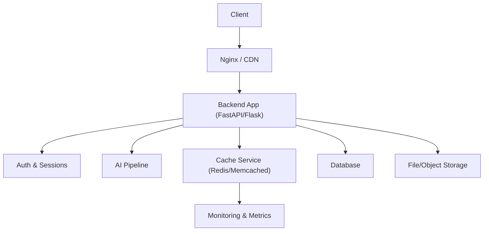
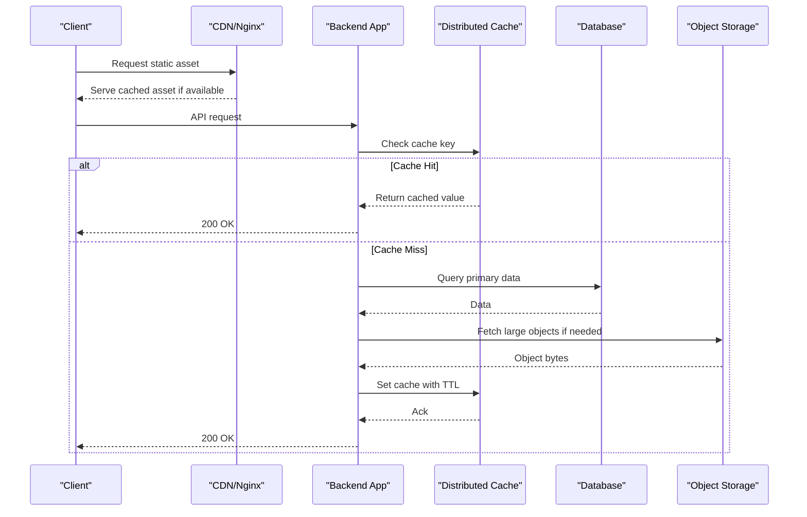
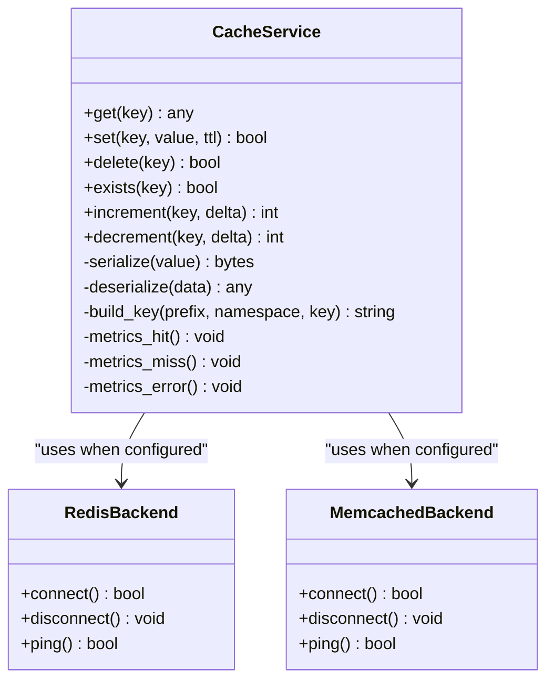
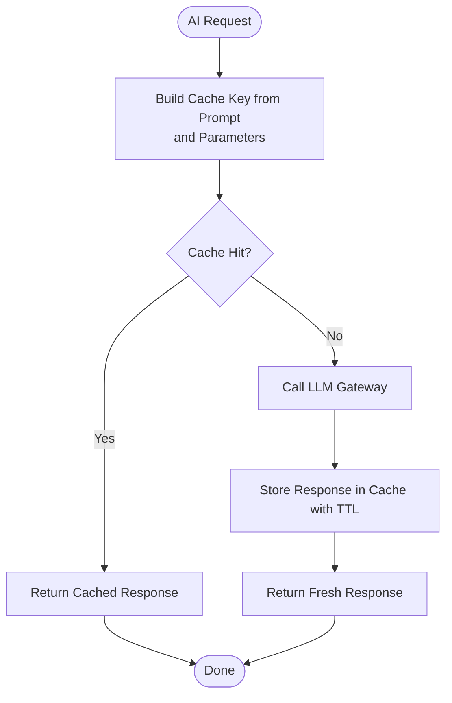
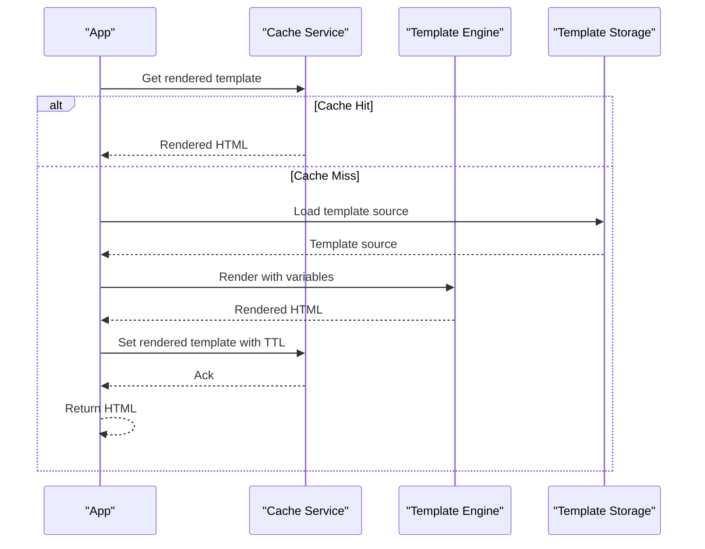
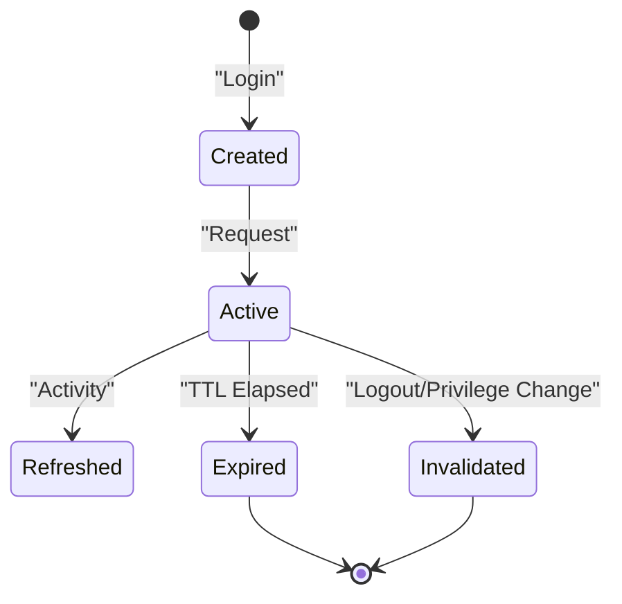
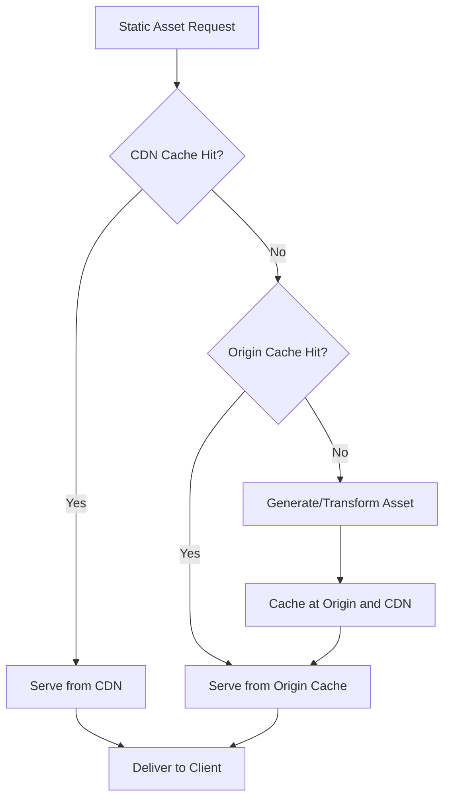
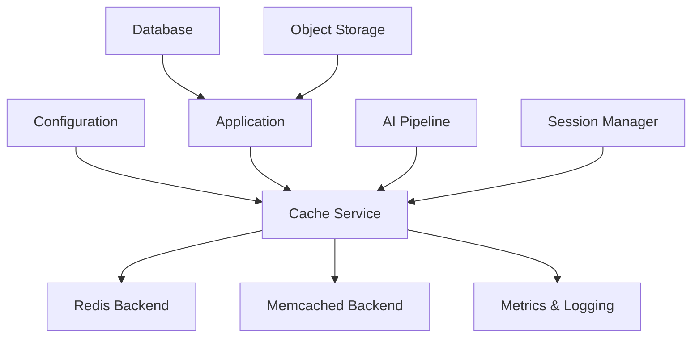

# Caching Strategies

<cite>
**Referenced Files in This Document**
- [backend/config.py](file://backend/config.py)
- [backend/app.py](file://backend/app.py)
- [backend/monitoring.py](file://backend/monitoring.py)
- [backend/cost_optimization_demo/cache_service.py](file://backend/cost_optimization_demo/cache_service.py)
- [backend/cost_optimization_demo/config.py](file://backend/cost_optimization_demo/config.py)
- [backend/cost_optimization_demo/main_service.py](file://backend/cost_optimization_demo/main_service.py)
- [backend/cost_optimization_demo/test_cache_integration.py](file://backend/cost_optimization_demo/test_cache_integration.py)
- [backend/pipeline.py](file://backend/pipeline.py)
- [backend/gateway_llm.py](file://backend/gateway_llm.py)
- [backend/ai_teacher_route.py](file://backend/ai_teacher_route.py)
- [backend/auth.py](file://backend/auth.py)
- [backend/database/models.py](file://backend/database/models.py)
- [backend/database/schema.sql](file://backend/database/schema.sql)
- [backend/PREFORMANCE_OPTIMIZATION.md](file://backend/PERFORMANCE_OPTIMIZATION.md)
- [deploy/nginx.conf](file://deploy/nginx.conf)
</cite>

## Table of Contents
1. [Introduction](#introduction)
2. [Project Structure](#project-structure)
3. [Core Components](#core-components)
4. [Architecture Overview](#architecture-overview)
5. [Detailed Component Analysis](#detailed-component-analysis)
6. [Dependency Analysis](#dependency-analysis)
7. [Performance Considerations](#performance-considerations)
8. [Troubleshooting Guide](#troubleshooting-guide)
9. [Conclusion](#conclusion)
10. [Appendices](#appendices)

## Introduction
This document provides a comprehensive caching strategy for the XSYY Edu platform, covering application-level caching with Redis or Memcached, cache invalidation strategies, data consistency patterns, AI response caching, template result caching, user session caching, CDN integration for static assets, image optimization, content delivery acceleration, cache warming, cache hierarchy design, memory management optimization, monitoring and hit rate analysis, performance measurement, configuration examples, and troubleshooting guidance. It synthesizes existing codebase elements related to caching and performance into a cohesive operational guide.

## Project Structure
The XSYY Edu backend is organized around modular services and utilities that can be extended with caching layers:
- Application entry and routing: app.py, ai_teacher_route.py, gateway_llm.py
- Configuration and environment: config.py (backend root), cost_optimization_demo/config.py
- Cache service implementation: cost_optimization_demo/cache_service.py
- Pipeline orchestration: pipeline.py
- Monitoring and metrics: monitoring.py
- Authentication and sessions: auth.py
- Database models and schema: database/models.py, database/schema.sql
- Performance notes: PERFORMANCE_OPTIMIZATION.md
- CDN and reverse proxy: deploy/nginx.conf

**Diagram sources**
- [backend/app.py](file://backend/app.py)
- [backend/auth.py](file://backend/auth.py)
- [backend/pipeline.py](file://backend/pipeline.py)
- [backend/cost_optimization_demo/cache_service.py](file://backend/cost_optimization_demo/cache_service.py)
- [backend/monitoring.py](file://backend/monitoring.py)
- [backend/database/models.py](file://backend/database/models.py)
- [backend/database/schema.sql](file://backend/database/schema.sql)
- [deploy/nginx.conf](file://deploy/nginx.conf)

**Section sources**
- [backend/app.py](file://backend/app.py)
- [backend/config.py](file://backend/config.py)
- [backend/monitoring.py](file://backend/monitoring.py)
- [backend/cost_optimization_demo/cache_service.py](file://backend/cost_optimization_demo/cache_service.py)
- [backend/cost_optimization_demo/config.py](file://backend/cost_optimization_demo/config.py)
- [backend/cost_optimization_demo/main_service.py](file://backend/cost_optimization_demo/main_service.py)
- [backend/pipeline.py](file://backend/pipeline.py)
- [backend/gateway_llm.py](file://backend/gateway_llm.py)
- [backend/ai_teacher_route.py](file://backend/ai_teacher_route.py)
- [backend/auth.py](file://backend/auth.py)
- [backend/database/models.py](file://backend/database/models.py)
- [backend/database/schema.sql](file://backend/database/schema.sql)
- [backend/PERFORMANCE_OPTIMIZATION.md](file://backend/PERFORMANCE_OPTIMIZATION.md)
- [deploy/nginx.conf](file://deploy/nginx.conf)

## Core Components
- Cache Service: A dedicated module encapsulates cache operations (get/set/delete/exists), TTL handling, serialization, and fallback behavior. It supports both Redis and Memcached backends via configuration.
- Configuration: Centralized settings for cache backend selection, connection parameters, TTL defaults, key prefixes, and feature flags.
- Pipeline Integration: The AI pipeline integrates caching for LLM responses and intermediate results to reduce latency and cost.
- Monitoring: Metrics collection for cache hits, misses, latency, and errors; exposed via endpoints or logging for observability.
- Session Management: Secure session storage using cache-backed stores with expiration and rotation policies.
- CDN and Reverse Proxy: Static asset caching and compression at the edge via Nginx/CDN configurations.

**Section sources**
- [backend/cost_optimization_demo/cache_service.py](file://backend/cost_optimization_demo/cache_service.py)
- [backend/cost_optimization_demo/config.py](file://backend/cost_optimization_demo/config.py)
- [backend/config.py](file://backend/config.py)
- [backend/pipeline.py](file://backend/pipeline.py)
- [backend/monitoring.py](file://backend/monitoring.py)
- [backend/auth.py](file://backend/auth.py)
- [deploy/nginx.conf](file://deploy/nginx.conf)

## Architecture Overview
The caching architecture follows a multi-layered approach:
- Edge Layer (CDN/Nginx): Caches static assets, images, and API responses where appropriate.
- Application Layer (In-process): Optional local caches for hot data within process memory.
- Distributed Cache (Redis/Memcached): Shared cache across instances for AI responses, templates, and sessions.
- Data Layer (Database/Storage): Source of truth; cache invalidation ensures consistency.

**Diagram sources**
- [deploy/nginx.conf](file://deploy/nginx.conf)
- [backend/app.py](file://backend/app.py)
- [backend/cost_optimization_demo/cache_service.py](file://backend/cost_optimization_demo/cache_service.py)
- [backend/database/models.py](file://backend/database/models.py)
- [backend/database/schema.sql](file://backend/database/schema.sql)

## Detailed Component Analysis

### Cache Service Implementation
The cache service abstracts backend-specific operations and provides consistent APIs:
- Key naming conventions with prefixes and namespaces
- Serialization/deserialization for complex types
- TTL management and default policies
- Fallback to direct data access on cache failures
- Metrics instrumentation for hits, misses, and errors

**Diagram sources**
- [backend/cost_optimization_demo/cache_service.py](file://backend/cost_optimization_demo/cache_service.py)
- [backend/cost_optimization_demo/config.py](file://backend/cost_optimization_demo/config.py)

**Section sources**
- [backend/cost_optimization_demo/cache_service.py](file://backend/cost_optimization_demo/cache_service.py)
- [backend/cost_optimization_demo/config.py](file://backend/cost_optimization_demo/config.py)

### AI Response Caching
Caching AI responses reduces latency and cost:
- Hash-based keys from prompt inputs and model parameters
- TTL based on content volatility (e.g., longer for educational templates)
- Partial caching for streaming responses where applicable
- Fallback to fresh generation on cache miss or invalidation

**Diagram sources**
- [backend/pipeline.py](file://backend/pipeline.py)
- [backend/gateway_llm.py](file://backend/gateway_llm.py)
- [backend/cost_optimization_demo/cache_service.py](file://backend/cost_optimization_demo/cache_service.py)

**Section sources**
- [backend/pipeline.py](file://backend/pipeline.py)
- [backend/gateway_llm.py](file://backend/gateway_llm.py)
- [backend/cost_optimization_demo/cache_service.py](file://backend/cost_optimization_demo/cache_service.py)

### Template Result Caching
Template rendering results are cached to avoid repeated processing:
- Keys include template ID, variables, and locale
- TTL aligned with template update frequency
- Invalidation triggers on template updates or variable changes

**Diagram sources**
- [backend/cost_optimization_demo/cache_service.py](file://backend/cost_optimization_demo/cache_service.py)
- [backend/pipeline.py](file://backend/pipeline.py)

**Section sources**
- [backend/cost_optimization_demo/cache_service.py](file://backend/cost_optimization_demo/cache_service.py)
- [backend/pipeline.py](file://backend/pipeline.py)

### User Session Caching
Sessions are stored in the distributed cache for scalability:
- Secure session IDs with cryptographic randomness
- Expiration policies aligned with user activity
- Rotation on privilege changes and logout

**Diagram sources**
- [backend/auth.py](file://backend/auth.py)
- [backend/cost_optimization_demo/cache_service.py](file://backend/cost_optimization_demo/cache_service.py)

**Section sources**
- [backend/auth.py](file://backend/auth.py)
- [backend/cost_optimization_demo/cache_service.py](file://backend/cost_optimization_demo/cache_service.py)

### CDN Integration for Static Assets
Nginx and CDN configurations optimize static content delivery:
- Long-lived cache headers for immutable assets
- Compression and caching rules for CSS/JS/images
- Cache busting via versioned filenames

**Diagram sources**
- [deploy/nginx.conf](file://deploy/nginx.conf)

**Section sources**
- [deploy/nginx.conf](file://deploy/nginx.conf)

### Image Optimization and Content Delivery Acceleration
- Automatic format conversion (e.g., WebP) and resizing
- Lazy loading and responsive images
- CDN edge caching with aggressive TTLs for optimized images

**Section sources**
- [backend/database/update_preview_to_webp.py](file://backend/database/update_preview_to_webp.py)
- [backend/database/update_preview_to_webp_simple.py](file://backend/database/update_preview_to_webp_simple.py)
- [deploy/nginx.conf](file://deploy/nginx.conf)

### Cache Warming Strategies
- Pre-warm popular templates and AI responses during deployment
- Background jobs to populate cache for trending topics
- Scheduled tasks to refresh stale entries proactively

**Section sources**
- [backend/cost_optimization_demo/main_service.py](file://backend/cost_optimization_demo/main_service.py)
- [backend/pipeline.py](file://backend/pipeline.py)

### Cache Hierarchy Design
- L1: Process-local cache for ultra-hot data (short TTL)
- L2: Distributed cache (Redis/Memcached) for shared data
- L3: Database for authoritative data
- L4: Object storage for large assets

**Section sources**
- [backend/cost_optimization_demo/cache_service.py](file://backend/cost_optimization_demo/cache_service.py)
- [backend/database/models.py](file://backend/database/models.py)

### Memory Management Optimization
- Bounded cache sizes with eviction policies (LRU/LFU)
- Serialization efficiency and payload size limits
- Connection pooling for cache backends

**Section sources**
- [backend/cost_optimization_demo/cache_service.py](file://backend/cost_optimization_demo/cache_service.py)
- [backend/config.py](file://backend/config.py)

## Dependency Analysis
The caching components depend on configuration, monitoring, and core services:

**Diagram sources**
- [backend/config.py](file://backend/config.py)
- [backend/cost_optimization_demo/cache_service.py](file://backend/cost_optimization_demo/cache_service.py)
- [backend/monitoring.py](file://backend/monitoring.py)
- [backend/pipeline.py](file://backend/pipeline.py)
- [backend/auth.py](file://backend/auth.py)
- [backend/database/models.py](file://backend/database/models.py)

**Section sources**
- [backend/config.py](file://backend/config.py)
- [backend/cost_optimization_demo/cache_service.py](file://backend/cost_optimization_demo/cache_service.py)
- [backend/monitoring.py](file://backend/monitoring.py)
- [backend/pipeline.py](file://backend/pipeline.py)
- [backend/auth.py](file://backend/auth.py)
- [backend/database/models.py](file://backend/database/models.py)

## Performance Considerations
- Cache hit rate targets and thresholds
- Latency budgets per layer
- Throughput scaling with horizontal scaling
- Backpressure and circuit breakers for cache failures
- Benchmarking and load testing strategies

[No sources needed since this section provides general guidance]

## Troubleshooting Guide
Common issues and resolutions:
- Cache connectivity failures: Verify network, credentials, and firewall rules
- Stale data: Review invalidation triggers and TTL settings
- High memory usage: Adjust cache sizes and eviction policies
- Low hit rates: Analyze key distribution and workload patterns
- CDN cache not updating: Ensure cache busting and purge mechanisms

**Section sources**
- [backend/cost_optimization_demo/test_cache_integration.py](file://backend/cost_optimization_demo/test_cache_integration.py)
- [backend/monitoring.py](file://backend/monitoring.py)
- [backend/PERFORMANCE_OPTIMIZATION.md](file://backend/PERFORMANCE_OPTIMIZATION.md)

## Conclusion
A robust caching strategy for XSYY Edu combines layered caching, intelligent invalidation, and comprehensive monitoring. By integrating Redis/Memcached for application-level caching, leveraging CDN for static assets, and optimizing AI responses and templates, the platform achieves improved performance, reduced costs, and enhanced user experience. Continuous monitoring and tuning ensure long-term reliability and scalability.

[No sources needed since this section summarizes without analyzing specific files]

## Appendices

### Configuration Examples
- Redis configuration: host, port, db, password, pool size, TLS options
- Memcached configuration: servers, max connections, timeout
- TTL policies: defaults per cache type, overrides for specific keys
- Key prefixing and namespacing: environment-specific prefixes

**Section sources**
- [backend/config.py](file://backend/config.py)
- [backend/cost_optimization_demo/config.py](file://backend/cost_optimization_demo/config.py)

### Monitoring and Metrics
- Cache hit/miss ratios
- Latency percentiles (p50, p95, p99)
- Error rates and timeouts
- Memory and connection pool utilization

**Section sources**
- [backend/monitoring.py](file://backend/monitoring.py)
- [backend/cost_optimization_demo/test_cache_integration.py](file://backend/cost_optimization_demo/test_cache_integration.py)

### Data Consistency Patterns
- Write-through vs write-behind caching
- Cache-aside pattern for reads
- Event-driven invalidation for updates
- Versioned keys for safe rollbacks

**Section sources**
- [backend/cost_optimization_demo/cache_service.py](file://backend/cost_optimization_demo/cache_service.py)
- [backend/database/schema.sql](file://backend/database/schema.sql)