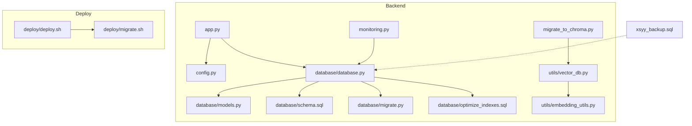
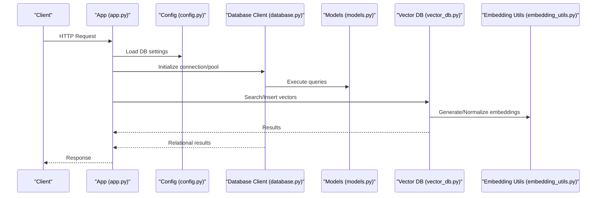
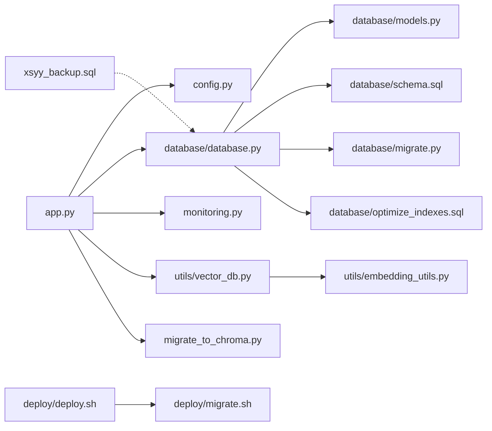

# Database Scaling

<cite>
**Referenced Files in This Document**
- [backend/database/schema.sql](file://backend/database/schema.sql)
- [backend/database/models.py](file://backend/database/models.py)
- [backend/database/database.py](file://backend/database/database.py)
- [backend/database/migrate.py](file://backend/database/migrate.py)
- [backend/database/optimize_indexes.sql](file://backend/database/optimize_indexes.sql)
- [backend/config.py](file://backend/config.py)
- [backend/app.py](file://backend/app.py)
- [backend/utils/vector_db.py](file://backend/utils/vector_db.py)
- [backend/utils/embedding_utils.py](file://backend/utils/embedding_utils.py)
- [backend/migrate_to_chroma.py](file://backend/migrate_to_chroma.py)
- [backend/monitoring.py](file://backend/monitoring.py)
- [backend/xsyy_backup.sql](file://backend/xsyy_backup.sql)
- [deploy/deploy.sh](file://deploy/deploy.sh)
- [deploy/migrate.sh](file://deploy/migrate.sh)
</cite>

## Table of Contents
1. [Introduction](#introduction)
2. [Project Structure](#project-structure)
3. [Core Components](#core-components)
4. [Architecture Overview](#architecture-overview)
5. [Detailed Component Analysis](#detailed-component-analysis)
6. [Dependency Analysis](#dependency-analysis)
7. [Performance Considerations](#performance-considerations)
8. [Troubleshooting Guide](#troubleshooting-guide)
9. [Conclusion](#conclusion)
10. [Appendices](#appendices)

## Introduction
This document provides a comprehensive guide to scaling the XSYY Edu platform’s data layer for production workloads. It covers:
- SQLite limitations and migration strategies to PostgreSQL or MySQL
- Read replica implementation, connection pooling configuration, and query optimization techniques
- Database sharding strategies, partitioning approaches, and data distribution patterns
- Vector database scaling with ChromaDB, embedding storage optimization, and search performance tuning
- Backup and recovery procedures for scaled databases, replication lag management, and consistency guarantees
- Monitoring strategies for database performance, slow query analysis, and capacity planning guidelines

The guidance is grounded in the repository’s current database schema, ORM models, migration scripts, vector DB utilities, and deployment scripts.

## Project Structure
The XSYY Edu backend organizes database-related code under backend/database, with additional utilities for embeddings and vector operations, plus deployment and monitoring helpers.

**Diagram sources**
- [backend/app.py](file://backend/app.py)
- [backend/config.py](file://backend/config.py)
- [backend/database/database.py](file://backend/database/database.py)
- [backend/database/models.py](file://backend/database/models.py)
- [backend/database/schema.sql](file://backend/database/schema.sql)
- [backend/database/migrate.py](file://backend/database/migrate.py)
- [backend/database/optimize_indexes.sql](file://backend/database/optimize_indexes.sql)
- [backend/utils/vector_db.py](file://backend/utils/vector_db.py)
- [backend/utils/embedding_utils.py](file://backend/utils/embedding_utils.py)
- [backend/migrate_to_chroma.py](file://backend/migrate_to_chroma.py)
- [backend/monitoring.py](file://backend/monitoring.py)
- [backend/xsyy_backup.sql](file://backend/xsyy_backup.sql)
- [deploy/deploy.sh](file://deploy/deploy.sh)
- [deploy/migrate.sh](file://deploy/migrate.sh)

**Section sources**
- [backend/database/schema.sql](file://backend/database/schema.sql)
- [backend/database/models.py](file://backend/database/models.py)
- [backend/database/database.py](file://backend/database/database.py)
- [backend/database/migrate.py](file://backend/database/migrate.py)
- [backend/database/optimize_indexes.sql](file://backend/database/optimize_indexes.sql)
- [backend/config.py](file://backend/config.py)
- [backend/app.py](file://backend/app.py)
- [backend/utils/vector_db.py](file://backend/utils/vector_db.py)
- [backend/utils/embedding_utils.py](file://backend/utils/embedding_utils.py)
- [backend/migrate_to_chroma.py](file://backend/migrate_to_chroma.py)
- [backend/monitoring.py](file://backend/monitoring.py)
- [backend/xsyy_backup.sql](file://backend/xsyy_backup.sql)
- [deploy/deploy.sh](file://deploy/deploy.sh)
- [deploy/migrate.sh](file://deploy/migrate.sh)

## Core Components
- Data model definitions and schema: The relational schema and ORM models define core entities such as users, teachings, topics, view history, and AI teaching tables. These drive indexing and query design decisions.
- Database client and migrations: The database client initializes connections and runs migrations; migration scripts evolve the schema over time.
- Index optimization: Dedicated SQL files provide index recommendations and maintenance routines.
- Vector store integration: Utilities manage embeddings and ChromaDB interactions, including migration from existing storage.
- Deployment and backup: Scripts orchestrate application startup, migrations, and backups.

Key responsibilities:
- Schema evolution via migration scripts
- Connection lifecycle and pool configuration
- Query optimization through indexes and query patterns
- Vector search scalability via ChromaDB and embedding optimizations
- Operational reliability via backups and monitoring hooks

**Section sources**
- [backend/database/schema.sql](file://backend/database/schema.sql)
- [backend/database/models.py](file://backend/database/models.py)
- [backend/database/database.py](file://backend/database/database.py)
- [backend/database/migrate.py](file://backend/database/migrate.py)
- [backend/database/optimize_indexes.sql](file://backend/database/optimize_indexes.sql)
- [backend/utils/vector_db.py](file://backend/utils/vector_db.py)
- [backend/utils/embedding_utils.py](file://backend/utils/embedding_utils.py)
- [backend/migrate_to_chroma.py](file://backend/migrate_to_chroma.py)
- [backend/monitoring.py](file://backend/monitoring.py)
- [backend/xsyy_backup.sql](file://backend/xsyy_backup.sql)
- [deploy/deploy.sh](file://deploy/deploy.sh)
- [deploy/migrate.sh](file://deploy/migrate.sh)

## Architecture Overview
At runtime, the application loads configuration, initializes the database client, applies migrations, and serves API requests that read/write relational data and perform vector searches.

**Diagram sources**
- [backend/app.py](file://backend/app.py)
- [backend/config.py](file://backend/config.py)
- [backend/database/database.py](file://backend/database/database.py)
- [backend/database/models.py](file://backend/database/models.py)
- [backend/utils/vector_db.py](file://backend/utils/vector_db.py)
- [backend/utils/embedding_utils.py](file://backend/utils/embedding_utils.py)

## Detailed Component Analysis

### Relational Data Model and Schema
- Entities include users, teachings, topics, view history, and AI teaching tables.
- Indexes are defined or recommended to optimize common access patterns (e.g., user-centric lookups, topic-based retrieval, time-range queries).
- Migration scripts add fields and tables incrementally.

Recommendations:
- Ensure foreign keys and constraints are enforced on production engines (PostgreSQL/MySQL).
- Normalize large JSON-like payloads into separate tables if frequent filtering is required.
- Use appropriate data types (e.g., timestamps, enums) to improve storage and query efficiency.

**Section sources**
- [backend/database/schema.sql](file://backend/database/schema.sql)
- [backend/database/models.py](file://backend/database/models.py)
- [backend/database/migrate.py](file://backend/database/migrate.py)

### Database Client and Migration Strategy
- The database client initializes connections and manages lifecycle.
- Migration scripts evolve schema safely across environments.

Scaling considerations:
- For PostgreSQL/MySQL, configure connection pools and timeouts at the client level.
- Use transaction boundaries around batch writes to reduce lock contention.
- Apply migrations during zero-downtime deployments using blue/green or rolling updates.

**Section sources**
- [backend/database/database.py](file://backend/database/database.py)
- [backend/database/migrate.py](file://backend/database/migrate.py)

### Index Optimization and Query Tuning
- Index optimization SQL provides targeted improvements for hot paths.
- Focus on high-cardinality columns used in WHERE, JOIN, and ORDER BY clauses.
- Periodically analyze and rebuild indexes based on workload changes.

Operational tips:
- Enable query logging in development/staging to identify slow queries.
- Use EXPLAIN plans to validate index usage after schema changes.

**Section sources**
- [backend/database/optimize_indexes.sql](file://backend/database/optimize_indexes.sql)

### Vector Database Scaling with ChromaDB
- Vector operations are handled by dedicated utilities, including embedding generation and normalization.
- Migration tooling supports moving data into ChromaDB.

Scaling strategies:
- Partition collections by tenant or domain to limit search scope.
- Cache frequently accessed embeddings and metadata to reduce compute overhead.
- Tune chunk sizes and batch sizes for ingestion to balance throughput and latency.

Search performance tuning:
- Pre-filter by metadata before vector similarity to reduce candidate set size.
- Use approximate nearest neighbor parameters tuned to your recall/latency trade-offs.

**Section sources**
- [backend/utils/vector_db.py](file://backend/utils/vector_db.py)
- [backend/utils/embedding_utils.py](file://backend/utils/embedding_utils.py)
- [backend/migrate_to_chroma.py](file://backend/migrate_to_chroma.py)

### Deployment and Backup Integration
- Deployment scripts orchestrate app start and migrations.
- Backups are maintained as SQL dumps for relational data.

Best practices:
- Run migrations in a controlled manner with rollback plans.
- Schedule regular backups and test restore procedures.
- Separate write and read endpoints when implementing replicas.

**Section sources**
- [deploy/deploy.sh](file://deploy/deploy.sh)
- [deploy/migrate.sh](file://deploy/migrate.sh)
- [backend/xsyy_backup.sql](file://backend/xsyy_backup.sql)

## Dependency Analysis
The following diagram shows key dependencies among components involved in database operations and vector search.

**Diagram sources**
- [backend/app.py](file://backend/app.py)
- [backend/config.py](file://backend/config.py)
- [backend/database/database.py](file://backend/database/database.py)
- [backend/database/models.py](file://backend/database/models.py)
- [backend/database/schema.sql](file://backend/database/schema.sql)
- [backend/database/migrate.py](file://backend/database/migrate.py)
- [backend/database/optimize_indexes.sql](file://backend/database/optimize_indexes.sql)
- [backend/monitoring.py](file://backend/monitoring.py)
- [backend/utils/vector_db.py](file://backend/utils/vector_db.py)
- [backend/utils/embedding_utils.py](file://backend/utils/embedding_utils.py)
- [backend/migrate_to_chroma.py](file://backend/migrate_to_chroma.py)
- [deploy/deploy.sh](file://deploy/deploy.sh)
- [deploy/migrate.sh](file://deploy/migrate.sh)
- [backend/xsyy_backup.sql](file://backend/xsyy_backup.sql)

**Section sources**
- [backend/app.py](file://backend/app.py)
- [backend/config.py](file://backend/config.py)
- [backend/database/database.py](file://backend/database/database.py)
- [backend/database/models.py](file://backend/database/models.py)
- [backend/database/schema.sql](file://backend/database/schema.sql)
- [backend/database/migrate.py](file://backend/database/migrate.py)
- [backend/database/optimize_indexes.sql](file://backend/database/optimize_indexes.sql)
- [backend/monitoring.py](file://backend/monitoring.py)
- [backend/utils/vector_db.py](file://backend/utils/vector_db.py)
- [backend/utils/embedding_utils.py](file://backend/utils/embedding_utils.py)
- [backend/migrate_to_chroma.py](file://backend/migrate_to_chroma.py)
- [deploy/deploy.sh](file://deploy/deploy.sh)
- [deploy/migrate.sh](file://deploy/migrate.sh)
- [backend/xsyy_backup.sql](file://backend/xsyy_backup.sql)

## Performance Considerations
- Connection pooling: Configure per-service pools sized to CPU cores and expected concurrency; tune idle timeouts and max lifetime to avoid stale connections.
- Read replicas: Route read-heavy queries to replicas; keep writes on primary; monitor replication lag and fallback to primary when necessary.
- Indexing strategy: Maintain lean indexes; remove unused ones; periodically reanalyze statistics.
- Query patterns: Avoid SELECT *, use covering indexes where possible, paginate with keyset pagination for large datasets.
- Vector search: Pre-filter by metadata, batch embeddings, cache hot vectors, and adjust top_k/recall thresholds.
- Storage layout: Store large blobs outside the database (object storage), keep only references in tables.

[No sources needed since this section provides general guidance]

## Troubleshooting Guide
Common issues and mitigations:
- Slow queries: Use EXPLAIN plans, add missing indexes, rewrite joins, and consider materialized views for heavy aggregations.
- Lock contention: Reduce transaction scopes, break large batches into smaller chunks, and prefer optimistic locking where applicable.
- Replication lag: Implement retry logic with backoff, mark reads as “eventually consistent,” and alert on lag thresholds.
- Vector search degradation: Rebuild indices, normalize embeddings consistently, and review chunking strategies.
- Backup failures: Validate checksums, schedule offsite copies, and run periodic restore drills.

**Section sources**
- [backend/database/optimize_indexes.sql](file://backend/database/optimize_indexes.sql)
- [backend/monitoring.py](file://backend/monitoring.py)
- [backend/xsyy_backup.sql](file://backend/xsyy_backup.sql)

## Conclusion
To scale XSYY Edu for production:
- Migrate from SQLite to PostgreSQL or MySQL with careful schema validation and migration automation.
- Implement read replicas and robust connection pooling.
- Optimize queries and indexes continuously.
- Scale vector search with ChromaDB using partitioning, caching, and tuned search parameters.
- Establish reliable backup and recovery processes, monitor replication lag, and enforce consistency expectations.
- Instrument monitoring and capacity planning to sustain growth.

[No sources needed since this section summarizes without analyzing specific files]

## Appendices

### SQLite Limitations and Migration Strategies
Limitations:
- Single-writer concurrency and limited connection handling
- Limited advanced features (e.g., full-text search, advanced analytics)
- Scalability constraints under high read/write load

Migration approach:
- Export schema and data from SQLite
- Recreate schema on target engine (PostgreSQL/MySQL)
- Validate constraints, indexes, and data integrity
- Switch application configuration to new database URL
- Run incremental migrations and verify functionality

**Section sources**
- [backend/database/schema.sql](file://backend/database/schema.sql)
- [backend/database/migrate.py](file://backend/database/migrate.py)
- [backend/config.py](file://backend/config.py)

### Read Replica Implementation
- Primary handles writes; replicas serve reads
- Application routes reads to replicas with failover to primary
- Monitor replication lag and handle eventual consistency

**Section sources**
- [backend/config.py](file://backend/config.py)
- [backend/database/database.py](file://backend/database/database.py)

### Connection Pooling Configuration
- Set pool size based on concurrency and CPU cores
- Configure idle timeout and max lifetime
- Use health checks and circuit breakers for resilience

**Section sources**
- [backend/database/database.py](file://backend/database/database.py)
- [backend/config.py](file://backend/config.py)

### Query Optimization Techniques
- Add targeted indexes for hot paths
- Rewrite queries to leverage indexes
- Use pagination and selective column projection
- Analyze execution plans regularly

**Section sources**
- [backend/database/optimize_indexes.sql](file://backend/database/optimize_indexes.sql)

### Sharding, Partitioning, and Data Distribution
- Horizontal sharding by tenant or region for multi-tenant isolation
- Range or hash partitioning for time-series and large tables
- Consistent hashing for even distribution and rebalancing

[No sources needed since this section provides general guidance]

### Vector Database Scaling with ChromaDB
- Partition collections by domain or tenant
- Batch ingestion and pre-filtering to reduce search space
- Cache embeddings and metadata for hot items
- Tune approximate search parameters for recall vs. latency

**Section sources**
- [backend/utils/vector_db.py](file://backend/utils/vector_db.py)
- [backend/utils/embedding_utils.py](file://backend/utils/embedding_utils.py)
- [backend/migrate_to_chroma.py](file://backend/migrate_to_chroma.py)

### Backup and Recovery Procedures
- Regular SQL dumps for relational data
- Offsite storage and retention policies
- Test restores and measure RTO/RPO

**Section sources**
- [backend/xsyy_backup.sql](file://backend/xsyy_backup.sql)
- [deploy/deploy.sh](file://deploy/deploy.sh)
- [deploy/migrate.sh](file://deploy/migrate.sh)

### Replication Lag Management and Consistency Guarantees
- Alert on lag thresholds
- Mark critical reads as strong-consistent by routing to primary
- Design APIs to tolerate eventual consistency where appropriate

**Section sources**
- [backend/monitoring.py](file://backend/monitoring.py)

### Monitoring, Slow Query Analysis, and Capacity Planning
- Track QPS, latency percentiles, error rates, and replication lag
- Log and analyze slow queries; maintain an index backlog
- Plan capacity based on growth trends and peak loads

**Section sources**
- [backend/monitoring.py](file://backend/monitoring.py)