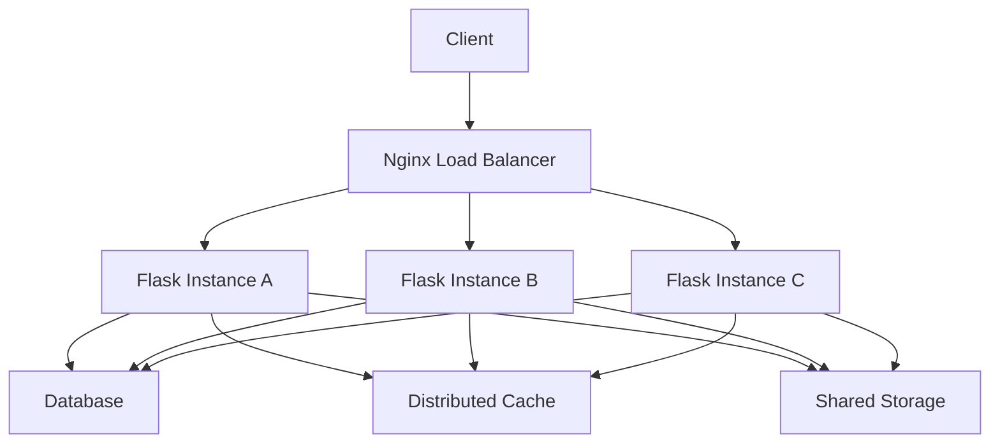
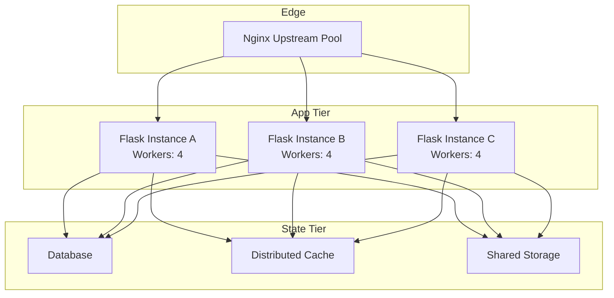
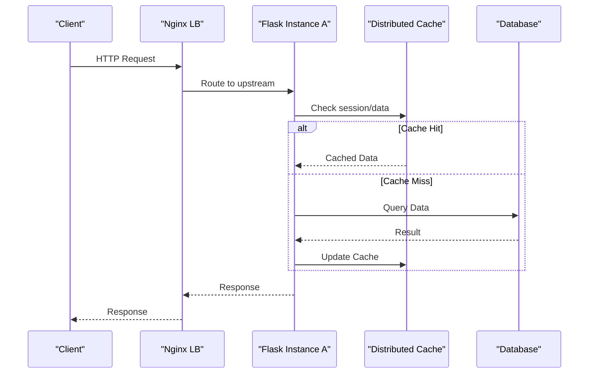
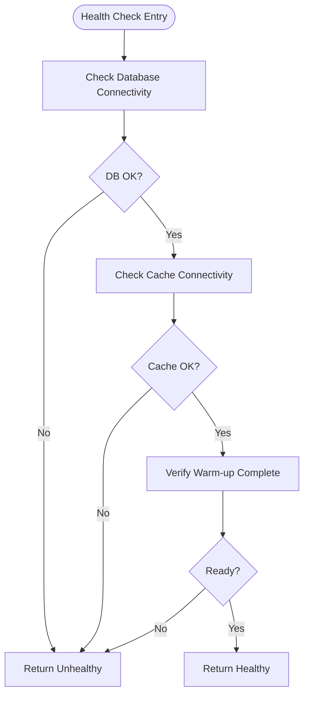
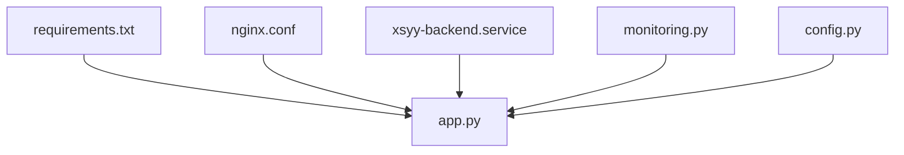

# Horizontal Scaling

<cite>
**Referenced Files in This Document**
- [app.py](file://backend/app.py)
- [config.py](file://backend/config.py)
- [auth.py](file://backend/auth.py)
- [monitoring.py](file://backend/monitoring.py)
- [nginx.conf](file://deploy/nginx.conf)
- [xsyy-backend.service](file://deploy/xsyy-backend.service)
- [start.bat](file://backend/start.bat)
- [requirements.txt](file://backend/requirements.txt)
- [PERFORMANCE_OPTIMIZATION.md](file://backend/PERFORMANCE_OPTIMIZATION.md)
- [DEPLOYMENT.md](file://deploy/DEPLOYMENT.md)
</cite>

## Table of Contents
1. [Introduction](#introduction)
2. [Project Structure](#project-structure)
3. [Core Components](#core-components)
4. [Architecture Overview](#architecture-overview)
5. [Detailed Component Analysis](#detailed-component-analysis)
6. [Dependency Analysis](#dependency-analysis)
7. [Performance Considerations](#performance-considerations)
8. [Troubleshooting Guide](#troubleshooting-guide)
9. [Conclusion](#conclusion)
10. [Appendices](#appendices)

## Introduction
This document provides a comprehensive guide to horizontally scaling the XSYY Edu platform. It focuses on stateless Flask application design, session management across multiple instances, process distribution strategies, Nginx load balancing with upstream servers and health checks, worker process optimization, memory management for concurrent requests, containerization and orchestration patterns, shared state and distributed caching, inter-process communication, performance tuning, and monitoring for scaled deployments.

## Project Structure
The horizontal scaling strategy centers around:
- Stateless Flask application entrypoints and configuration
- Nginx as a reverse proxy and load balancer
- System-level service management for process control
- Monitoring endpoints for health and metrics
- Deployment scripts and documentation for multi-instance operations

[No sources needed since this diagram shows conceptual workflow, not actual code structure]

**Section sources**
- [app.py:1-200](file://backend/app.py#L1-L200)
- [config.py:1-200](file://backend/config.py#L1-L200)
- [nginx.conf:1-200](file://deploy/nginx.conf#L1-L200)
- [xsyy-backend.service:1-200](file://deploy/xsyy-backend.service#L1-L200)

## Core Components
- Stateless Flask Application: The application must avoid storing request-scoped or process-local mutable state. Use external stores (database, cache) for sessions and shared data.
- Session Management: Store sessions in an external store such as Redis or database-backed sessions to support multiple instances.
- Process Distribution: Run multiple WSGI workers per instance and multiple instances behind Nginx.
- Health Checks: Expose lightweight endpoints for readiness and liveness probes used by orchestrators and load balancers.
- Monitoring: Provide metrics endpoints for CPU, memory, request rates, and error rates.

Key files:
- Flask app initialization and routes: [app.py](file://backend/app.py)
- Configuration for environment-specific settings: [config.py](file://backend/config.py)
- Authentication and session handling: [auth.py](file://backend/auth.py)
- Monitoring endpoints and metrics: [monitoring.py](file://backend/monitoring.py)
- Nginx configuration for load balancing: [nginx.conf](file://deploy/nginx.conf)
- Systemd service definition for process management: [xsyy-backend.service](file://deploy/xsyy-backend.service)

**Section sources**
- [app.py:1-200](file://backend/app.py#L1-L200)
- [config.py:1-200](file://backend/config.py#L1-L200)
- [auth.py:1-200](file://backend/auth.py#L1-L200)
- [monitoring.py:1-200](file://backend/monitoring.py#L1-L200)
- [nginx.conf:1-200](file://deploy/nginx.conf#L1-L200)
- [xsyy-backend.service:1-200](file://deploy/xsyy-backend.service#L1-L200)

## Architecture Overview
The recommended architecture uses Nginx as a reverse proxy and load balancer distributing traffic across multiple Flask instances. Each instance runs multiple WSGI workers. Shared state is externalized to a database and distributed cache. Persistent storage is mounted via shared filesystem or object storage.

**Diagram sources**
- [nginx.conf:1-200](file://deploy/nginx.conf#L1-L200)
- [app.py:1-200](file://backend/app.py#L1-L200)
- [config.py:1-200](file://backend/config.py#L1-L200)

**Section sources**
- [nginx.conf:1-200](file://deploy/nginx.conf#L1-L200)
- [app.py:1-200](file://backend/app.py#L1-L200)
- [config.py:1-200](file://backend/config.py#L1-L200)

## Detailed Component Analysis

### Stateless Flask Design Patterns
- Avoid global mutable state; initialize per-request resources using application factories or context managers.
- Externalize sessions to a distributed store (Redis or database-backed).
- Use configuration-driven behavior via environment variables and config modules.
- Implement idempotent handlers where possible to support retries.

Implementation references:
- Application setup and route definitions: [app.py](file://backend/app.py)
- Configuration module for environment-based settings: [config.py](file://backend/config.py)
- Authentication and session handling: [auth.py](file://backend/auth.py)

**Section sources**
- [app.py:1-200](file://backend/app.py#L1-L200)
- [config.py:1-200](file://backend/config.py#L1-L200)
- [auth.py:1-200](file://backend/auth.py#L1-L200)

### Session Management Across Multiple Instances
- Use server-side sessions stored in Redis or database-backed sessions.
- Ensure cookie domain/path are configured for cross-instance access.
- Set secure flags and SameSite policies appropriately for production.
- Invalidate sessions centrally when rotating secrets or rolling out changes.

References:
- Session-related logic and authentication: [auth.py](file://backend/auth.py)
- Environment configuration for session backend: [config.py](file://backend/config.py)

**Section sources**
- [auth.py:1-200](file://backend/auth.py#L1-L200)
- [config.py:1-200](file://backend/config.py#L1-L200)

### Process Distribution Strategies
- Run multiple WSGI workers per instance to utilize multi-core CPUs.
- Scale out by adding more instances behind Nginx.
- Use system service manager (systemd) to supervise processes and auto-restart on failures.

References:
- Service definition for process supervision: [xsyy-backend.service](file://deploy/xsyy-backend.service)
- Startup script for local development and testing: [start.bat](file://backend/start.bat)

**Section sources**
- [xsyy-backend.service:1-200](file://deploy/xsyy-backend.service#L1-L200)
- [start.bat:1-200](file://backend/start.bat#L1-L200)

### Nginx Load Balancing Configuration
- Define upstream pools with multiple Flask instances.
- Configure health checks and failover behavior.
- Choose appropriate load balancing algorithm (round-robin, least connections, IP hash for sticky sessions if required).
- Tune keepalive connections and timeouts for high concurrency.

References:
- Nginx configuration file: [nginx.conf](file://deploy/nginx.conf)

**Section sources**
- [nginx.conf:1-200](file://deploy/nginx.conf#L1-L200)

### Worker Process Optimization and Memory Management
- Determine optimal number of workers based on CPU cores and I/O characteristics.
- Monitor memory usage per worker and set restart thresholds to prevent leaks.
- Use connection pooling for database and cache clients.
- Enable GZIP compression and efficient static asset serving via Nginx.

References:
- Performance optimization notes: [PERFORMANCE_OPTIMIZATION.md](file://backend/PERFORMANCE_OPTIMIZATION.md)
- Dependencies including WSGI server and extensions: [requirements.txt](file://backend/requirements.txt)

**Section sources**
- [PERFORMANCE_OPTIMIZATION.md:1-200](file://backend/PERFORMANCE_OPTIMIZATION.md#L1-L200)
- [requirements.txt:1-200](file://backend/requirements.txt#L1-L200)

### Containerization and Orchestration
- Build Docker images for each Flask instance with minimal base images.
- Use environment variables for configuration injection.
- Orchestrate with Kubernetes or Docker Swarm; define replicas and resource limits.
- Implement readiness and liveness probes using health endpoints.

References:
- Deployment documentation: [DEPLOYMENT.md](file://deploy/DEPLOYMENT.md)
- Monitoring endpoints for health and metrics: [monitoring.py](file://backend/monitoring.py)

**Section sources**
- [DEPLOYMENT.md:1-200](file://deploy/DEPLOYMENT.md#L1-L200)
- [monitoring.py:1-200](file://backend/monitoring.py#L1-L200)

### Shared State Management and Distributed Caching
- Centralize user sessions, rate limiting counters, and feature flags in Redis.
- Cache expensive computations and frequently accessed data with TTLs.
- Use consistent hashing for cache keys to improve hit rates across instances.
- Evict stale entries and handle cache misses gracefully.

References:
- Configuration for external services: [config.py](file://backend/config.py)
- Monitoring for cache and DB metrics: [monitoring.py](file://backend/monitoring.py)

**Section sources**
- [config.py:1-200](file://backend/config.py#L1-L200)
- [monitoring.py:1-200](file://backend/monitoring.py#L1-L200)

### Inter-Process Communication Patterns
- Prefer asynchronous task queues (e.g., Celery with Redis/RabbitMQ) for long-running jobs.
- Use message brokers for event-driven workflows between instances.
- Implement idempotency keys to handle duplicate processing safely.

References:
- Task queue dependencies and utilities: [requirements.txt](file://backend/requirements.txt)
- Monitoring for job queues and latency: [monitoring.py](file://backend/monitoring.py)

**Section sources**
- [requirements.txt:1-200](file://backend/requirements.txt#L1-L200)
- [monitoring.py:1-200](file://backend/monitoring.py#L1-L200)

### Health Checks and Readiness Probes
- Expose /health endpoint returning status and dependency checks (DB, cache).
- Implement readiness probe that verifies warm-up completion and resource availability.
- Use these endpoints for orchestrator autoscaling decisions.

References:
- Monitoring and health endpoints: [monitoring.py](file://backend/monitoring.py)

**Section sources**
- [monitoring.py:1-200](file://backend/monitoring.py#L1-L200)

### Autoscaling Configurations
- Define HPA policies based on CPU utilization, memory, and custom metrics (request latency, queue depth).
- Use target utilization thresholds and scale-down stabilization periods.
- Combine with pod disruption budgets for safe rollouts.

References:
- Deployment guidance and best practices: [DEPLOYMENT.md](file://deploy/DEPLOYMENT.md)
- Monitoring metrics for autoscaling signals: [monitoring.py](file://backend/monitoring.py)

**Section sources**
- [DEPLOYMENT.md:1-200](file://deploy/DEPLOYMENT.md#L1-L200)
- [monitoring.py:1-200](file://backend/monitoring.py#L1-L200)

### Sequence Diagram: Request Flow Through Nginx and Flask Instances

**Diagram sources**
- [nginx.conf:1-200](file://deploy/nginx.conf#L1-L200)
- [app.py:1-200](file://backend/app.py#L1-L200)
- [monitoring.py:1-200](file://backend/monitoring.py#L1-L200)

### Flowchart: Health Check Decision Logic

**Diagram sources**
- [monitoring.py:1-200](file://backend/monitoring.py#L1-L200)

## Dependency Analysis
Horizontal scaling depends on:
- WSGI server and extensions listed in requirements
- Nginx configuration for upstream pools and algorithms
- System service manager for process lifecycle
- Monitoring endpoints for observability

**Diagram sources**
- [requirements.txt:1-200](file://backend/requirements.txt#L1-L200)
- [nginx.conf:1-200](file://deploy/nginx.conf#L1-L200)
- [xsyy-backend.service:1-200](file://deploy/xsyy-backend.service#L1-L200)
- [monitoring.py:1-200](file://backend/monitoring.py#L1-L200)
- [app.py:1-200](file://backend/app.py#L1-L200)
- [config.py:1-200](file://backend/config.py#L1-L200)

**Section sources**
- [requirements.txt:1-200](file://backend/requirements.txt#L1-L200)
- [nginx.conf:1-200](file://deploy/nginx.conf#L1-L200)
- [xsyy-backend.service:1-200](file://deploy/xsyy-backend.service#L1-L200)
- [monitoring.py:1-200](file://backend/monitoring.py#L1-L200)
- [app.py:1-200](file://backend/app.py#L1-L200)
- [config.py:1-200](file://backend/config.py#L1-L200)

## Performance Considerations
- Tune WSGI workers and threads based on workload profile.
- Enable connection pooling for DB and cache clients.
- Use Nginx buffering and keepalive to reduce overhead.
- Apply compression and caching headers for static assets.
- Monitor memory growth and implement graceful worker recycling.
- Profile hot paths and optimize database queries and cache strategies.

**Section sources**
- [PERFORMANCE_OPTIMIZATION.md:1-200](file://backend/PERFORMANCE_OPTIMIZATION.md#L1-L200)
- [nginx.conf:1-200](file://deploy/nginx.conf#L1-L200)
- [requirements.txt:1-200](file://backend/requirements.txt#L1-L200)

## Troubleshooting Guide
Common issues and resolutions:
- Session inconsistencies across instances: verify external session store connectivity and cookie configuration.
- High latency under load: check Nginx upstream health, worker saturation, and DB/cachemiss rates.
- Memory leaks: monitor per-worker memory and enable periodic restarts.
- Health check flapping: ensure readiness probes include dependency checks and warm-up delays.

Operational references:
- Health and monitoring endpoints: [monitoring.py](file://backend/monitoring.py)
- Service supervision and restart policies: [xsyy-backend.service](file://deploy/xsyy-backend.service)
- Deployment procedures and rollback steps: [DEPLOYMENT.md](file://deploy/DEPLOYMENT.md)

**Section sources**
- [monitoring.py:1-200](file://backend/monitoring.py#L1-L200)
- [xsyy-backend.service:1-200](file://deploy/xsyy-backend.service#L1-L200)
- [DEPLOYMENT.md:1-200](file://deploy/DEPLOYMENT.md#L1-L200)

## Conclusion
Scaling XSYY Edu horizontally requires a stateless Flask design, robust session management, effective process distribution, and careful Nginx load balancing. Externalizing shared state to databases and distributed caches, implementing health checks, and leveraging orchestration with autoscaling ensures resilience and performance at scale. Continuous monitoring and performance tuning are essential to maintain stability under varying loads.

## Appendices
- Best practices checklist for multi-instance deployments
- Example autoscaling policies and thresholds
- Reference configurations for Nginx upstream pools and health checks

[No sources needed since this section provides general guidance]