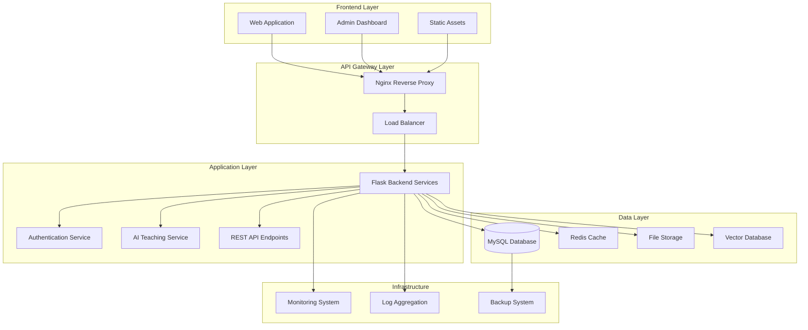
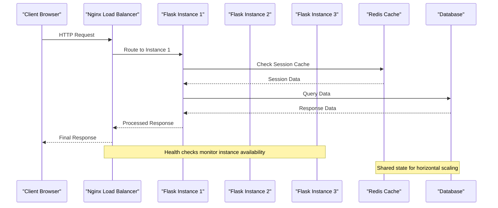
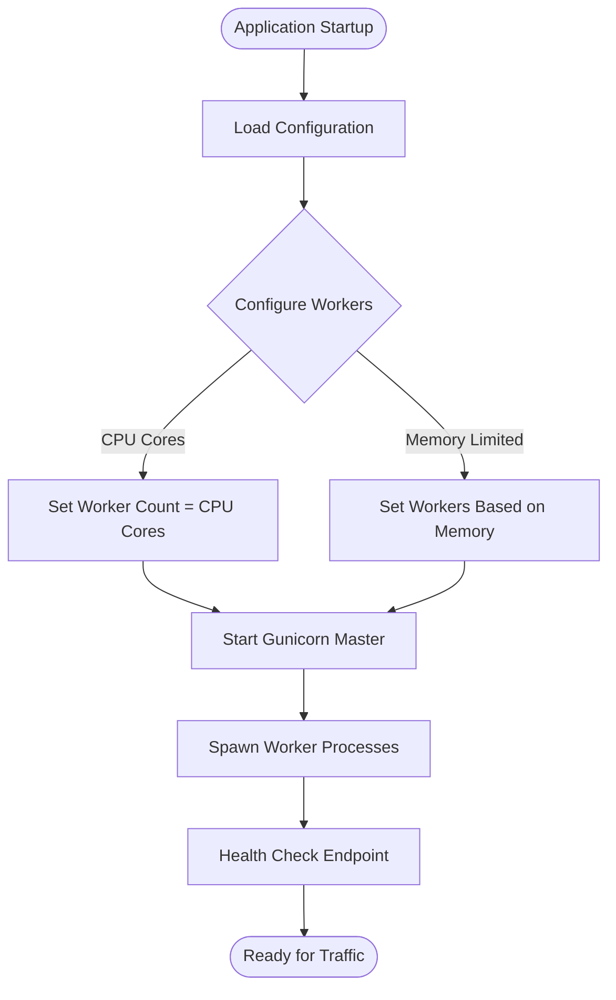
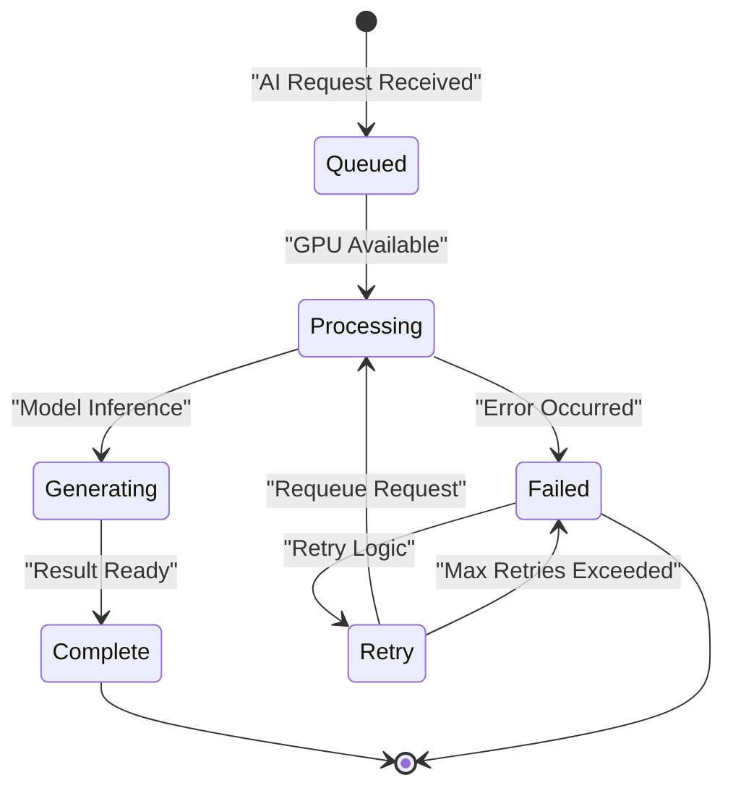
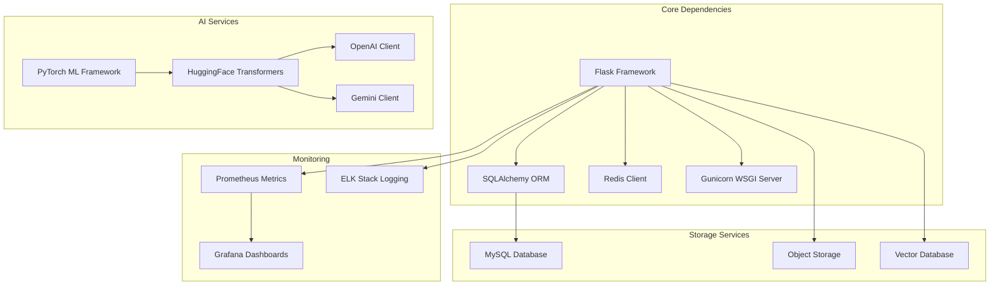

# Scaling & Load Balancing

<cite>
**Referenced Files in This Document**
- [app.py](file://backend/app.py)
- [config.py](file://backend/config.py)
- [database.py](file://backend/database/database.py)
- [nginx.conf](file://deploy/nginx.conf)
- [deploy.sh](file://deploy/deploy.sh)
- [requirements.txt](file://backend/requirements.txt)
- [PERFORMANCE_OPTIMIZATION.md](file://backend/PERFORMANCE_OPTIMIZATION.md)
- [DEPLOYMENT.md](file://deploy/DEPLOYMENT.md)
</cite>

## Table of Contents
1. [Introduction](#introduction)
2. [Project Structure](#project-structure)
3. [Core Components](#core-components)
4. [Architecture Overview](#architecture-overview)
5. [Detailed Component Analysis](#detailed-component-analysis)
6. [Dependency Analysis](#dependency-analysis)
7. [Performance Considerations](#performance-considerations)
8. [Troubleshooting Guide](#troubleshooting-guide)
9. [Conclusion](#conclusion)
10. [Appendices](#appendices)

## Introduction

The XSYY Edu platform is a comprehensive educational system built with Flask backend services, featuring AI-powered teaching capabilities, user management, content delivery, and real-time collaboration features. This document provides comprehensive guidance on scaling and load balancing strategies to ensure high availability, performance, and reliability as the platform grows.

The platform architecture supports horizontal scaling through stateless application design, distributed session management, intelligent load distribution via Nginx reverse proxy, and optimized database connectivity patterns. The system is designed to handle increasing user loads while maintaining consistent performance and user experience.

## Project Structure

The XSYY Edu platform follows a modular architecture with clear separation of concerns:

**Diagram sources**
- [app.py:1-50](file://backend/app.py#L1-L50)
- [nginx.conf:1-100](file://deploy/nginx.conf#L1-L100)
- [database.py:1-50](file://backend/database/database.py#L1-L50)

**Section sources**
- [app.py:1-100](file://backend/app.py#L1-L100)
- [config.py:1-50](file://backend/config.py#L1-L50)

## Core Components

### Flask Application Architecture

The Flask backend serves as the core application layer, providing RESTful APIs, authentication services, and integration with external AI models. The application is designed with horizontal scaling in mind, using stateless request processing and externalized session management.

Key architectural patterns include:
- Stateless request handling for easy horizontal scaling
- External session storage for multi-instance support
- Connection pooling for database efficiency
- Asynchronous task processing for long-running operations
- Health check endpoints for load balancer integration

### Configuration Management

The configuration system supports environment-specific settings, allowing different scaling configurations for development, staging, and production environments. Environment variables control database connections, cache settings, and service endpoints.

**Section sources**
- [config.py:1-100](file://backend/config.py#L1-L100)
- [PERFORMANCE_OPTIMIZATION.md:1-50](file://backend/PERFORMANCE_OPTIMIZATION.md#L1-L50)

## Architecture Overview

The XSYY Edu platform implements a microservices-inspired architecture with clear separation between presentation, business logic, and data layers. The system uses Nginx as a reverse proxy and load balancer, distributing traffic across multiple Flask application instances.

**Diagram sources**
- [nginx.conf:1-150](file://deploy/nginx.conf#L1-L150)
- [app.py:50-150](file://backend/app.py#L50-L150)
- [database.py:50-150](file://backend/database/database.py#L50-L150)

## Detailed Component Analysis

### Horizontal Scaling Strategies

#### Stateless Application Design

The Flask application is designed to be completely stateless, enabling seamless horizontal scaling without session affinity requirements. Key implementation patterns include:

- **External Session Storage**: User sessions are stored in Redis rather than local memory, allowing any application instance to process requests regardless of which instance created the session.
- **Shared File Storage**: Uploaded files and generated content are stored in shared storage accessible by all instances.
- **Distributed Task Queue**: Long-running AI processing tasks use a message queue system for reliable execution across multiple workers.

#### Multi-Process Deployment

The application supports multiple worker processes per instance, maximizing CPU utilization:

**Diagram sources**
- [app.py:100-200](file://backend/app.py#L100-L200)
- [config.py:50-100](file://backend/config.py#L50-L100)

### Nginx Reverse Proxy Configuration

Nginx serves as the primary entry point, handling SSL termination, static file serving, and load distribution across Flask application instances.

#### Load Distribution Strategy

The Nginx configuration implements round-robin load balancing with health checking:

- **Round-Robin Algorithm**: Distributes requests evenly across available Flask instances
- **Health Monitoring**: Regular health checks ensure only healthy instances receive traffic
- **Failover Support**: Automatic failover when instances become unavailable
- **Connection Pooling**: Efficient connection reuse to backend instances

#### Performance Optimization

Nginx is configured for optimal performance with:
- Keep-alive connections to reduce TCP handshake overhead
- Buffer tuning for large file uploads and downloads
- Compression for text-based responses
- Caching headers for static assets

**Section sources**
- [nginx.conf:1-200](file://deploy/nginx.conf#L1-L200)
- [deploy.sh:1-100](file://deploy/deploy.sh#L1-L100)

### Database Scaling Considerations

#### Connection Pooling

The database layer implements connection pooling to optimize resource usage and improve response times:

- **Pool Size Configuration**: Dynamic pool sizing based on application instances and available resources
- **Connection Recycling**: Automatic connection cleanup to prevent leaks
- **Query Timeout Handling**: Prevents long-running queries from blocking connections
- **Read/Write Splitting**: Future-ready architecture for read replica support

#### Database Schema Optimization

The database schema includes optimization strategies for high-concurrency scenarios:

- **Index Strategy**: Strategic indexing for frequently queried fields
- **Table Partitioning**: Large tables partitioned by time or category
- **Connection Limits**: Per-user and global connection limits to prevent resource exhaustion

**Section sources**
- [database.py:1-200](file://backend/database/database.py#L1-L200)
- [optimize_indexes.sql:1-100](file://backend/database/optimize_indexes.sql#L1-L100)

### AI Model Service Scaling

#### GPU Resource Management

AI model inference requires specialized GPU resource allocation:

- **GPU Pooling**: Multiple model instances share GPU resources efficiently
- **Request Queuing**: Incoming AI requests are queued for batch processing
- **Model Caching**: Frequently used models are cached in memory
- **Fallback Mechanisms**: Graceful degradation when GPU resources are exhausted

#### Asynchronous Processing

Long-running AI operations use asynchronous processing patterns:

**Diagram sources**
- [ai_teacher_route.py:1-100](file://backend/ai_teacher_route.py#L1-L100)
- [gateway_llm.py:1-100](file://backend/gateway_llm.py#L1-L100)

### Cache Layer Scaling

#### Redis Integration

Redis provides distributed caching for improved performance and scalability:

- **Session Storage**: User sessions stored in Redis for cross-instance access
- **Query Caching**: Frequently accessed data cached to reduce database load
- **Rate Limiting**: Request throttling to prevent abuse
- **Real-time Features**: Pub/sub messaging for live updates

#### Cache Strategy

Multi-level caching strategy implemented:

1. **In-memory Cache**: Fast access for frequently used data within process
2. **Redis Cache**: Distributed cache shared across all instances
3. **CDN Cache**: Static assets cached at edge locations
4. **Browser Cache**: Client-side caching for repeat visits

**Section sources**
- [cache_service.py:1-100](file://backend/cost_optimization_demo/cache_service.py#L1-L100)
- [embedding_utils.py:1-100](file://backend/utils/embedding_utils.py#L1-L100)

### Container Orchestration with Kubernetes

#### Deployment Architecture

The platform supports containerized deployment with Kubernetes orchestration:

- **Horizontal Pod Autoscaling**: Automatic scaling based on CPU/memory usage
- **Service Discovery**: Internal DNS-based service communication
- **ConfigMaps and Secrets**: Centralized configuration management
- **Health Checks**: Liveness and readiness probes for container health monitoring

#### Auto-scaling Configuration

Kubernetes auto-scaling policies:

- **CPU-based Scaling**: Scale up when CPU usage exceeds threshold
- **Memory-based Scaling**: Scale based on memory consumption patterns
- **Custom Metrics**: Scale based on application-specific metrics like request queue length
- **Cooldown Periods**: Prevent rapid scaling oscillations

**Section sources**
- [DEPLOYMENT.md:1-200](file://deploy/DEPLOYMENT.md#L1-L200)
- [xsyy-backend.service:1-100](file://deploy/xsyy-backend.service#L1-L100)

## Dependency Analysis

The platform's dependency graph shows clear separation between core services and external dependencies:

**Diagram sources**
- [requirements.txt:1-100](file://backend/requirements.txt#L1-L100)
- [app.py:1-50](file://backend/app.py#L1-L50)

**Section sources**
- [requirements.txt:1-150](file://backend/requirements.txt#L1-L150)
- [app.py:1-100](file://backend/app.py#L1-L100)

## Performance Considerations

### Load Testing and Capacity Planning

#### Benchmarking Strategy

Comprehensive load testing ensures the platform can handle expected traffic patterns:

- **Baseline Testing**: Establish performance baselines under normal conditions
- **Stress Testing**: Identify breaking points and capacity limits
- **Endurance Testing**: Validate stability under sustained load
- **Spike Testing**: Handle sudden traffic increases gracefully

#### Capacity Planning Metrics

Key metrics for capacity planning:

- **Requests per Second (RPS)**: Target throughput requirements
- **Response Time Percentiles**: P50, P95, P99 latency targets
- **Resource Utilization**: CPU, memory, and I/O usage patterns
- **Error Rates**: Acceptable error rate thresholds
- **Queue Lengths**: AI processing queue depth monitoring

### Bottleneck Identification

#### Monitoring and Profiling

Systematic approach to identifying performance bottlenecks:

- **Application Profiling**: Code-level profiling to identify slow functions
- **Database Query Analysis**: Slow query identification and optimization
- **Network Latency Measurement**: API call timing and network overhead analysis
- **Resource Contention Detection**: Lock contention and resource conflicts

#### Optimization Techniques

Common optimization strategies:

- **Database Query Optimization**: Index optimization and query refactoring
- **Caching Strategy Refinement**: Cache hit ratio improvement
- **Connection Pool Tuning**: Optimal pool sizes for different workloads
- **Asynchronous Processing**: Offloading long-running operations

**Section sources**
- [PERFORMANCE_OPTIMIZATION.md:1-200](file://backend/PERFORMANCE_OPTIMIZATION.md#L1-L200)
- [monitoring.py:1-100](file://backend/monitoring.py#L1-L100)

## Troubleshooting Guide

### Common Scaling Issues

#### Session Management Problems

When implementing horizontal scaling, session-related issues commonly arise:

- **Session Loss**: Users losing login status when routed to different instances
- **Session Inconsistency**: Different session states across instances
- **Memory Leaks**: Session objects not properly cleaned up

**Resolution Steps:**
1. Verify Redis connectivity and configuration
2. Check session serialization/deserialization
3. Monitor session cleanup and expiration
4. Implement session validation and recovery

#### Database Connection Issues

Database connection problems in scaled environments:

- **Connection Exhaustion**: Too many concurrent connections
- **Connection Timeouts**: Network latency affecting connection establishment
- **Deadlocks**: Concurrent transaction conflicts

**Resolution Steps:**
1. Tune connection pool sizes based on workload
2. Implement connection retry logic with exponential backoff
3. Monitor connection usage and set appropriate limits
4. Use connection timeout and idle connection cleanup

#### Load Balancer Health Check Failures

Health check failures causing service disruption:

- **False Positives**: Healthy instances marked as unhealthy
- **Slow Health Checks**: Health checks taking too long
- **Resource Exhaustion**: Health checks consuming excessive resources

**Resolution Steps:**
1. Optimize health check endpoints for minimal resource usage
2. Implement graceful degradation in health checks
3. Configure appropriate timeouts and failure thresholds
4. Add detailed logging for health check diagnostics

**Section sources**
- [check_server_status.sh:1-100](file://backend/check_server_status.sh#L1-L100)
- [memory_guard.sh:1-100](file://backend/memory_guard.sh#L1-L100)

## Conclusion

The XSYY Edu platform is designed with horizontal scaling and load balancing as first-class concerns. Through stateless application design, distributed session management, intelligent load distribution, and optimized database connectivity, the platform can scale effectively to handle growing user demands.

Key scaling strategies include:
- Stateless Flask applications with external session storage
- Nginx reverse proxy with health checking and failover
- Connection pooling and database optimization
- Asynchronous AI processing with GPU resource management
- Multi-level caching with Redis and CDN integration
- Container orchestration with Kubernetes auto-scaling

The platform's architecture supports seamless scaling from single-instance deployments to large-scale distributed systems, ensuring consistent performance and reliability as the educational platform grows.

## Appendices

### A. Deployment Checklist

#### Pre-deployment Verification
- [ ] All environment variables configured correctly
- [ ] Database migrations applied successfully
- [ ] Cache service connectivity verified
- [ ] Health check endpoints responding
- [ ] SSL certificates installed and valid

#### Post-deployment Validation
- [ ] Load balancer distributing traffic evenly
- [ ] Health checks passing for all instances
- [ ] Error rates within acceptable thresholds
- [ ] Performance metrics meeting SLA requirements
- [ ] Monitoring and alerting systems operational

### B. Scaling Decision Matrix

| Metric | Threshold | Action |
|--------|-----------|---------|
| CPU Usage > 80% | Sustained for 5 minutes | Scale up instances |
| Memory Usage > 85% | Sustained for 10 minutes | Increase instance size |
| Response Time P95 > 2s | Sustained for 15 minutes | Investigate bottlenecks |
| Error Rate > 1% | Any duration | Alert and investigate |
| Database Connections > 80% | Sustained for 5 minutes | Tune connection pools |

### C. Emergency Procedures

#### High Load Mitigation
1. Enable request queuing for non-critical operations
2. Reduce cache TTL values to improve freshness
3. Disable non-essential features temporarily
4. Activate emergency scaling policies

#### Service Degradation
1. Redirect traffic to healthy instances
2. Enable circuit breakers for failing services
3. Switch to fallback implementations
4. Notify users of degraded service