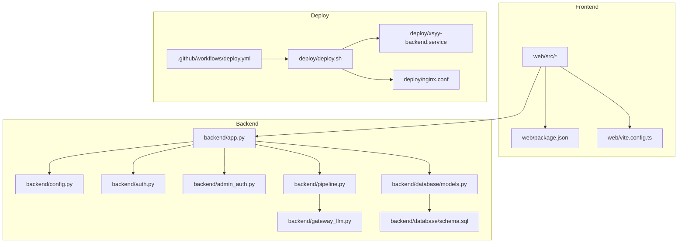
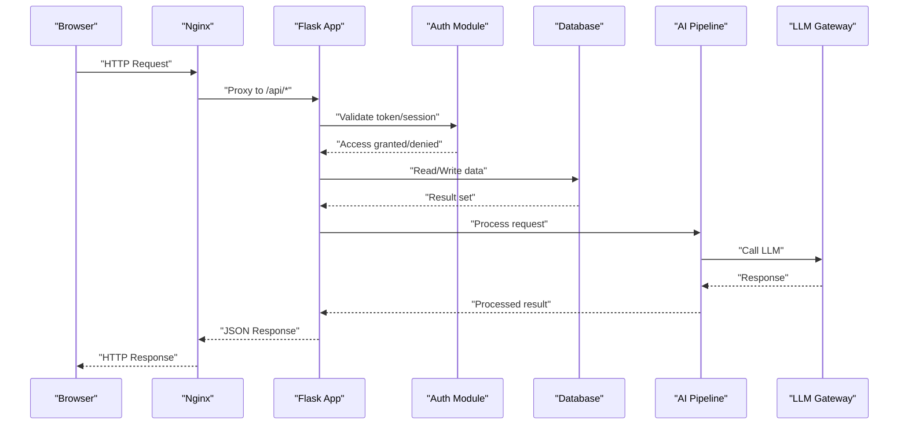
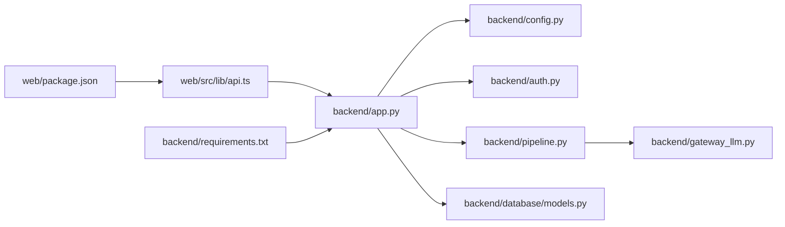

# Developer Guide

<cite>
**Referenced Files in This Document**
- [backend/app.py](file://backend/app.py)
- [backend/config.py](file://backend/config.py)
- [backend/requirements.txt](file://backend/requirements.txt)
- [backend/install.bat](file://backend/install.bat)
- [backend/start.bat](file://backend/start.bat)
- [backend/env.example](file://backend/env.example)
- [backend/database/models.py](file://backend/database/models.py)
- [backend/database/schema.sql](file://backend/database/schema.sql)
- [backend/auth.py](file://backend/auth.py)
- [backend/admin_auth.py](file://backend/admin_auth.py)
- [backend/pipeline.py](file://backend/pipeline.py)
- [backend/gateway_llm.py](file://backend/gateway_llm.py)
- [backend/cost_optimization_demo/main_service.py](file://backend/cost_optimization_demo/main_service.py)
- [web/package.json](file://web/package.json)
- [web/vite.config.ts](file://web/vite.config.ts)
- [web/src/App.tsx](file://web/src/App.tsx)
- [web/src/main.tsx](file://web/src/main.tsx)
- [web/src/lib/api.ts](file://web/src/lib/api.ts)
- [web/src/components/AuthModal.tsx](file://web/src/components/AuthModal.tsx)
- [web/src/store/appStore.ts](file://web/src/store/appStore.ts)
- [deploy/deploy.sh](file://deploy/deploy.sh)
- [deploy/nginx.conf](file://deploy/nginx.conf)
- [deploy/xsyy-backend.service](file://deploy/xsyy-backend.service)
- [.github/workflows/deploy.yml](file://.github/workflows/deploy.yml)
</cite>

## Table of Contents
1. [Introduction](#introduction)
2. [Project Structure](#project-structure)
3. [Core Components](#core-components)
4. [Architecture Overview](#architecture-overview)
5. [Detailed Component Analysis](#detailed-component-analysis)
6. [Dependency Analysis](#dependency-analysis)
7. [Performance Considerations](#performance-considerations)
8. [Troubleshooting Guide](#troubleshooting-guide)
9. [Conclusion](#conclusion)
10. [Appendices](#appendices)

## Introduction
This Developer Guide provides a comprehensive, practical reference for contributing to the XSYY Edu platform. It covers development environment setup, IDE configuration, debugging strategies, code style and naming conventions, architectural patterns, contribution workflows, build processes, deployment preparation, performance profiling, and troubleshooting. The guide is designed for both frontend and backend contributors and includes diagrams that map directly to source files where applicable.

## Project Structure
The repository follows a clear separation between backend (Python), frontend (TypeScript + Vite), shared assets, deployment scripts, and CI configuration:
- Backend: Flask-based API with database models, authentication, AI pipeline integration, and utilities.
- Frontend: React + TypeScript application built with Vite, Tailwind CSS, and PostCSS.
- Deploy: Shell scripts, systemd service, Nginx config, and GitHub Actions workflow.
- Storage: Persistent teaching artifacts and metadata.

**Diagram sources**
- [backend/app.py](file://backend/app.py)
- [backend/config.py](file://backend/config.py)
- [backend/auth.py](file://backend/auth.py)
- [backend/admin_auth.py](file://backend/admin_auth.py)
- [backend/pipeline.py](file://backend/pipeline.py)
- [backend/gateway_llm.py](file://backend/gateway_llm.py)
- [backend/database/models.py](file://backend/database/models.py)
- [backend/database/schema.sql](file://backend/database/schema.sql)
- [web/src/App.tsx](file://web/src/App.tsx)
- [web/src/main.tsx](file://web/src/main.tsx)
- [web/vite.config.ts](file://web/vite.config.ts)
- [web/package.json](file://web/package.json)
- [deploy/deploy.sh](file://deploy/deploy.sh)
- [deploy/nginx.conf](file://deploy/nginx.conf)
- [deploy/xsyy-backend.service](file://deploy/xsyy-backend.service)
- [.github/workflows/deploy.yml](file://.github/workflows/deploy.yml)

**Section sources**
- [backend/app.py](file://backend/app.py)
- [web/src/App.tsx](file://web/src/App.tsx)
- [web/vite.config.ts](file://web/vite.config.ts)
- [deploy/deploy.sh](file://deploy/deploy.sh)

## Core Components
- Backend API server: Central entry point registering routes, middleware, and lifecycle hooks.
- Configuration: Environment-driven settings for DB, LLM gateway, storage, and feature flags.
- Authentication: User and admin auth modules protecting endpoints.
- Data layer: SQLAlchemy-like models and SQL schema definitions.
- AI Pipeline: Orchestrates prompts, templates, and LLM calls via gateway.
- Frontend App: React app with components, store, and API client.
- Deployment: Scripts and configs for production runtime and reverse proxy.

Key responsibilities:
- Route registration and request handling in the API server.
- Config loading from environment variables and defaults.
- Auth guards for protected endpoints.
- Model definitions aligned with schema migrations.
- Pipeline orchestration for AI features.
- Frontend API client abstraction over HTTP calls.

**Section sources**
- [backend/app.py](file://backend/app.py)
- [backend/config.py](file://backend/config.py)
- [backend/auth.py](file://backend/auth.py)
- [backend/admin_auth.py](file://backend/admin_auth.py)
- [backend/database/models.py](file://backend/database/models.py)
- [backend/database/schema.sql](file://backend/database/schema.sql)
- [backend/pipeline.py](file://backend/pipeline.py)
- [backend/gateway_llm.py](file://backend/gateway_llm.py)
- [web/src/App.tsx](file://web/src/App.tsx)
- [web/src/main.tsx](file://web/src/main.tsx)
- [web/src/lib/api.ts](file://web/src/lib/api.ts)

## Architecture Overview
High-level flow: Browser requests are served by Nginx, proxied to the Python backend. The backend validates requests, applies auth, interacts with the database, and invokes the AI pipeline when needed. The frontend uses an API client to call backend endpoints and renders UI components.

**Diagram sources**
- [deploy/nginx.conf](file://deploy/nginx.conf)
- [backend/app.py](file://backend/app.py)
- [backend/auth.py](file://backend/auth.py)
- [backend/database/models.py](file://backend/database/models.py)
- [backend/pipeline.py](file://backend/pipeline.py)
- [backend/gateway_llm.py](file://backend/gateway_llm.py)

## Detailed Component Analysis

### Backend API Server
Responsibilities:
- Initialize app, load configuration, register blueprints/routes.
- Configure CORS, error handlers, logging, and startup tasks.
- Expose health checks and version info.

Development tips:
- Use environment variables for secrets and toggles.
- Run with a local dev server and enable verbose logs.

**Section sources**
- [backend/app.py](file://backend/app.py)
- [backend/config.py](file://backend/config.py)

### Configuration Management
Responsibilities:
- Load environment variables with typed accessors.
- Provide defaults for optional services.
- Centralize paths for storage and DB.

Best practices:
- Keep secrets out of code; use env files or secret managers.
- Validate required keys at startup.

**Section sources**
- [backend/config.py](file://backend/config.py)
- [backend/env.example](file://backend/env.example)

### Authentication and Authorization
Responsibilities:
- Protect user-facing endpoints with session/token validation.
- Admin-only endpoints with stricter checks.

Patterns:
- Decorators/middleware for route protection.
- Separate admin auth logic for clarity.

**Section sources**
- [backend/auth.py](file://backend/auth.py)
- [backend/admin_auth.py](file://backend/admin_auth.py)

### Database Models and Schema
Responsibilities:
- Define entities and relationships.
- Align with SQL schema and migration scripts.

Guidelines:
- Keep model fields synchronized with schema changes.
- Use migrations for incremental updates.

**Section sources**
- [backend/database/models.py](file://backend/database/models.py)
- [backend/database/schema.sql](file://backend/database/schema.sql)

### AI Pipeline and LLM Gateway
Responsibilities:
- Orchestrate prompt generation, template rendering, and response processing.
- Abstract LLM provider calls through a gateway interface.

Optimization opportunities:
- Cache frequent responses.
- Implement retries and timeouts.

**Section sources**
- [backend/pipeline.py](file://backend/pipeline.py)
- [backend/gateway_llm.py](file://backend/gateway_llm.py)
- [backend/cost_optimization_demo/main_service.py](file://backend/cost_optimization_demo/main_service.py)

### Frontend Application
Responsibilities:
- Render UI components and manage global state.
- Communicate with backend via API client.

Structure:
- Entry points bootstrap the app.
- Components encapsulate UI logic.
- Store holds application state.
- API client centralizes HTTP interactions.

**Section sources**
- [web/src/App.tsx](file://web/src/App.tsx)
- [web/src/main.tsx](file://web/src/main.tsx)
- [web/src/components/AuthModal.tsx](file://web/src/components/AuthModal.tsx)
- [web/src/store/appStore.ts](file://web/src/store/appStore.ts)
- [web/src/lib/api.ts](file://web/src/lib/api.ts)

### Build and Dev Tooling
Responsibilities:
- Frontend build pipeline using Vite.
- Dependency management via package manager.

Configuration highlights:
- Vite config for dev server, bundling, and asset handling.
- Package manifest for dependencies and scripts.

**Section sources**
- [web/vite.config.ts](file://web/vite.config.ts)
- [web/package.json](file://web/package.json)

### Deployment and Runtime
Responsibilities:
- Systemd service for long-running backend process.
- Nginx reverse proxy for static assets and API routing.
- Deployment script orchestrating steps.
- CI workflow for automated deployments.

**Section sources**
- [deploy/xsyy-backend.service](file://deploy/xsyy-backend.service)
- [deploy/nginx.conf](file://deploy/nginx.conf)
- [deploy/deploy.sh](file://deploy/deploy.sh)
- [.github/workflows/deploy.yml](file://.github/workflows/deploy.yml)

## Dependency Analysis
External and internal dependencies:
- Backend Python packages defined in requirements file.
- Frontend packages defined in package manifest.
- Internal module coupling: API server depends on config, auth, pipeline, and database layers.

**Diagram sources**
- [backend/requirements.txt](file://backend/requirements.txt)
- [web/package.json](file://web/package.json)
- [backend/app.py](file://backend/app.py)
- [backend/config.py](file://backend/config.py)
- [backend/auth.py](file://backend/auth.py)
- [backend/pipeline.py](file://backend/pipeline.py)
- [backend/gateway_llm.py](file://backend/gateway_llm.py)
- [backend/database/models.py](file://backend/database/models.py)
- [web/src/lib/api.ts](file://web/src/lib/api.ts)

**Section sources**
- [backend/requirements.txt](file://backend/requirements.txt)
- [web/package.json](file://web/package.json)

## Performance Considerations
- Enable connection pooling for database access.
- Cache expensive computations and LLM outputs where safe.
- Use streaming responses for long-running AI operations.
- Profile hot paths with backend profilers and browser dev tools.
- Optimize frontend bundle size and lazy-load heavy components.

[No sources needed since this section provides general guidance]

## Troubleshooting Guide
Common issues and resolutions:
- Missing environment variables: Ensure all required keys are present and valid.
- Database connectivity errors: Verify credentials, host, port, and schema initialization.
- LLM gateway failures: Check network access, API keys, and rate limits; implement retries.
- Port conflicts: Change ports in configs and ensure firewall rules allow traffic.
- Static assets not loading: Confirm Nginx root and alias paths match build output.

Operational checks:
- Health endpoint returns OK.
- Service status shows active.
- Logs contain no repeated fatal errors.

**Section sources**
- [backend/config.py](file://backend/config.py)
- [backend/app.py](file://backend/app.py)
- [deploy/xsyy-backend.service](file://deploy/xsyy-backend.service)
- [deploy/nginx.conf](file://deploy/nginx.conf)

## Conclusion
This guide consolidates essential knowledge for developing, testing, and deploying the XSYY Edu platform. By following the outlined architecture, coding standards, and operational procedures, contributors can efficiently extend functionality while maintaining reliability and performance.

[No sources needed since this section summarizes without analyzing specific files]

## Appendices

### Development Environment Setup
- Install backend dependencies using the provided installer script.
- Configure environment variables based on the example file.
- Start the backend server with the provided launcher script.
- Install frontend dependencies and run the dev server.

**Section sources**
- [backend/install.bat](file://backend/install.bat)
- [backend/env.example](file://backend/env.example)
- [backend/start.bat](file://backend/start.bat)
- [web/package.json](file://web/package.json)

### Code Style and Naming Conventions
- Python: Follow PEP 8; use descriptive names; prefer snake_case for functions and variables.
- TypeScript/React: Use PascalCase for components; camelCase for functions and variables; keep files co-located with their components.
- API: Use consistent resource nouns and HTTP verbs; return structured JSON responses.

[No sources needed since this section provides general guidance]

### Contribution Workflow
- Create feature branches from main with descriptive names.
- Open pull requests with clear descriptions and linked issues.
- Ensure tests pass and linting is clean before requesting review.
- Address review feedback promptly and maintain backward compatibility.

[No sources needed since this section provides general guidance]

### Debugging Techniques
- Backend:
  - Enable verbose logging during development.
  - Use breakpoints in your IDE for request handlers.
  - Inspect database queries and payloads.
- Frontend:
  - Use browser dev tools to inspect network requests and console logs.
  - Add logging around API calls and component lifecycle.

**Section sources**
- [backend/app.py](file://backend/app.py)
- [web/src/lib/api.ts](file://web/src/lib/api.ts)

### Build Processes and Asset Compilation
- Frontend:
  - Build with Vite for production assets.
  - Tailwind and PostCSS configured via project config files.
- Backend:
  - No compilation step; ensure dependencies are installed.

**Section sources**
- [web/vite.config.ts](file://web/vite.config.ts)
- [web/package.json](file://web/package.json)

### Deployment Preparation
- Update deploy scripts for new environments if needed.
- Verify Nginx configuration for correct upstream and static paths.
- Test systemd service start and restart behavior.
- Trigger CI workflow to automate deployment.

**Section sources**
- [deploy/deploy.sh](file://deploy/deploy.sh)
- [deploy/nginx.conf](file://deploy/nginx.conf)
- [deploy/xsyy-backend.service](file://deploy/xsyy-backend.service)
- [.github/workflows/deploy.yml](file://.github/workflows/deploy.yml)

### Extending Functionality
- Adding a new API endpoint:
  - Register route in the API server.
  - Implement handler logic and integrate with models.
  - Add auth guard if necessary.
- Adding a new frontend feature:
  - Create component(s) under src/components.
  - Update store if global state is needed.
  - Call backend via API client.

**Section sources**
- [backend/app.py](file://backend/app.py)
- [backend/database/models.py](file://backend/database/models.py)
- [web/src/components/AuthModal.tsx](file://web/src/components/AuthModal.tsx)
- [web/src/store/appStore.ts](file://web/src/store/appStore.ts)
- [web/src/lib/api.ts](file://web/src/lib/api.ts)