# Admin Dashboard Interface

<cite>
**Referenced Files in This Document**
- [dashboard.html](file://web/admin/dashboard.html)
- [users.html](file://web/admin/users.html)
- [teachings.html](file://web/admin/teachings.html)
- [feedbacks.html](file://web/admin/feedbacks.html)
- [settings.html](file://web/admin/settings.html)
- [recharge_requests.html](file://web/admin/recharge_requests.html)
- [admin.css](file://web/admin/css/admin.css)
- [admin-auth.js](file://web/admin/js/admin-auth.js)
- [admin-api.js](file://web/admin/js/admin-api.js)
- [admin-feedbacks.js](file://web/admin/js/admin-feedbacks.js)
- [admin-utils.js](file://web/admin/js/admin-utils.js)
- [index.html](file://web/admin/index.html)
- [app.py](file://backend/app.py)
- [admin_auth.py](file://backend/admin_auth.py)
- [auth.py](file://backend/auth.py)
- [monitoring.py](file://backend/monitoring.py)
- [invite_quota_api.py](file://backend/invite_quota_api.py)
- [ai_teacher_route.py](file://backend/ai_teacher_route.py)
</cite>

## Table of Contents
1. [Introduction](#introduction)
2. [Project Structure](#project-structure)
3. [Core Components](#core-components)
4. [Architecture Overview](#architecture-overview)
5. [Detailed Component Analysis](#detailed-component-analysis)
6. [Dependency Analysis](#dependency-analysis)
7. [Performance Considerations](#performance-considerations)
8. [Troubleshooting Guide](#troubleshooting-guide)
9. [Conclusion](#conclusion)
10. [Appendices](#appendices)

## Introduction
This document provides comprehensive documentation for the admin dashboard interface, covering layout and navigation, role-based access control, user management, content moderation, system monitoring, settings configuration, feedback management, authentication flows, API integration patterns, real-time updates, and guidance for extending the dashboard with new features and workflows.

The admin dashboard is a web-based administrative console that allows authorized users to manage platform users, review and approve teaching materials, handle feedback, configure system settings, monitor system health, and perform operational tasks such as managing recharge requests and invite quotas.

## Project Structure
The admin dashboard consists of:
- Frontend pages under web/admin for each administrative area (dashboard, users, teachings, feedbacks, settings, recharge requests).
- Shared CSS and JavaScript modules for authentication, API calls, utilities, and feature-specific logic.
- Backend routes and services exposing APIs for admin operations, including authentication, user management, content moderation, monitoring, and quota management.

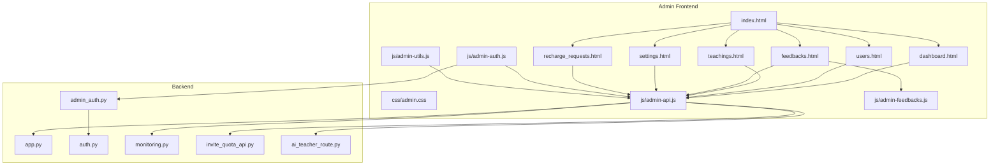

**Diagram sources**
- [index.html](file://web/admin/index.html)
- [dashboard.html](file://web/admin/dashboard.html)
- [users.html](file://web/admin/users.html)
- [teachings.html](file://web/admin/teachings.html)
- [feedbacks.html](file://web/admin/feedbacks.html)
- [settings.html](file://web/admin/settings.html)
- [recharge_requests.html](file://web/admin/recharge_requests.html)
- [admin.css](file://web/admin/css/admin.css)
- [admin-auth.js](file://web/admin/js/admin-auth.js)
- [admin-api.js](file://web/admin/js/admin-api.js)
- [admin-feedbacks.js](file://web/admin/js/admin-feedbacks.js)
- [admin-utils.js](file://web/admin/js/admin-utils.js)
- [app.py](file://backend/app.py)
- [admin_auth.py](file://backend/admin_auth.py)
- [auth.py](file://backend/auth.py)
- [monitoring.py](file://backend/monitoring.py)
- [invite_quota_api.py](file://backend/invite_quota_api.py)
- [ai_teacher_route.py](file://backend/ai_teacher_route.py)

**Section sources**
- [index.html](file://web/admin/index.html)
- [dashboard.html](file://web/admin/dashboard.html)
- [users.html](file://web/admin/users.html)
- [teachings.html](file://web/admin/teachings.html)
- [feedbacks.html](file://web/admin/feedbacks.html)
- [settings.html](file://web/admin/settings.html)
- [recharge_requests.html](file://web/admin/recharge_requests.html)
- [admin.css](file://web/admin/css/admin.css)
- [admin-auth.js](file://web/admin/js/admin-auth.js)
- [admin-api.js](file://web/admin/js/admin-api.js)
- [admin-feedbacks.js](file://web/admin/js/admin-feedbacks.js)
- [admin-utils.js](file://web/admin/js/admin-utils.js)
- [app.py](file://backend/app.py)
- [admin_auth.py](file://backend/admin_auth.py)
- [auth.py](file://backend/auth.py)
- [monitoring.py](file://backend/monitoring.py)
- [invite_quota_api.py](file://backend/invite_quota_api.py)
- [ai_teacher_route.py](file://backend/ai_teacher_route.py)

## Core Components
- Authentication and Authorization
  - Admin login flow and session/token handling are implemented via dedicated frontend auth module and backend admin authentication middleware.
  - Role checks ensure only authorized admins can access protected endpoints and UI sections.

- API Integration Layer
  - Centralized API client handles HTTP requests, headers, error handling, retries, and response normalization.
  - Feature-specific modules call appropriate endpoints for CRUD operations and status queries.

- User Management
  - Listing users, viewing profiles, editing attributes, and managing quotas (including invite quotas).

- Content Moderation
  - Reviewing teaching materials, approving or rejecting submissions, and tracking moderation state.

- Feedback Management
  - Viewing, filtering, and responding to user feedback; marking items resolved.

- System Monitoring
  - Health checks, metrics, and logs exposed through monitoring endpoints.

- Settings Configuration
  - Updating application settings and toggling features from the admin UI.

- Recharge Requests
  - Managing user recharge requests and approvals.

**Section sources**
- [admin-auth.js](file://web/admin/js/admin-auth.js)
- [admin-api.js](file://web/admin/js/admin-api.js)
- [admin_auth.py](file://backend/admin_auth.py)
- [auth.py](file://backend/auth.py)
- [invite_quota_api.py](file://backend/invite_quota_api.py)
- [monitoring.py](file://backend/monitoring.py)
- [ai_teacher_route.py](file://backend/ai_teacher_route.py)

## Architecture Overview
The admin dashboard follows a typical client-server architecture:
- The browser loads admin pages and initializes shared scripts for authentication and API interactions.
- The frontend authenticates the admin, obtains tokens/session, and enforces role-based access on both UI and API calls.
- Feature modules call backend endpoints for data retrieval and mutations.
- Real-time updates may be achieved via polling or server-sent events where supported by backend endpoints.

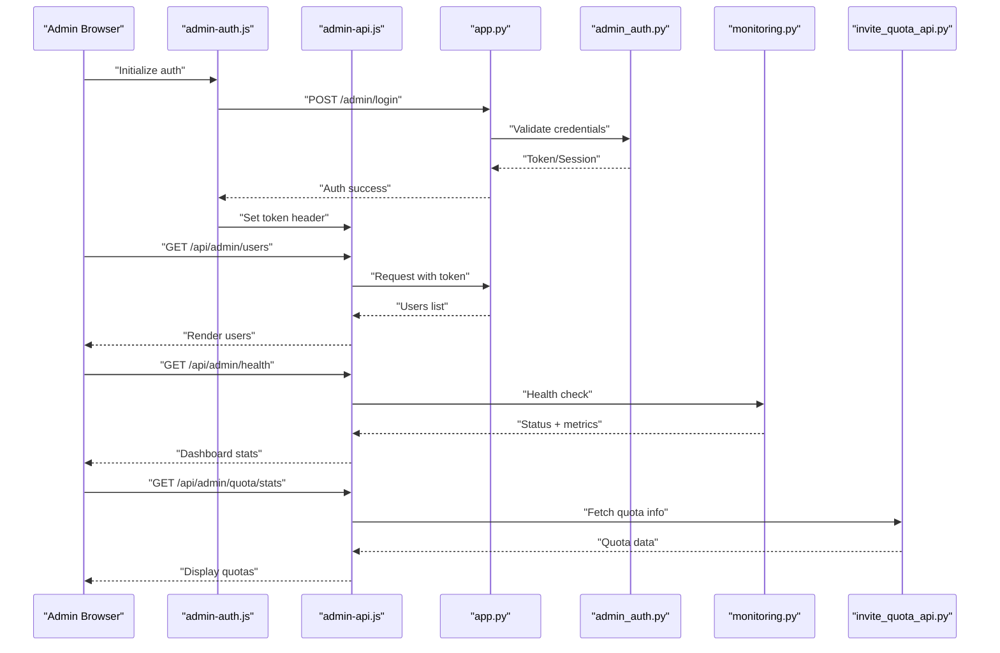

**Diagram sources**
- [admin-auth.js](file://web/admin/js/admin-auth.js)
- [admin-api.js](file://web/admin/js/admin-api.js)
- [app.py](file://backend/app.py)
- [admin_auth.py](file://backend/admin_auth.py)
- [monitoring.py](file://backend/monitoring.py)
- [invite_quota_api.py](file://backend/invite_quota_api.py)

## Detailed Component Analysis

### Dashboard Layout and Navigation
- Layout
  - The admin index page serves as the entry point and navigates to specific admin areas.
  - Each admin page includes common styles and scripts for consistent UX.
- Navigation
  - Sidebar or top navigation links connect to users, teachings, feedbacks, settings, and recharge requests.
  - Active route highlighting improves usability.

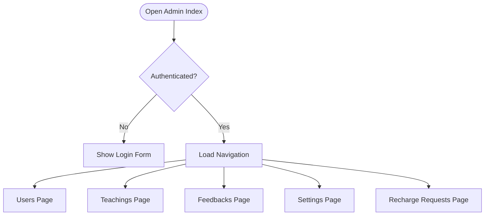

**Diagram sources**
- [index.html](file://web/admin/index.html)
- [dashboard.html](file://web/admin/dashboard.html)
- [users.html](file://web/admin/users.html)
- [teachings.html](file://web/admin/teachings.html)
- [feedbacks.html](file://web/admin/feedbacks.html)
- [settings.html](file://web/admin/settings.html)
- [recharge_requests.html](file://web/admin/recharge_requests.html)

**Section sources**
- [index.html](file://web/admin/index.html)
- [dashboard.html](file://web/admin/dashboard.html)
- [users.html](file://web/admin/users.html)
- [teachings.html](file://web/admin/teachings.html)
- [feedbacks.html](file://web/admin/feedbacks.html)
- [settings.html](file://web/admin/settings.html)
- [recharge_requests.html](file://web/admin/recharge_requests.html)
- [admin.css](file://web/admin/css/admin.css)

### Role-Based Access Control (RBAC)
- Authentication Flow
  - Admin credentials are validated via backend admin authentication.
  - On success, a token or session is established and stored securely in the frontend.
- Authorization Checks
  - Protected routes require valid tokens.
  - UI elements are conditionally rendered based on roles.
- Middleware
  - Backend admin middleware validates tokens and enforces role permissions before processing requests.

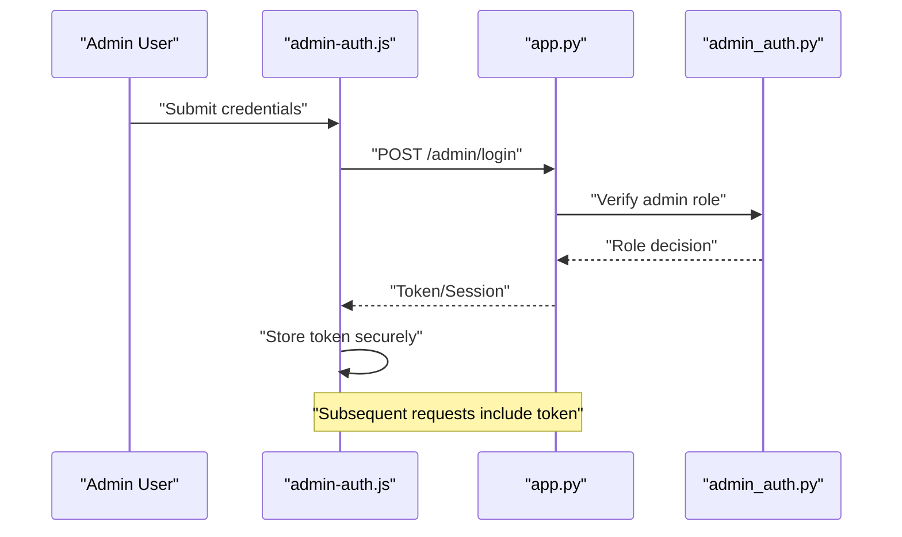

**Diagram sources**
- [admin-auth.js](file://web/admin/js/admin-auth.js)
- [app.py](file://backend/app.py)
- [admin_auth.py](file://backend/admin_auth.py)
- [auth.py](file://backend/auth.py)

**Section sources**
- [admin-auth.js](file://web/admin/js/admin-auth.js)
- [admin_auth.py](file://backend/admin_auth.py)
- [auth.py](file://backend/auth.py)

### User Management Features
- User Listing
  - Fetches paginated lists of users with filters and search capabilities.
- Profile Editing
  - Updates user profile fields and saves changes via API.
- Quota Management
  - Displays and adjusts invite quotas per user or globally.

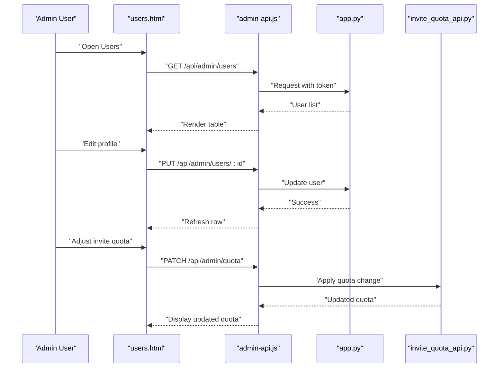

**Diagram sources**
- [users.html](file://web/admin/users.html)
- [admin-api.js](file://web/admin/js/admin-api.js)
- [app.py](file://backend/app.py)
- [invite_quota_api.py](file://backend/invite_quota_api.py)

**Section sources**
- [users.html](file://web/admin/users.html)
- [admin-api.js](file://web/admin/js/admin-api.js)
- [invite_quota_api.py](file://backend/invite_quota_api.py)

### Content Moderation Tools
- Teaching Materials Review
  - Lists pending submissions with metadata and preview options.
- Approval Workflow
  - Approves or rejects materials; updates moderation status and notifies relevant parties.

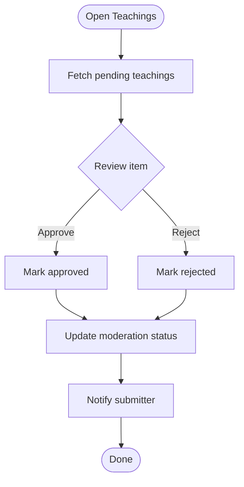

**Diagram sources**
- [teachings.html](file://web/admin/teachings.html)
- [admin-api.js](file://web/admin/js/admin-api.js)
- [ai_teacher_route.py](file://backend/ai_teacher_route.py)

**Section sources**
- [teachings.html](file://web/admin/teachings.html)
- [admin-api.js](file://web/admin/js/admin-api.js)
- [ai_teacher_route.py](file://backend/ai_teacher_route.py)

### System Monitoring Capabilities
- Health Checks
  - Exposes health status and basic metrics for uptime and performance.
- Metrics Display
  - Dashboard shows key indicators like request counts, error rates, and resource usage.

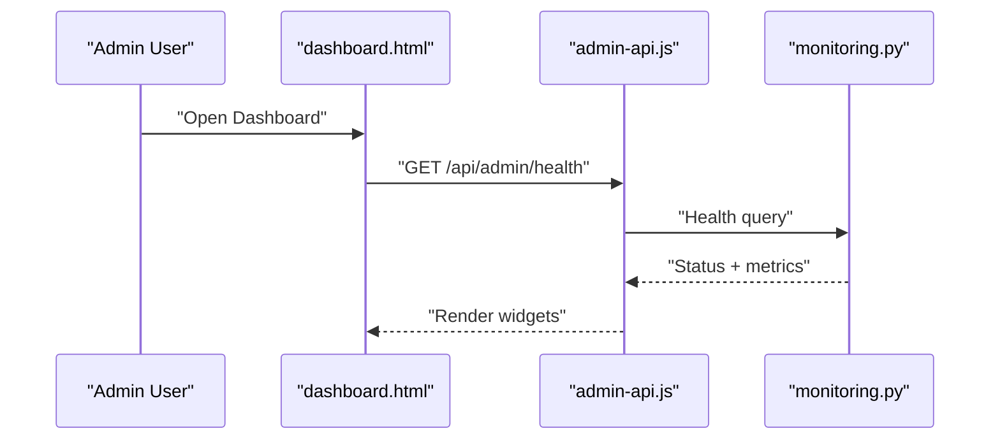

**Diagram sources**
- [dashboard.html](file://web/admin/dashboard.html)
- [admin-api.js](file://web/admin/js/admin-api.js)
- [monitoring.py](file://backend/monitoring.py)

**Section sources**
- [dashboard.html](file://web/admin/dashboard.html)
- [admin-api.js](file://web/admin/js/admin-api.js)
- [monitoring.py](file://backend/monitoring.py)

### Settings Configuration Interfaces
- Application Settings
  - View and update global settings such as feature flags, thresholds, and integrations.
- Persistence
  - Changes are saved via API and reflected across sessions.

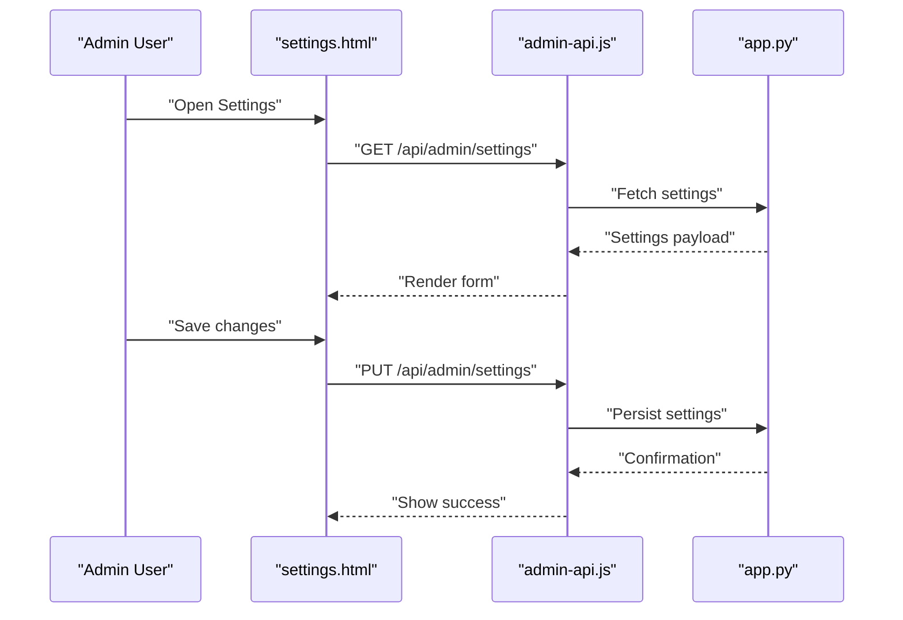

**Diagram sources**
- [settings.html](file://web/admin/settings.html)
- [admin-api.js](file://web/admin/js/admin-api.js)
- [app.py](file://backend/app.py)

**Section sources**
- [settings.html](file://web/admin/settings.html)
- [admin-api.js](file://web/admin/js/admin-api.js)
- [app.py](file://backend/app.py)

### Feedback Management Systems
- Feedback Listing
  - Displays user feedback with filters and sorting.
- Response and Resolution
  - Allows admins to respond and mark feedback as resolved.

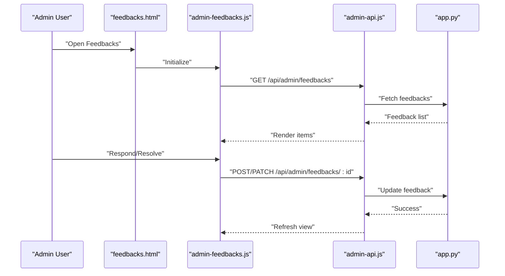

**Diagram sources**
- [feedbacks.html](file://web/admin/feedbacks.html)
- [admin-feedbacks.js](file://web/admin/js/admin-feedbacks.js)
- [admin-api.js](file://web/admin/js/admin-api.js)
- [app.py](file://backend/app.py)

**Section sources**
- [feedbacks.html](file://web/admin/feedbacks.html)
- [admin-feedbacks.js](file://web/admin/js/admin-feedbacks.js)
- [admin-api.js](file://web/admin/js/admin-api.js)
- [app.py](file://backend/app.py)

### Recharge Requests Management
- Request Listing
  - Shows pending and processed recharge requests.
- Approval Workflow
  - Approves or denies requests and updates user balances accordingly.

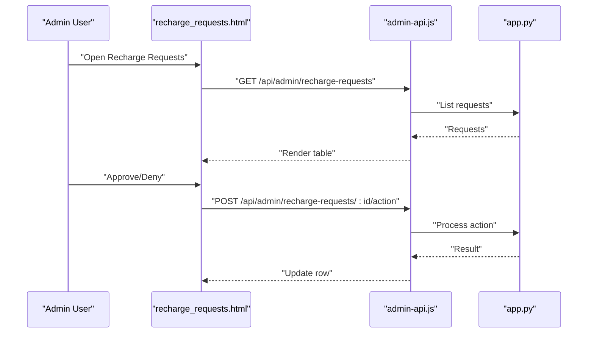

**Diagram sources**
- [recharge_requests.html](file://web/admin/recharge_requests.html)
- [admin-api.js](file://web/admin/js/admin-api.js)
- [app.py](file://backend/app.py)

**Section sources**
- [recharge_requests.html](file://web/admin/recharge_requests.html)
- [admin-api.js](file://web/admin/js/admin-api.js)
- [app.py](file://backend/app.py)

### Admin Authentication Flow
- Steps
  - Admin submits credentials.
  - Backend validates and issues token/session.
  - Frontend stores token and attaches it to subsequent requests.
- Security
  - Tokens are transmitted securely and validated by middleware.

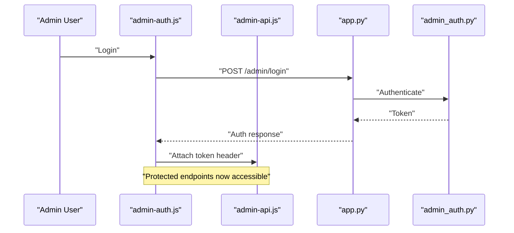

**Diagram sources**
- [admin-auth.js](file://web/admin/js/admin-auth.js)
- [admin-api.js](file://web/admin/js/admin-api.js)
- [app.py](file://backend/app.py)
- [admin_auth.py](file://backend/admin_auth.py)

**Section sources**
- [admin-auth.js](file://web/admin/js/admin-auth.js)
- [admin-api.js](file://web/admin/js/admin-api.js)
- [app.py](file://backend/app.py)
- [admin_auth.py](file://backend/admin_auth.py)

### API Integration Patterns
- Centralized Client
  - All admin features use a unified API client for consistency and maintainability.
- Error Handling
  - Global error handlers display user-friendly messages and retry transient failures.
- Headers and Tokens
  - Token injection ensures authenticated requests.

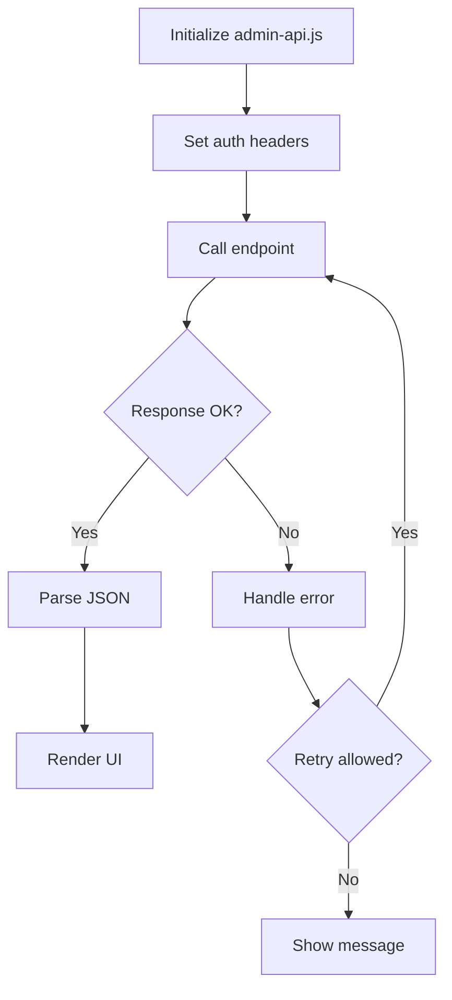

**Diagram sources**
- [admin-api.js](file://web/admin/js/admin-api.js)
- [admin-utils.js](file://web/admin/js/admin-utils.js)

**Section sources**
- [admin-api.js](file://web/admin/js/admin-api.js)
- [admin-utils.js](file://web/admin/js/admin-utils.js)

### Real-Time Updates
- Polling Strategy
  - Periodic polling refreshes critical data (e.g., health, pending items).
- Server-Sent Events (if available)
  - For live dashboards, consider SSE endpoints to push updates without polling overhead.

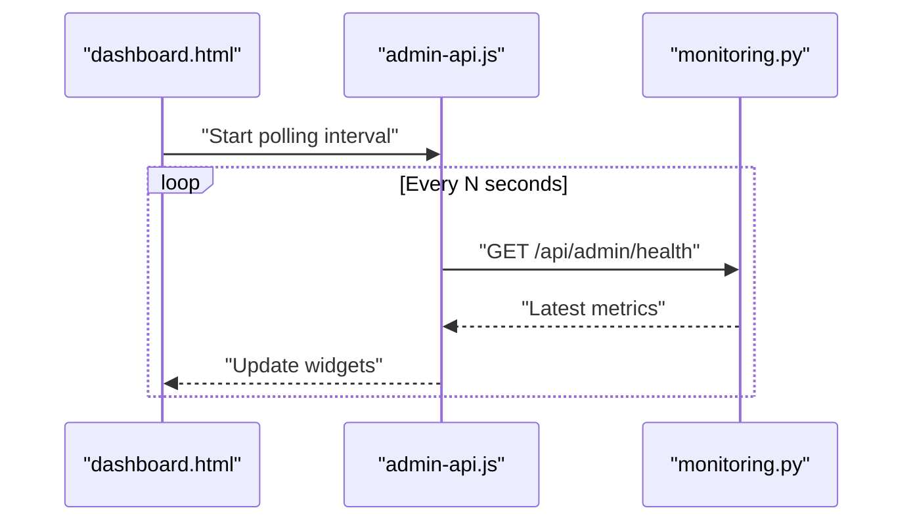

**Diagram sources**
- [dashboard.html](file://web/admin/dashboard.html)
- [admin-api.js](file://web/admin/js/admin-api.js)
- [monitoring.py](file://backend/monitoring.py)

**Section sources**
- [dashboard.html](file://web/admin/dashboard.html)
- [admin-api.js](file://web/admin/js/admin-api.js)
- [monitoring.py](file://backend/monitoring.py)

### Extending the Dashboard: Adding New Admin Features
- Steps
  - Create a new HTML page under web/admin.
  - Add navigation link in the index page.
  - Implement feature-specific JS module and integrate with admin-api.js.
  - Define backend endpoints in app.py or a dedicated route file.
  - Ensure RBAC protection using admin_auth middleware.
- Example Pattern
  - Follow the pattern used by existing modules (users, teachings, feedbacks) for consistency.

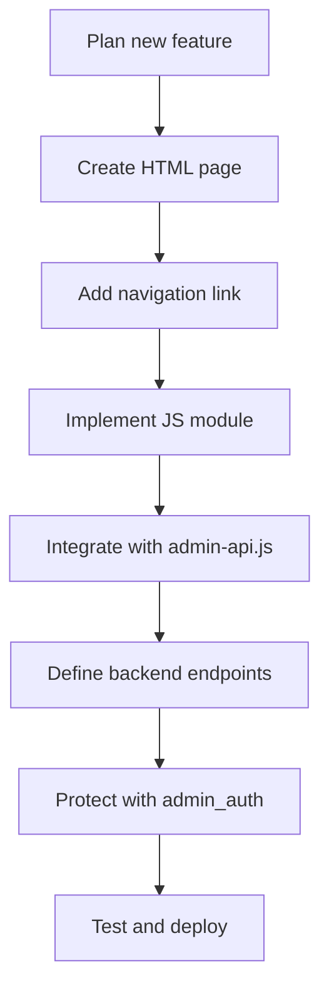

[No sources needed since this section provides general guidance]

### Customizing Dashboards
- Styling
  - Use admin.css for consistent themes and responsive layouts.
- Widgets
  - Add reusable components for charts, tables, and forms.
- Theming
  - Centralize color variables and typography for easy customization.

**Section sources**
- [admin.css](file://web/admin/css/admin.css)

### Administrative Workflows
- Approval Chains
  - Multi-step approval processes can be modeled with state transitions in the UI and backend.
- Audit Trails
  - Log admin actions for accountability and debugging.
- Notifications
  - Send notifications to users upon significant admin actions.

[No sources needed since this section provides general guidance]

## Dependency Analysis
Frontend dependencies:
- Pages depend on shared CSS and JS modules.
- Feature modules rely on the centralized API client and utilities.

Backend dependencies:
- Routes expose endpoints for admin operations.
- Middleware enforces authentication and authorization.
- Monitoring and quota modules provide specialized functionality.

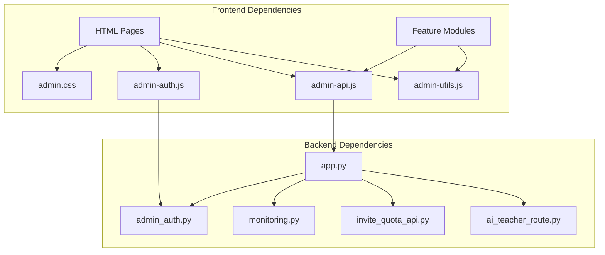

**Diagram sources**
- [admin.css](file://web/admin/css/admin.css)
- [admin-auth.js](file://web/admin/js/admin-auth.js)
- [admin-api.js](file://web/admin/js/admin-api.js)
- [admin-utils.js](file://web/admin/js/admin-utils.js)
- [app.py](file://backend/app.py)
- [admin_auth.py](file://backend/admin_auth.py)
- [monitoring.py](file://backend/monitoring.py)
- [invite_quota_api.py](file://backend/invite_quota_api.py)
- [ai_teacher_route.py](file://backend/ai_teacher_route.py)

**Section sources**
- [admin.css](file://web/admin/css/admin.css)
- [admin-auth.js](file://web/admin/js/admin-auth.js)
- [admin-api.js](file://web/admin/js/admin-api.js)
- [admin-utils.js](file://web/admin/js/admin-utils.js)
- [app.py](file://backend/app.py)
- [admin_auth.py](file://backend/admin_auth.py)
- [monitoring.py](file://backend/monitoring.py)
- [invite_quota_api.py](file://backend/invite_quota_api.py)
- [ai_teacher_route.py](file://backend/ai_teacher_route.py)

## Performance Considerations
- Pagination and Filtering
  - Use pagination and server-side filtering to reduce payload sizes.
- Caching
  - Cache frequently accessed read-only data at the API layer.
- Debouncing
  - Debounce search inputs and frequent UI actions to minimize API calls.
- Efficient Rendering
  - Virtualize large lists and avoid unnecessary re-renders.

[No sources needed since this section provides general guidance]

## Troubleshooting Guide
- Authentication Issues
  - Verify token presence and validity; check admin_auth middleware logs.
- API Errors
  - Inspect network responses and error messages; ensure correct endpoints and headers.
- Real-Time Data Not Updating
  - Confirm polling intervals and SSE availability; check backend health endpoints.
- Permission Denied
  - Validate admin roles and permissions; ensure routes are protected correctly.

**Section sources**
- [admin-auth.js](file://web/admin/js/admin-auth.js)
- [admin-api.js](file://web/admin/js/admin-api.js)
- [admin_auth.py](file://backend/admin_auth.py)
- [monitoring.py](file://backend/monitoring.py)

## Conclusion
The admin dashboard provides a robust, extensible interface for managing users, content, feedback, settings, and system health. Its modular architecture, clear separation of concerns, and standardized API integration patterns facilitate maintenance and growth. By following the documented patterns, teams can add new features, customize dashboards, and implement complex administrative workflows efficiently.

## Appendices
- Best Practices
  - Keep UI and API contracts stable; version endpoints when necessary.
  - Enforce least privilege in RBAC; audit sensitive actions.
  - Monitor performance and errors continuously.

[No sources needed since this section provides general guidance]