# Content Moderation & Teaching Materials

<cite>
**Referenced Files in This Document**
- [app.py](file://backend/app.py)
- [ai_teacher_route.py](file://backend/ai_teacher_route.py)
- [pipeline.py](file://backend/pipeline.py)
- [models.py](file://backend/database/models.py)
- [schema.sql](file://backend/database/schema.sql)
- [add_ai_teaching_tables.py](file://backend/database/add_ai_teaching_tables.py)
- [admin_auth.py](file://backend/admin_auth.py)
- [teachings.html](file://web/admin/teachings.html)
- [dashboard.html](file://web/admin/dashboard.html)
- [admin-api.js](file://web/admin/js/admin-api.js)
- [admin-auth.js](file://web/admin/js/admin-auth.js)
- [admin.css](file://web/admin/css/admin.css)
- [teaching_system_prompt.txt](file://backend/prompt/teaching_system_prompt.txt)
- [teaching_user_prompt.txt](file://backend/prompt/teaching_user_prompt.txt)
- [teaching_template.html](file://backend/prompt/teaching_template.html)
- [generate_preview_images.py](file://backend/generate_preview_images.py)
- [update_preview_to_webp.py](file://backend/database/update_preview_to_webp.py)
- [storage_metadata.json](file://storage/02f5efec-416c-4a17-9bf2-7ebea80cf178/metadata.json)
- [storage_teaching.html](file://storage/02f5efec-416c-4a17-9bf2-7ebea80cf178/teaching.html)
</cite>

## Table of Contents
1. [Introduction](#introduction)
2. [Project Structure](#project-structure)
3. [Core Components](#core-components)
4. [Architecture Overview](#architecture-overview)
5. [Detailed Component Analysis](#detailed-component-analysis)
6. [Dependency Analysis](#dependency-analysis)
7. [Performance Considerations](#performance-considerations)
8. [Troubleshooting Guide](#troubleshooting-guide)
9. [Conclusion](#conclusion)
10. [Appendices](#appendices)

## Introduction
This document explains the content moderation system and teaching materials management, focusing on:
- The teaching material review interface and approval workflows
- Quality assessment tools and automated checks
- Content filtering, tagging, and categorization
- Preview generation for HTML content, error reporting, and regeneration
- Bulk operations, version history tracking, and analytics
- Extensibility patterns for custom moderation rules, validation checks, and automated quality assurance

The system is designed to generate high-quality teaching materials using AI prompts, store artifacts (HTML and metadata), preview content, and provide an admin workflow for moderation and approval.

## Project Structure
Key areas relevant to content moderation and teaching materials:
- Backend API and orchestration: app routes, AI teacher integration, pipeline processing
- Database models and schema: teaching records, status fields, tags, categories, previews
- Admin web UI: review dashboard, bulk actions, filters, and approvals
- Prompt templates: system/user prompts and HTML template used for generation
- Storage layout: per-item directories with metadata and generated HTML
- Utilities: preview image generation and conversion utilities

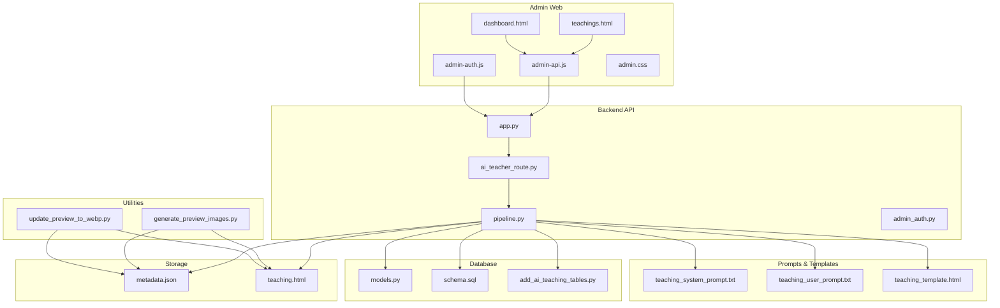

**Diagram sources**
- [app.py](file://backend/app.py)
- [ai_teacher_route.py](file://backend/ai_teacher_route.py)
- [pipeline.py](file://backend/pipeline.py)
- [models.py](file://backend/database/models.py)
- [schema.sql](file://backend/database/schema.sql)
- [add_ai_teaching_tables.py](file://backend/database/add_ai_teaching_tables.py)
- [admin_auth.py](file://backend/admin_auth.py)
- [teachings.html](file://web/admin/teachings.html)
- [dashboard.html](file://web/admin/dashboard.html)
- [admin-api.js](file://web/admin/js/admin-api.js)
- [admin-auth.js](file://web/admin/js/admin-auth.js)
- [admin.css](file://web/admin/css/admin.css)
- [teaching_system_prompt.txt](file://backend/prompt/teaching_system_prompt.txt)
- [teaching_user_prompt.txt](file://backend/prompt/teaching_user_prompt.txt)
- [teaching_template.html](file://backend/prompt/teaching_template.html)
- [generate_preview_images.py](file://backend/generate_preview_images.py)
- [update_preview_to_webp.py](file://backend/database/update_preview_to_webp.py)
- [storage_metadata.json](file://storage/02f5efec-416c-4a17-9bf2-7ebea80cf178/metadata.json)
- [storage_teaching.html](file://storage/02f5efec-416c-4a17-9bf2-7ebea80cf178/teaching.html)

**Section sources**
- [app.py](file://backend/app.py)
- [ai_teacher_route.py](file://backend/ai_teacher_route.py)
- [pipeline.py](file://backend/pipeline.py)
- [models.py](file://backend/database/models.py)
- [schema.sql](file://backend/database/schema.sql)
- [add_ai_teaching_tables.py](file://backend/database/add_ai_teaching_tables.py)
- [admin_auth.py](file://backend/admin_auth.py)
- [teachings.html](file://web/admin/teachings.html)
- [dashboard.html](file://web/admin/dashboard.html)
- [admin-api.js](file://web/admin/js/admin-api.js)
- [admin-auth.js](file://web/admin/js/admin-auth.js)
- [admin.css](file://web/admin/css/admin.css)
- [teaching_system_prompt.txt](file://backend/prompt/teaching_system_prompt.txt)
- [teaching_user_prompt.txt](file://backend/prompt/teaching_user_prompt.txt)
- [teaching_template.html](file://backend/prompt/teaching_template.html)
- [generate_preview_images.py](file://backend/generate_preview_images.py)
- [update_preview_to_webp.py](file://backend/database/update_preview_to_webp.py)
- [storage_metadata.json](file://storage/02f5efec-416c-4a17-9bf2-7ebea80cf178/metadata.json)
- [storage_teaching.html](file://storage/02f5efec-416c-4a17-9bf2-7ebea80cf178/teaching.html)

## Core Components
- Teaching Material Model and Schema
  - Defines core fields such as title, description, category, tags, status, preview path, and timestamps.
  - Includes migration scripts to add AI-related tables and fields.
- Pipeline Orchestration
  - Coordinates prompt rendering, HTML generation, storage writes, preview creation, and status updates.
- Admin Review Interface
  - Provides listing, filtering, preview, approve/reject, regenerate, and bulk operations.
- Moderation and Quality Tools
  - Integrates rule-based checks and optional AI-assisted scoring; supports tagging and categorization.
- Preview System
  - Generates preview images from HTML and converts assets to optimized formats.
- Storage Layout
  - Each item has a directory containing metadata and generated HTML.

**Section sources**
- [models.py](file://backend/database/models.py)
- [schema.sql](file://backend/database/schema.sql)
- [add_ai_teaching_tables.py](file://backend/database/add_ai_teaching_tables.py)
- [pipeline.py](file://backend/pipeline.py)
- [teachings.html](file://web/admin/teachings.html)
- [admin-api.js](file://web/admin/js/admin-api.js)
- [generate_preview_images.py](file://backend/generate_preview_images.py)
- [update_preview_to_webp.py](file://backend/database/update_preview_to_webp.py)
- [storage_metadata.json](file://storage/02f5efec-416c-4a17-9bf2-7ebea80cf178/metadata.json)
- [storage_teaching.html](file://storage/02f5efec-416c-4a17-9bf2-7ebea80cf178/teaching.html)

## Architecture Overview
High-level flow from request to moderated content:
- Admin UI calls backend APIs for listing, filtering, approving, regenerating, and bulk actions.
- Backend orchestrates AI teacher route and pipeline to generate or update teaching materials.
- Pipeline renders prompts, generates HTML, persists artifacts, creates previews, and updates database status.
- Moderation and quality checks run during generation and before approval.

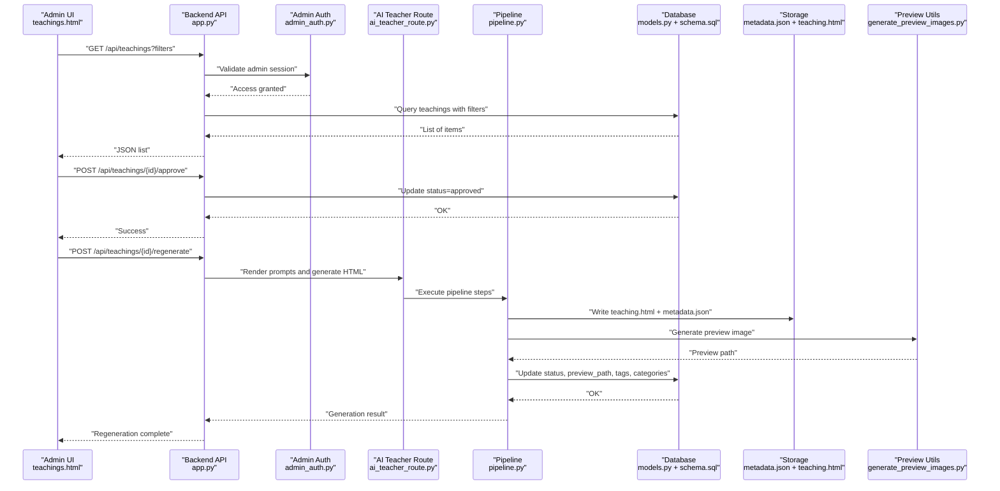

**Diagram sources**
- [app.py](file://backend/app.py)
- [admin_auth.py](file://backend/admin_auth.py)
- [ai_teacher_route.py](file://backend/ai_teacher_route.py)
- [pipeline.py](file://backend/pipeline.py)
- [models.py](file://backend/database/models.py)
- [schema.sql](file://backend/database/schema.sql)
- [teachings.html](file://web/admin/teachings.html)
- [generate_preview_images.py](file://backend/generate_preview_images.py)
- [storage_metadata.json](file://storage/02f5efec-416c-4a17-9bf2-7ebea80cf178/metadata.json)
- [storage_teaching.html](file://storage/02f5efec-416c-4a17-9bf2-7ebea80cf178/teaching.html)

## Detailed Component Analysis

### Teaching Material Data Model and Versioning
- Fields include identifiers, titles, descriptions, categories, tags, status, preview paths, and timestamps.
- Migration scripts add AI-specific tables and fields to support generation and moderation.
- Versioning can be implemented by appending versioned artifacts and maintaining a history table or versioned metadata entries.

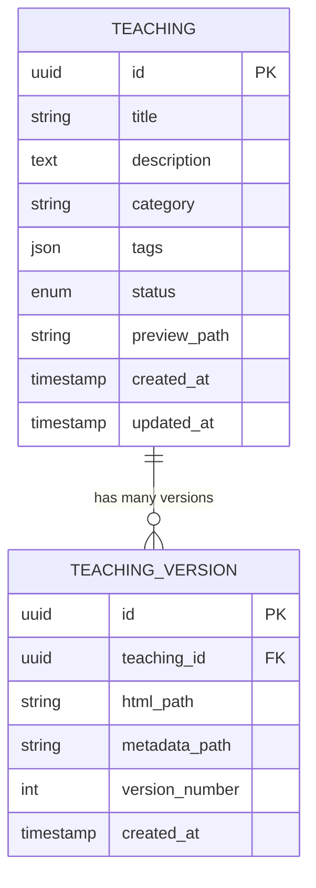

**Diagram sources**
- [models.py](file://backend/database/models.py)
- [schema.sql](file://backend/database/schema.sql)
- [add_ai_teaching_tables.py](file://backend/database/add_ai_teaching_tables.py)

**Section sources**
- [models.py](file://backend/database/models.py)
- [schema.sql](file://backend/database/schema.sql)
- [add_ai_teaching_tables.py](file://backend/database/add_ai_teaching_tables.py)

### Pipeline Orchestration and Generation Flow
- Renders prompts from templates and user/system inputs.
- Executes generation steps, writes HTML and metadata, creates previews, and updates statuses.
- Supports error handling and retries for robustness.

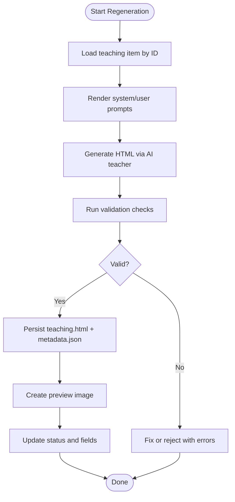

**Diagram sources**
- [pipeline.py](file://backend/pipeline.py)
- [ai_teacher_route.py](file://backend/ai_teacher_route.py)
- [teaching_system_prompt.txt](file://backend/prompt/teaching_system_prompt.txt)
- [teaching_user_prompt.txt](file://backend/prompt/teaching_user_prompt.txt)
- [teaching_template.html](file://backend/prompt/teaching_template.html)
- [generate_preview_images.py](file://backend/generate_preview_images.py)
- [storage_metadata.json](file://storage/02f5efec-416c-4a17-9bf2-7ebea80cf178/metadata.json)
- [storage_teaching.html](file://storage/02f5efec-416c-4a17-9bf2-7ebea80cf178/teaching.html)

**Section sources**
- [pipeline.py](file://backend/pipeline.py)
- [ai_teacher_route.py](file://backend/ai_teacher_route.py)
- [teaching_system_prompt.txt](file://backend/prompt/teaching_system_prompt.txt)
- [teaching_user_prompt.txt](file://backend/prompt/teaching_user_prompt.txt)
- [teaching_template.html](file://backend/prompt/teaching_template.html)
- [generate_preview_images.py](file://backend/generate_preview_images.py)
- [storage_metadata.json](file://storage/02f5efec-416c-4a17-9bf2-7ebea80cf178/metadata.json)
- [storage_teaching.html](file://storage/02f5efec-416c-4a17-9bf2-7ebea80cf178/teaching.html)

### Admin Review Interface and Approval Workflows
- Listings with filters (status, category, tags).
- Preview panel to inspect generated HTML and metadata.
- Approve/reject actions that update status and trigger downstream publishing.
- Bulk operations for mass approve/reject/regenerate.

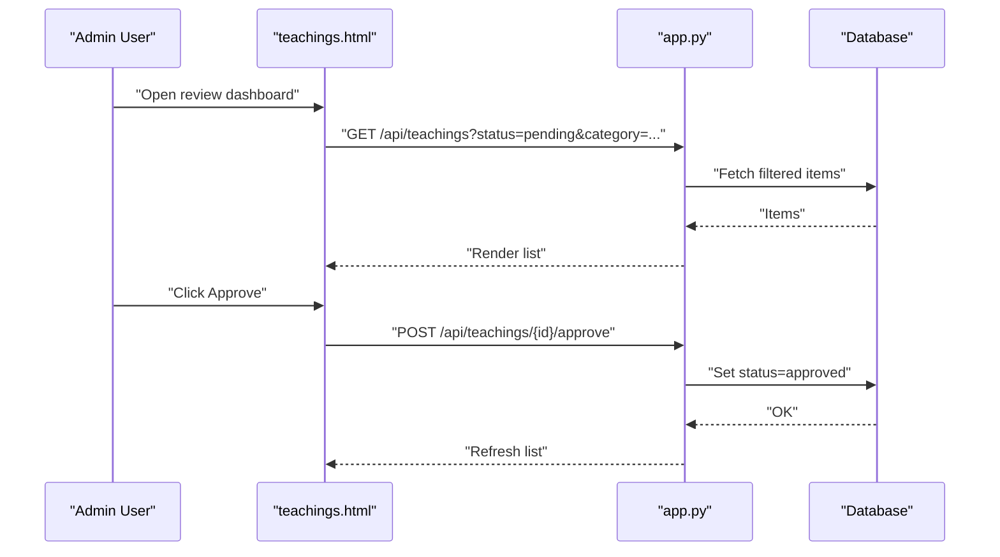

**Diagram sources**
- [teachings.html](file://web/admin/teachings.html)
- [admin-api.js](file://web/admin/js/admin-api.js)
- [app.py](file://backend/app.py)
- [models.py](file://backend/database/models.py)
- [schema.sql](file://backend/database/schema.sql)

**Section sources**
- [teachings.html](file://web/admin/teachings.html)
- [admin-api.js](file://web/admin/js/admin-api.js)
- [app.py](file://backend/app.py)
- [models.py](file://backend/database/models.py)
- [schema.sql](file://backend/database/schema.sql)

### Content Filtering, Tagging, and Categorization
- Filters by status, category, and tags.
- Tags stored as structured data for flexible querying.
- Categories enable grouping and navigation.

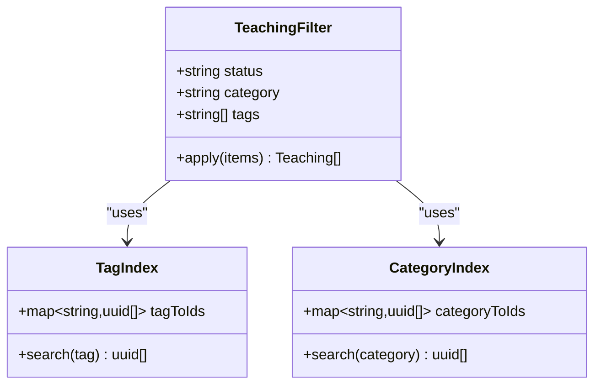

**Diagram sources**
- [models.py](file://backend/database/models.py)
- [schema.sql](file://backend/database/schema.sql)
- [teachings.html](file://web/admin/teachings.html)
- [admin-api.js](file://web/admin/js/admin-api.js)

**Section sources**
- [models.py](file://backend/database/models.py)
- [schema.sql](file://backend/database/schema.sql)
- [teachings.html](file://web/admin/teachings.html)
- [admin-api.js](file://web/admin/js/admin-api.js)

### Preview System for Generated HTML
- Generates preview images from HTML content.
- Converts previews to optimized formats (e.g., WebP).
- Stores preview paths in metadata and links them in the admin UI.

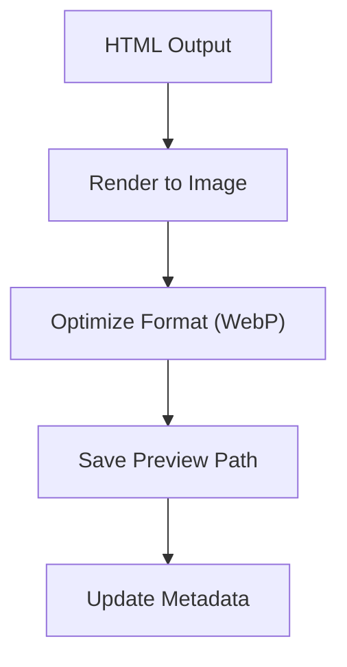

**Diagram sources**
- [generate_preview_images.py](file://backend/generate_preview_images.py)
- [update_preview_to_webp.py](file://backend/database/update_preview_to_webp.py)
- [storage_metadata.json](file://storage/02f5efec-416c-4a17-9bf2-7ebea80cf178/metadata.json)

**Section sources**
- [generate_preview_images.py](file://backend/generate_preview_images.py)
- [update_preview_to_webp.py](file://backend/database/update_preview_to_webp.py)
- [storage_metadata.json](file://storage/02f5efec-416c-4a17-9bf2-7ebea80cf178/metadata.json)

### Error Reporting and Content Regeneration
- Errors during generation are captured and surfaced in the admin UI.
- Regeneration allows retrying with updated prompts or parameters.
- Status transitions reflect success/failure states.

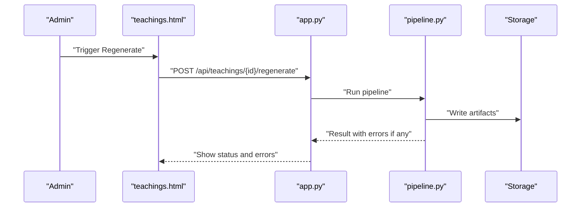

**Diagram sources**
- [teachings.html](file://web/admin/teachings.html)
- [admin-api.js](file://web/admin/js/admin-api.js)
- [app.py](file://backend/app.py)
- [pipeline.py](file://backend/pipeline.py)
- [storage_metadata.json](file://storage/02f5efec-416c-4a17-9bf2-7ebea80cf178/metadata.json)

**Section sources**
- [teachings.html](file://web/admin/teachings.html)
- [admin-api.js](file://web/admin/js/admin-api.js)
- [app.py](file://backend/app.py)
- [pipeline.py](file://backend/pipeline.py)
- [storage_metadata.json](file://storage/02f5efec-416c-4a17-9bf2-7ebea80cf178/metadata.json)

### Bulk Operations
- Select multiple items and perform batch approve/reject/regenerate.
- Progress feedback and error summaries per batch.

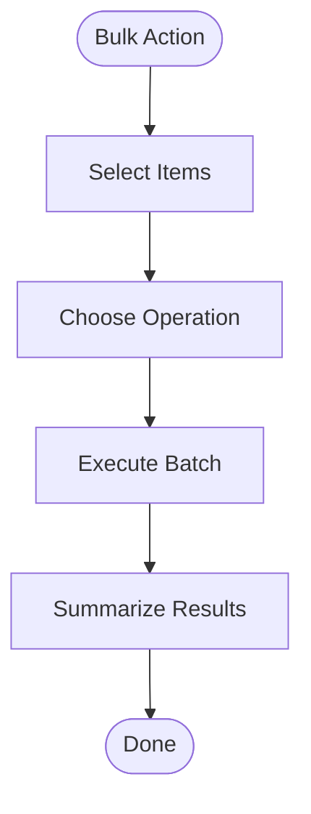

**Diagram sources**
- [teachings.html](file://web/admin/teachings.html)
- [admin-api.js](file://web/admin/js/admin-api.js)
- [app.py](file://backend/app.py)

**Section sources**
- [teachings.html](file://web/admin/teachings.html)
- [admin-api.js](file://web/admin/js/admin-api.js)
- [app.py](file://backend/app.py)

### Version History Tracking
- Maintain versioned artifacts and metadata entries.
- Support rollback to previous versions and audit trails.

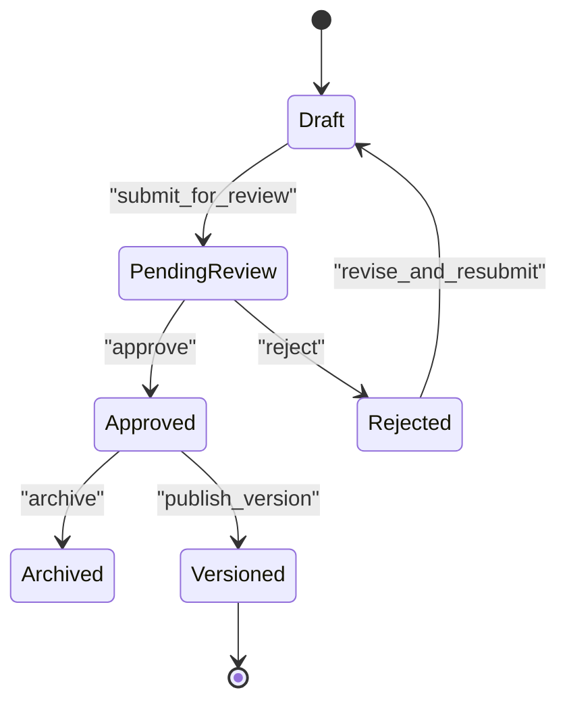

**Diagram sources**
- [models.py](file://backend/database/models.py)
- [schema.sql](file://backend/database/schema.sql)
- [add_ai_teaching_tables.py](file://backend/database/add_ai_teaching_tables.py)

**Section sources**
- [models.py](file://backend/database/models.py)
- [schema.sql](file://backend/database/schema.sql)
- [add_ai_teaching_tables.py](file://backend/database/add_ai_teaching_tables.py)

### Content Analytics
- Track view counts and engagement metrics.
- Provide dashboards for moderation workload and throughput.

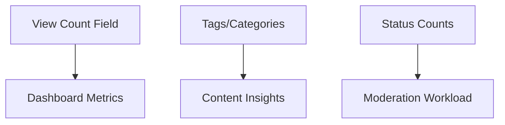

**Diagram sources**
- [models.py](file://backend/database/models.py)
- [schema.sql](file://backend/database/schema.sql)
- [dashboard.html](file://web/admin/dashboard.html)

**Section sources**
- [models.py](file://backend/database/models.py)
- [schema.sql](file://backend/database/schema.sql)
- [dashboard.html](file://web/admin/dashboard.html)

### Implementing Custom Moderation Rules
- Add rule functions invoked during pipeline validation.
- Return pass/fail with descriptive messages for admin feedback.
- Integrate with tagging to auto-label issues.

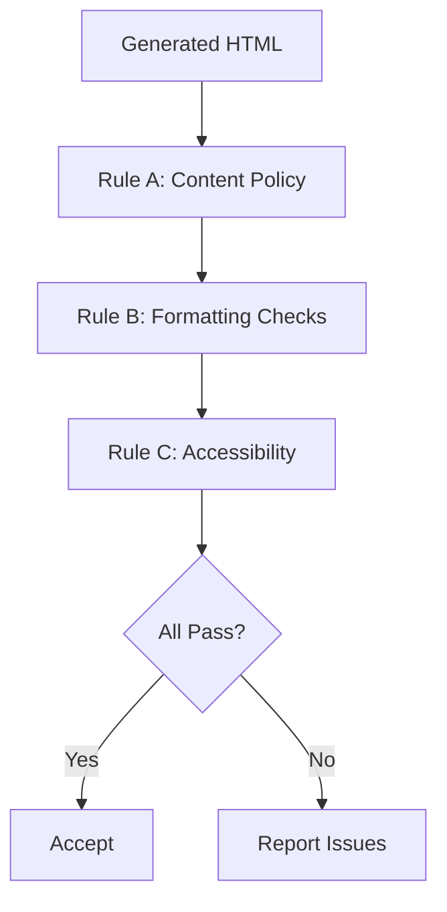

[No sources needed since this diagram shows conceptual workflow, not actual code structure]

### Adding Content Validation Checks
- Extend validation hooks in the pipeline to enforce schema constraints and content standards.
- Log violations and associate with metadata for traceability.

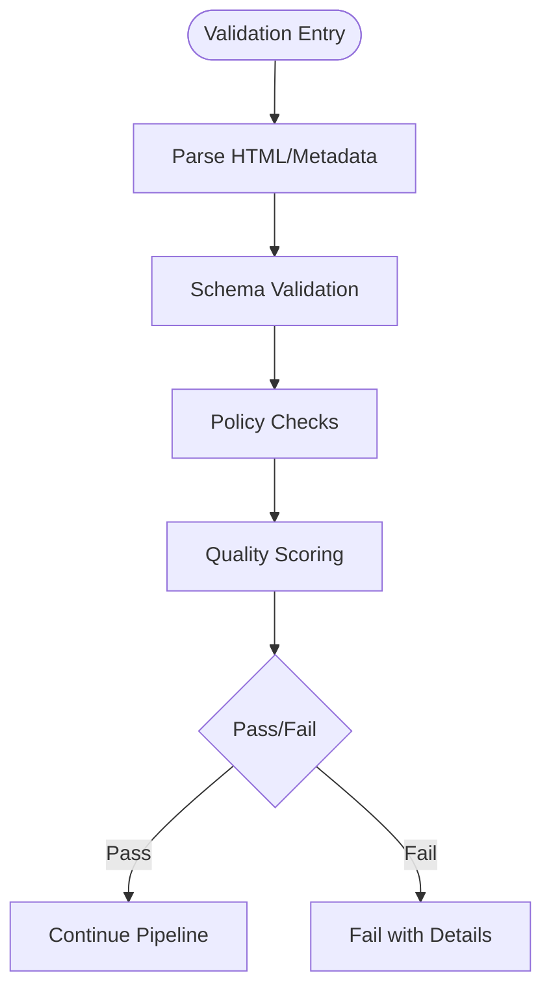

[No sources needed since this diagram shows conceptual workflow, not actual code structure]

### Creating Automated Quality Assurance Workflows
- Chain checks into CI-like stages within the pipeline.
- Use thresholds and alerts for critical failures.
- Auto-regenerate with adjusted prompts when safe.

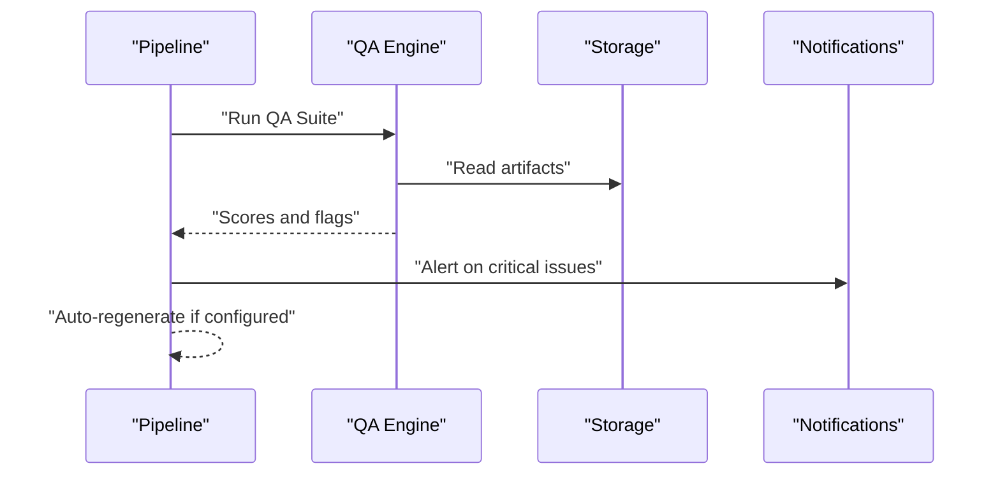

[No sources needed since this diagram shows conceptual workflow, not actual code structure]

## Dependency Analysis
Key dependencies between components:
- Admin UI depends on backend APIs for CRUD and bulk operations.
- Backend orchestrates AI teacher route and pipeline.
- Pipeline depends on prompts/templates and storage.
- Database models and schema define persistence contracts.

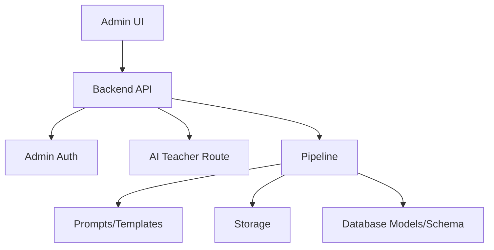

**Diagram sources**
- [teachings.html](file://web/admin/teachings.html)
- [admin-api.js](file://web/admin/js/admin-api.js)
- [app.py](file://backend/app.py)
- [admin_auth.py](file://backend/admin_auth.py)
- [ai_teacher_route.py](file://backend/ai_teacher_route.py)
- [pipeline.py](file://backend/pipeline.py)
- [teaching_system_prompt.txt](file://backend/prompt/teaching_system_prompt.txt)
- [teaching_user_prompt.txt](file://backend/prompt/teaching_user_prompt.txt)
- [teaching_template.html](file://backend/prompt/teaching_template.html)
- [models.py](file://backend/database/models.py)
- [schema.sql](file://backend/database/schema.sql)

**Section sources**
- [teachings.html](file://web/admin/teachings.html)
- [admin-api.js](file://web/admin/js/admin-api.js)
- [app.py](file://backend/app.py)
- [admin_auth.py](file://backend/admin_auth.py)
- [ai_teacher_route.py](file://backend/ai_teacher_route.py)
- [pipeline.py](file://backend/pipeline.py)
- [teaching_system_prompt.txt](file://backend/prompt/teaching_system_prompt.txt)
- [teaching_user_prompt.txt](file://backend/prompt/teaching_user_prompt.txt)
- [teaching_template.html](file://backend/prompt/teaching_template.html)
- [models.py](file://backend/database/models.py)
- [schema.sql](file://backend/database/schema.sql)

## Performance Considerations
- Optimize preview image generation and format conversion to reduce latency.
- Cache frequently accessed teaching listings and filter results.
- Use asynchronous tasks for heavy operations like regeneration and bulk actions.
- Index database fields commonly used in filters (status, category, tags).

[No sources needed since this section provides general guidance]

## Troubleshooting Guide
Common issues and resolutions:
- Preview not updating: verify preview path in metadata and ensure generation succeeded.
- Regeneration fails: check pipeline logs, prompt rendering, and storage permissions.
- Approval not reflected: confirm status field updates and cache invalidation.
- Bulk operation timeouts: split batches and implement progress tracking.

**Section sources**
- [pipeline.py](file://backend/pipeline.py)
- [generate_preview_images.py](file://backend/generate_preview_images.py)
- [update_preview_to_webp.py](file://backend/database/update_preview_to_webp.py)
- [storage_metadata.json](file://storage/02f5efec-416c-4a17-9bf2-7ebea80cf178/metadata.json)

## Conclusion
The content moderation and teaching materials system integrates AI-driven generation, robust storage, preview utilities, and an admin workflow for review and approval. It supports filtering, tagging, categorization, bulk operations, versioning, and analytics. Extensibility points allow custom moderation rules, validation checks, and automated quality assurance workflows.

## Appendices
- Example artifact references:
  - [storage_metadata.json](file://storage/02f5efec-416c-4a17-9bf2-7ebea80cf178/metadata.json)
  - [storage_teaching.html](file://storage/02f5efec-416c-4a17-9bf2-7ebea80cf178/teaching.html)