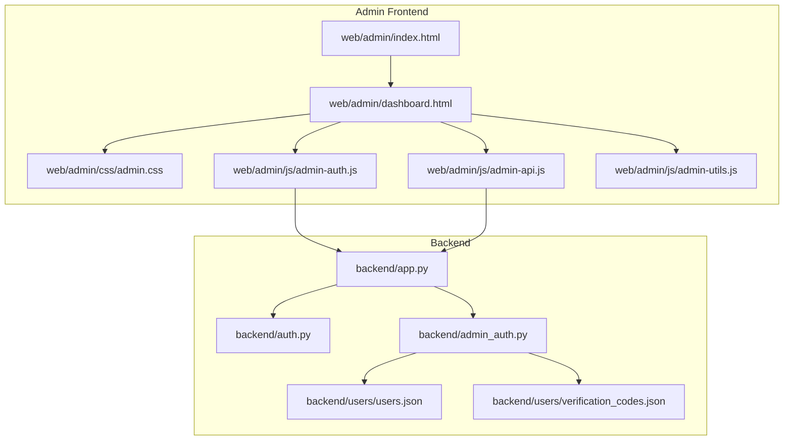
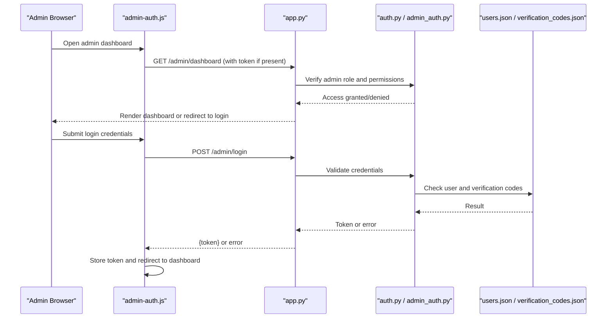
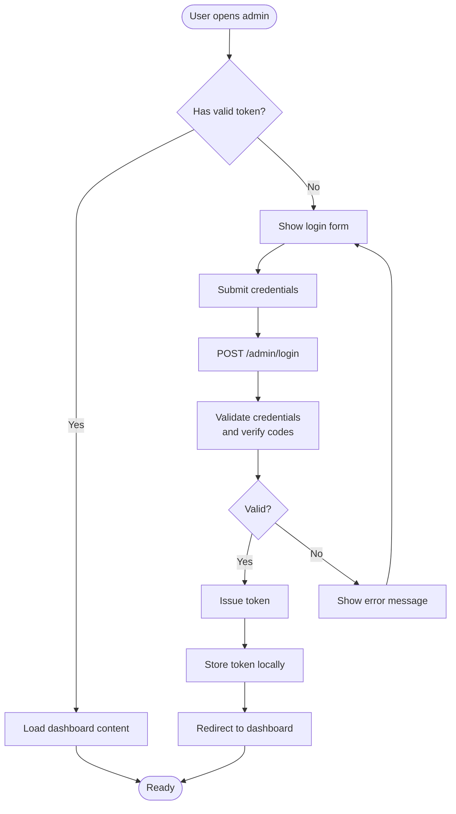
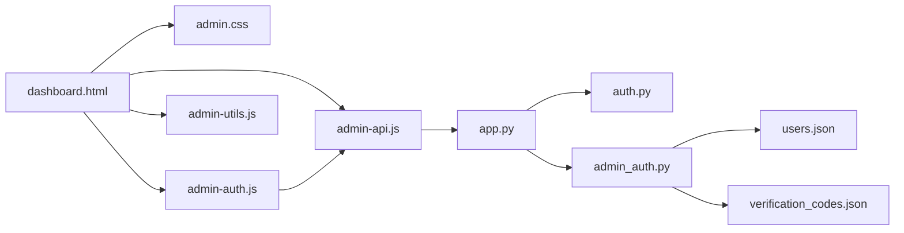

# Dashboard Overview & Navigation

<cite>
**Referenced Files in This Document**
- [dashboard.html](file://web/admin/dashboard.html)
- [index.html](file://web/admin/index.html)
- [admin.css](file://web/admin/css/admin.css)
- [admin-auth.js](file://web/admin/js/admin-auth.js)
- [admin-api.js](file://web/admin/js/admin-api.js)
- [admin-utils.js](file://web/admin/js/admin-utils.js)
- [app.py](file://backend/app.py)
- [auth.py](file://backend/auth.py)
- [admin_auth.py](file://backend/admin_auth.py)
- [users.json](file://backend/users/users.json)
- [verification_codes.json](file://backend/users/verification_codes.json)
</cite>

## Table of Contents
1. [Introduction](#introduction)
2. [Project Structure](#project-structure)
3. [Core Components](#core-components)
4. [Architecture Overview](#architecture-overview)
5. [Detailed Component Analysis](#detailed-component-analysis)
6. [Dependency Analysis](#dependency-analysis)
7. [Performance Considerations](#performance-considerations)
8. [Troubleshooting Guide](#troubleshooting-guide)
9. [Conclusion](#conclusion)
10. [Appendices](#appendices)

## Introduction
This document explains the admin dashboard overview and navigation system, including layout, sidebar navigation structure, role-based access control (RBAC), authentication flow for admin users, session management, security measures, dashboard widgets, real-time statistics display, quick action panels, and customization guidance. It is designed to be accessible to both technical and non-technical readers while providing precise references to source files.

## Project Structure
The admin dashboard is implemented as a static frontend under web/admin with JavaScript modules for authentication, API calls, and utilities. The backend provides HTTP endpoints for authentication, authorization, and data retrieval used by the dashboard.

**Diagram sources**
- [index.html](file://web/admin/index.html)
- [dashboard.html](file://web/admin/dashboard.html)
- [admin.css](file://web/admin/css/admin.css)
- [admin-auth.js](file://web/admin/js/admin-auth.js)
- [admin-api.js](file://web/admin/js/admin-api.js)
- [admin-utils.js](file://web/admin/js/admin-utils.js)
- [app.py](file://backend/app.py)
- [auth.py](file://backend/auth.py)
- [admin_auth.py](file://backend/admin_auth.py)
- [users.json](file://backend/users/users.json)
- [verification_codes.json](file://backend/users/verification_codes.json)

**Section sources**
- [index.html](file://web/admin/index.html)
- [dashboard.html](file://web/admin/dashboard.html)
- [admin.css](file://web/admin/css/admin.css)
- [admin-auth.js](file://web/admin/js/admin-auth.js)
- [admin-api.js](file://web/admin/js/admin-api.js)
- [admin-utils.js](file://web/admin/js/admin-utils.js)
- [app.py](file://backend/app.py)
- [auth.py](file://backend/auth.py)
- [admin_auth.py](file://backend/admin_auth.py)
- [users.json](file://backend/users/users.json)
- [verification_codes.json](file://backend/users/verification_codes.json)

## Core Components
- Layout shell: index.html hosts the main frame and loads the dashboard page.
- Dashboard view: dashboard.html renders the primary content area, widgets, and quick actions.
- Styles: admin.css defines layout, sidebar, cards, and responsive behavior.
- Authentication module: admin-auth.js handles login, token/session storage, and redirects.
- API client: admin-api.js encapsulates requests to backend endpoints and error handling.
- Utilities: admin-utils.js provides helpers for formatting, rendering, and common UI logic.
- Backend routes: app.py registers endpoints; auth.py provides shared auth helpers; admin_auth.py enforces admin-only access and RBAC.
- User store: users.json and verification_codes.json are used by admin_auth.py for credential checks and verification flows.

Key responsibilities:
- Admin entry and routing: index.html -> dashboard.html
- Auth flow: admin-auth.js -> backend auth endpoints -> admin_auth.py -> users.json
- Data fetching: admin-api.js -> backend endpoints -> database or JSON stores
- UI rendering: dashboard.html + admin.css + admin-utils.js

**Section sources**
- [index.html](file://web/admin/index.html)
- [dashboard.html](file://web/admin/dashboard.html)
- [admin.css](file://web/admin/css/admin.css)
- [admin-auth.js](file://web/admin/js/admin-auth.js)
- [admin-api.js](file://web/admin/js/admin-api.js)
- [admin-utils.js](file://web/admin/js/admin-utils.js)
- [app.py](file://backend/app.py)
- [auth.py](file://backend/auth.py)
- [admin_auth.py](file://backend/admin_auth.py)
- [users.json](file://backend/users/users.json)
- [verification_codes.json](file://backend/users/verification_codes.json)

## Architecture Overview
The admin dashboard follows a classic client-server architecture:
- Client-side: HTML/CSS/JS under web/admin.
- Server-side: Python application exposing REST-like endpoints under backend.
- Authorization: Admin-only decorators/middleware ensure only authorized users can access admin features.
- Session/token: The frontend persists an auth token after successful login and includes it in subsequent requests.

**Diagram sources**
- [admin-auth.js](file://web/admin/js/admin-auth.js)
- [app.py](file://backend/app.py)
- [auth.py](file://backend/auth.py)
- [admin_auth.py](file://backend/admin_auth.py)
- [users.json](file://backend/users/users.json)
- [verification_codes.json](file://backend/users/verification_codes.json)

## Detailed Component Analysis

### Main Dashboard Layout
- Shell: index.html provides the top-level container and navigates to dashboard.html.
- Content: dashboard.html contains the main grid, widget containers, and quick action panels.
- Styling: admin.css defines the sidebar, card layouts, spacing, and responsive breakpoints.

Customization tips:
- To add new sections, extend the grid in dashboard.html and add corresponding CSS rules in admin.css.
- To change theme colors or typography, update variables or classes in admin.css.

**Section sources**
- [index.html](file://web/admin/index.html)
- [dashboard.html](file://web/admin/dashboard.html)
- [admin.css](file://web/admin/css/admin.css)

### Sidebar Navigation Structure
- Navigation items are defined within the dashboard’s HTML and styled via admin.css.
- Active state highlighting and collapsible behavior are managed by JavaScript utilities in admin-utils.js.
- Role-based visibility is enforced by checking the current user’s roles before rendering specific links.

Adding a new navigation item:
- Add a link element in the sidebar section of dashboard.html.
- Ensure the route exists on the backend and is protected by admin-only middleware.
- Optionally, gate visibility using role checks in admin-utils.js.

**Section sources**
- [dashboard.html](file://web/admin/dashboard.html)
- [admin.css](file://web/admin/css/admin.css)
- [admin-utils.js](file://web/admin/js/admin-utils.js)

### Role-Based Access Control (RBAC)
- Admin-only protection is implemented in the backend via admin_auth.py and shared helpers in auth.py.
- Endpoints require valid tokens and admin privileges; unauthorized access returns errors or redirects.
- The frontend checks for a valid token and admin status before rendering sensitive controls.

Security notes:
- Always enforce server-side checks; do not rely solely on client-side visibility toggles.
- Use short-lived tokens and refresh mechanisms where applicable.

**Section sources**
- [admin_auth.py](file://backend/admin_auth.py)
- [auth.py](file://backend/auth.py)
- [admin-api.js](file://web/admin/js/admin-api.js)

### Authentication Flow for Admin Users
The login sequence ensures secure access to admin features:

**Diagram sources**
- [admin-auth.js](file://web/admin/js/admin-auth.js)
- [app.py](file://backend/app.py)
- [admin_auth.py](file://backend/admin_auth.py)
- [users.json](file://backend/users/users.json)
- [verification_codes.json](file://backend/users/verification_codes.json)

**Section sources**
- [admin-auth.js](file://web/admin/js/admin-auth.js)
- [app.py](file://backend/app.py)
- [admin_auth.py](file://backend/admin_auth.py)
- [users.json](file://backend/users/users.json)
- [verification_codes.json](file://backend/users/verification_codes.json)

### Session Management
- Token persistence: The frontend stores the authentication token after successful login and attaches it to subsequent requests.
- Expiration handling: If the token expires, the client should prompt re-login or refresh the token via a dedicated endpoint.
- Logout: Clear stored tokens and redirect to the login page.

Best practices:
- Use secure storage mechanisms and avoid logging tokens.
- Implement automatic logout on inactivity if required by policy.

**Section sources**
- [admin-auth.js](file://web/admin/js/admin-auth.js)
- [admin-api.js](file://web/admin/js/admin-api.js)

### Security Measures
- Admin-only endpoints: Protected by admin_auth.py to prevent unauthorized access.
- Input validation: Backend validates request payloads before processing.
- Secure headers: Configure CORS and security headers at the server level.
- Rate limiting: Apply rate limits to login and sensitive endpoints to mitigate brute-force attacks.

**Section sources**
- [admin_auth.py](file://backend/admin_auth.py)
- [auth.py](file://backend/auth.py)
- [app.py](file://backend/app.py)

### Dashboard Widgets and Real-Time Statistics
- Widgets: Cards displaying key metrics such as total users, active sessions, and recent activities.
- Real-time updates: Polling or WebSocket integration can be added to refresh statistics periodically.
- Quick actions: Buttons for common tasks like adding users, clearing caches, or sending announcements.

Implementation guidance:
- Use admin-api.js to fetch metrics from backend endpoints.
- Update DOM elements via admin-utils.js helpers.
- Debounce frequent updates to reduce network load.

**Section sources**
- [dashboard.html](file://web/admin/dashboard.html)
- [admin-api.js](file://web/admin/js/admin-api.js)
- [admin-utils.js](file://web/admin/js/admin-utils.js)

### Customizing the Dashboard Layout
- Add new sections: Insert additional grid items in dashboard.html and style them in admin.css.
- Change layout density: Adjust CSS variables or grid columns in admin.css.
- Responsive behavior: Test on mobile and adjust breakpoints in admin.css.

Example steps:
- Create a new card container in dashboard.html.
- Add a corresponding API call in admin-api.js to fetch data.
- Render results using helper functions in admin-utils.js.

**Section sources**
- [dashboard.html](file://web/admin/dashboard.html)
- [admin.css](file://web/admin/css/admin.css)
- [admin-api.js](file://web/admin/js/admin-api.js)
- [admin-utils.js](file://web/admin/js/admin-utils.js)

### Adding New Navigation Items
- Define a new link in the sidebar of dashboard.html.
- Ensure the target route exists and is protected by admin-only middleware.
- Gate visibility based on roles using admin-utils.js checks.

Example steps:
- Add <a href="/admin/new-feature">New Feature</a> in the sidebar.
- Create backend route in app.py with admin-only decorator.
- Conditionally render the link based on user roles.

**Section sources**
- [dashboard.html](file://web/admin/dashboard.html)
- [app.py](file://backend/app.py)
- [admin_auth.py](file://backend/admin_auth.py)
- [admin-utils.js](file://web/admin/js/admin-utils.js)

### Implementing Role-Specific Views
- Role detection: Determine user roles from the token payload or a profile endpoint.
- Conditional rendering: Hide or show UI elements based on roles.
- Server-side enforcement: Protect all sensitive endpoints with admin-only checks.

Example approach:
- Fetch user profile via admin-api.js.
- Toggle visibility of admin-only buttons in dashboard.html using admin-utils.js.
- Ensure backend rejects non-admin requests.

**Section sources**
- [admin-api.js](file://web/admin/js/admin-api.js)
- [dashboard.html](file://web/admin/dashboard.html)
- [admin-utils.js](file://web/admin/js/admin-utils.js)
- [admin_auth.py](file://backend/admin_auth.py)

## Dependency Analysis
Frontend dependencies:
- dashboard.html depends on admin.css, admin-auth.js, admin-api.js, and admin-utils.js.
- admin-auth.js relies on admin-api.js for network calls.
- admin-api.js depends on backend endpoints registered in app.py.

Backend dependencies:
- app.py imports auth.py and admin_auth.py for shared and admin-specific logic.
- admin_auth.py reads users.json and verification_codes.json for credential and code validation.

**Diagram sources**
- [dashboard.html](file://web/admin/dashboard.html)
- [admin.css](file://web/admin/css/admin.css)
- [admin-auth.js](file://web/admin/js/admin-auth.js)
- [admin-api.js](file://web/admin/js/admin-api.js)
- [admin-utils.js](file://web/admin/js/admin-utils.js)
- [app.py](file://backend/app.py)
- [auth.py](file://backend/auth.py)
- [admin_auth.py](file://backend/admin_auth.py)
- [users.json](file://backend/users/users.json)
- [verification_codes.json](file://backend/users/verification_codes.json)

**Section sources**
- [dashboard.html](file://web/admin/dashboard.html)
- [admin.css](file://web/admin/css/admin.css)
- [admin-auth.js](file://web/admin/js/admin-auth.js)
- [admin-api.js](file://web/admin/js/admin-api.js)
- [admin-utils.js](file://web/admin/js/admin-utils.js)
- [app.py](file://backend/app.py)
- [auth.py](file://backend/auth.py)
- [admin_auth.py](file://backend/admin_auth.py)
- [users.json](file://backend/users/users.json)
- [verification_codes.json](file://backend/users/verification_codes.json)

## Performance Considerations
- Minimize polling frequency for real-time stats; use debouncing and caching where appropriate.
- Lazy-load heavy widgets to improve initial page load time.
- Compress assets and leverage browser caching for static resources.
- Optimize backend queries and consider pagination for large datasets.

[No sources needed since this section provides general guidance]

## Troubleshooting Guide
Common issues and resolutions:
- Login fails: Verify credentials in users.json and check verification codes in verification_codes.json. Ensure backend endpoints are reachable.
- Dashboard shows no data: Confirm admin-api.js endpoints return correct responses and that the token is attached to requests.
- Unauthorized access: Check admin_auth.py protections and ensure the user has admin privileges.
- UI not updating: Inspect admin-utils.js rendering logic and ensure DOM selectors match dashboard.html structure.

**Section sources**
- [admin-auth.js](file://web/admin/js/admin-auth.js)
- [admin-api.js](file://web/admin/js/admin-api.js)
- [admin-utils.js](file://web/admin/js/admin-utils.js)
- [admin_auth.py](file://backend/admin_auth.py)
- [users.json](file://backend/users/users.json)
- [verification_codes.json](file://backend/users/verification_codes.json)

## Conclusion
The admin dashboard combines a clear layout, robust navigation, and strong RBAC to provide a secure and extensible administrative interface. By following the customization guidelines and adhering to security best practices, you can tailor the dashboard to your organization’s needs while maintaining reliability and performance.

[No sources needed since this section summarizes without analyzing specific files]

## Appendices

### Example: Adding a New Widget
- Add a card container in dashboard.html.
- Create a backend endpoint in app.py to serve widget data.
- Fetch data in admin-api.js and render via admin-utils.js.
- Style the widget in admin.css.

**Section sources**
- [dashboard.html](file://web/admin/dashboard.html)
- [app.py](file://backend/app.py)
- [admin-api.js](file://web/admin/js/admin-api.js)
- [admin-utils.js](file://web/admin/js/admin-utils.js)
- [admin.css](file://web/admin/css/admin.css)

### Example: Enforcing Role-Specific Visibility
- Retrieve user roles from token or profile endpoint.
- Toggle visibility of admin-only elements using admin-utils.js.
- Protect backend routes with admin_auth.py.

**Section sources**
- [admin-api.js](file://web/admin/js/admin-api.js)
- [dashboard.html](file://web/admin/dashboard.html)
- [admin-utils.js](file://web/admin/js/admin-utils.js)
- [admin_auth.py](file://backend/admin_auth.py)