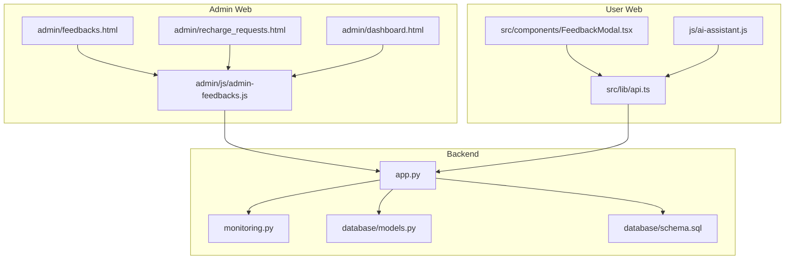
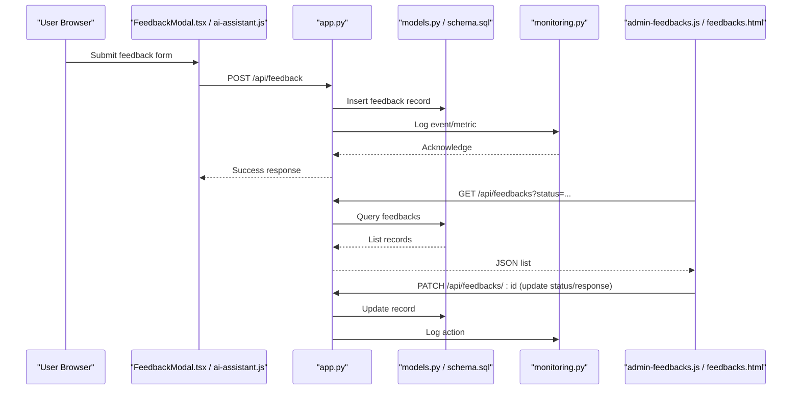
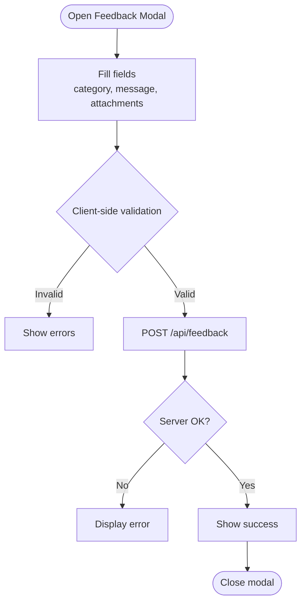
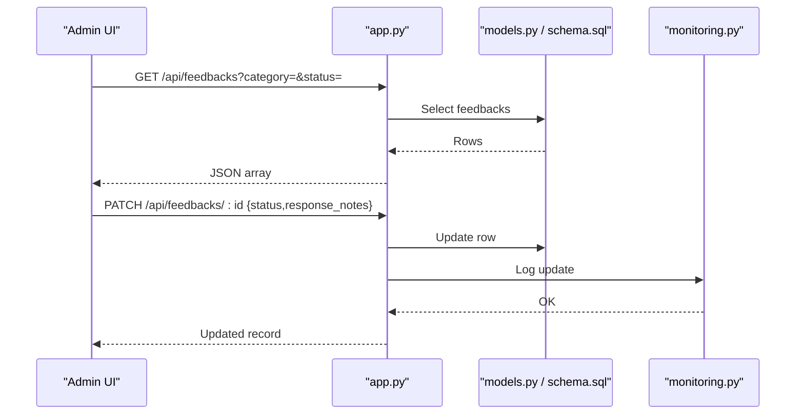
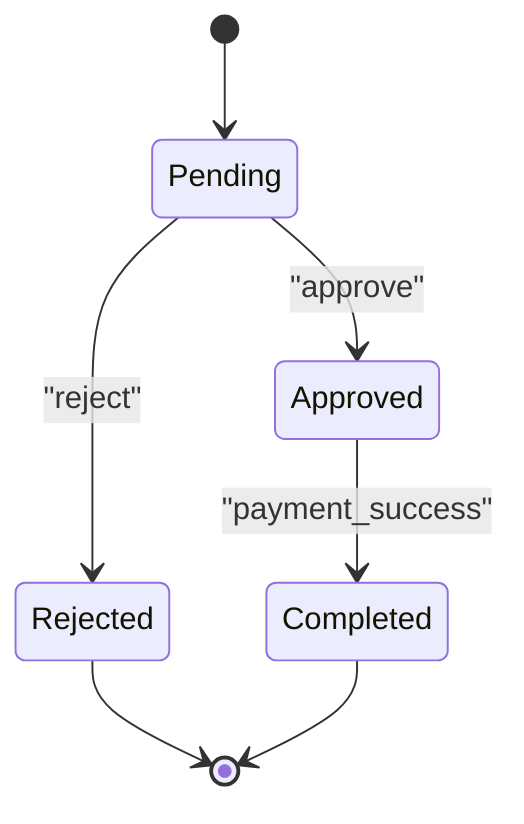
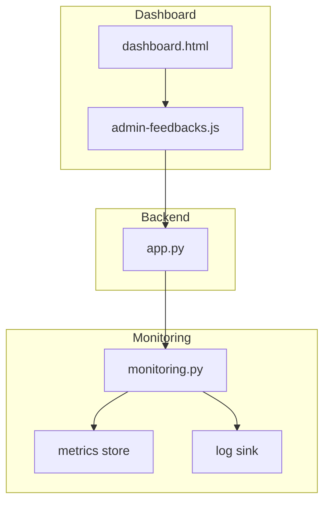
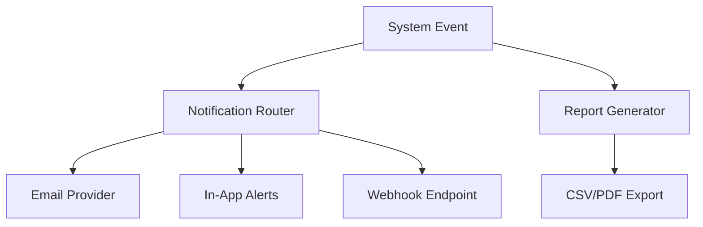
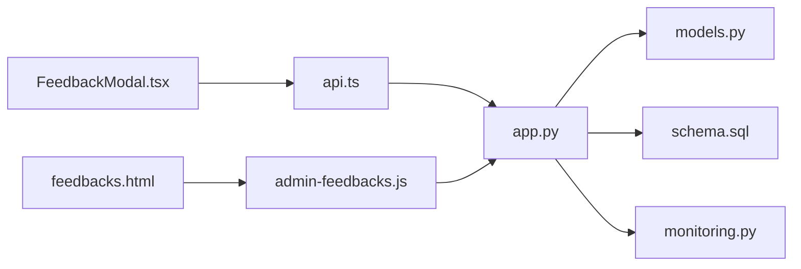
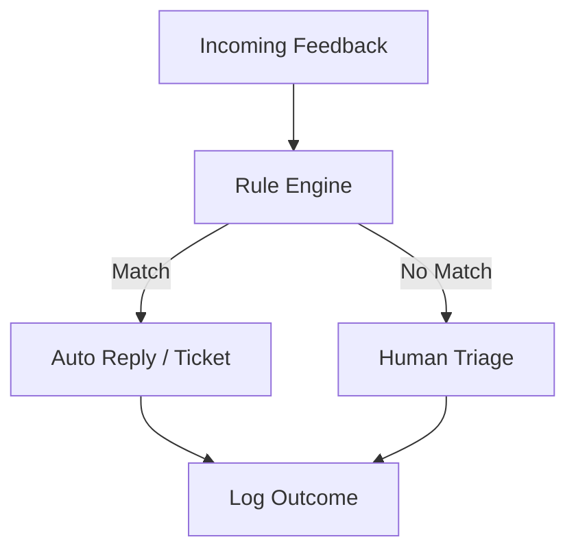

# Feedback Management & Monitoring

<cite>
**Referenced Files in This Document**
- [app.py](file://backend/app.py)
- [monitoring.py](file://backend/monitoring.py)
- [models.py](file://backend/database/models.py)
- [schema.sql](file://backend/database/schema.sql)
- [admin-feedbacks.js](file://web/admin/js/admin-feedbacks.js)
- [feedbacks.html](file://web/admin/feedbacks.html)
- [recharge_requests.html](file://web/admin/recharge_requests.html)
- [dashboard.html](file://web/admin/dashboard.html)
- [ai-assistant.js](file://web/js/ai-assistant.js)
- [FeedbackModal.tsx](file://web/src/components/FeedbackModal.tsx)
- [api.ts](file://web/src/lib/api.ts)
</cite>

## Table of Contents
1. [Introduction](#introduction)
2. [Project Structure](#project-structure)
3. [Core Components](#core-components)
4. [Architecture Overview](#architecture-overview)
5. [Detailed Component Analysis](#detailed-component-analysis)
6. [Dependency Analysis](#dependency-analysis)
7. [Performance Considerations](#performance-considerations)
8. [Troubleshooting Guide](#troubleshooting-guide)
9. [Conclusion](#conclusion)
10. [Appendices](#appendices)

## Introduction
This document explains the feedback management and system monitoring features implemented across the backend and admin frontend. It covers:
- User feedback collection interface, categorization, and response workflow
- Recharge request processing, approval workflows, and payment integration points
- System monitoring dashboards, error logging, and performance metrics visualization
- Notification systems, alert configurations, and reporting capabilities
- Examples for extending categories, adding metrics, and automating responses

The goal is to provide both a high-level understanding and actionable guidance for developers and operators.

## Project Structure
Key areas involved in feedback and monitoring:
- Backend API and monitoring utilities
- Database models and schema definitions
- Admin UI pages and scripts for managing feedback and recharge requests
- Frontend components for user feedback submission

**Diagram sources**
- [app.py](file://backend/app.py)
- [monitoring.py](file://backend/monitoring.py)
- [models.py](file://backend/database/models.py)
- [schema.sql](file://backend/database/schema.sql)
- [feedbacks.html](file://web/admin/feedbacks.html)
- [recharge_requests.html](file://web/admin/recharge_requests.html)
- [dashboard.html](file://web/admin/dashboard.html)
- [admin-feedbacks.js](file://web/admin/js/admin-feedbacks.js)
- [FeedbackModal.tsx](file://web/src/components/FeedbackModal.tsx)
- [ai-assistant.js](file://web/js/ai-assistant.js)
- [api.ts](file://web/src/lib/api.ts)

**Section sources**
- [app.py](file://backend/app.py)
- [monitoring.py](file://backend/monitoring.py)
- [models.py](file://backend/database/models.py)
- [schema.sql](file://backend/database/schema.sql)
- [feedbacks.html](file://web/admin/feedbacks.html)
- [recharge_requests.html](file://web/admin/recharge_requests.html)
- [dashboard.html](file://web/admin/dashboard.html)
- [admin-feedbacks.js](file://web/admin/js/admin-feedbacks.js)
- [FeedbackModal.tsx](file://web/src/components/FeedbackModal.tsx)
- [ai-assistant.js](file://web/js/ai-assistant.js)
- [api.ts](file://web/src/lib/api.ts)

## Core Components
- Feedback submission and listing endpoints (backend)
- Admin feedback management UI and operations
- Recharge request lifecycle and approvals
- Monitoring dashboard and metrics collection
- Error logging and alerting hooks
- Notification integrations and reporting exports

These components interact via REST APIs and shared database tables. The admin UI orchestrates CRUD operations and status transitions, while the monitoring module provides metrics and logs.

**Section sources**
- [app.py](file://backend/app.py)
- [monitoring.py](file://backend/monitoring.py)
- [models.py](file://backend/database/models.py)
- [schema.sql](file://backend/database/schema.sql)
- [admin-feedbacks.js](file://web/admin/js/admin-feedbacks.js)
- [feedbacks.html](file://web/admin/feedbacks.html)
- [recharge_requests.html](file://web/admin/recharge_requests.html)
- [dashboard.html](file://web/admin/dashboard.html)
- [FeedbackModal.tsx](file://web/src/components/FeedbackModal.tsx)
- [ai-assistant.js](file://web/js/ai-assistant.js)
- [api.ts](file://web/src/lib/api.ts)

## Architecture Overview
High-level flow from user feedback submission to admin handling and monitoring:

**Diagram sources**
- [FeedbackModal.tsx](file://web/src/components/FeedbackModal.tsx)
- [ai-assistant.js](file://web/js/ai-assistant.js)
- [app.py](file://backend/app.py)
- [models.py](file://backend/database/models.py)
- [schema.sql](file://backend/database/schema.sql)
- [monitoring.py](file://backend/monitoring.py)
- [admin-feedbacks.js](file://web/admin/js/admin-feedbacks.js)
- [feedbacks.html](file://web/admin/feedbacks.html)

## Detailed Component Analysis

### Feedback Collection Interface
- User-facing modal collects category, description, attachments, and optional contact info.
- Submission calls the API with validation and returns confirmation.
- Optional AI assistant can prefill or suggest categories based on content.

**Diagram sources**
- [FeedbackModal.tsx](file://web/src/components/FeedbackModal.tsx)
- [ai-assistant.js](file://web/js/ai-assistant.js)
- [api.ts](file://web/src/lib/api.ts)
- [app.py](file://backend/app.py)

**Section sources**
- [FeedbackModal.tsx](file://web/src/components/FeedbackModal.tsx)
- [ai-assistant.js](file://web/js/ai-assistant.js)
- [api.ts](file://web/src/lib/api.ts)
- [app.py](file://backend/app.py)

### Feedback Categorization and Response Workflow
- Categories are defined by configuration or database; admins can filter and sort by category/status.
- Response workflow includes triage, assignment, status updates, and reply notes.
- Admin UI lists feedbacks, allows bulk actions, and persists changes via API.

**Diagram sources**
- [admin-feedbacks.js](file://web/admin/js/admin-feedbacks.js)
- [feedbacks.html](file://web/admin/feedbacks.html)
- [app.py](file://backend/app.py)
- [models.py](file://backend/database/models.py)
- [schema.sql](file://backend/database/schema.sql)
- [monitoring.py](file://backend/monitoring.py)

**Section sources**
- [admin-feedbacks.js](file://web/admin/js/admin-feedbacks.js)
- [feedbacks.html](file://web/admin/feedbacks.html)
- [app.py](file://backend/app.py)
- [models.py](file://backend/database/models.py)
- [schema.sql](file://backend/database/schema.sql)
- [monitoring.py](file://backend/monitoring.py)

### Recharge Request Processing and Approval
- Users submit recharge requests through the admin portal or integrated flows.
- Requests include amount, method, proof, and timestamps.
- Approval workflow supports states such as pending, approved, rejected, completed.
- Payment integration points are invoked upon approval; completion updates status.

**Diagram sources**
- [recharge_requests.html](file://web/admin/recharge_requests.html)
- [app.py](file://backend/app.py)
- [models.py](file://backend/database/models.py)
- [schema.sql](file://backend/database/schema.sql)

**Section sources**
- [recharge_requests.html](file://web/admin/recharge_requests.html)
- [app.py](file://backend/app.py)
- [models.py](file://backend/database/models.py)
- [schema.sql](file://backend/database/schema.sql)

### System Monitoring Dashboards, Logging, and Metrics
- Dashboard aggregates key metrics and recent events.
- Monitoring module exposes metrics and logs for health checks and alerts.
- Admin dashboard fetches data from backend endpoints and renders charts/lists.

**Diagram sources**
- [monitoring.py](file://backend/monitoring.py)
- [dashboard.html](file://web/admin/dashboard.html)
- [admin-feedbacks.js](file://web/admin/js/admin-feedbacks.js)
- [app.py](file://backend/app.py)

**Section sources**
- [monitoring.py](file://backend/monitoring.py)
- [dashboard.html](file://web/admin/dashboard.html)
- [admin-feedbacks.js](file://web/admin/js/admin-feedbacks.js)
- [app.py](file://backend/app.py)

### Notifications, Alerts, and Reporting
- Notifications can be triggered on feedback status changes or recharge approvals.
- Alert configurations are managed via environment settings and backend hooks.
- Reporting exports summarize feedback trends, recharge volumes, and resolution times.

[No sources needed since this diagram shows conceptual workflow, not actual code structure]

## Dependency Analysis
- Backend routes depend on database models and schema for persistence.
- Monitoring module is used by routes to record events and metrics.
- Admin UI depends on JavaScript modules that call backend APIs.
- User feedback modal depends on shared API client library.

**Diagram sources**
- [FeedbackModal.tsx](file://web/src/components/FeedbackModal.tsx)
- [api.ts](file://web/src/lib/api.ts)
- [app.py](file://backend/app.py)
- [models.py](file://backend/database/models.py)
- [schema.sql](file://backend/database/schema.sql)
- [monitoring.py](file://backend/monitoring.py)
- [admin-feedbacks.js](file://web/admin/js/admin-feedbacks.js)
- [feedbacks.html](file://web/admin/feedbacks.html)

**Section sources**
- [FeedbackModal.tsx](file://web/src/components/FeedbackModal.tsx)
- [api.ts](file://web/src/lib/api.ts)
- [app.py](file://backend/app.py)
- [models.py](file://backend/database/models.py)
- [schema.sql](file://backend/database/schema.sql)
- [monitoring.py](file://backend/monitoring.py)
- [admin-feedbacks.js](file://web/admin/js/admin-feedbacks.js)
- [feedbacks.html](file://web/admin/feedbacks.html)

## Performance Considerations
- Use pagination and filtering on feedback and recharge endpoints to reduce payload sizes.
- Cache frequently accessed reference data (categories, statuses) on the client side when appropriate.
- Batch metric emissions in monitoring to avoid excessive writes.
- Index database columns commonly used in filters (e.g., status, category, created_at).
- Avoid heavy synchronous operations in request handlers; offload to background tasks where possible.

[No sources needed since this section provides general guidance]

## Troubleshooting Guide
Common issues and resolutions:
- Feedback submission fails due to validation errors: verify required fields and formats in the modal and API contract.
- Admin cannot update feedback status: check permissions and ensure correct endpoint and payload.
- Recharge approval does not trigger payment: confirm integration endpoint availability and credentials.
- Dashboard metrics missing: inspect monitoring module initialization and backend route exposure.
- Logs not appearing: verify log sinks and file permissions.

Operational checks:
- Confirm database connectivity and schema migrations applied.
- Validate environment variables for external services (email, webhook, payment).
- Review server logs for stack traces around failing endpoints.

**Section sources**
- [app.py](file://backend/app.py)
- [monitoring.py](file://backend/monitoring.py)
- [models.py](file://backend/database/models.py)
- [schema.sql](file://backend/database/schema.sql)
- [admin-feedbacks.js](file://web/admin/js/admin-feedbacks.js)
- [feedbacks.html](file://web/admin/feedbacks.html)
- [recharge_requests.html](file://web/admin/recharge_requests.html)
- [dashboard.html](file://web/admin/dashboard.html)
- [FeedbackModal.tsx](file://web/src/components/FeedbackModal.tsx)
- [ai-assistant.js](file://web/js/ai-assistant.js)
- [api.ts](file://web/src/lib/api.ts)

## Conclusion
The feedback and monitoring subsystem integrates user input, administrative workflows, and operational observability. By following the documented flows and extension examples, teams can customize categories, add metrics, and automate responses effectively while maintaining robust logging and reporting.

[No sources needed since this section summarizes without analyzing specific files]

## Appendices

### Example: Implement Custom Feedback Categories
Steps:
- Define new categories in configuration or database lookup table.
- Update the feedback submission form to include the new options.
- Ensure backend accepts and persists the new category values.
- Add admin filters and reports for the new category.

References:
- [FeedbackModal.tsx](file://web/src/components/FeedbackModal.tsx)
- [api.ts](file://web/src/lib/api.ts)
- [app.py](file://backend/app.py)
- [models.py](file://backend/database/models.py)
- [schema.sql](file://backend/database/schema.sql)
- [admin-feedbacks.js](file://web/admin/js/admin-feedbacks.js)
- [feedbacks.html](file://web/admin/feedbacks.html)

**Section sources**
- [FeedbackModal.tsx](file://web/src/components/FeedbackModal.tsx)
- [api.ts](file://web/src/lib/api.ts)
- [app.py](file://backend/app.py)
- [models.py](file://backend/database/models.py)
- [schema.sql](file://backend/database/schema.sql)
- [admin-feedbacks.js](file://web/admin/js/admin-feedbacks.js)
- [feedbacks.html](file://web/admin/feedbacks.html)

### Example: Add New Monitoring Metrics
Steps:
- Extend the monitoring module to collect and expose the new metric.
- Add a backend endpoint or enrich existing metrics endpoint.
- Update the dashboard to render the new metric.
- Optionally configure alerts based on thresholds.

References:
- [monitoring.py](file://backend/monitoring.py)
- [app.py](file://backend/app.py)
- [dashboard.html](file://web/admin/dashboard.html)
- [admin-feedbacks.js](file://web/admin/js/admin-feedbacks.js)

**Section sources**
- [monitoring.py](file://backend/monitoring.py)
- [app.py](file://backend/app.py)
- [dashboard.html](file://web/admin/dashboard.html)
- [admin-feedbacks.js](file://web/admin/js/admin-feedbacks.js)

### Example: Create Automated Response Workflows for Common Issues
Conceptual steps:
- Detect recurring feedback patterns using rules or simple heuristics.
- Trigger automated replies or internal tickets via notification router.
- Log automation actions and outcomes for auditability.
- Provide admin override to adjust or disable automation.

[No sources needed since this diagram shows conceptual workflow, not actual code structure]