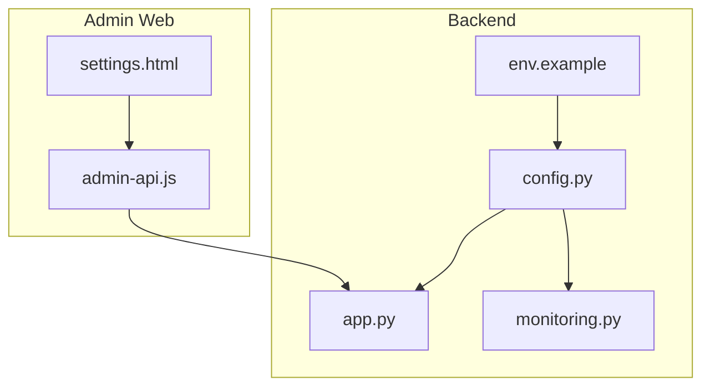
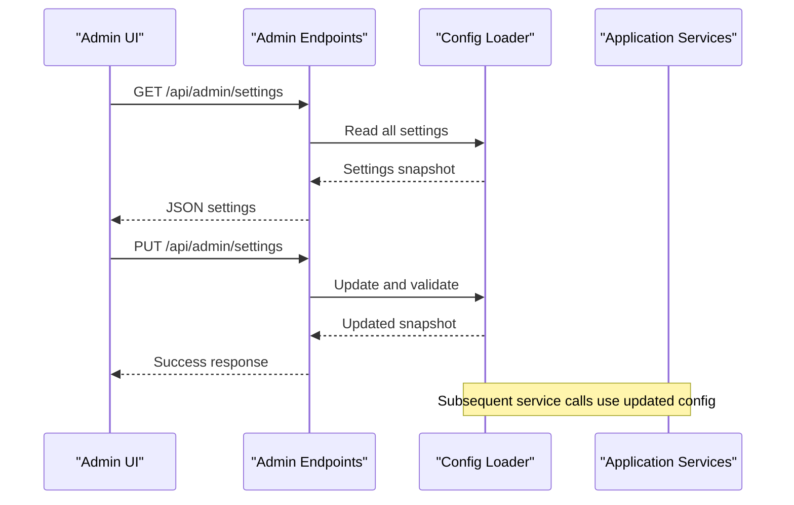
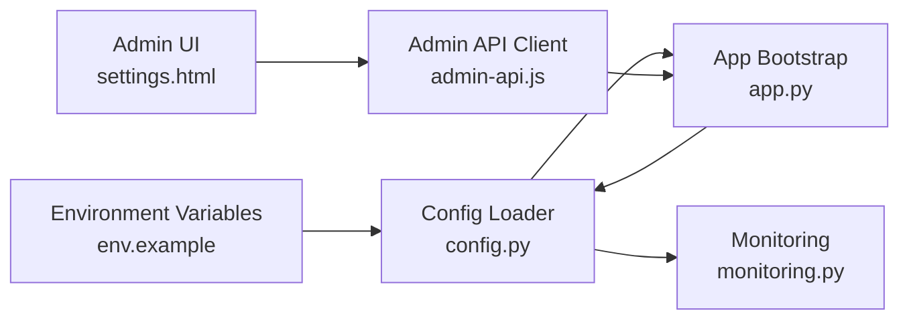

# System Configuration & Settings

<cite>
**Referenced Files in This Document**
- [config.py](file://backend/config.py)
- [app.py](file://backend/app.py)
- [env.example](file://backend/env.example)
- [settings.html](file://web/admin/settings.html)
- [admin-api.js](file://web/admin/js/admin-api.js)
- [monitoring.py](file://backend/monitoring.py)
- [test_config.py](file://backend/tests/test_config.py)
</cite>

## Table of Contents
1. [Introduction](#introduction)
2. [Project Structure](#project-structure)
3. [Core Components](#core-components)
4. [Architecture Overview](#architecture-overview)
5. [Detailed Component Analysis](#detailed-component-analysis)
6. [Dependency Analysis](#dependency-analysis)
7. [Performance Considerations](#performance-considerations)
8. [Troubleshooting Guide](#troubleshooting-guide)
9. [Conclusion](#conclusion)
10. [Appendices](#appendices)

## Introduction
This document explains the system configuration and settings management interface, focusing on how application parameters are loaded, validated, exposed to the admin UI, and used at runtime. It covers AI model settings, database connections, storage configurations, environment variable management, validation, hot-reloading behavior, security settings, API key management, integrations, backup and restore, health monitoring, and performance tuning. It also provides guidance for adding new configuration options, implementing validation rules, and creating custom setting categories.

## Project Structure
Configuration-related code is primarily implemented in the backend with a dedicated configuration module and an admin-facing web page that reads and updates settings via API calls. The following files are central:
- Backend configuration loader and runtime accessors
- Environment variable template
- Admin settings UI and its API client
- Health and monitoring utilities
- Tests validating configuration behavior

**Diagram sources**
- [config.py](file://backend/config.py)
- [app.py](file://backend/app.py)
- [monitoring.py](file://backend/monitoring.py)
- [env.example](file://backend/env.example)
- [settings.html](file://web/admin/settings.html)
- [admin-api.js](file://web/admin/js/admin-api.js)

**Section sources**
- [config.py](file://backend/config.py)
- [app.py](file://backend/app.py)
- [env.example](file://backend/env.example)
- [settings.html](file://web/admin/settings.html)
- [admin-api.js](file://web/admin/js/admin-api.js)
- [monitoring.py](file://backend/monitoring.py)

## Core Components
- Configuration loader: Loads environment variables, applies defaults, validates required values, and exposes typed getters for use across services.
- Application bootstrap: Initializes services using configuration values (e.g., database, storage, AI providers).
- Admin settings UI: Presents current settings and allows administrators to update them through secure endpoints.
- Monitoring and health: Exposes health checks and metrics based on configuration-driven components.
- Tests: Validate configuration loading, defaults, and error paths.

Key responsibilities:
- Centralized configuration source of truth
- Strong typing and validation
- Safe exposure to admin UI with authorization
- Clear separation between runtime-only secrets and persistent settings

**Section sources**
- [config.py](file://backend/config.py)
- [app.py](file://backend/app.py)
- [settings.html](file://web/admin/settings.html)
- [admin-api.js](file://web/admin/js/admin-api.js)
- [monitoring.py](file://backend/monitoring.py)
- [test_config.py](file://backend/tests/test_config.py)

## Architecture Overview
The configuration architecture follows a layered approach:
- Environment layer: .env or process environment variables provide base values.
- Loader layer: Reads env, merges defaults, validates, and caches results.
- Runtime layer: Services read from the loader; some settings can be updated at runtime via admin APIs.
- Admin layer: Authenticated UI calls admin endpoints to view/update settings.

**Diagram sources**
- [settings.html](file://web/admin/settings.html)
- [admin-api.js](file://web/admin/js/admin-api.js)
- [config.py](file://backend/config.py)
- [app.py](file://backend/app.py)

## Detailed Component Analysis

### Configuration Loader
Responsibilities:
- Load environment variables from the OS environment and optional file-based templates.
- Provide strongly-typed getters for common domains: AI models, database, storage, app preferences, security, integrations.
- Validate presence and format of critical keys; fail fast during startup if required values are missing.
- Cache computed values to avoid repeated parsing.

Typical categories:
- AI model settings: provider selection, model names, temperature, max tokens, timeouts, retry policies.
- Database connections: driver, host, port, credentials, pool size, SSL flags.
- Storage configurations: local path or cloud bucket, region, credentials, upload limits.
- Application preferences: feature flags, logging level, rate limits, maintenance mode.
- Security settings: CORS origins, session lifetime, password policy, secret rotation hints.
- Integration configurations: third-party API keys, webhook URLs, proxy settings.

Hot-reloading considerations:
- If supported, changes applied via admin endpoints should be validated before being committed.
- Services should re-read affected settings or subscribe to change events where applicable.
- For sensitive settings (e.g., secrets), prefer restarts unless explicit safe reload is implemented.

Validation strategy:
- Required fields enforced at load time.
- Type coercion and range checks performed per field.
- Custom validators for domain-specific constraints (e.g., URL formats, regex patterns).

Security posture:
- Secrets should not be persisted in plain text unless encrypted at rest.
- Admin endpoints must enforce authentication and authorization.
- Sensitive values should be masked in logs and responses.

**Section sources**
- [config.py](file://backend/config.py)
- [env.example](file://backend/env.example)
- [test_config.py](file://backend/tests/test_config.py)

### Application Bootstrap and Service Initialization
Responsibilities:
- Initialize core services (database, storage, AI clients) using configuration values.
- Apply connection pooling, timeouts, and retries based on configuration.
- Register health check endpoints that depend on configured subsystems.

Integration points:
- Database initialization uses connection strings and pool settings.
- Storage backends initialize with credentials and bucket/path settings.
- AI clients initialize with provider-specific keys and model parameters.

Error handling:
- Startup failures due to invalid configuration should produce clear error messages indicating which setting is problematic.
- Graceful degradation may be enabled for non-critical features when optional settings are missing.

**Section sources**
- [app.py](file://backend/app.py)
- [config.py](file://backend/config.py)

### Admin Settings Interface
Responsibilities:
- Display current configuration grouped by category.
- Allow administrators to update non-sensitive settings at runtime where supported.
- Enforce role-based access control for configuration changes.

User experience:
- Grouped sections for AI, Database, Storage, Integrations, Security, Preferences.
- Inline validation feedback and confirmation prompts for destructive actions.
- Audit trail entries for configuration changes.

API contract:
- GET returns a sanitized snapshot (secrets masked).
- PUT accepts partial updates and validates before applying.
- Responses include status and human-readable messages.

**Section sources**
- [settings.html](file://web/admin/settings.html)
- [admin-api.js](file://web/admin/js/admin-api.js)
- [config.py](file://backend/config.py)

### Monitoring and Health Checks
Responsibilities:
- Expose health endpoints reflecting the state of configured subsystems.
- Report readiness/liveness based on successful connectivity tests.
- Surface warnings for misconfiguration or degraded performance.

Metrics:
- Connection pool utilization, request latency, error rates.
- Feature flag states and integration availability.

**Section sources**
- [monitoring.py](file://backend/monitoring.py)
- [config.py](file://backend/config.py)

### Backup and Restore
Scope:
- Configuration snapshots: export current settings (excluding secrets) for audit and migration.
- Secret-safe backups: encrypt or redact sensitive values when exporting.
- Restore workflow: import validated configuration and apply changes safely.

Operational notes:
- Prefer versioned configuration schemas to support migrations.
- Validate imported configurations against current schema before applying.
- Maintain rollback capability by keeping previous snapshots.

[No sources needed since this section provides general guidance]

### Performance Tuning Options
Areas influenced by configuration:
- Database: pool sizes, timeouts, query cache settings.
- Storage: chunk sizes, concurrency limits, compression toggles.
- AI clients: concurrency, retry/backoff, token limits, caching strategies.
- Application: worker/process counts, logging verbosity, feature flags.

Guidance:
- Start with conservative defaults and adjust based on observed metrics.
- Use health and monitoring endpoints to validate impact of changes.
- Avoid overly aggressive concurrency without capacity planning.

[No sources needed since this section provides general guidance]

## Dependency Analysis
High-level dependencies among configuration-related components:

**Diagram sources**
- [env.example](file://backend/env.example)
- [config.py](file://backend/config.py)
- [app.py](file://backend/app.py)
- [monitoring.py](file://backend/monitoring.py)
- [settings.html](file://web/admin/settings.html)
- [admin-api.js](file://web/admin/js/admin-api.js)

**Section sources**
- [config.py](file://backend/config.py)
- [app.py](file://backend/app.py)
- [monitoring.py](file://backend/monitoring.py)
- [settings.html](file://web/admin/settings.html)
- [admin-api.js](file://web/admin/js/admin-api.js)
- [env.example](file://backend/env.example)

## Performance Considerations
- Minimize configuration parsing overhead by caching parsed values.
- Avoid frequent disk I/O for large configuration payloads; prefer in-memory structures after initial load.
- Use lazy initialization for heavy resources (e.g., AI clients) until first use.
- Tune connection pools and timeouts according to workload profiles.
- Enable selective logging to reduce overhead in production.

[No sources needed since this section provides general guidance]

## Troubleshooting Guide
Common issues and resolutions:
- Missing required environment variables: ensure all mandatory keys are present and correctly formatted.
- Invalid types or ranges: verify numeric bounds, boolean flags, and enum values.
- Connectivity failures: confirm hostnames, ports, credentials, and network reachability.
- Permission errors: validate filesystem paths and cloud bucket permissions.
- Hot-reload failures: inspect validation errors returned by admin endpoints; revert to last known good snapshot if necessary.

Diagnostic steps:
- Check health endpoints for subsystem status.
- Review logs for configuration-related errors.
- Compare current settings against the environment template to identify drift.

**Section sources**
- [test_config.py](file://backend/tests/test_config.py)
- [monitoring.py](file://backend/monitoring.py)
- [config.py](file://backend/config.py)

## Conclusion
The configuration and settings management system centralizes environment-driven parameters, enforces validation, and exposes a secure admin interface for runtime adjustments. By adhering to strong typing, careful validation, and clear separation of concerns, the system supports reliable operation, observability, and safe evolution of settings across environments.

[No sources needed since this section summarizes without analyzing specific files]

## Appendices

### Adding a New Configuration Option
Steps:
- Define the option in the configuration loader with a default value and type.
- Add documentation and example usage in the environment template.
- Implement validation rules for correctness and safety.
- Expose the option in the admin UI under an appropriate category.
- Update tests to cover default, valid, and invalid scenarios.

[No sources needed since this section provides general guidance]

### Implementing Validation Rules
Recommendations:
- Use centralized validators for common patterns (URLs, emails, integers, booleans).
- Fail fast on startup for required settings; warn on optional misconfigurations.
- Provide descriptive error messages indicating the exact field and constraint violated.

[No sources needed since this section provides general guidance]

### Creating Custom Setting Categories
Approach:
- Group related options into logical categories (e.g., AI Providers, Storage Backends, Integrations).
- Ensure consistent naming conventions and hierarchical organization in both backend and UI.
- Protect sensitive categories with additional access controls and masking in responses.

[No sources needed since this section provides general guidance]