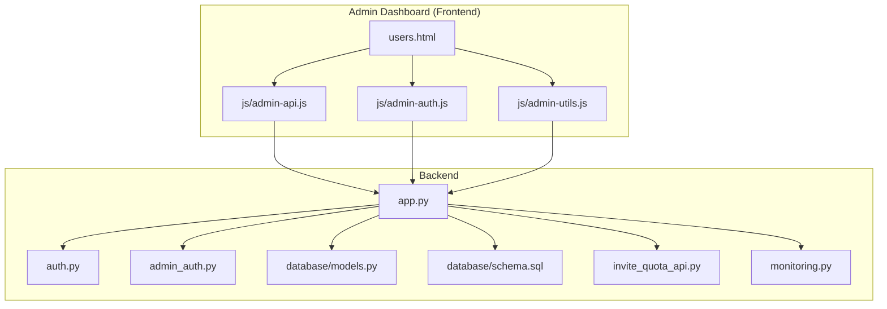
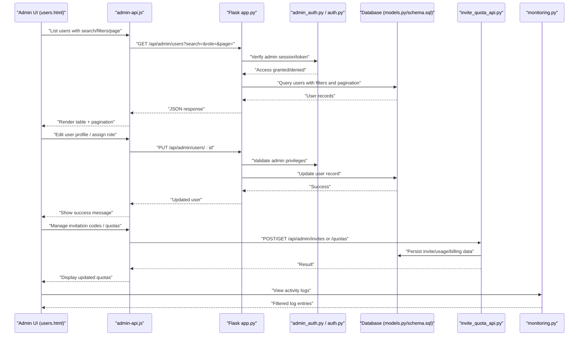
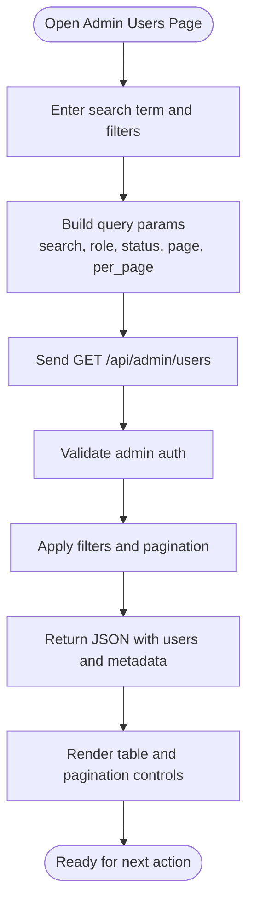
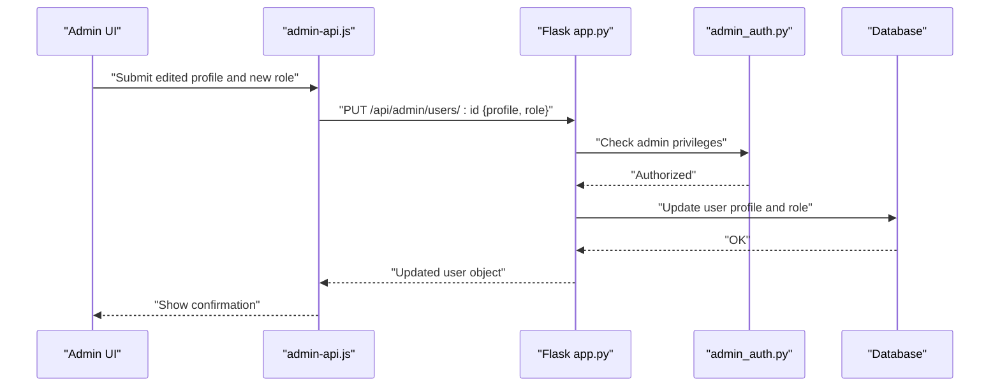
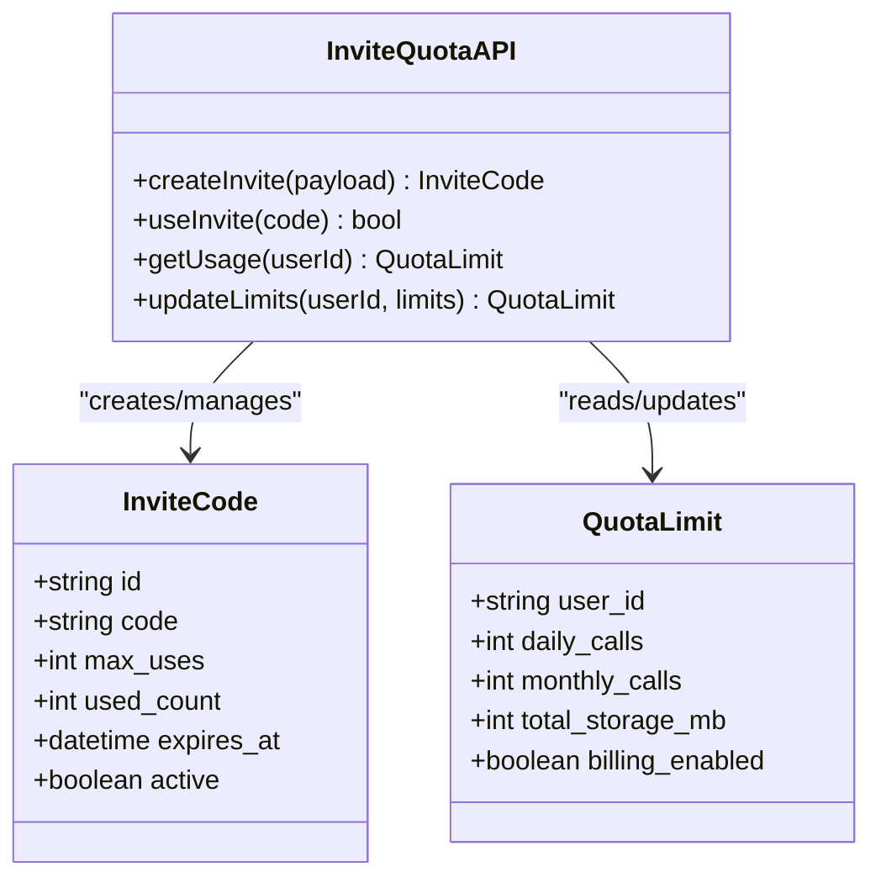
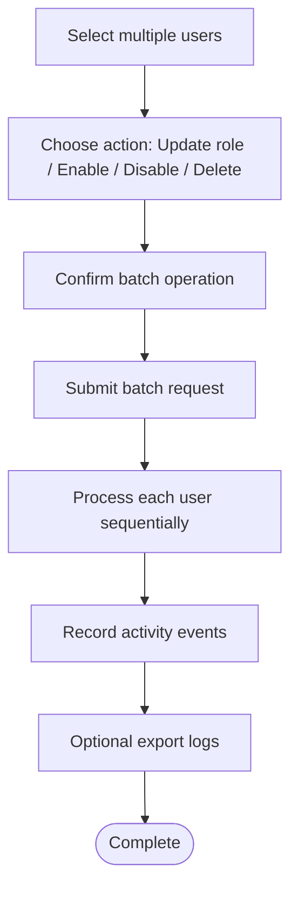
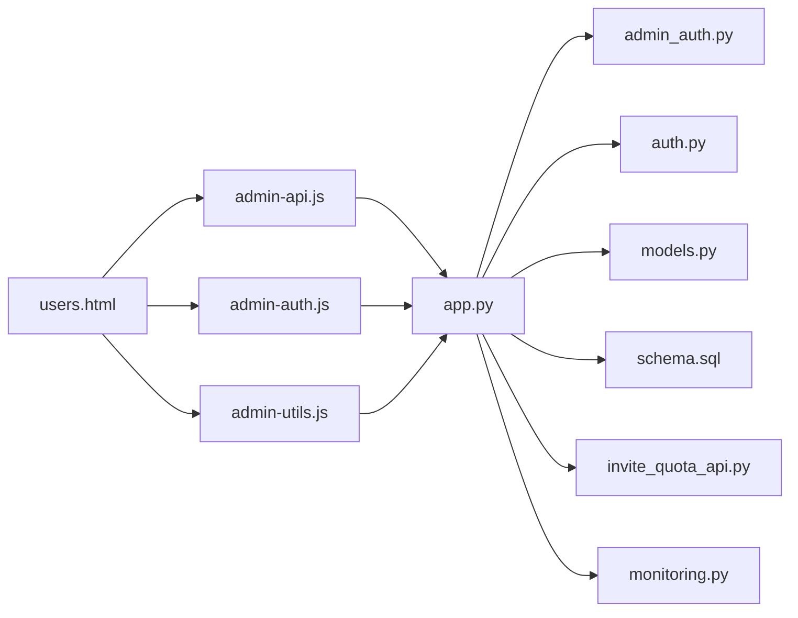

# User Management System

<cite>
**Referenced Files in This Document**
- [users.html](file://web/admin/users.html)
- [admin-api.js](file://web/admin/js/admin-api.js)
- [admin-auth.js](file://web/admin/js/admin-auth.js)
- [admin-utils.js](file://web/admin/js/admin-utils.js)
- [app.py](file://backend/app.py)
- [auth.py](file://backend/auth.py)
- [admin_auth.py](file://backend/admin_auth.py)
- [models.py](file://backend/database/models.py)
- [schema.sql](file://backend/database/schema.sql)
- [add_user_profile_fields.py](file://backend/database/add_user_profile_fields.py)
- [add_user_profile_fields.sql](file://backend/database/add_user_profile_fields.sql)
- [invite_quota_api.py](file://backend/invite_quota_api.py)
- [add_invite_quota_tables.py](file://backend/database/add_invite_quota_tables.py)
- [add_invite_quota_tables.sql](file://backend/database/add_invite_quota_tables.sql)
- [monitoring.py](file://backend/monitoring.py)
</cite>

## Table of Contents
1. [Introduction](#introduction)
2. [Project Structure](#project-structure)
3. [Core Components](#core-components)
4. [Architecture Overview](#architecture-overview)
5. [Detailed Component Analysis](#detailed-component-analysis)
6. [Dependency Analysis](#dependency-analysis)
7. [Performance Considerations](#performance-considerations)
8. [Troubleshooting Guide](#troubleshooting-guide)
9. [Conclusion](#conclusion)
10. [Appendices](#appendices)

## Introduction
This document describes the user management system exposed by the admin dashboard. It covers:
- User listing with search, filtering, and pagination
- User profile editing, role assignment, and permission management
- Quota management including invitation codes, usage limits, and billing controls
- Bulk operations, import/export, and activity monitoring
- Extensibility patterns for custom fields, roles, and external authentication integration

The documentation is organized to be accessible to both technical and non-technical readers, with diagrams mapping directly to source files where applicable.

## Project Structure
The user management system spans frontend admin pages and backend APIs:
- Frontend admin UI: HTML page for users and JavaScript modules for API calls, auth, and utilities
- Backend: Flask application routes, authentication middleware, database models, schema migrations, quota APIs, and monitoring endpoints

**Diagram sources**
- [users.html](file://web/admin/users.html)
- [admin-api.js](file://web/admin/js/admin-api.js)
- [admin-auth.js](file://web/admin/js/admin-auth.js)
- [admin-utils.js](file://web/admin/js/admin-utils.js)
- [app.py](file://backend/app.py)
- [auth.py](file://backend/auth.py)
- [admin_auth.py](file://backend/admin_auth.py)
- [models.py](file://backend/database/models.py)
- [schema.sql](file://backend/database/schema.sql)
- [invite_quota_api.py](file://backend/invite_quota_api.py)
- [monitoring.py](file://backend/monitoring.py)

**Section sources**
- [users.html](file://web/admin/users.html)
- [admin-api.js](file://web/admin/js/admin-api.js)
- [admin-auth.js](file://web/admin/js/admin-auth.js)
- [admin-utils.js](file://web/admin/js/admin-utils.js)
- [app.py](file://backend/app.py)
- [auth.py](file://backend/auth.py)
- [admin_auth.py](file://backend/admin_auth.py)
- [models.py](file://backend/database/models.py)
- [schema.sql](file://backend/database/schema.sql)
- [invite_quota_api.py](file://backend/invite_quota_api.py)
- [monitoring.py](file://backend/monitoring.py)

## Core Components
- Admin Users Page: Renders the user list, search inputs, filters, pagination controls, and action buttons for edit, delete, and bulk actions.
- Admin API Client: Encapsulates HTTP requests for user CRUD, search/filter/pagination, bulk operations, and quota management.
- Admin Auth Middleware: Protects admin routes and enforces admin-only access on the server side.
- Database Models and Schema: Define user entities, roles, permissions, profile fields, and quota-related tables.
- Invitation and Quota API: Provides endpoints to manage invitation codes, usage limits, and billing controls.
- Monitoring: Tracks user activities and provides audit logs for admin review.

Key responsibilities:
- Listing and searching users with efficient pagination
- Editing profiles and assigning roles/permissions
- Managing quotas and invitation codes
- Performing bulk operations and importing/exporting data
- Recording and viewing user activity

**Section sources**
- [users.html](file://web/admin/users.html)
- [admin-api.js](file://web/admin/js/admin-api.js)
- [admin-auth.js](file://web/admin/js/admin-auth.js)
- [models.py](file://backend/database/models.py)
- [schema.sql](file://backend/database/schema.sql)
- [invite_quota_api.py](file://backend/invite_quota_api.py)
- [monitoring.py](file://backend/monitoring.py)

## Architecture Overview
The admin dashboard interacts with backend APIs secured by admin authentication. Data flows from the browser through the admin API client to Flask routes, which validate requests, enforce permissions, and query the database. Quota and invitation code management are handled via dedicated endpoints. Activity monitoring records events for auditing.

**Diagram sources**
- [users.html](file://web/admin/users.html)
- [admin-api.js](file://web/admin/js/admin-api.js)
- [app.py](file://backend/app.py)
- [admin_auth.py](file://backend/admin_auth.py)
- [auth.py](file://backend/auth.py)
- [models.py](file://backend/database/models.py)
- [schema.sql](file://backend/database/schema.sql)
- [invite_quota_api.py](file://backend/invite_quota_api.py)
- [monitoring.py](file://backend/monitoring.py)

## Detailed Component Analysis

### User Listing Interface (Search, Filtering, Pagination)
- The admin users page provides input fields for search terms and filters such as role or status, along with pagination controls.
- The admin API client constructs query parameters and sends GET requests to the backend user listing endpoint.
- The backend validates admin access, applies filters, and returns paginated results.

**Diagram sources**
- [users.html](file://web/admin/users.html)
- [admin-api.js](file://web/admin/js/admin-api.js)
- [app.py](file://backend/app.py)
- [models.py](file://backend/database/models.py)
- [schema.sql](file://backend/database/schema.sql)

**Section sources**
- [users.html](file://web/admin/users.html)
- [admin-api.js](file://web/admin/js/admin-api.js)
- [app.py](file://backend/app.py)
- [models.py](file://backend/database/models.py)
- [schema.sql](file://backend/database/schema.sql)

### User Profile Editing, Role Assignment, and Permission Management
- The admin UI allows editing user profile fields and assigning roles. Permissions are derived from roles.
- The backend updates user records and persists changes to the database.

**Diagram sources**
- [users.html](file://web/admin/users.html)
- [admin-api.js](file://web/admin/js/admin-api.js)
- [app.py](file://backend/app.py)
- [admin_auth.py](file://backend/admin_auth.py)
- [models.py](file://backend/database/models.py)
- [schema.sql](file://backend/database/schema.sql)

**Section sources**
- [users.html](file://web/admin/users.html)
- [admin-api.js](file://web/admin/js/admin-api.js)
- [app.py](file://backend/app.py)
- [admin_auth.py](file://backend/admin_auth.py)
- [models.py](file://backend/database/models.py)
- [schema.sql](file://backend/database/schema.sql)

### Quota Management Tools (Invitation Codes, Usage Limits, Billing Controls)
- Dedicated endpoints manage invitation codes, track usage, and control billing-related quotas.
- The admin UI can create, distribute, and monitor invitation codes; view usage metrics; and adjust limits.

**Diagram sources**
- [invite_quota_api.py](file://backend/invite_quota_api.py)
- [add_invite_quota_tables.py](file://backend/database/add_invite_quota_tables.py)
- [add_invite_quota_tables.sql](file://backend/database/add_invite_quota_tables.sql)

**Section sources**
- [invite_quota_api.py](file://backend/invite_quota_api.py)
- [add_invite_quota_tables.py](file://backend/database/add_invite_quota_tables.py)
- [add_invite_quota_tables.sql](file://backend/database/add_invite_quota_tables.sql)

### Bulk Operations, Import/Export, and Activity Monitoring
- Bulk operations allow selecting multiple users to update roles, enable/disable accounts, or delete them.
- Import/export functionality supports CSV/JSON uploads and downloads for large datasets.
- Activity monitoring records login events, profile changes, and quota usage for audit purposes.

**Diagram sources**
- [users.html](file://web/admin/users.html)
- [admin-api.js](file://web/admin/js/admin-api.js)
- [monitoring.py](file://backend/monitoring.py)

**Section sources**
- [users.html](file://web/admin/users.html)
- [admin-api.js](file://web/admin/js/admin-api.js)
- [monitoring.py](file://backend/monitoring.py)

### Extensibility Patterns
- Custom User Fields: Extend the user model and schema to add new profile attributes. Use migration scripts to alter the database and update the admin UI forms accordingly.
- Extending Roles: Add new roles and map permissions to them. Ensure the admin UI reflects available roles and that authorization checks use the updated role definitions.
- External Authentication Integration: Integrate OAuth providers or SAML identity providers by adding authentication handlers and linking external identities to internal user records.

Implementation references:
- Adding profile fields via migration scripts and SQL
- Defining models and schema for users and related entities
- Updating admin UI forms to capture new fields

**Section sources**
- [add_user_profile_fields.py](file://backend/database/add_user_profile_fields.py)
- [add_user_profile_fields.sql](file://backend/database/add_user_profile_fields.sql)
- [models.py](file://backend/database/models.py)
- [schema.sql](file://backend/database/schema.sql)
- [users.html](file://web/admin/users.html)

## Dependency Analysis
The following diagram shows key dependencies between frontend and backend components involved in user management.

**Diagram sources**
- [users.html](file://web/admin/users.html)
- [admin-api.js](file://web/admin/js/admin-api.js)
- [admin-auth.js](file://web/admin/js/admin-auth.js)
- [admin-utils.js](file://web/admin/js/admin-utils.js)
- [app.py](file://backend/app.py)
- [admin_auth.py](file://backend/admin_auth.py)
- [auth.py](file://backend/auth.py)
- [models.py](file://backend/database/models.py)
- [schema.sql](file://backend/database/schema.sql)
- [invite_quota_api.py](file://backend/invite_quota_api.py)
- [monitoring.py](file://backend/monitoring.py)

**Section sources**
- [users.html](file://web/admin/users.html)
- [admin-api.js](file://web/admin/js/admin-api.js)
- [admin-auth.js](file://web/admin/js/admin-auth.js)
- [admin-utils.js](file://web/admin/js/admin-utils.js)
- [app.py](file://backend/app.py)
- [admin_auth.py](file://backend/admin_auth.py)
- [auth.py](file://backend/auth.py)
- [models.py](file://backend/database/models.py)
- [schema.sql](file://backend/database/schema.sql)
- [invite_quota_api.py](file://backend/invite_quota_api.py)
- [monitoring.py](file://backend/monitoring.py)

## Performance Considerations
- Pagination: Always paginate user listings to avoid loading entire datasets into memory.
- Indexes: Ensure database indexes exist on frequently filtered columns (e.g., email, role, status).
- Search Optimization: Use partial match queries carefully; consider full-text search for large datasets.
- Batch Processing: For bulk operations, process items in chunks and log progress to prevent timeouts.
- Caching: Cache read-heavy admin queries when appropriate, with invalidation on writes.
- Monitoring: Track slow queries and API latencies to identify bottlenecks.

[No sources needed since this section provides general guidance]

## Troubleshooting Guide
Common issues and resolutions:
- Admin Access Denied: Verify admin session/token validity and ensure the route requires admin privileges. Check admin authentication middleware configuration.
- Missing Fields in Edit Form: Confirm that migration scripts have been applied and the database schema includes new fields. Update the admin UI form to include these fields.
- Invitation Code Not Working: Validate code existence, expiration, and remaining uses. Check quota usage counters and billing flags.
- Bulk Operation Failures: Inspect per-user error logs and retry failed items. Ensure transactional consistency and rollback on critical failures.
- Activity Logs Not Appearing: Confirm monitoring endpoints are invoked and persisted. Check logging levels and storage availability.

**Section sources**
- [admin_auth.py](file://backend/admin_auth.py)
- [auth.py](file://backend/auth.py)
- [add_user_profile_fields.py](file://backend/database/add_user_profile_fields.py)
- [add_user_profile_fields.sql](file://backend/database/add_user_profile_fields.sql)
- [invite_quota_api.py](file://backend/invite_quota_api.py)
- [monitoring.py](file://backend/monitoring.py)

## Conclusion
The user management system provides a comprehensive admin interface for listing, editing, and controlling user accounts, roles, and permissions. Quota management tools support invitation codes, usage limits, and billing controls. Bulk operations, import/export, and activity monitoring enhance operational efficiency and auditability. Extensibility patterns enable custom fields, additional roles, and integration with external authentication systems.

[No sources needed since this section summarizes without analyzing specific files]

## Appendices

### API Endpoints Reference
- List users: GET /api/admin/users with query parameters for search, filters, and pagination
- Get user details: GET /api/admin/users/:id
- Update user: PUT /api/admin/users/:id
- Delete user: DELETE /api/admin/users/:id
- Bulk update: POST /api/admin/users/bulk
- Manage invitations: POST/GET /api/admin/invites
- Manage quotas: GET/PUT /api/admin/quotas/:user_id
- Activity logs: GET /api/admin/activity

Note: All endpoints require admin authentication.

**Section sources**
- [app.py](file://backend/app.py)
- [admin_auth.py](file://backend/admin_auth.py)
- [invite_quota_api.py](file://backend/invite_quota_api.py)
- [monitoring.py](file://backend/monitoring.py)