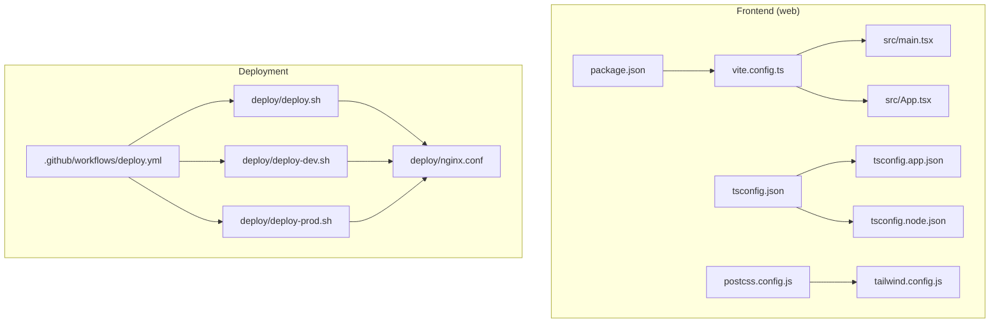
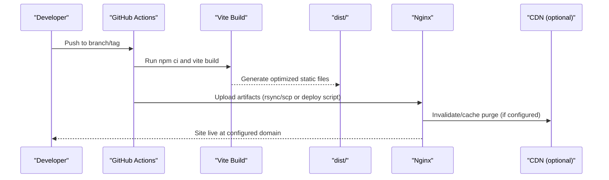
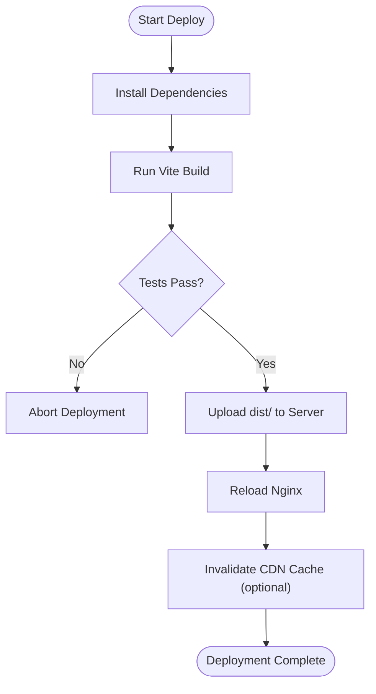
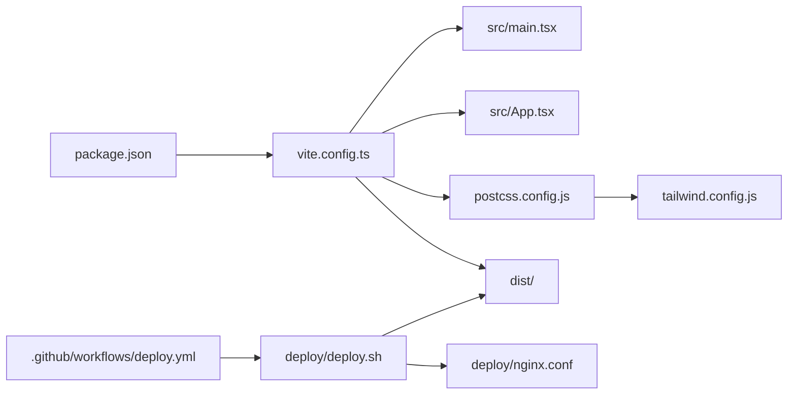

# Build Process & Deployment

<cite>
**Referenced Files in This Document**
- [vite.config.ts](file://web/vite.config.ts)
- [package.json](file://web/package.json)
- [tsconfig.json](file://web/tsconfig.json)
- [tsconfig.app.json](file://web/tsconfig.app.json)
- [tsconfig.node.json](file://web/tsconfig.node.json)
- [postcss.config.js](file://web/postcss.config.js)
- [tailwind.config.js](file://web/tailwind.config.js)
- [src/main.tsx](file://web/src/main.tsx)
- [src/App.tsx](file://web/src/App.tsx)
- [deploy/deploy.sh](file://deploy/deploy.sh)
- [deploy/deploy-dev.sh](file://deploy/deploy-dev.sh)
- [deploy/deploy-prod.sh](file://deploy/deploy-prod.sh)
- [deploy/nginx.conf](file://deploy/nginx.conf)
- [.github/workflows/deploy.yml](file://.github/workflows/deploy.yml)
</cite>

## Table of Contents
1. [Introduction](#introduction)
2. [Project Structure](#project-structure)
3. [Core Components](#core-components)
4. [Architecture Overview](#architecture-overview)
5. [Detailed Component Analysis](#detailed-component-analysis)
6. [Dependency Analysis](#dependency-analysis)
7. [Performance Considerations](#performance-considerations)
8. [Troubleshooting Guide](#troubleshooting-guide)
9. [Conclusion](#conclusion)
10. [Appendices](#appendices)

## Introduction
This document explains the frontend build process and deployment pipeline for the project. It covers Vite configuration, development server behavior, production builds, asset optimization, TypeScript compilation, PostCSS processing, dependency management, development workflow (hot reload, debugging, testing), and production deployment procedures including CDN configuration and performance strategies. It also provides examples for customizing the build, adding new assets, and troubleshooting common issues.

## Project Structure
The frontend is located under web/. The key build-related files are:
- Vite configuration and entry points
- TypeScript configuration files
- PostCSS and Tailwind CSS configuration
- Package scripts and dependencies
- Deployment scripts and CI/CD workflow
- Nginx configuration for serving static assets

**Diagram sources**
- [vite.config.ts](file://web/vite.config.ts)
- [package.json](file://web/package.json)
- [tsconfig.json](file://web/tsconfig.json)
- [tsconfig.app.json](file://web/tsconfig.app.json)
- [tsconfig.node.json](file://web/tsconfig.node.json)
- [postcss.config.js](file://web/postcss.config.js)
- [tailwind.config.js](file://web/tailwind.config.js)
- [src/main.tsx](file://web/src/main.tsx)
- [src/App.tsx](file://web/src/App.tsx)
- [.github/workflows/deploy.yml](file://.github/workflows/deploy.yml)
- [deploy/deploy.sh](file://deploy/deploy.sh)
- [deploy/deploy-dev.sh](file://deploy/deploy-dev.sh)
- [deploy/deploy-prod.sh](file://deploy/deploy-prod.sh)
- [deploy/nginx.conf](file://deploy/nginx.conf)

**Section sources**
- [vite.config.ts](file://web/vite.config.ts)
- [package.json](file://web/package.json)
- [tsconfig.json](file://web/tsconfig.json)
- [tsconfig.app.json](file://web/tsconfig.app.json)
- [tsconfig.node.json](file://web/tsconfig.node.json)
- [postcss.config.js](file://web/postcss.config.js)
- [tailwind.config.js](file://web/tailwind.config.js)
- [src/main.tsx](file://web/src/main.tsx)
- [src/App.tsx](file://web/src/App.tsx)
- [.github/workflows/deploy.yml](file://.github/workflows/deploy.yml)
- [deploy/deploy.sh](file://deploy/deploy.sh)
- [deploy/deploy-dev.sh](file://deploy/deploy-dev.sh)
- [deploy/deploy-prod.sh](file://deploy/deploy-prod.sh)
- [deploy/nginx.conf](file://deploy/nginx.conf)

## Core Components
- Vite configuration: Defines dev server options, build targets, output directory, base path, plugins, and environment variable handling.
- TypeScript settings: Separate configs for app and node tooling; strictness, module resolution, and JSX support.
- PostCSS and Tailwind: PostCSS pipeline with Tailwind plugin for utility-first styling.
- Dependency management: Scripts for install, dev server, building, previewing, and type checking via package.json.
- Entry points: main.tsx bootstraps the React application; App.tsx defines the root component tree.

Key responsibilities:
- Development: Fast refresh, local proxy if needed, source maps, and environment variables.
- Production: Minification, code splitting, asset hashing, and optimized output.
- Styling: Tailwind processing through PostCSS.
- Type safety: Strict TS checks for both app and build tooling.

**Section sources**
- [vite.config.ts](file://web/vite.config.ts)
- [tsconfig.json](file://web/tsconfig.json)
- [tsconfig.app.json](file://web/tsconfig.app.json)
- [tsconfig.node.json](file://web/tsconfig.node.json)
- [postcss.config.js](file://web/postcss.config.js)
- [tailwind.config.js](file://web/tailwind.config.js)
- [package.json](file://web/package.json)
- [src/main.tsx](file://web/src/main.tsx)
- [src/App.tsx](file://web/src/App.tsx)

## Architecture Overview
The build and deployment architecture connects source code to a static site served by Nginx, orchestrated by GitHub Actions.

**Diagram sources**
- [.github/workflows/deploy.yml](file://.github/workflows/deploy.yml)
- [deploy/deploy.sh](file://deploy/deploy.sh)
- [deploy/deploy-dev.sh](file://deploy/deploy-dev.sh)
- [deploy/deploy-prod.sh](file://deploy/deploy-prod.sh)
- [deploy/nginx.conf](file://deploy/nginx.conf)

## Detailed Component Analysis

### Vite Configuration
Responsibilities:
- Dev server setup: host, port, open behavior, proxy rules, and hot module replacement.
- Build configuration: target browsers, outDir, base path, minification, sourcemaps, rollup options.
- Asset handling: public folder, asset URL generation, and resource optimization.
- Environment variables: prefixing and exposure to client code.
- Plugins: React, Tailwind integration, and any additional optimizations.

Development vs Production:
- Development emphasizes speed and accurate error reporting with HMR.
- Production focuses on bundle size, caching, and browser compatibility.

Customization examples:
- Add a new plugin for image optimization or analytics.
- Configure proxy to backend API endpoints.
- Adjust base path for subdirectory deployments.

**Section sources**
- [vite.config.ts](file://web/vite.config.ts)

### TypeScript Compilation Settings
Settings overview:
- tsconfig.json: shared compiler options and references to app/node configs.
- tsconfig.app.json: strict mode, module resolution, JSX transform, lib targets, and paths.
- tsconfig.node.json: Node-specific settings for build tooling.

Impact:
- Ensures consistent types across development and build.
- Enables modern JS features and JSX transformation.
- Controls module resolution and library inclusion.

**Section sources**
- [tsconfig.json](file://web/tsconfig.json)
- [tsconfig.app.json](file://web/tsconfig.app.json)
- [tsconfig.node.json](file://web/tsconfig.node.json)

### PostCSS and Tailwind Processing
PostCSS pipeline:
- postcss.config.js configures Tailwind and other processors.
- tailwind.config.js defines content scanning, theme customization, and plugins.

Styling workflow:
- Source styles import Tailwind directives.
- Vite integrates PostCSS during dev and build.
- Unused CSS is purged in production.

**Section sources**
- [postcss.config.js](file://web/postcss.config.js)
- [tailwind.config.js](file://web/tailwind.config.js)

### Dependency Management and Scripts
Scripts typically include:
- Install dependencies
- Start dev server with HMR
- Build for production
- Preview built assets locally
- Type check

Dependencies:
- Vite and React plugin
- TypeScript and related tooling
- PostCSS and Tailwind
- Optional analysis tools (e.g., bundle analyzer)

**Section sources**
- [package.json](file://web/package.json)

### Application Entry Points
- src/main.tsx: Bootstraps the React app, mounts to DOM, and initializes providers.
- src/App.tsx: Root component composing layout, routing, and global state.

These files are consumed by Vite during dev and build.

**Section sources**
- [src/main.tsx](file://web/src/main.tsx)
- [src/App.tsx](file://web/src/App.tsx)

### Development Workflow
Hot reload:
- Enabled by default in Vite dev server.
- Fast refresh preserves state where possible.

Debugging:
- Use browser devtools with source maps.
- Log environment variables prefixed appropriately.

Testing integration:
- Unit tests can be run alongside dev workflows.
- E2E tests can use the dev server or built artifacts.

Local preview:
- Serve dist/ after build to validate production behavior.

**Section sources**
- [vite.config.ts](file://web/vite.config.ts)
- [package.json](file://web/package.json)

### Production Builds and Asset Optimization
Outputs:
- Static HTML, JS, CSS, and hashed assets.
- Optimized bundles with minification and code splitting.

Optimization strategies:
- Enable minification and sourcemaps as needed.
- Configure target browsers for appropriate transpilation.
- Tune Rollup options for chunking and compression.
- Use CDN-friendly filenames via asset hashing.

Bundle analysis:
- Integrate an analyzer plugin to inspect bundle composition.

**Section sources**
- [vite.config.ts](file://web/vite.config.ts)

### Deployment Pipeline
CI/CD:
- .github/workflows/deploy.yml triggers on push/merge.
- Installs dependencies, builds, and deploys artifacts.

Deploy scripts:
- deploy/deploy.sh: Common logic for uploading artifacts.
- deploy/deploy-dev.sh: Deploys to staging/dev environment.
- deploy/deploy-prod.sh: Deploys to production with safeguards.

Web server:
- deploy/nginx.conf serves static files from dist/ and sets cache headers.

CDN configuration:
- If using a CDN, configure cache invalidation and origin pointing to the server’s static directory.

**Diagram sources**
- [.github/workflows/deploy.yml](file://.github/workflows/deploy.yml)
- [deploy/deploy.sh](file://deploy/deploy.sh)
- [deploy/deploy-dev.sh](file://deploy/deploy-dev.sh)
- [deploy/deploy-prod.sh](file://deploy/deploy-prod.sh)
- [deploy/nginx.conf](file://deploy/nginx.conf)

**Section sources**
- [.github/workflows/deploy.yml](file://.github/workflows/deploy.yml)
- [deploy/deploy.sh](file://deploy/deploy.sh)
- [deploy/deploy-dev.sh](file://deploy/deploy-dev.sh)
- [deploy/deploy-prod.sh](file://deploy/deploy-prod.sh)
- [deploy/nginx.conf](file://deploy/nginx.conf)

## Dependency Analysis
The following diagram shows how build and deployment components depend on each other.

**Diagram sources**
- [package.json](file://web/package.json)
- [vite.config.ts](file://web/vite.config.ts)
- [src/main.tsx](file://web/src/main.tsx)
- [src/App.tsx](file://web/src/App.tsx)
- [postcss.config.js](file://web/postcss.config.js)
- [tailwind.config.js](file://web/tailwind.config.js)
- [.github/workflows/deploy.yml](file://.github/workflows/deploy.yml)
- [deploy/deploy.sh](file://deploy/deploy.sh)
- [deploy/nginx.conf](file://deploy/nginx.conf)

**Section sources**
- [package.json](file://web/package.json)
- [vite.config.ts](file://web/vite.config.ts)
- [postcss.config.js](file://web/postcss.config.js)
- [tailwind.config.js](file://web/tailwind.config.js)
- [.github/workflows/deploy.yml](file://.github/workflows/deploy.yml)
- [deploy/deploy.sh](file://deploy/deploy.sh)
- [deploy/nginx.conf](file://deploy/nginx.conf)

## Performance Considerations
- Enable production minification and disable sourcemaps unless required.
- Configure target browsers to reduce polyfills and transpilation overhead.
- Use code splitting and lazy loading for large components.
- Prefer efficient image formats and sizes; leverage CDN caching.
- Monitor bundle size with an analyzer and remove unused dependencies.
- Set appropriate cache-control headers in Nginx for long-lived caching.

[No sources needed since this section provides general guidance]

## Troubleshooting Guide
Common issues and resolutions:
- Module not found or path errors: Verify tsconfig paths and Vite alias configuration.
- Tailwind classes not applied: Ensure content paths include all source files and that PostCSS is enabled.
- Environment variables missing in build: Confirm variable prefixing and exposure in Vite config.
- Hot reload not working: Check network proxy settings and ensure HMR is enabled.
- Build fails due to type errors: Run type checks locally before committing.
- Assets not loading in production: Validate base path and asset URL generation.

Operational checks:
- Inspect dist/ contents after build.
- Review Nginx logs for 404s or permission issues.
- Validate CDN cache invalidation after updates.

**Section sources**
- [vite.config.ts](file://web/vite.config.ts)
- [postcss.config.js](file://web/postcss.config.js)
- [tailwind.config.js](file://web/tailwind.config.js)
- [deploy/nginx.conf](file://deploy/nginx.conf)

## Conclusion
The frontend build system leverages Vite for fast development and optimized production builds, TypeScript for type safety, and PostCSS with Tailwind for styling. The deployment pipeline automates builds and artifact delivery to a Nginx server, optionally backed by a CDN. By tuning Vite and Nginx configurations and monitoring bundle size, teams can achieve reliable, high-performance releases.

[No sources needed since this section summarizes without analyzing specific files]

## Appendices

### Customizing the Build Process
- Add a new Vite plugin for analytics or image optimization.
- Configure proxy rules for backend APIs in development.
- Adjust base path for subdirectory hosting.

**Section sources**
- [vite.config.ts](file://web/vite.config.ts)

### Adding New Assets
- Place static assets in the public directory for direct URLs.
- Import assets within modules to enable bundling and hashing.
- Update Tailwind content patterns if new templates introduce new class names.

**Section sources**
- [tailwind.config.js](file://web/tailwind.config.js)
- [vite.config.ts](file://web/vite.config.ts)

### Example Commands
- Install dependencies
- Start development server
- Build for production
- Preview production build locally
- Run type checks

**Section sources**
- [package.json](file://web/package.json)