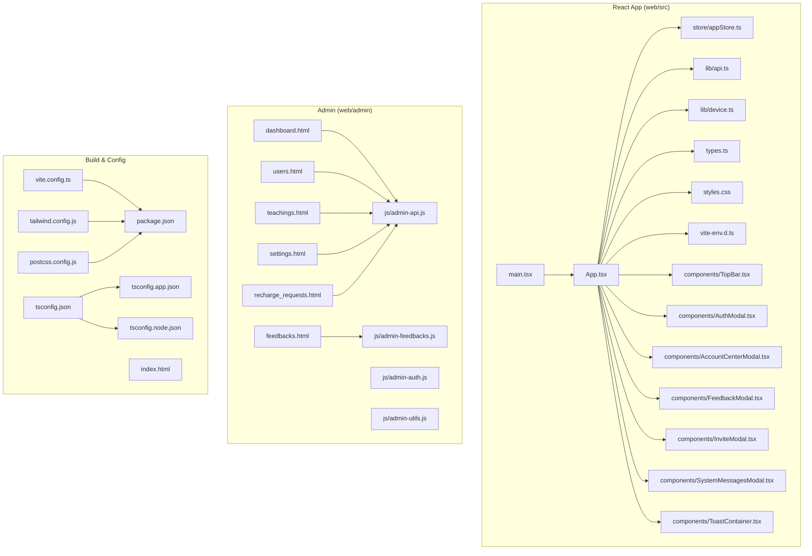
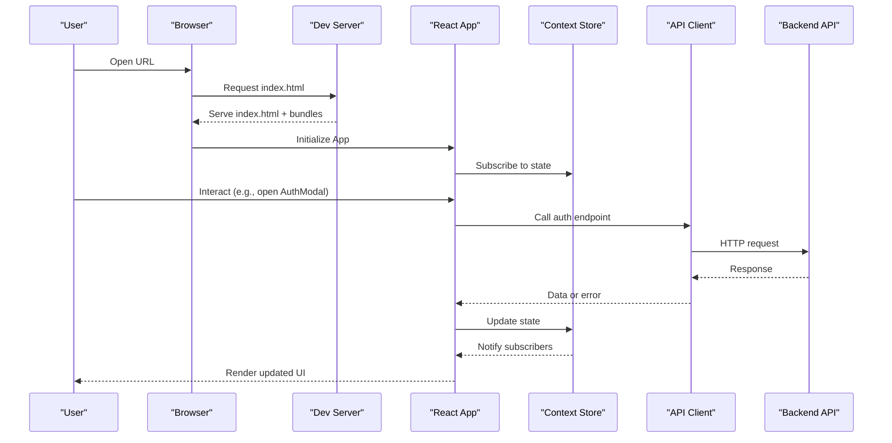
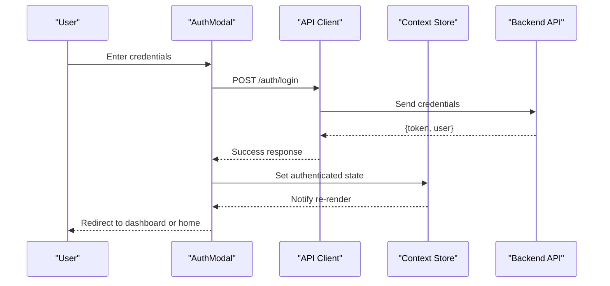
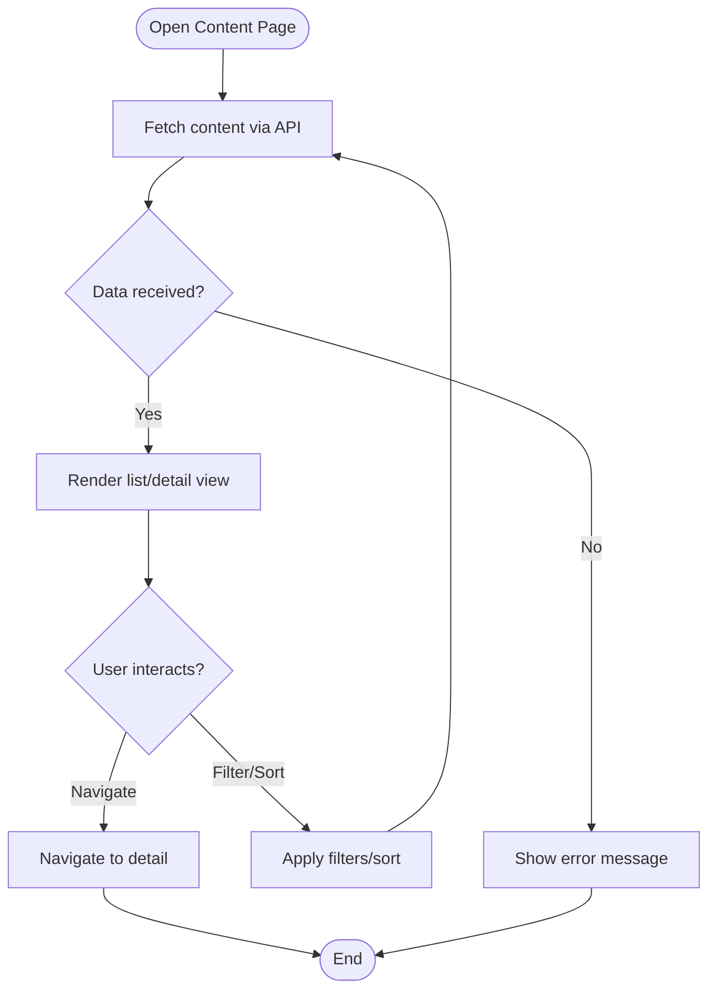
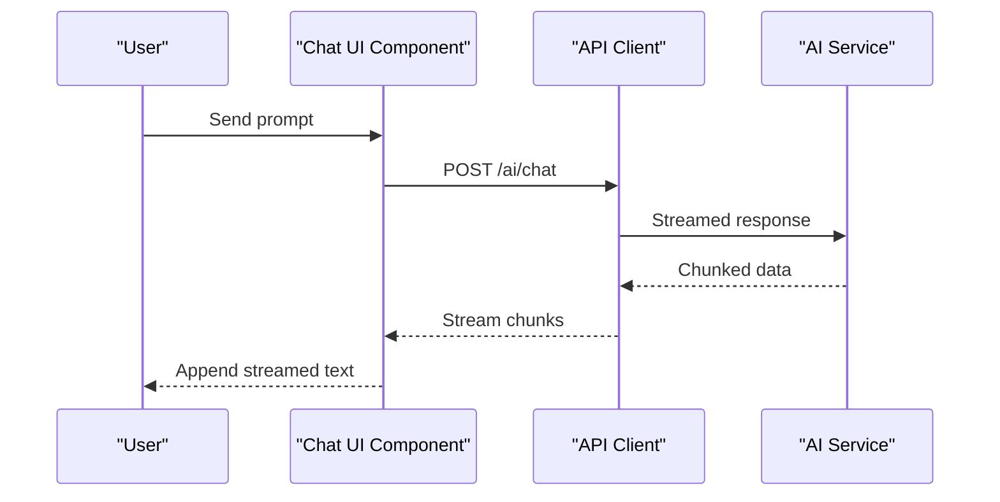
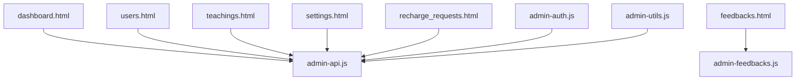
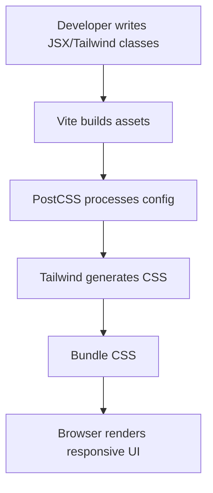
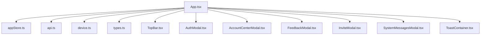

# Frontend Application

<cite>
**Referenced Files in This Document**
- [App.tsx](file://web/src/App.tsx)
- [main.tsx](file://web/src/main.tsx)
- [types.ts](file://web/src/types.ts)
- [styles.css](file://web/src/styles.css)
- [vite-env.d.ts](file://web/src/vite-env.d.ts)
- [api.ts](file://web/src/lib/api.ts)
- [device.ts](file://web/src/lib/device.ts)
- [appStore.ts](file://web/src/store/appStore.ts)
- [AuthModal.tsx](file://web/src/components/AuthModal.tsx)
- [AccountCenterModal.tsx](file://web/src/components/AccountCenterModal.tsx)
- [FeedbackModal.tsx](file://web/src/components/FeedbackModal.tsx)
- [InviteModal.tsx](file://web/src/components/InviteModal.tsx)
- [SystemMessagesModal.tsx](file://web/src/components/SystemMessagesModal.tsx)
- [ToastContainer.tsx](file://web/src/components/ToastContainer.tsx)
- [TopBar.tsx](file://web/src/components/TopBar.tsx)
- [tailwind.config.js](file://web/tailwind.config.js)
- [postcss.config.js](file://web/postcss.config.js)
- [package.json](file://web/package.json)
- [tsconfig.json](file://web/tsconfig.json)
- [tsconfig.app.json](file://web/tsconfig.app.json)
- [tsconfig.node.json](file://web/tsconfig.node.json)
- [vite.config.ts](file://web/vite.config.ts)
- [index.html](file://web/index.html)
- [ai-assistant.js](file://web/js/ai-assistant.js)
- [auth-modal.js](file://web/js/auth-modal.js)
- [auth.js](file://web/js/auth.js)
- [admin-api.js](file://web/admin/js/admin-api.js)
- [admin-auth.js](file://web/admin/js/admin-auth.js)
- [admin-feedbacks.js](file://web/admin/js/admin-feedbacks.js)
- [admin-utils.js](file://web/admin/js/admin-utils.js)
- [dashboard.html](file://web/admin/dashboard.html)
- [users.html](file://web/admin/users.html)
- [teachings.html](file://web/admin/teachings.html)
- [settings.html](file://web/admin/settings.html)
- [feedbacks.html](file://web/admin/feedbacks.html)
- [recharge_requests.html](file://web/admin/recharge_requests.html)
- [deploy.yml](file://.github/workflows/deploy.yml)
</cite>

## Table of Contents
1. [Introduction](#introduction)
2. [Project Structure](#project-structure)
3. [Core Components](#core-components)
4. [Architecture Overview](#architecture-overview)
5. [Detailed Component Analysis](#detailed-component-analysis)
6. [Dependency Analysis](#dependency-analysis)
7. [Performance Considerations](#performance-considerations)
8. [Troubleshooting Guide](#troubleshooting-guide)
9. [Conclusion](#conclusion)
10. [Appendices](#appendices)

## Introduction
This document provides comprehensive frontend application documentation for the XSYY Edu platform. It covers the React/TypeScript application structure, component hierarchy, state management using Context API, and API client implementation. It also explains the main application components for content browsing, AI assistant interaction, user authentication flows, and admin dashboard functionality including user management, content moderation, system monitoring, and configuration interfaces. Additionally, it documents the styling system using Tailwind CSS, responsive design patterns, accessibility considerations, build process configuration with Vite, development workflow, deployment procedures, and examples for extending functionality and integrating with backend APIs.

## Project Structure
The frontend is organized into two primary areas:
- A modern React/TypeScript application under web/src with Vite as the build tool.
- A legacy JavaScript-based admin interface under web/admin with supporting scripts and styles.

Key directories and files:
- web/src: React application source code, including components, store, types, and styles.
- web/src/lib: Utility modules for API calls and device detection.
- web/src/store: State management via Context API.
- web/src/components: Reusable UI components such as modals and top bar.
- web/admin: Admin dashboard pages and JavaScript utilities.
- web: Build configuration (Vite, Tailwind, PostCSS), package metadata, and legacy HTML/JS assets.

**Diagram sources**
- [main.tsx](file://web/src/main.tsx)
- [App.tsx](file://web/src/App.tsx)
- [appStore.ts](file://web/src/store/appStore.ts)
- [api.ts](file://web/src/lib/api.ts)
- [device.ts](file://web/src/lib/device.ts)
- [types.ts](file://web/src/types.ts)
- [styles.css](file://web/src/styles.css)
- [vite-env.d.ts](file://web/src/vite-env.d.ts)
- [TopBar.tsx](file://web/src/components/TopBar.tsx)
- [AuthModal.tsx](file://web/src/components/AuthModal.tsx)
- [AccountCenterModal.tsx](file://web/src/components/AccountCenterModal.tsx)
- [FeedbackModal.tsx](file://web/src/components/FeedbackModal.tsx)
- [InviteModal.tsx](file://web/src/components/InviteModal.tsx)
- [SystemMessagesModal.tsx](file://web/src/components/SystemMessagesModal.tsx)
- [ToastContainer.tsx](file://web/src/components/ToastContainer.tsx)
- [dashboard.html](file://web/admin/dashboard.html)
- [users.html](file://web/admin/users.html)
- [teachings.html](file://web/admin/teachings.html)
- [settings.html](file://web/admin/settings.html)
- [feedbacks.html](file://web/admin/feedbacks.html)
- [recharge_requests.html](file://web/admin/recharge_requests.html)
- [admin-api.js](file://web/admin/js/admin-api.js)
- [admin-auth.js](file://web/admin/js/admin-auth.js)
- [admin-feedbacks.js](file://web/admin/js/admin-feedbacks.js)
- [admin-utils.js](file://web/admin/js/admin-utils.js)
- [vite.config.ts](file://web/vite.config.ts)
- [tailwind.config.js](file://web/tailwind.config.js)
- [postcss.config.js](file://web/postcss.config.js)
- [package.json](file://web/package.json)
- [tsconfig.json](file://web/tsconfig.json)
- [tsconfig.app.json](file://web/tsconfig.app.json)
- [tsconfig.node.json](file://web/tsconfig.node.json)
- [index.html](file://web/index.html)

**Section sources**
- [main.tsx](file://web/src/main.tsx)
- [App.tsx](file://web/src/App.tsx)
- [vite.config.ts](file://web/vite.config.ts)
- [package.json](file://web/package.json)
- [tailwind.config.js](file://web/tailwind.config.js)
- [postcss.config.js](file://web/postcss.config.js)
- [tsconfig.json](file://web/tsconfig.json)
- [tsconfig.app.json](file://web/tsconfig.app.json)
- [tsconfig.node.json](file://web/tsconfig.node.json)
- [index.html](file://web/index.html)

## Core Components
The React application composes a set of core components that provide navigation, authentication, account management, feedback, invitations, system messages, toast notifications, and a top bar. The application state is centralized using a Context-based store.

- TopBar: Provides global navigation and quick actions.
- AuthModal: Handles user login and registration flows.
- AccountCenterModal: Manages user profile and settings.
- FeedbackModal: Collects user feedback.
- InviteModal: Facilitates invitation workflows.
- SystemMessagesModal: Displays system-wide announcements.
- ToastContainer: Renders transient notifications.

State management:
- appStore.ts implements a Context provider to manage global state such as user session, preferences, and UI flags.

API client:
- api.ts centralizes HTTP requests to backend endpoints, handling headers, error responses, and retries where applicable.

Device utilities:
- device.ts detects device capabilities and environment to tailor behavior.

Types:
- types.ts defines shared TypeScript interfaces and enums used across components.

Styles:
- styles.css contains global styles and theme variables.

**Section sources**
- [TopBar.tsx](file://web/src/components/TopBar.tsx)
- [AuthModal.tsx](file://web/src/components/AuthModal.tsx)
- [AccountCenterModal.tsx](file://web/src/components/AccountCenterModal.tsx)
- [FeedbackModal.tsx](file://web/src/components/FeedbackModal.tsx)
- [InviteModal.tsx](file://web/src/components/InviteModal.tsx)
- [SystemMessagesModal.tsx](file://web/src/components/SystemMessagesModal.tsx)
- [ToastContainer.tsx](file://web/src/components/ToastContainer.tsx)
- [appStore.ts](file://web/src/store/appStore.ts)
- [api.ts](file://web/src/lib/api.ts)
- [device.ts](file://web/src/lib/device.ts)
- [types.ts](file://web/src/types.ts)
- [styles.css](file://web/src/styles.css)

## Architecture Overview
The frontend architecture follows a layered approach:
- Entry point initializes the React app and mounts the root component.
- App orchestrates routing, layout, and integration of components.
- Store provides global state via Context API.
- API client abstracts backend communication.
- Components are modular and consume store and API services.

**Diagram sources**
- [main.tsx](file://web/src/main.tsx)
- [App.tsx](file://web/src/App.tsx)
- [appStore.ts](file://web/src/store/appStore.ts)
- [api.ts](file://web/src/lib/api.ts)

**Section sources**
- [main.tsx](file://web/src/main.tsx)
- [App.tsx](file://web/src/App.tsx)
- [appStore.ts](file://web/src/store/appStore.ts)
- [api.ts](file://web/src/lib/api.ts)

## Detailed Component Analysis

### Authentication Flow
Authentication involves the AuthModal component interacting with the API client to authenticate users and update the global store.

**Diagram sources**
- [AuthModal.tsx](file://web/src/components/AuthModal.tsx)
- [api.ts](file://web/src/lib/api.ts)
- [appStore.ts](file://web/src/store/appStore.ts)

**Section sources**
- [AuthModal.tsx](file://web/src/components/AuthModal.tsx)
- [api.ts](file://web/src/lib/api.ts)
- [appStore.ts](file://web/src/store/appStore.ts)

### Content Browsing
Content browsing is driven by components that fetch and display teachings or topics. The flow typically involves:
- Fetching content via API client.
- Rendering lists or detail views.
- Updating store state for pagination or filters.

[No sources needed since this diagram shows conceptual workflow, not actual code structure]

### AI Assistant Interaction
AI assistant interactions are handled through dedicated scripts and components. The legacy JS file ai-assistant.js manages chat-like interactions, while React components may integrate with streaming responses and real-time updates.

**Diagram sources**
- [ai-assistant.js](file://web/js/ai-assistant.js)
- [api.ts](file://web/src/lib/api.ts)

**Section sources**
- [ai-assistant.js](file://web/js/ai-assistant.js)
- [api.ts](file://web/src/lib/api.ts)

### Admin Dashboard Functionality
The admin dashboard includes multiple pages for user management, content moderation, system monitoring, and configuration. Each page uses admin-specific JavaScript modules to interact with backend APIs.

**Diagram sources**
- [dashboard.html](file://web/admin/dashboard.html)
- [users.html](file://web/admin/users.html)
- [teachings.html](file://web/admin/teachings.html)
- [settings.html](file://web/admin/settings.html)
- [feedbacks.html](file://web/admin/feedbacks.html)
- [recharge_requests.html](file://web/admin/recharge_requests.html)
- [admin-api.js](file://web/admin/js/admin-api.js)
- [admin-auth.js](file://web/admin/js/admin-auth.js)
- [admin-feedbacks.js](file://web/admin/js/admin-feedbacks.js)
- [admin-utils.js](file://web/admin/js/admin-utils.js)

**Section sources**
- [dashboard.html](file://web/admin/dashboard.html)
- [users.html](file://web/admin/users.html)
- [teachings.html](file://web/admin/teachings.html)
- [settings.html](file://web/admin/settings.html)
- [feedbacks.html](file://web/admin/feedbacks.html)
- [recharge_requests.html](file://web/admin/recharge_requests.html)
- [admin-api.js](file://web/admin/js/admin-api.js)
- [admin-auth.js](file://web/admin/js/admin-auth.js)
- [admin-feedbacks.js](file://web/admin/js/admin-feedbacks.js)
- [admin-utils.js](file://web/admin/js/admin-utils.js)

### Styling System and Responsive Design
Styling is implemented using Tailwind CSS with PostCSS processing. Global styles are defined in styles.css, and Tailwind configuration resides in tailwind.config.js. Responsive design patterns leverage Tailwind’s utility classes and breakpoints.

**Diagram sources**
- [tailwind.config.js](file://web/tailwind.config.js)
- [postcss.config.js](file://web/postcss.config.js)
- [styles.css](file://web/src/styles.css)
- [vite.config.ts](file://web/vite.config.ts)

**Section sources**
- [tailwind.config.js](file://web/tailwind.config.js)
- [postcss.config.js](file://web/postcss.config.js)
- [styles.css](file://web/src/styles.css)
- [vite.config.ts](file://web/vite.config.ts)

### Accessibility Considerations
Accessibility is supported through semantic HTML elements, ARIA attributes in modals, keyboard navigation, and color contrast compliance. Components like AuthModal and ToastContainer should ensure focus management and screen reader compatibility.

[No sources needed since this section provides general guidance]

## Dependency Analysis
The React application has clear dependencies between components, store, and API client. The admin dashboard relies on separate JavaScript modules for API interactions and authentication.

**Diagram sources**
- [App.tsx](file://web/src/App.tsx)
- [appStore.ts](file://web/src/store/appStore.ts)
- [api.ts](file://web/src/lib/api.ts)
- [device.ts](file://web/src/lib/device.ts)
- [types.ts](file://web/src/types.ts)
- [TopBar.tsx](file://web/src/components/TopBar.tsx)
- [AuthModal.tsx](file://web/src/components/AuthModal.tsx)
- [AccountCenterModal.tsx](file://web/src/components/AccountCenterModal.tsx)
- [FeedbackModal.tsx](file://web/src/components/FeedbackModal.tsx)
- [InviteModal.tsx](file://web/src/components/InviteModal.tsx)
- [SystemMessagesModal.tsx](file://web/src/components/SystemMessagesModal.tsx)
- [ToastContainer.tsx](file://web/src/components/ToastContainer.tsx)

**Section sources**
- [App.tsx](file://web/src/App.tsx)
- [appStore.ts](file://web/src/store/appStore.ts)
- [api.ts](file://web/src/lib/api.ts)
- [device.ts](file://web/src/lib/device.ts)
- [types.ts](file://web/src/types.ts)
- [TopBar.tsx](file://web/src/components/TopBar.tsx)
- [AuthModal.tsx](file://web/src/components/AuthModal.tsx)
- [AccountCenterModal.tsx](file://web/src/components/AccountCenterModal.tsx)
- [FeedbackModal.tsx](file://web/src/components/FeedbackModal.tsx)
- [InviteModal.tsx](file://web/src/components/InviteModal.tsx)
- [SystemMessagesModal.tsx](file://web/src/components/SystemMessagesModal.tsx)
- [ToastContainer.tsx](file://web/src/components/ToastContainer.tsx)

## Performance Considerations
- Code splitting: Use dynamic imports for heavy components to reduce initial bundle size.
- Memoization: Apply React.memo and useMemo where appropriate to prevent unnecessary re-renders.
- Caching: Implement client-side caching for frequently accessed data via the API client.
- Image optimization: Use WebP formats and lazy loading for images.
- Network efficiency: Batch API requests and use pagination for large datasets.

[No sources needed since this section provides general guidance]

## Troubleshooting Guide
Common issues and resolutions:
- Authentication failures: Verify token storage and expiration handling in the store and API client.
- API errors: Check network requests and error responses; implement retry logic for transient failures.
- Modal focus traps: Ensure proper focus management in modals for accessibility.
- Tailwind classes not applied: Confirm PostCSS and Tailwind configurations are correct.
- Build errors: Validate TypeScript configurations and module resolution.

**Section sources**
- [api.ts](file://web/src/lib/api.ts)
- [appStore.ts](file://web/src/store/appStore.ts)
- [tailwind.config.js](file://web/tailwind.config.js)
- [postcss.config.js](file://web/postcss.config.js)
- [tsconfig.json](file://web/tsconfig.json)

## Conclusion
The XSYY Edu frontend combines a modern React/TypeScript application with a legacy admin interface. The React app leverages Context API for state management, a centralized API client for backend communication, and Tailwind CSS for styling. The admin dashboard provides essential administrative functions through dedicated JavaScript modules. Following the guidelines in this document will help developers extend functionality, maintain performance, and ensure accessibility.

[No sources needed since this section summarizes without analyzing specific files]

## Appendices

### Build Process Configuration with Vite
Vite is configured to handle TypeScript, React, and asset bundling. Key configuration files include vite.config.ts, package.json, and TypeScript configs.

**Section sources**
- [vite.config.ts](file://web/vite.config.ts)
- [package.json](file://web/package.json)
- [tsconfig.json](file://web/tsconfig.json)
- [tsconfig.app.json](file://web/tsconfig.app.json)
- [tsconfig.node.json](file://web/tsconfig.node.json)

### Development Workflow
- Install dependencies: npm install
- Start dev server: npm run dev
- Build production: npm run build
- Preview build: npm run preview

**Section sources**
- [package.json](file://web/package.json)

### Deployment Procedures
Deployment is automated via GitHub Actions using deploy.yml. The workflow builds the frontend and deploys artifacts to the target environment.

**Section sources**
- [deploy.yml](file://.github/workflows/deploy.yml)

### Examples: Creating New Components
- Create a new component under web/src/components with TypeScript and React best practices.
- Integrate with the store via Context API for state sharing.
- Use the API client for data fetching and error handling.
- Style with Tailwind CSS classes and ensure accessibility.

[No sources needed since this section provides general guidance]

### Extending Existing Functionality
- Add new routes or views in App.tsx.
- Extend the store in appStore.ts to include new state slices.
- Implement new API endpoints in api.ts and handle responses in components.

**Section sources**
- [App.tsx](file://web/src/App.tsx)
- [appStore.ts](file://web/src/store/appStore.ts)
- [api.ts](file://web/src/lib/api.ts)

### Integrating with Backend APIs
- Define request/response types in types.ts.
- Use api.ts to make HTTP requests with proper headers and error handling.
- Update store state based on API responses and notify subscribers.

**Section sources**
- [types.ts](file://web/src/types.ts)
- [api.ts](file://web/src/lib/api.ts)
- [appStore.ts](file://web/src/store/appStore.ts)