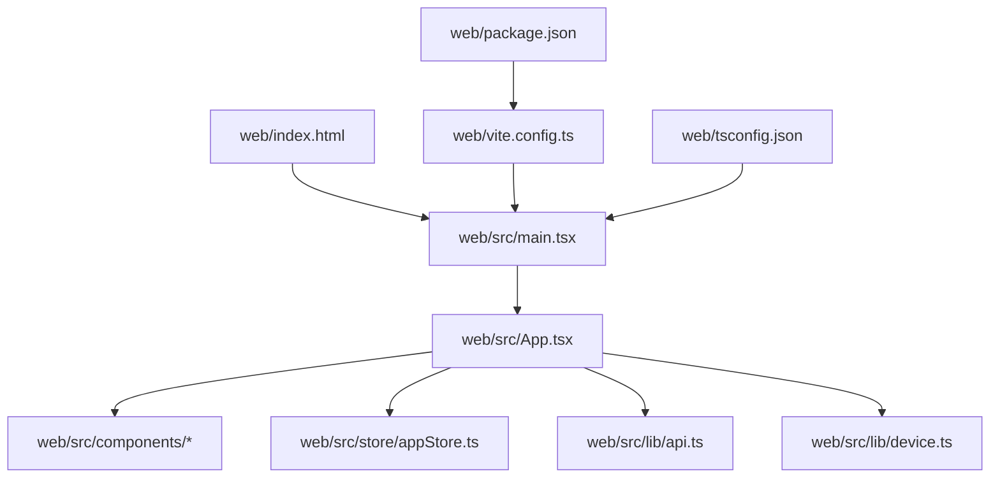
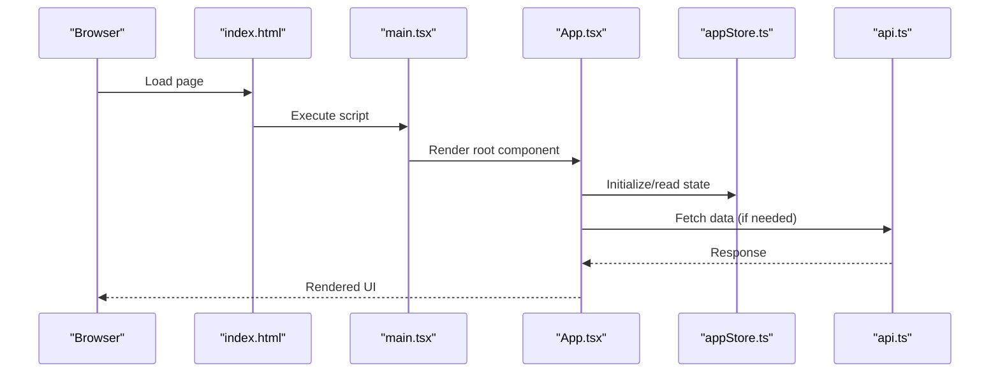
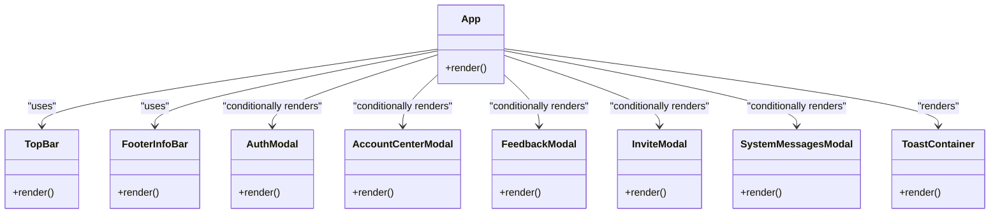
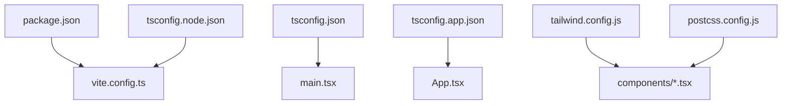

# React Application Structure

<cite>
**Referenced Files in This Document**
- [main.tsx](file://web/src/main.tsx)
- [App.tsx](file://web/src/App.tsx)
- [vite.config.ts](file://web/vite.config.ts)
- [tsconfig.json](file://web/tsconfig.json)
- [tsconfig.app.json](file://web/tsconfig.app.json)
- [tsconfig.node.json](file://web/tsconfig.node.json)
- [package.json](file://web/package.json)
- [tailwind.config.js](file://web/tailwind.config.js)
- [postcss.config.js](file://web/postcss.config.js)
- [index.html](file://web/index.html)
- [types.ts](file://web/src/types.ts)
- [store/appStore.ts](file://web/src/store/appStore.ts)
- [components/TopBar.tsx](file://web/src/components/TopBar.tsx)
- [components/FooterInfoBar.tsx](file://web/src/components/FooterInfoBar.tsx)
- [components/AuthModal.tsx](file://web/src/components/AuthModal.tsx)
- [components/AccountCenterModal.tsx](file://web/src/components/AccountCenterModal.tsx)
- [components/FeedbackModal.tsx](file://web/src/components/FeedbackModal.tsx)
- [components/InviteModal.tsx](file://web/src/components/InviteModal.tsx)
- [components/SystemMessagesModal.tsx](file://web/src/components/SystemMessagesModal.tsx)
- [components/ToastContainer.tsx](file://web/src/components/ToastContainer.tsx)
- [lib/api.ts](file://web/src/lib/api.ts)
- [lib/device.ts](file://web/src/lib/device.ts)
</cite>

## Table of Contents
1. [Introduction](#introduction)
2. [Project Structure](#project-structure)
3. [Core Components](#core-components)
4. [Architecture Overview](#architecture-overview)
5. [Detailed Component Analysis](#detailed-component-analysis)
6. [Dependency Analysis](#dependency-analysis)
7. [Performance Considerations](#performance-considerations)
8. [Troubleshooting Guide](#troubleshooting-guide)
9. [Conclusion](#conclusion)
10. [Appendices](#appendices)

## Introduction
This document explains the React application structure and architecture, focusing on the main entry point, bootstrap process, component hierarchy, TypeScript configuration, module organization, and Vite build setup. It also provides practical guidance for adding new pages, configuring routes, and extending the application shell while following established conventions.

## Project Structure
The frontend is located under web/. The React source code lives in web/src/, with components organized by feature, shared logic in lib/, global state in store/, and types in types.ts. Build and tooling configurations are at the web/ root.

Key directories and files:
- web/src/main.tsx: Application entry point that bootstraps React into the DOM.
- web/src/App.tsx: Root component composing layout and page content.
- web/src/components: Reusable UI components (modals, top bar, footer).
- web/src/lib: Shared utilities and API client.
- web/src/store: Global state management.
- web/src/types.ts: Shared TypeScript type definitions.
- web/vite.config.ts: Vite configuration for dev server, assets, and environment variables.
- web/tsconfig*.json: TypeScript project settings.
- web/package.json: Scripts and dependencies.
- web/tailwind.config.js and web/postcss.config.js: Styling pipeline.
- web/index.html: HTML shell where the app mounts.

**Diagram sources**
- [main.tsx](file://web/src/main.tsx)
- [App.tsx](file://web/src/App.tsx)
- [vite.config.ts](file://web/vite.config.ts)
- [tsconfig.json](file://web/tsconfig.json)
- [package.json](file://web/package.json)
- [index.html](file://web/index.html)

**Section sources**
- [main.tsx](file://web/src/main.tsx)
- [App.tsx](file://web/src/App.tsx)
- [vite.config.ts](file://web/vite.config.ts)
- [tsconfig.json](file://web/tsconfig.json)
- [tsconfig.app.json](file://web/tsconfig.app.json)
- [tsconfig.node.json](file://web/tsconfig.node.json)
- [package.json](file://web/package.json)
- [tailwind.config.js](file://web/tailwind.config.js)
- [postcss.config.js](file://web/postcss.config.js)
- [index.html](file://web/index.html)

## Core Components
- Entry point (main.tsx): Mounts the React application into the DOM element defined in index.html and initializes providers or global context if present.
- Root component (App.tsx): Composes the application shell (layout), renders page content, and wires up global state and shared services.
- Layout components: TopBar.tsx and FooterInfoBar.tsx provide consistent header and footer across pages.
- Modal system: AuthModal.tsx, AccountCenterModal.tsx, FeedbackModal.tsx, InviteModal.tsx, SystemMessagesModal.tsx encapsulate user interactions.
- Utilities: api.ts centralizes HTTP requests; device.ts exposes device capabilities.
- State: appStore.ts holds global application state consumed by components.

Typical responsibilities:
- main.tsx: Bootstrap React, attach to DOM, configure error boundaries if used.
- App.tsx: Orchestrate layout, route rendering, and global state initialization.
- Components: Encapsulate UI behavior and presentation, consume store via hooks/context.

**Section sources**
- [main.tsx](file://web/src/main.tsx)
- [App.tsx](file://web/src/App.tsx)
- [components/TopBar.tsx](file://web/src/components/TopBar.tsx)
- [components/FooterInfoBar.tsx](file://web/src/components/FooterInfoBar.tsx)
- [components/AuthModal.tsx](file://web/src/components/AuthModal.tsx)
- [components/AccountCenterModal.tsx](file://web/src/components/AccountCenterModal.tsx)
- [components/FeedbackModal.tsx](file://web/src/components/FeedbackModal.tsx)
- [components/InviteModal.tsx](file://web/src/components/InviteModal.tsx)
- [components/SystemMessagesModal.tsx](file://web/src/components/SystemMessagesModal.tsx)
- [components/ToastContainer.tsx](file://web/src/components/ToastContainer.tsx)
- [lib/api.ts](file://web/src/lib/api.ts)
- [lib/device.ts](file://web/src/lib/device.ts)
- [store/appStore.ts](file://web/src/store/appStore.ts)

## Architecture Overview
High-level flow:
- index.html defines the mount point.
- main.tsx creates the React root and renders App.
- App composes layout and page content, reads/writes global state from appStore, and calls API via lib/api.
- Vite serves the app during development and bundles it for production using vite.config.ts.

**Diagram sources**
- [index.html](file://web/index.html)
- [main.tsx](file://web/src/main.tsx)
- [App.tsx](file://web/src/App.tsx)
- [store/appStore.ts](file://web/src/store/appStore.ts)
- [lib/api.ts](file://web/src/lib/api.ts)

## Detailed Component Analysis

### Entry Point and Bootstrap
- main.tsx: Creates a React root and mounts App into the DOM node referenced by index.html. If any global providers or initializations are required, they are configured here before rendering.
- index.html: Provides the root container element and loads the compiled scripts.

Practical notes:
- Ensure the root element exists in index.html before mounting.
- Keep initialization logic minimal in main.tsx; defer heavy work to App or dedicated services.

**Section sources**
- [main.tsx](file://web/src/main.tsx)
- [index.html](file://web/index.html)

### Application Shell and Root Component
- App.tsx: Renders the application shell (header/footer), manages global state, and renders page content. It may conditionally render modals based on state.
- TopBar.tsx and FooterInfoBar.tsx: Provide consistent navigation and information across pages.

Component relationships:
- App depends on store/appStore for global state.
- App includes layout components and modal components as needed.

**Diagram sources**
- [App.tsx](file://web/src/App.tsx)
- [components/TopBar.tsx](file://web/src/components/TopBar.tsx)
- [components/FooterInfoBar.tsx](file://web/src/components/FooterInfoBar.tsx)
- [components/AuthModal.tsx](file://web/src/components/AuthModal.tsx)
- [components/AccountCenterModal.tsx](file://web/src/components/AccountCenterModal.tsx)
- [components/FeedbackModal.tsx](file://web/src/components/FeedbackModal.tsx)
- [components/InviteModal.tsx](file://web/src/components/InviteModal.tsx)
- [components/SystemMessagesModal.tsx](file://web/src/components/SystemMessagesModal.tsx)
- [components/ToastContainer.tsx](file://web/src/components/ToastContainer.tsx)

**Section sources**
- [App.tsx](file://web/src/App.tsx)
- [components/TopBar.tsx](file://web/src/components/TopBar.tsx)
- [components/FooterInfoBar.tsx](file://web/src/components/FooterInfoBar.tsx)
- [components/AuthModal.tsx](file://web/src/components/AuthModal.tsx)
- [components/AccountCenterModal.tsx](file://web/src/components/AccountCenterModal.tsx)
- [components/FeedbackModal.tsx](file://web/src/components/FeedbackModal.tsx)
- [components/InviteModal.tsx](file://web/src/components/InviteModal.tsx)
- [components/SystemMessagesModal.tsx](file://web/src/components/SystemMessagesModal.tsx)
- [components/ToastContainer.tsx](file://web/src/components/ToastContainer.tsx)

### Global State Management
- appStore.ts: Centralized state for the application. Components subscribe to relevant slices and dispatch updates.
- Typical usage pattern: Read state via hooks/selectors and update via actions/dispatchers exposed by the store.

Best practices:
- Keep store modules small and focused.
- Prefer derived state and memoization to avoid unnecessary re-renders.

**Section sources**
- [store/appStore.ts](file://web/src/store/appStore.ts)

### API and Device Utilities
- api.ts: Centralized HTTP client configuration and request helpers. Use this for all network calls to ensure consistent headers, base URLs, and error handling.
- device.ts: Utility functions for device detection and capabilities.

Integration points:
- Components call api.ts methods to fetch or mutate data.
- Device info can influence UI behavior or feature flags.

**Section sources**
- [lib/api.ts](file://web/src/lib/api.ts)
- [lib/device.ts](file://web/src/lib/device.ts)

### Type Definitions and Module Organization
- types.ts: Shared TypeScript interfaces and types used across components and libraries.
- Module organization:
  - src/components: Feature-specific UI components.
  - src/lib: Shared utilities and API client.
  - src/store: Global state modules.
  - src/types.ts: Cross-cutting types.
  - Import/export strategy: Named exports for reusable pieces; default export only for primary entry points like App.

Guidelines:
- Co-locate related types near their consumers when appropriate, but centralize shared types in types.ts.
- Avoid circular imports by extracting shared contracts into types.ts.

**Section sources**
- [types.ts](file://web/src/types.ts)

## Dependency Analysis
Build and tooling dependencies:
- package.json: Declares dependencies and scripts for development and production builds.
- vite.config.ts: Configures the dev server, asset optimization, and environment variable access.
- tsconfig.json, tsconfig.app.json, tsconfig.node.json: Define TypeScript compilation targets and module resolution.
- tailwind.config.js and postcss.config.js: Configure CSS processing and Tailwind directives.

**Diagram sources**
- [package.json](file://web/package.json)
- [vite.config.ts](file://web/vite.config.ts)
- [tsconfig.json](file://web/tsconfig.json)
- [tsconfig.app.json](file://web/tsconfig.app.json)
- [tsconfig.node.json](file://web/tsconfig.node.json)
- [tailwind.config.js](file://web/tailwind.config.js)
- [postcss.config.js](file://web/postcss.config.js)
- [main.tsx](file://web/src/main.tsx)
- [App.tsx](file://web/src/App.tsx)
- [components/TopBar.tsx](file://web/src/components/TopBar.tsx)

**Section sources**
- [package.json](file://web/package.json)
- [vite.config.ts](file://web/vite.config.ts)
- [tsconfig.json](file://web/tsconfig.json)
- [tsconfig.app.json](file://web/tsconfig.app.json)
- [tsconfig.node.json](file://web/tsconfig.node.json)
- [tailwind.config.js](file://web/tailwind.config.js)
- [postcss.config.js](file://web/postcss.config.js)

## Performance Considerations
- Code splitting: Use dynamic imports for large components or routes to reduce initial bundle size.
- Asset optimization: Configure image formats and compression in vite.config.ts.
- Dev server: Enable fast refresh and minimize overhead in vite.config.ts.
- Environment variables: Access via import.meta.env in Vite-managed files; keep secrets out of the client bundle.
- CSS: Leverage Tailwind’s purge/minification through PostCSS and Tailwind config.

[No sources needed since this section provides general guidance]

## Troubleshooting Guide
Common issues and resolutions:
- Mount point missing: Ensure the root element exists in index.html and matches the selector used in main.tsx.
- TypeScript errors: Verify tsconfig paths and moduleResolution settings; run type checks using npm scripts defined in package.json.
- Vite dev server not starting: Check port conflicts and environment variables; review vite.config.ts for custom host/port settings.
- API failures: Inspect base URL and headers in api.ts; validate CORS and authentication flows.
- Tailwind styles not applied: Confirm Tailwind directives are included and postcss.config.js references Tailwind correctly.

**Section sources**
- [index.html](file://web/index.html)
- [main.tsx](file://web/src/main.tsx)
- [tsconfig.json](file://web/tsconfig.json)
- [package.json](file://web/package.json)
- [vite.config.ts](file://web/vite.config.ts)
- [lib/api.ts](file://web/src/lib/api.ts)
- [tailwind.config.js](file://web/tailwind.config.js)
- [postcss.config.js](file://web/postcss.config.js)

## Conclusion
The application follows a clear separation of concerns: main.tsx bootstraps React, App.tsx orchestrates layout and state, components encapsulate UI, and lib/store handle shared logic and global state. TypeScript and Vite configurations ensure a robust development experience and optimized production builds. Adhering to the documented conventions will streamline adding features and maintaining consistency.

[No sources needed since this section summarizes without analyzing specific files]

## Appendices

### Adding a New Page
Steps:
1. Create a new component under src/components (e.g., MyPage.tsx).
2. Update App.tsx to include the new component in the layout or routing logic.
3. If using a router library, add a route definition and link from navigation components.
4. Add any necessary types to types.ts and state slices to store/appStore.ts.
5. Test locally using the dev server and verify integration with api.ts.

[No sources needed since this section provides general guidance]

### Configuring Routes
If integrating a router:
- Define route mappings in a dedicated file or within App.tsx.
- Use Link components for navigation and protected routes for authenticated areas.
- Keep route components lazy-loaded for performance.

[No sources needed since this section provides general guidance]

### Extending the Application Shell
To extend the shell:
- Modify App.tsx to wrap page content with additional layout elements.
- Extend TopBar.tsx and FooterInfoBar.tsx for global navigation and branding.
- Introduce new modals under src/components and control visibility via global state.

**Section sources**
- [App.tsx](file://web/src/App.tsx)
- [components/TopBar.tsx](file://web/src/components/TopBar.tsx)
- [components/FooterInfoBar.tsx](file://web/src/components/FooterInfoBar.tsx)