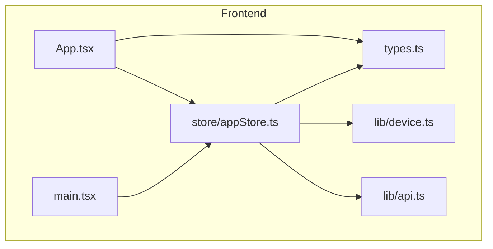
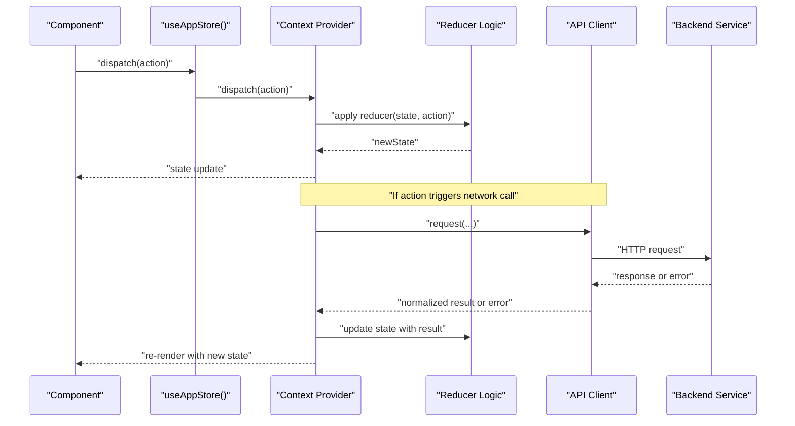
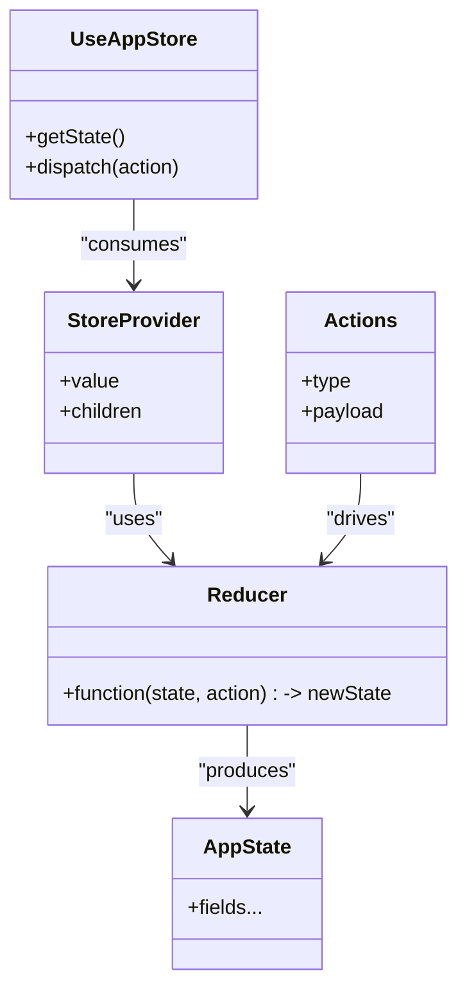
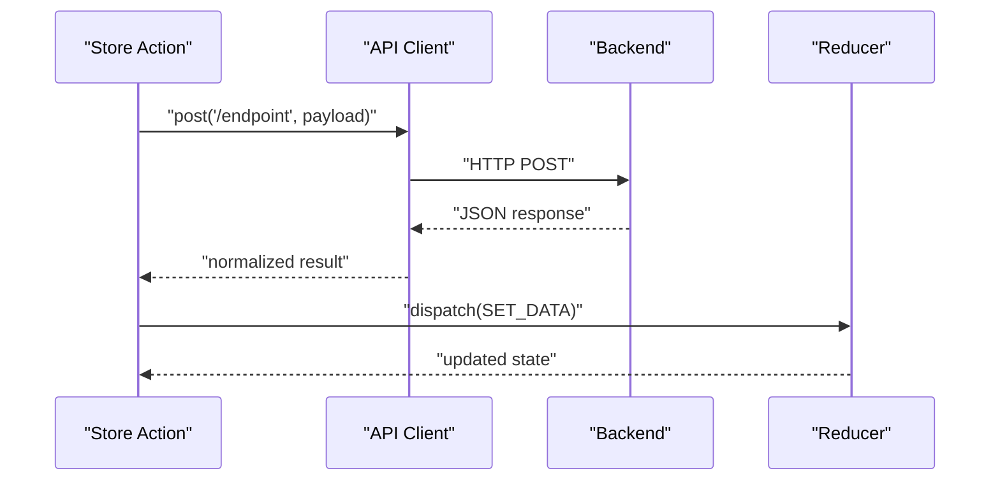
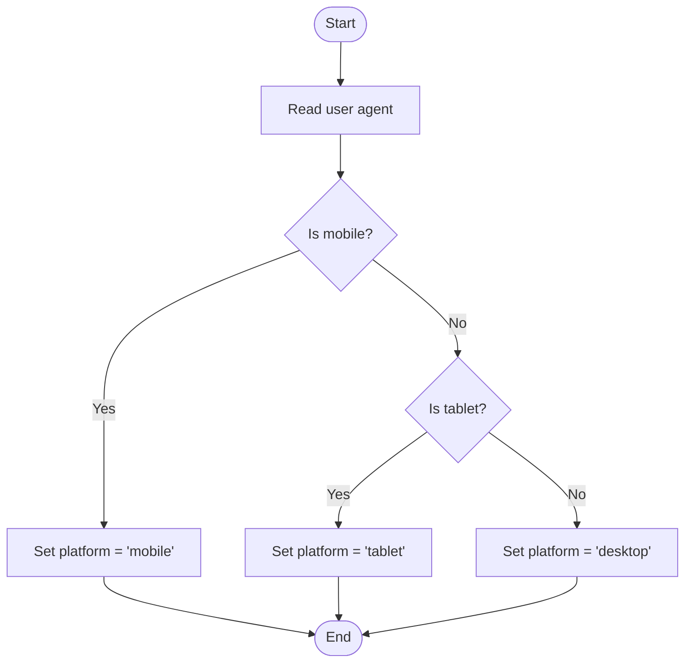
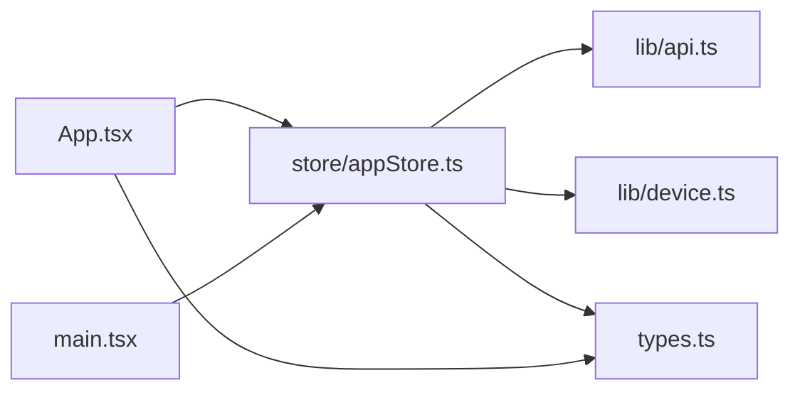

# State Management & Store

<cite>
**Referenced Files in This Document**
- [appStore.ts](file://web/src/store/appStore.ts)
- [api.ts](file://web/src/lib/api.ts)
- [device.ts](file://web/src/lib/device.ts)
- [App.tsx](file://web/src/App.tsx)
- [main.tsx](file://web/src/main.tsx)
- [types.ts](file://web/src/types.ts)
</cite>

## Table of Contents
1. [Introduction](#introduction)
2. [Project Structure](#project-structure)
3. [Core Components](#core-components)
4. [Architecture Overview](#architecture-overview)
5. [Detailed Component Analysis](#detailed-component-analysis)
6. [Dependency Analysis](#dependency-analysis)
7. [Performance Considerations](#performance-considerations)
8. [Troubleshooting Guide](#troubleshooting-guide)
9. [Conclusion](#conclusion)
10. [Appendices](#appendices)

## Introduction
This document explains the application’s state management system built with React Context API, focusing on the app store implementation, actions and reducers, context providers, and how components consume global state. It also documents the API client abstraction layer for backend communication, request/response handling, and error management, as well as device utility functions for platform detection and feature capabilities. Finally, it provides examples of accessing global state, dispatching actions, implementing custom hooks, strategies for state persistence, performance optimization techniques, and debugging approaches for complex state interactions.

## Project Structure
The relevant frontend modules are organized under web/src:
- Store: centralized state via Context API
- Lib: shared utilities including API client and device helpers
- App entry points and types

**Diagram sources**
- [App.tsx](file://web/src/App.tsx)
- [main.tsx](file://web/src/main.tsx)
- [appStore.ts](file://web/src/store/appStore.ts)
- [api.ts](file://web/src/lib/api.ts)
- [device.ts](file://web/src/lib/device.ts)
- [types.ts](file://web/src/types.ts)

**Section sources**
- [App.tsx](file://web/src/App.tsx)
- [main.tsx](file://web/src/main.tsx)
- [appStore.ts](file://web/src/store/appStore.ts)
- [api.ts](file://web/src/lib/api.ts)
- [device.ts](file://web/src/lib/device.ts)
- [types.ts](file://web/src/types.ts)

## Core Components
- Global state provider and store: encapsulates state shape, action dispatchers, and reducer logic; exposes a context for consumption by components.
- API client abstraction: centralizes HTTP requests, headers, base URL configuration, response normalization, and error mapping.
- Device utilities: platform detection (mobile/desktop/tablet), capability checks (e.g., touch, offline), and environment hints.
- Types: shared TypeScript interfaces used across store, API client, and components.

Key responsibilities:
- Store: define initial state, action types, reducer transitions, and context value memoization.
- API client: build requests, handle retries/timeouts, normalize payloads, and surface typed errors.
- Device utils: provide boolean flags and helper methods to adapt UI/behavior per platform.

**Section sources**
- [appStore.ts](file://web/src/store/appStore.ts)
- [api.ts](file://web/src/lib/api.ts)
- [device.ts](file://web/src/lib/device.ts)
- [types.ts](file://web/src/types.ts)

## Architecture Overview
High-level flow from component to backend and back:

**Diagram sources**
- [appStore.ts](file://web/src/store/appStore.ts)
- [api.ts](file://web/src/lib/api.ts)

## Detailed Component Analysis

### Store Implementation (Context API)
Responsibilities:
- Define the global state shape and initial values.
- Provide an action dispatcher and a reducer that updates state immutably.
- Wrap the application with a context provider so components can read/write state.
- Expose a custom hook to access state and dispatch actions.

Typical structure:
- State interface(s): describe all persisted and transient fields.
- Action types: discriminated union or string constants for each mutation.
- Reducer function: pure function returning next state based on action type and payload.
- Context creation and provider: supply state and dispatch to consumers.
- Custom hook: convenience accessor for state and dispatch.

Usage patterns:
- Read-only access: use the custom hook to subscribe to specific slices of state.
- Dispatching mutations: call dispatch with typed actions; avoid direct state writes.
- Side effects: trigger API calls within effect handlers or thunks if implemented.

Best practices:
- Keep reducer pure and deterministic.
- Normalize nested data where possible to reduce re-renders.
- Memoize expensive derived values using selectors or useMemo.

**Section sources**
- [appStore.ts](file://web/src/store/appStore.ts)
- [types.ts](file://web/src/types.ts)

#### Class Diagram (Conceptual Mapping)

[No diagram sources since this is a conceptual mapping]

### API Client Abstraction Layer
Responsibilities:
- Centralize HTTP configuration (base URL, default headers).
- Build typed request methods for common operations (GET, POST, PUT, DELETE).
- Handle request lifecycle: timeouts, retries, cancellation tokens if needed.
- Normalize responses into consistent shapes and map errors to domain-specific types.
- Integrate with authentication (e.g., attach tokens, refresh flows).

Request/response handling:
- Serialize/deserialize payloads consistently.
- Attach auth headers conditionally.
- Parse error responses and convert them to structured objects.

Error management:
- Network vs server errors distinction.
- Retry/backoff policies for transient failures.
- User-facing messages and logging hooks.

Integration with store:
- Actions that perform side effects call the API client and then dispatch success/failure actions.

**Section sources**
- [api.ts](file://web/src/lib/api.ts)
- [types.ts](file://web/src/types.ts)

#### Sequence Diagram (API Call Flow)

**Diagram sources**
- [api.ts](file://web/src/lib/api.ts)
- [appStore.ts](file://web/src/store/appStore.ts)

### Device Utility Functions
Responsibilities:
- Detect platform: mobile, tablet, desktop.
- Feature detection: touch support, online/offline status, screen size breakpoints.
- Environment hints: user agent parsing, viewport metrics.

Use cases:
- Conditional rendering of UI elements.
- Enabling/disabling features based on capabilities.
- Adjusting behavior for different input methods.

Implementation notes:
- Cache results when appropriate to avoid repeated DOM queries.
- Provide stable boolean flags and small helper functions.

**Section sources**
- [device.ts](file://web/src/lib/device.ts)

#### Flowchart (Platform Detection)

[No diagram sources since this is a conceptual algorithm]

### Accessing Global State and Dispatching Actions
Patterns:
- In functional components, import the custom hook and call it to get state and dispatch.
- Subscribe only to the minimal required state slice to avoid unnecessary re-renders.
- For side effects triggered by actions, place API calls in effect handlers or thunk-like wrappers around dispatch.

Examples (described):
- Reading a flag: call the hook, destructure the field, render accordingly.
- Updating state: call dispatch with a typed action containing necessary payload.
- Combining reads and writes: compute derived values locally before dispatching.

**Section sources**
- [appStore.ts](file://web/src/store/appStore.ts)
- [types.ts](file://web/src/types.ts)

### Implementing Custom Hooks
Guidelines:
- Encapsulate frequently used state selections and action combinations.
- Return both state and dispatch functions, or specialized helpers.
- Memoize computed values inside hooks to prevent redundant recalculations.

Example patterns (described):
- useAuth: returns isAuthenticated, user profile, and login/logout actions.
- useFeatureFlags: returns capability flags derived from device utils and local settings.

**Section sources**
- [appStore.ts](file://web/src/store/appStore.ts)
- [device.ts](file://web/src/lib/device.ts)

### State Persistence Strategies
Options:
- Local storage: persist selected slices of state across sessions.
- Session storage: ephemeral persistence tied to tab lifetime.
- IndexedDB: for larger datasets or binary blobs.

Recommendations:
- Persist only essential state to minimize I/O overhead.
- Debounce or batch writes to avoid excessive storage operations.
- Migrate schema versions gracefully when evolving state shape.

Integration points:
- On store initialization, hydrate from storage.
- On significant state changes, write back to storage.
- Handle storage errors and fallbacks gracefully.

**Section sources**
- [appStore.ts](file://web/src/store/appStore.ts)

### Performance Optimization Techniques
- Memoization: use memoized selectors or useMemo for derived state.
- Selective subscriptions: expose granular getters to limit re-renders.
- Batched updates: group multiple state changes into a single dispatch.
- Lazy loading: split large state slices and load on demand.
- Avoid object churn: prefer immutable updates that reuse references where safe.

**Section sources**
- [appStore.ts](file://web/src/store/appStore.ts)

### Debugging Approaches
- Logging: log actions and resulting state diffs during development.
- Time-travel: snapshot state before/after actions for inspection.
- Error boundaries: catch rendering errors caused by invalid state.
- Assertions: validate invariants in reducer transitions.

Practical steps:
- Add debug toggles to enable verbose logs.
- Export store state to console periodically.
- Instrument API client to log request/response summaries.

**Section sources**
- [appStore.ts](file://web/src/store/appStore.ts)
- [api.ts](file://web/src/lib/api.ts)

## Dependency Analysis
Relationships between core modules:

**Diagram sources**
- [App.tsx](file://web/src/App.tsx)
- [main.tsx](file://web/src/main.tsx)
- [appStore.ts](file://web/src/store/appStore.ts)
- [api.ts](file://web/src/lib/api.ts)
- [device.ts](file://web/src/lib/device.ts)
- [types.ts](file://web/src/types.ts)

**Section sources**
- [App.tsx](file://web/src/App.tsx)
- [main.tsx](file://web/src/main.tsx)
- [appStore.ts](file://web/src/store/appStore.ts)
- [api.ts](file://web/src/lib/api.ts)
- [device.ts](file://web/src/lib/device.ts)
- [types.ts](file://web/src/types.ts)

## Performance Considerations
- Prefer fine-grained state slices and selective subscriptions.
- Avoid deep nesting; flatten where practical.
- Coalesce frequent updates (debounce/throttle) especially for I/O-bound actions.
- Use lazy initialization for heavy computations.
- Profile re-renders to identify unnecessary updates.

[No sources needed since this section provides general guidance]

## Troubleshooting Guide
Common issues and resolutions:
- Stale closures: ensure dependencies in effects/hooks are correct.
- Race conditions: cancel in-flight requests or ignore outdated responses.
- Storage corruption: validate persisted state on hydration and reset if invalid.
- API errors: distinguish network vs server errors and present actionable feedback.

Diagnostic tips:
- Enable debug logging for actions and API calls.
- Snapshot state before and after critical operations.
- Verify device flags and environment assumptions.

**Section sources**
- [appStore.ts](file://web/src/store/appStore.ts)
- [api.ts](file://web/src/lib/api.ts)
- [device.ts](file://web/src/lib/device.ts)

## Conclusion
The application uses a clear separation of concerns: a Context-based store for state, a dedicated API client for backend communication, and device utilities for platform-aware behavior. By following the patterns outlined—typed actions, pure reducers, memoized selectors, robust error handling, and thoughtful persistence—you can maintain predictable state transitions, high performance, and a smooth developer experience.

[No sources needed since this section summarizes without analyzing specific files]

## Appendices

### Quick Reference: Typical Workflows
- Initialize store: wrap app with provider at the root.
- Consume state: use the custom hook to read fields and dispatch actions.
- Perform network operation: dispatch an action that invokes the API client and updates state upon completion.
- Persist state: hydrate on startup and write back on meaningful changes.

[No sources needed since this section provides general guidance]