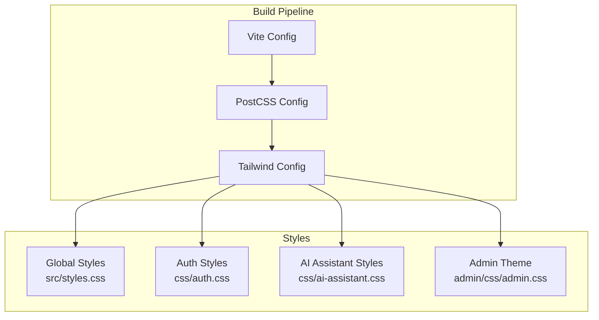
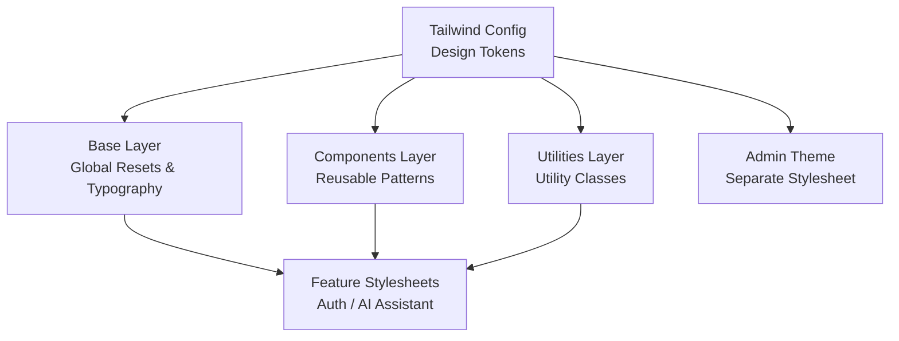
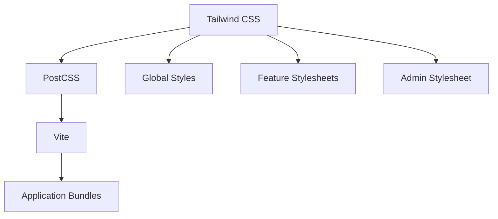

# Styling & Theming System

<cite>
**Referenced Files in This Document**
- [tailwind.config.js](file://web/tailwind.config.js)
- [styles.css](file://web/src/styles.css)
- [admin.css](file://web/admin/css/admin.css)
- [ai-assistant.css](file://web/css/ai-assistant.css)
- [auth.css](file://web/css/auth.css)
- [postcss.config.js](file://web/postcss.config.js)
- [vite.config.js](file://web/vite.config.js)
</cite>

## Table of Contents
1. [Introduction](#introduction)
2. [Project Structure](#project-structure)
3. [Core Components](#core-components)
4. [Architecture Overview](#architecture-overview)
5. [Detailed Component Analysis](#detailed-component-analysis)
6. [Dependency Analysis](#dependency-analysis)
7. [Performance Considerations](#performance-considerations)
8. [Troubleshooting Guide](#troubleshooting-guide)
9. [Conclusion](#conclusion)
10. [Appendices](#appendices)

## Introduction
This document describes the styling and theming system built on Tailwind CSS. It covers configuration (custom themes, color palettes, typography scales, responsive breakpoints), CSS architecture (global styles, component-specific styles, admin theme separation), design system principles, utility class usage patterns, custom CSS extensions, dark mode support, responsive strategies, and accessibility considerations. The goal is to help developers create consistent UI elements and maintain design consistency across the application.

## Project Structure
The styling system is organized into:
- Tailwind configuration and build pipeline
- Global styles and base layer
- Feature-specific stylesheets
- Admin theme separation
- Build tool integration

[No sources needed since this diagram shows conceptual workflow, not actual code structure]

## Core Components
- Tailwind Configuration: Centralizes theme tokens (colors, fonts, spacing, radii, shadows), breakpoints, plugins, and purge/content paths.
- Global Styles: Base layer resets, typography defaults, and global utilities.
- Feature Styles: Scoped styles for auth flows and AI assistant interactions.
- Admin Theme: Separate stylesheet for admin surfaces with distinct visual language.
- Build Integration: PostCSS and Vite orchestrate Tailwind processing and asset bundling.

Key responsibilities:
- Define and extend design tokens via Tailwind config.
- Maintain clear separation between global, feature, and admin styles.
- Provide reusable patterns for components and layouts.
- Ensure performance through efficient content scanning and minimal CSS output.

**Section sources**
- [tailwind.config.js](file://web/tailwind.config.js)
- [styles.css](file://web/src/styles.css)
- [admin.css](file://web/admin/css/admin.css)
- [ai-assistant.css](file://web/css/ai-assistant.css)
- [auth.css](file://web/css/auth.css)
- [postcss.config.js](file://web/postcss.config.js)
- [vite.config.js](file://web/vite.config.js)

## Architecture Overview
The styling architecture follows a layered approach:
- Layered CSS strategy using Tailwind’s @layer directives (base, components, utilities).
- Design tokens centralized in Tailwind config for consistency.
- Feature-scoped stylesheets for isolated concerns.
- Admin theme separated to avoid leakage into user-facing pages.
- Build-time optimization via Purge/Tailwind content scanning.

[No sources needed since this diagram shows conceptual workflow, not actual code structure]

## Detailed Component Analysis

### Tailwind Configuration
Responsibilities:
- Define custom color palette and semantic tokens.
- Configure typography scale and font families.
- Set responsive breakpoints and container behavior.
- Enable plugins and configure content paths for tree-shaking.
- Extend spacing, border radius, shadows, and z-index scale.

Best practices:
- Use semantic color names (e.g., brand-primary) mapped to concrete values.
- Keep breakpoints aligned with mobile-first strategy.
- Limit custom utilities; prefer composition of existing utilities.
- Keep content globs precise to reduce CSS size.

**Section sources**
- [tailwind.config.js](file://web/tailwind.config.js)

### Global Styles (Base Layer)
Responsibilities:
- Normalize browser defaults.
- Establish baseline typography and link styles.
- Provide global layout helpers and focus states.
- Introduce CSS variables for runtime theming (e.g., dark mode).

Patterns:
- Use @layer base for resets and base rules.
- Apply :root variables for colors and spacing tokens.
- Ensure accessible focus indicators and contrast.

**Section sources**
- [styles.css](file://web/src/styles.css)

### Feature Stylesheets
- Auth Styles: Scoped to authentication flows (modals, forms, feedback).
- AI Assistant Styles: Scoped to chat-like interfaces and message bubbles.

Guidelines:
- Keep selectors scoped and minimal.
- Prefer Tailwind utilities for layout and spacing.
- Use custom classes only when necessary for complex state or animations.

**Section sources**
- [auth.css](file://web/css/auth.css)
- [ai-assistant.css](file://web/css/ai-assistant.css)

### Admin Theme Separation
Responsibilities:
- Provide a distinct visual language for admin surfaces.
- Override or extend tokens where appropriate without affecting public UI.
- Isolate admin-specific components and interactions.

Approach:
- Load admin.css separately in admin routes.
- Use a dedicated prefix or scope if needed.
- Avoid importing admin styles into non-admin pages.

**Section sources**
- [admin.css](file://web/admin/css/admin.css)

### Build Integration (PostCSS and Vite)
Responsibilities:
- Process Tailwind directives and generate optimized CSS.
- Configure content scanning for unused style removal.
- Integrate with Vite’s dev server and production builds.

Configuration highlights:
- Tailwind plugin chain and content paths.
- PostCSS plugins order and options.
- Vite aliasing and asset handling for styles.

**Section sources**
- [postcss.config.js](file://web/postcss.config.js)
- [vite.config.js](file://web/vite.config.js)

### Dark Mode Support
Implementation patterns:
- Use Tailwind’s dark mode strategy (class-based or media query).
- Define dark variants for colors, backgrounds, borders, and text.
- Persist user preference and apply at runtime.

Recommendations:
- Ensure sufficient contrast in both light and dark modes.
- Test interactive states (hover, focus, active) in dark mode.
- Avoid hard-coded colors; use semantic tokens.

**Section sources**
- [tailwind.config.js](file://web/tailwind.config.js)
- [styles.css](file://web/src/styles.css)

### Responsive Design Strategy
Principles:
- Mobile-first breakpoints defined in Tailwind config.
- Fluid spacing and typography scales where possible.
- Grid/flex layouts that adapt gracefully.

Patterns:
- Use responsive prefixes consistently.
- Prefer stacking layouts on small screens and multi-column on larger screens.
- Validate touch targets and readability on mobile.

**Section sources**
- [tailwind.config.js](file://web/tailwind.config.js)

### Accessibility Considerations
Guidelines:
- Maintain WCAG contrast ratios for text and interactive elements.
- Provide visible focus indicators.
- Use semantic HTML and ARIA attributes where needed.
- Ensure keyboard navigability for modals and menus.
- Test with screen readers and automated checks.

**Section sources**
- [styles.css](file://web/src/styles.css)
- [auth.css](file://web/css/auth.css)
- [ai-assistant.css](file://web/css/ai-assistant.css)
- [admin.css](file://web/admin/css/admin.css)

### Utility Class Usage Patterns
Do:
- Compose utilities for layout, spacing, and typography.
- Extract repeated patterns into component-level classes under @layer components.
- Keep long class lists readable by grouping related utilities.

Avoid:
- Overriding Tailwind utilities with ad-hoc CSS unless necessary.
- Deeply nested selectors that break utility composition.
- Hard-coding values that should be tokens.

**Section sources**
- [styles.css](file://web/src/styles.css)
- [auth.css](file://web/css/auth.css)
- [ai-assistant.css](file://web/css/ai-assistant.css)
- [admin.css](file://web/admin/css/admin.css)

### Custom CSS Extensions
When to extend:
- Complex animations or transitions not covered by utilities.
- Browser-specific fixes or advanced selectors.
- Third-party integrations requiring custom overrides.

How to organize:
- Place custom rules under @layer components or features.
- Prefix custom classes to avoid collisions.
- Document extension points and usage guidelines.

**Section sources**
- [styles.css](file://web/src/styles.css)
- [auth.css](file://web/css/auth.css)
- [ai-assistant.css](file://web/css/ai-assistant.css)
- [admin.css](file://web/admin/css/admin.css)

### Creating Consistent UI Elements
Patterns:
- Define base component classes (buttons, inputs, cards) under @layer components.
- Use design tokens for colors, spacing, and typography.
- Provide variant classes for sizes, states, and emphasis levels.

Example pattern references:
- Button variants: primary, secondary, ghost, disabled.
- Input states: default, hover, focus, error, success.
- Card layouts: header, body, footer sections with consistent padding and borders.

**Section sources**
- [styles.css](file://web/src/styles.css)
- [auth.css](file://web/css/auth.css)
- [ai-assistant.css](file://web/css/ai-assistant.css)
- [admin.css](file://web/admin/css/admin.css)

### Maintaining Design Consistency
Practices:
- Centralize tokens in Tailwind config.
- Enforce naming conventions for custom classes.
- Review PRs for adherence to design tokens and patterns.
- Use linters or style guides to catch inconsistencies.

**Section sources**
- [tailwind.config.js](file://web/tailwind.config.js)
- [styles.css](file://web/src/styles.css)

## Dependency Analysis
The styling system depends on:
- Tailwind CSS core and plugins.
- PostCSS pipeline for directive processing.
- Vite for development and production builds.
- Feature stylesheets that consume Tailwind utilities and tokens.

[No sources needed since this diagram shows conceptual workflow, not actual code structure]

**Section sources**
- [postcss.config.js](file://web/postcss.config.js)
- [vite.config.js](file://web/vite.config.js)
- [tailwind.config.js](file://web/tailwind.config.js)

## Performance Considerations
- Keep content globs precise to minimize generated CSS.
- Prefer Tailwind utilities over custom CSS to leverage purging.
- Split large stylesheets into feature modules.
- Monitor bundle size and audit unused CSS regularly.
- Use lazy loading for heavy admin styles if applicable.

[No sources needed since this section provides general guidance]

## Troubleshooting Guide
Common issues and resolutions:
- Styles not applied: Verify content paths include relevant files.
- Conflicting styles: Check specificity and ensure custom rules are layered correctly.
- Dark mode not toggling: Confirm class-based strategy and persistence logic.
- Large CSS bundle: Narrow content globs and remove unused custom CSS.
- Admin styles leaking: Ensure separate load paths and scoping.

**Section sources**
- [tailwind.config.js](file://web/tailwind.config.js)
- [postcss.config.js](file://web/postcss.config.js)
- [vite.config.js](file://web/vite.config.js)
- [styles.css](file://web/src/styles.css)
- [admin.css](file://web/admin/css/admin.css)

## Conclusion
A robust styling and theming system relies on centralized design tokens, clear layering, and disciplined usage of utilities. By separating global, feature, and admin styles, and integrating tightly with the build pipeline, the application achieves consistency, maintainability, and performance. Adhering to accessibility and responsive design principles ensures an inclusive and high-quality user experience across devices and contexts.

[No sources needed since this section summarizes without analyzing specific files]

## Appendices

### Quick Start Checklist
- Define tokens in Tailwind config.
- Organize styles into base, components, and utilities layers.
- Scope feature styles and isolate admin theme.
- Configure content paths for optimal purging.
- Implement dark mode with semantic tokens.
- Validate accessibility and responsiveness.

[No sources needed since this section provides general guidance]