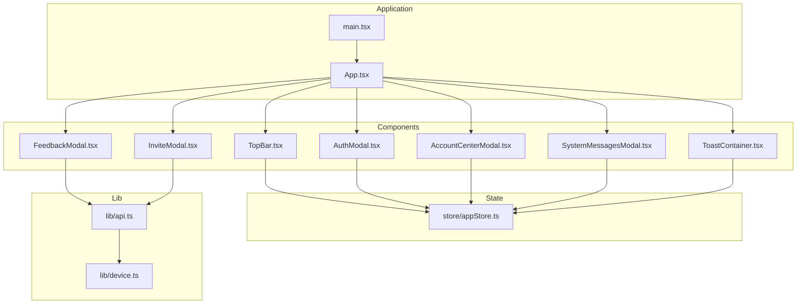
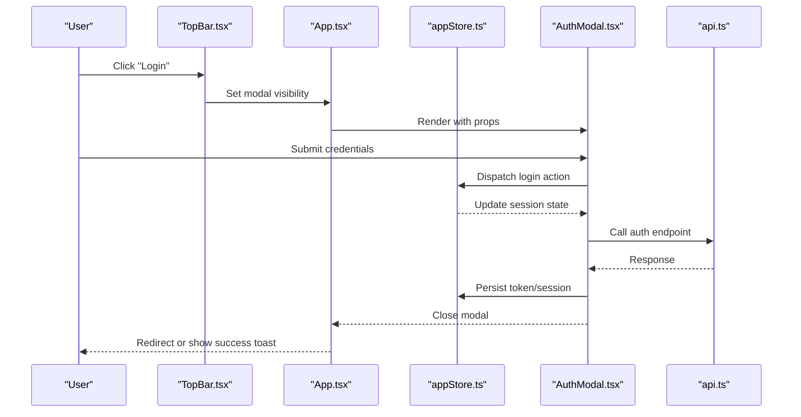
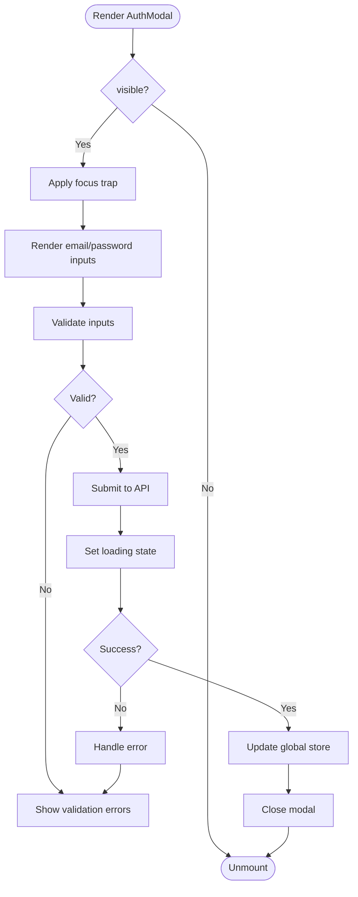
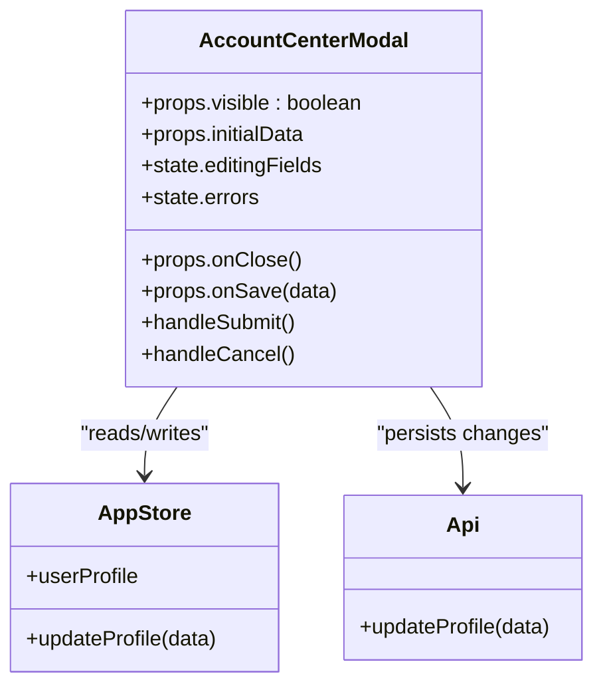
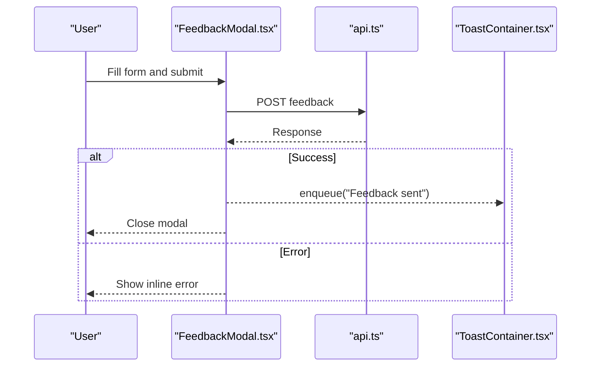
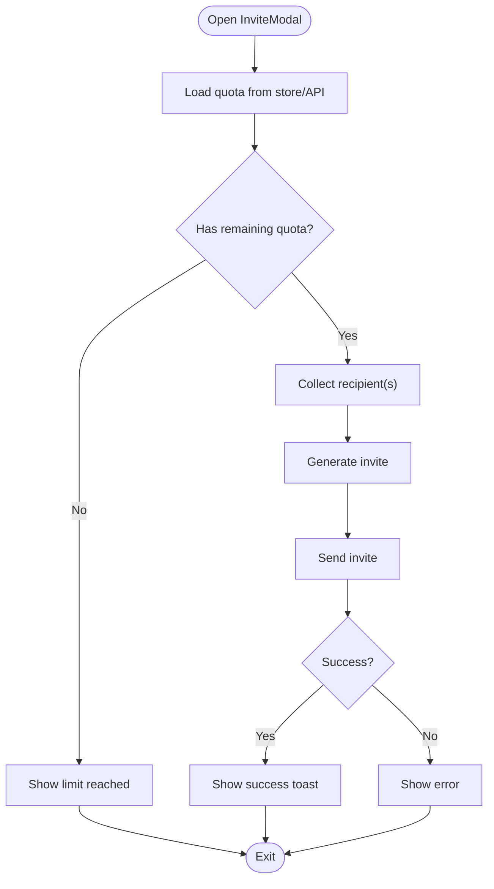
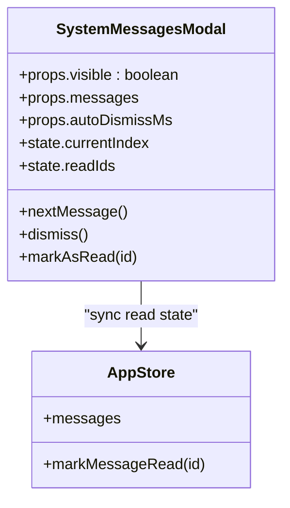
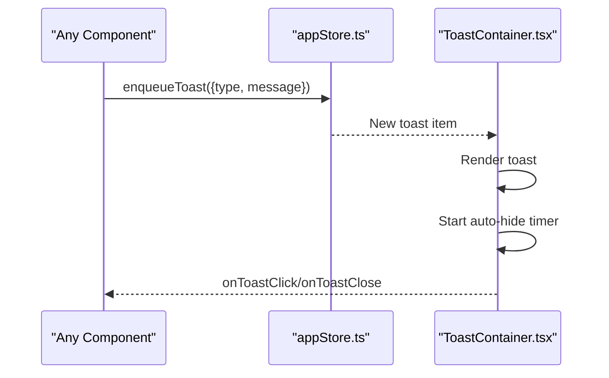
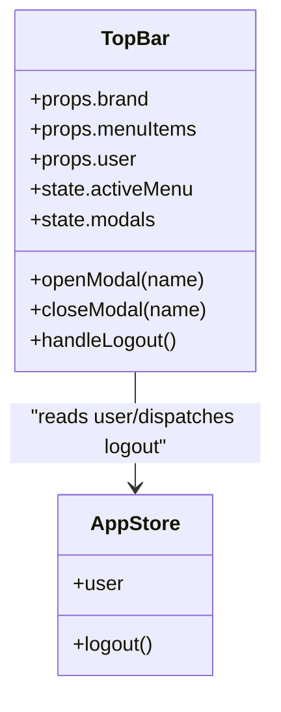
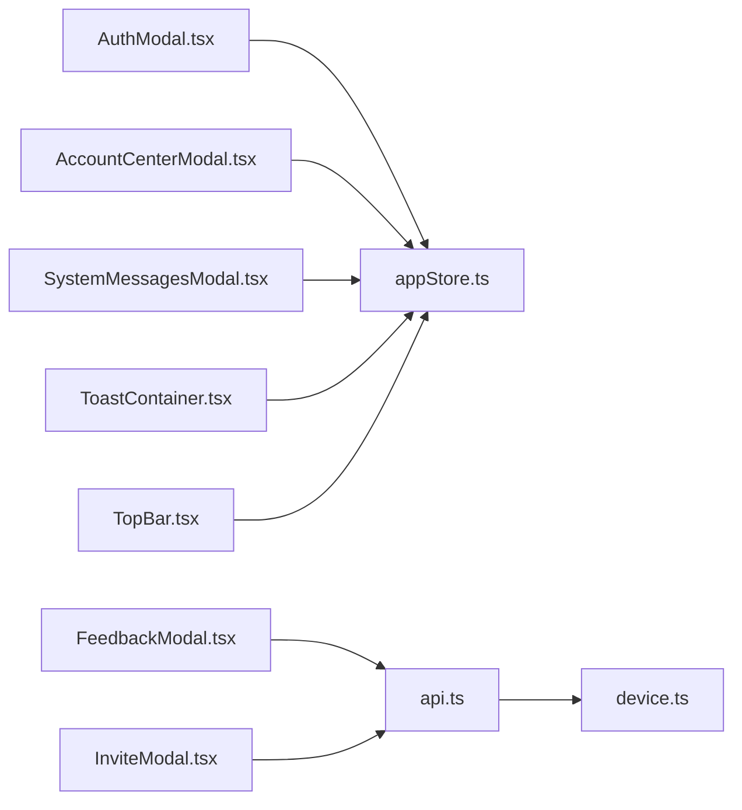

# UI Components Library

<cite>
**Referenced Files in This Document**
- [App.tsx](file://web/src/App.tsx)
- [main.tsx](file://web/src/main.tsx)
- [types.ts](file://web/src/types.ts)
- [appStore.ts](file://web/src/store/appStore.ts)
- [AuthModal.tsx](file://web/src/components/AuthModal.tsx)
- [AccountCenterModal.tsx](file://web/src/components/AccountCenterModal.tsx)
- [FeedbackModal.tsx](file://web/src/components/FeedbackModal.tsx)
- [InviteModal.tsx](file://web/src/components/InviteModal.tsx)
- [SystemMessagesModal.tsx](file://web/src/components/SystemMessagesModal.tsx)
- [ToastContainer.tsx](file://web/src/components/ToastContainer.tsx)
- [TopBar.tsx](file://web/src/components/TopBar.tsx)
- [api.ts](file://web/src/lib/api.ts)
- [device.ts](file://web/src/lib/device.ts)
</cite>

## Table of Contents
1. [Introduction](#introduction)
2. [Project Structure](#project-structure)
3. [Core Components](#core-components)
4. [Architecture Overview](#architecture-overview)
5. [Detailed Component Analysis](#detailed-component-analysis)
6. [Dependency Analysis](#dependency-analysis)
7. [Performance Considerations](#performance-considerations)
8. [Troubleshooting Guide](#troubleshooting-guide)
9. [Conclusion](#conclusion)
10. [Appendices](#appendices)

## Introduction
This document describes the reusable UI components library implemented in TypeScript and React. It focuses on modal components (AuthModal, AccountCenterModal, FeedbackModal, InviteModal, SystemMessagesModal), the ToastContainer notification system, and the TopBar navigation component. It explains props, events, composition patterns, internal state management, integration with the global store, customization approaches, accessibility features, responsive behavior, and cross-browser considerations.

## Project Structure
The UI components live under web/src/components and are consumed by the application entry points. The global store is defined under web/src/store, utilities under web/src/lib, and shared types under web/src/types.

**Diagram sources**
- [main.tsx](file://web/src/main.tsx)
- [App.tsx](file://web/src/App.tsx)
- [TopBar.tsx](file://web/src/components/TopBar.tsx)
- [AuthModal.tsx](file://web/src/components/AuthModal.tsx)
- [AccountCenterModal.tsx](file://web/src/components/AccountCenterModal.tsx)
- [FeedbackModal.tsx](file://web/src/components/FeedbackModal.tsx)
- [InviteModal.tsx](file://web/src/components/InviteModal.tsx)
- [SystemMessagesModal.tsx](file://web/src/components/SystemMessagesModal.tsx)
- [ToastContainer.tsx](file://web/src/components/ToastContainer.tsx)
- [appStore.ts](file://web/src/store/appStore.ts)
- [api.ts](file://web/src/lib/api.ts)
- [device.ts](file://web/src/lib/device.ts)

**Section sources**
- [main.tsx](file://web/src/main.tsx)
- [App.tsx](file://web/src/App.tsx)
- [appStore.ts](file://web/src/store/appStore.ts)
- [api.ts](file://web/src/lib/api.ts)
- [device.ts](file://web/src/lib/device.ts)

## Core Components
This section summarizes each component’s purpose, key props, events/callbacks, and typical usage patterns. For exact prop names and event handlers, refer to the component files and shared types.

- AuthModal
  - Purpose: Presents authentication flows (login/register) and integrates with the global store for session state.
  - Typical props: visibility flag, close callback, optional redirect or post-auth action, theme overrides.
  - Events/callbacks: onClose, onAuthSuccess, onAuthError.
  - Usage pattern: Controlled by parent state; opens via user action; updates global store on success.
  - Section sources
    - [AuthModal.tsx](file://web/src/components/AuthModal.tsx)
    - [appStore.ts](file://web/src/store/appStore.ts)
    - [types.ts](file://web/src/types.ts)

- AccountCenterModal
  - Purpose: Displays user profile/account details and allows editing settings.
  - Typical props: visible, onClose, initial data, save handler.
  - Events/callbacks: onSave, onCancel, onProfileUpdate.
  - Usage pattern: Opens from TopBar or after login; persists changes via API calls.
  - Section sources
    - [AccountCenterModal.tsx](file://web/src/components/AccountCenterModal.tsx)
    - [api.ts](file://web/src/lib/api.ts)
    - [types.ts](file://web/src/types.ts)

- FeedbackModal
  - Purpose: Collects user feedback and submits it to the backend.
  - Typical props: visible, onClose, category options, default values.
  - Events/callbacks: onSubmit, onSuccess, onError.
  - Usage pattern: Triggered from help or settings; uses api.ts to send payload.
  - Section sources
    - [FeedbackModal.tsx](file://web/src/components/FeedbackModal.tsx)
    - [api.ts](file://web/src/lib/api.ts)
    - [types.ts](file://web/src/types.ts)

- InviteModal
  - Purpose: Manages invitation workflows (generate/send invites).
  - Typical props: visible, onClose, quota info, invite actions.
  - Events/callbacks: onGenerate, onSend, onLimitReached.
  - Usage pattern: Integrated into account center or admin views; validates quotas before submission.
  - Section sources
    - [InviteModal.tsx](file://web/src/components/InviteModal.tsx)
    - [api.ts](file://web/src/lib/api.ts)
    - [types.ts](file://web/src/types.ts)

- SystemMessagesModal
  - Purpose: Shows system-wide messages and announcements.
  - Typical props: visible, onClose, message list, auto-dismiss duration.
  - Events/callbacks: onDismiss, onMarkRead.
  - Usage pattern: Reads from global store; marks messages as read; supports keyboard dismissal.
  - Section sources
    - [SystemMessagesModal.tsx](file://web/src/components/SystemMessagesModal.tsx)
    - [appStore.ts](file://web/src/store/appStore.ts)
    - [types.ts](file://web/src/types.ts)

- ToastContainer
  - Purpose: Centralized notification container that renders toasts globally.
  - Typical props: position, maxVisible, autoHideDuration, theme overrides.
  - Events/callbacks: onToastClick, onToastClose.
  - Usage pattern: Consumes global store to display notifications; supports programmatic show/hide.
  - Section sources
    - [ToastContainer.tsx](file://web/src/components/ToastContainer.tsx)
    - [appStore.ts](file://web/src/store/appStore.ts)
    - [types.ts](file://web/src/types.ts)

- TopBar
  - Purpose: Application header with navigation and quick actions (e.g., open modals).
  - Typical props: brand, menu items, user state, theme.
  - Events/callbacks: onMenuAction, onOpenModal, onLogout.
  - Usage pattern: Controls visibility of modals and navigates between sections; reads user state from store.
  - Section sources
    - [TopBar.tsx](file://web/src/components/TopBar.tsx)
    - [appStore.ts](file://web/src/store/appStore.ts)
    - [types.ts](file://web/src/types.ts)

## Architecture Overview
The UI layer composes components around a central store. Modals are typically controlled by parent state and may dispatch actions to update the store. Notifications are rendered by ToastContainer based on store state. Navigation and modal triggers originate from TopBar.

**Diagram sources**
- [TopBar.tsx](file://web/src/components/TopBar.tsx)
- [App.tsx](file://web/src/App.tsx)
- [AuthModal.tsx](file://web/src/components/AuthModal.tsx)
- [appStore.ts](file://web/src/store/appStore.ts)
- [api.ts](file://web/src/lib/api.ts)

## Detailed Component Analysis

### AuthModal
- Props
  - Visibility control (boolean)
  - Close callback
  - Post-auth redirect or action
  - Theme/style overrides
- Internal State
  - Form fields (email/password)
  - Validation errors
  - Loading/error states
- Events
  - onClose
  - onAuthSuccess
  - onAuthError
- Store Integration
  - Reads/writes session state
  - Subscribes to auth status
- Accessibility
  - Focus trap when open
  - ARIA roles for dialog and form fields
  - Keyboard support (Escape to close)
- Responsive Behavior
  - Full-screen on small devices
  - Centered card layout on larger screens
- Customization
  - Override colors, typography, spacing via props or CSS variables
- Example Usage Pattern
  - Controlled by parent state; open on button click; handle success by closing and navigating

**Diagram sources**
- [AuthModal.tsx](file://web/src/components/AuthModal.tsx)
- [appStore.ts](file://web/src/store/appStore.ts)
- [api.ts](file://web/src/lib/api.ts)

**Section sources**
- [AuthModal.tsx](file://web/src/components/AuthModal.tsx)
- [appStore.ts](file://web/src/store/appStore.ts)
- [api.ts](file://web/src/lib/api.ts)
- [types.ts](file://web/src/types.ts)

### AccountCenterModal
- Props
  - visible, onClose
  - Initial profile data
  - Save handler
- Internal State
  - Editable fields
  - Dirty tracking
  - Submission status
- Events
  - onSave
  - onCancel
  - onProfileUpdate
- Store Integration
  - Syncs with current user profile
- Accessibility
  - Dialog role, aria-labelledby
  - Tab order within modal
- Responsive Behavior
  - Stacked layout on mobile
- Customization
  - Field labels, validation messages, theme tokens
- Example Usage Pattern
  - Open from TopBar; persist changes via API; show toast on success

**Diagram sources**
- [AccountCenterModal.tsx](file://web/src/components/AccountCenterModal.tsx)
- [appStore.ts](file://web/src/store/appStore.ts)
- [api.ts](file://web/src/lib/api.ts)

**Section sources**
- [AccountCenterModal.tsx](file://web/src/components/AccountCenterModal.tsx)
- [appStore.ts](file://web/src/store/appStore.ts)
- [api.ts](file://web/src/lib/api.ts)
- [types.ts](file://web/src/types.ts)

### FeedbackModal
- Props
  - visible, onClose
  - Category options
  - Default values
- Internal State
  - Selected category
  - Message text
  - Validation and submission status
- Events
  - onSubmit
  - onSuccess
  - onError
- Store Integration
  - Optional: log feedback metadata
- Accessibility
  - Label associations for inputs
  - Error announcements via aria-live
- Responsive Behavior
  - Compact form on narrow screens
- Customization
  - Categories, placeholders, validation rules
- Example Usage Pattern
  - Trigger from help; submit via API; show success toast

**Diagram sources**
- [FeedbackModal.tsx](file://web/src/components/FeedbackModal.tsx)
- [api.ts](file://web/src/lib/api.ts)
- [ToastContainer.tsx](file://web/src/components/ToastContainer.tsx)

**Section sources**
- [FeedbackModal.tsx](file://web/src/components/FeedbackModal.tsx)
- [api.ts](file://web/src/lib/api.ts)
- [types.ts](file://web/src/types.ts)

### InviteModal
- Props
  - visible, onClose
  - Quota information
  - Invite actions
- Internal State
  - Recipient input(s)
  - Generation/loading states
  - Error handling
- Events
  - onGenerate
  - onSend
  - onLimitReached
- Store Integration
  - Reads quota from store if centralized
- Accessibility
  - Descriptive labels for inputs
  - Clear error messaging
- Responsive Behavior
  - Single-column layout on mobile
- Customization
  - Limits, templates, branding
- Example Usage Pattern
  - Validate quota; generate link; send via API; notify via toast

**Diagram sources**
- [InviteModal.tsx](file://web/src/components/InviteModal.tsx)
- [appStore.ts](file://web/src/store/appStore.ts)
- [api.ts](file://web/src/lib/api.ts)

**Section sources**
- [InviteModal.tsx](file://web/src/components/InviteModal.tsx)
- [appStore.ts](file://web/src/store/appStore.ts)
- [api.ts](file://web/src/lib/api.ts)
- [types.ts](file://web/src/types.ts)

### SystemMessagesModal
- Props
  - visible, onClose
  - Message list
  - Auto-dismiss duration
- Internal State
  - Active message index
  - Read/unread status
- Events
  - onDismiss
  - onMarkRead
- Store Integration
  - Reads messages from store; marks as read
- Accessibility
  - Live region for new messages
  - Keyboard navigation between messages
- Responsive Behavior
  - Scrollable list on small screens
- Customization
  - Message templates, colors, durations
- Example Usage Pattern
  - Auto-open on new critical message; dismissible; persists read state

**Diagram sources**
- [SystemMessagesModal.tsx](file://web/src/components/SystemMessagesModal.tsx)
- [appStore.ts](file://web/src/store/appStore.ts)

**Section sources**
- [SystemMessagesModal.tsx](file://web/src/components/SystemMessagesModal.tsx)
- [appStore.ts](file://web/src/store/appStore.ts)
- [types.ts](file://web/src/types.ts)

### ToastContainer
- Props
  - position (top/bottom, left/right)
  - maxVisible
  - autoHideDuration
  - theme overrides
- Internal State
  - Queue of active toasts
  - Timers for auto-hide
- Events
  - onToastClick
  - onToastClose
- Store Integration
  - Subscribes to global toast queue
- Accessibility
  - aria-live polite for announcements
  - Focus management when opening/closing
- Responsive Behavior
  - Stacks vertically; adjusts width on small screens
- Customization
  - Colors, spacing, animation durations
- Example Usage Pattern
  - Enqueue toasts from modals and API responses; auto-dismiss unless interactive

**Diagram sources**
- [ToastContainer.tsx](file://web/src/components/ToastContainer.tsx)
- [appStore.ts](file://web/src/store/appStore.ts)

**Section sources**
- [ToastContainer.tsx](file://web/src/components/ToastContainer.tsx)
- [appStore.ts](file://web/src/store/appStore.ts)
- [types.ts](file://web/src/types.ts)

### TopBar
- Props
  - Brand/logo
  - Menu items
  - User state
  - Theme
- Internal State
  - Active menu
  - Modal visibility flags
- Events
  - onMenuAction
  - onOpenModal
  - onLogout
- Store Integration
  - Reads user session; dispatches logout
- Accessibility
  - Semantic nav structure
  - Keyboard navigation for menu
- Responsive Behavior
  - Collapsible menu on small screens
- Customization
  - Brand assets, menu configuration, color tokens
- Example Usage Pattern
  - Triggers AuthModal, AccountCenterModal, FeedbackModal, InviteModal, SystemMessagesModal

**Diagram sources**
- [TopBar.tsx](file://web/src/components/TopBar.tsx)
- [appStore.ts](file://web/src/store/appStore.ts)

**Section sources**
- [TopBar.tsx](file://web/src/components/TopBar.tsx)
- [appStore.ts](file://web/src/store/appStore.ts)
- [types.ts](file://web/src/types.ts)

## Dependency Analysis
Components depend on the global store for shared state and on lib modules for networking and device capabilities.

**Diagram sources**
- [AuthModal.tsx](file://web/src/components/AuthModal.tsx)
- [AccountCenterModal.tsx](file://web/src/components/AccountCenterModal.tsx)
- [SystemMessagesModal.tsx](file://web/src/components/SystemMessagesModal.tsx)
- [ToastContainer.tsx](file://web/src/components/ToastContainer.tsx)
- [TopBar.tsx](file://web/src/components/TopBar.tsx)
- [FeedbackModal.tsx](file://web/src/components/FeedbackModal.tsx)
- [InviteModal.tsx](file://web/src/components/InviteModal.tsx)
- [appStore.ts](file://web/src/store/appStore.ts)
- [api.ts](file://web/src/lib/api.ts)
- [device.ts](file://web/src/lib/device.ts)

**Section sources**
- [appStore.ts](file://web/src/store/appStore.ts)
- [api.ts](file://web/src/lib/api.ts)
- [device.ts](file://web/src/lib/device.ts)

## Performance Considerations
- Keep modal content minimal; lazy-load heavy subcomponents when possible.
- Debounce rapid interactions (e.g., search or filter inside modals).
- Use memoization for expensive computations in modal forms.
- Avoid unnecessary re-renders by splitting large components and using stable references for callbacks.
- Prefer virtualized lists for long message or feedback histories.
- Throttle toast enqueues to prevent UI jank.

## Troubleshooting Guide
- Modal not closing
  - Ensure parent state is updated and passed back down correctly.
  - Verify onClose handlers are wired and not overridden.
- Toast not appearing
  - Confirm ToastContainer is mounted and subscribed to the store.
  - Check autoHideDuration and maxVisible limits.
- Network failures in Feedback/Invite
  - Inspect api.ts error paths and ensure proper retry or user feedback.
- Accessibility issues
  - Validate focus trapping and ARIA attributes in modals.
  - Test keyboard navigation and screen reader announcements.
- Responsive layout problems
  - Review media queries and flex/grid configurations in Tailwind or custom CSS.

## Conclusion
The UI components library provides a cohesive set of modals, a notification system, and a navigation bar built on React and TypeScript. They integrate with a central store for consistent state, follow accessibility best practices, and adapt to different screen sizes. By following the documented props, events, and composition patterns, developers can customize appearance, handle interactions, and extend the library with new modal types.

## Appendices

### Creating a New Modal Type
- Define props interface in types.ts or locally in the component file.
- Implement controlled visibility via parent state.
- Add internal state for form fields and submission status.
- Integrate with api.ts for persistence and appStore.ts for shared state.
- Provide accessible markup (role="dialog", aria-labelledby, focus trap).
- Wire up events (onClose, onSubmit, etc.) and show toasts via ToastContainer.

### Customizing Appearance
- Use theme props or CSS variables to override colors, typography, and spacing.
- Compose smaller presentational components for consistency.
- Apply responsive classes conditionally based on device detection from device.ts.

### Handling User Interactions
- Normalize input and validate before submission.
- Show inline errors and global toasts for system-level feedback.
- Debounce or throttle frequent actions to improve performance.

### Cross-Browser Compatibility
- Test focus management and modal backdrop behavior across browsers.
- Ensure polyfills or fallbacks for modern APIs used in device.ts or api.ts.
- Validate CSS grid/flex layouts and animations on target browsers.