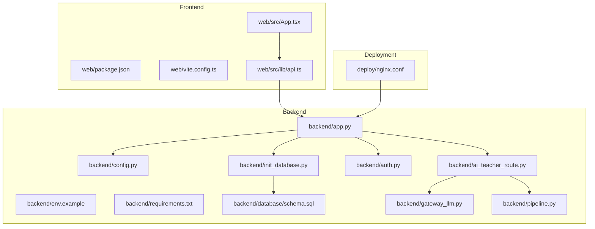
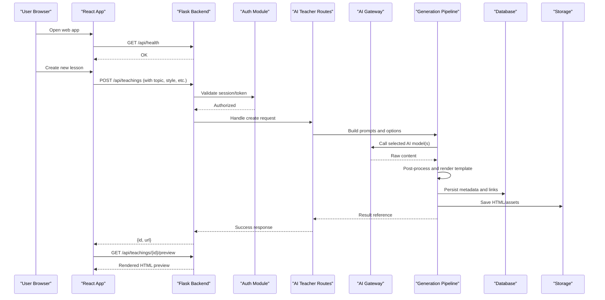

# Getting Started

<cite>
**Referenced Files in This Document**
- [backend/app.py](file://backend/app.py)
- [backend/config.py](file://backend/config.py)
- [backend/env.example](file://backend/env.example)
- [backend/requirements.txt](file://backend/requirements.txt)
- [backend/init_database.py](file://backend/init_database.py)
- [backend/database/schema.sql](file://backend/database/schema.sql)
- [backend/gateway_llm.py](file://backend/gateway_llm.py)
- [backend/pipeline.py](file://backend/pipeline.py)
- [backend/ai_teacher_route.py](file://backend/ai_teacher_route.py)
- [backend/auth.py](file://backend/auth.py)
- [web/package.json](file://web/package.json)
- [web/vite.config.ts](file://web/vite.config.ts)
- [web/src/lib/api.ts](file://web/src/lib/api.ts)
- [web/src/App.tsx](file://web/src/App.tsx)
- [deploy/nginx.conf](file://deploy/nginx.conf)
</cite>

## Table of Contents
1. [Introduction](#introduction)
2. [Project Structure](#project-structure)
3. [Core Components](#core-components)
4. [Architecture Overview](#architecture-overview)
5. [Installation and Setup](#installation-and-setup)
6. [First-Time Configuration](#first-time-configuration)
7. [Generate Your First Teaching Content](#generate-your-first-teaching-content)
8. [Essential Configuration Options](#essential-configuration-options)
9. [Development Workflow](#development-workflow)
10. [Troubleshooting Guide](#troubleshooting-guide)
11. [Conclusion](#conclusion)

## Introduction
XSYY Edu is an AI-powered educational content generation platform that helps teachers and creators produce high-quality teaching materials quickly. It combines a Flask-based backend with a React frontend, supports multiple AI models through a unified gateway, and uses template-driven rendering to generate structured HTML lessons. The system also includes user management, authentication, storage for generated assets, and optional vector search capabilities.

Key features:
- Multi-model AI integration via a configurable gateway
- Template-based content creation for consistent lesson structure
- Web interface for interactive authoring and preview
- REST API for programmatic access
- Persistent storage and database-backed metadata

## Project Structure
The repository follows a clear separation between backend (Python/Flask), frontend (React/Vite), deployment scripts, and shared resources.

**Diagram sources**
- [backend/app.py](file://backend/app.py)
- [backend/config.py](file://backend/config.py)
- [backend/env.example](file://backend/env.example)
- [backend/requirements.txt](file://backend/requirements.txt)
- [backend/init_database.py](file://backend/init_database.py)
- [backend/database/schema.sql](file://backend/database/schema.sql)
- [backend/gateway_llm.py](file://backend/gateway_llm.py)
- [backend/pipeline.py](file://backend/pipeline.py)
- [backend/ai_teacher_route.py](file://backend/ai_teacher_route.py)
- [backend/auth.py](file://backend/auth.py)
- [web/package.json](file://web/package.json)
- [web/vite.config.ts](file://web/vite.config.ts)
- [web/src/lib/api.ts](file://web/src/lib/api.ts)
- [web/src/App.tsx](file://web/src/App.tsx)
- [deploy/nginx.conf](file://deploy/nginx.conf)

**Section sources**
- [backend/app.py](file://backend/app.py)
- [web/src/App.tsx](file://web/src/App.tsx)
- [web/src/lib/api.ts](file://web/src/lib/api.ts)
- [web/vite.config.ts](file://web/vite.config.ts)
- [web/package.json](file://web/package.json)
- [backend/config.py](file://backend/config.py)
- [backend/env.example](file://backend/env.example)
- [backend/requirements.txt](file://backend/requirements.txt)
- [backend/init_database.py](file://backend/init_database.py)
- [backend/database/schema.sql](file://backend/database/schema.sql)
- [backend/gateway_llm.py](file://backend/gateway_llm.py)
- [backend/pipeline.py](file://backend/pipeline.py)
- [backend/ai_teacher_route.py](file://backend/ai_teacher_route.py)
- [backend/auth.py](file://backend/auth.py)
- [deploy/nginx.conf](file://deploy/nginx.conf)

## Core Components
- Backend application entrypoint and routing: central Flask app initializes configuration, routes, middleware, and services.
- Configuration loader: reads environment variables and provides typed settings to the app.
- Authentication module: handles login, registration, token issuance, and session validation.
- AI Gateway: abstracts calls to multiple LLM providers behind a single interface.
- Generation pipeline: orchestrates prompt assembly, model invocation, post-processing, and template rendering.
- Database initialization and schema: sets up tables and migrations required by the app.
- Frontend app and API client: React UI communicates with backend endpoints via a centralized API client.

**Section sources**
- [backend/app.py](file://backend/app.py)
- [backend/config.py](file://backend/config.py)
- [backend/auth.py](file://backend/auth.py)
- [backend/gateway_llm.py](file://backend/gateway_llm.py)
- [backend/pipeline.py](file://backend/pipeline.py)
- [backend/init_database.py](file://backend/init_database.py)
- [backend/database/schema.sql](file://backend/database/schema.sql)
- [web/src/lib/api.ts](file://web/src/lib/api.ts)
- [web/src/App.tsx](file://web/src/App.tsx)

## Architecture Overview
High-level flow from user request to generated content:

**Diagram sources**
- [backend/app.py](file://backend/app.py)
- [backend/auth.py](file://backend/auth.py)
- [backend/ai_teacher_route.py](file://backend/ai_teacher_route.py)
- [backend/pipeline.py](file://backend/pipeline.py)
- [backend/gateway_llm.py](file://backend/gateway_llm.py)
- [backend/init_database.py](file://backend/init_database.py)
- [backend/database/schema.sql](file://backend/database/schema.sql)
- [web/src/lib/api.ts](file://web/src/lib/api.ts)
- [web/src/App.tsx](file://web/src/App.tsx)

## Installation and Setup
Follow these steps to run XSYY Edu locally.

1. Prepare your environment
   - Python 3.10+ recommended
   - Node.js 18+ and npm or yarn
   - A relational database (SQLite for local dev; MySQL/PostgreSQL for production)

2. Install backend dependencies
   - Navigate to the backend directory
   - Install requirements using pip
   - Ensure virtualenv is active if used

3. Initialize the database
   - Run the database initialization script
   - Verify tables are created according to the schema

4. Start the backend server
   - Launch the Flask development server
   - Confirm health endpoint responds

5. Install frontend dependencies and build
   - Navigate to the web directory
   - Install Node packages
   - Build or start the development server

6. Configure reverse proxy (optional)
   - Use the provided nginx configuration as a starting point
   - Point it at the backend and frontend servers

**Section sources**
- [backend/requirements.txt](file://backend/requirements.txt)
- [backend/init_database.py](file://backend/init_database.py)
- [backend/database/schema.sql](file://backend/database/schema.sql)
- [backend/app.py](file://backend/app.py)
- [web/package.json](file://web/package.json)
- [web/vite.config.ts](file://web/vite.config.ts)
- [deploy/nginx.conf](file://deploy/nginx.conf)

## First-Time Configuration
Before running the app, configure environment variables.

- Copy the example environment file into your active environment
- Set database connection details
- Configure AI provider credentials and model selection
- Adjust storage paths and cache settings
- Define CORS origins and security tokens as needed
- Optionally set logging level and debug flags

After updating the environment file, restart the backend so changes take effect.

**Section sources**
- [backend/env.example](file://backend/env.example)
- [backend/config.py](file://backend/config.py)

## Generate Your First Teaching Content
You can generate content via the web interface or directly through API endpoints.

Using the web interface:
- Open the app in your browser
- Sign in or register if required
- Choose a topic, subject, and style
- Click “Generate” and wait for the result
- Preview and download the generated HTML

Using the API:
- Create a new teaching item by sending a POST request to the teachings endpoint with required fields such as topic, grade, and style
- Retrieve the generated content by fetching the preview endpoint with the returned ID
- Inspect the rendered HTML output

If you encounter errors, check authentication status, model availability, and network connectivity to the AI provider.

**Section sources**
- [web/src/lib/api.ts](file://web/src/lib/api.ts)
- [web/src/App.tsx](file://web/src/App.tsx)
- [backend/ai_teacher_route.py](file://backend/ai_teacher_route.py)
- [backend/pipeline.py](file://backend/pipeline.py)
- [backend/gateway_llm.py](file://backend/gateway_llm.py)

## Essential Configuration Options
Below are common configuration keys found in the environment example. Replace values with your own settings.

- Database
  - DATABASE_URL: Connection string for SQLite/MySQL/PostgreSQL
  - DATABASE_ECHO: Enable SQL logging in development

- AI Providers
  - GATEWAY_PROVIDER: Primary provider name
  - PROVIDER_API_KEY: Secret key for the chosen provider
  - MODEL_NAME: Model identifier to use for generation
  - TEMPERATURE, MAX_TOKENS: Generation parameters

- Storage
  - STORAGE_ROOT: Base path for storing generated HTML and assets
  - PREVIEW_FORMAT: Output format preference (e.g., HTML)

- Security and Sessions
  - SECRET_KEY: Application secret for signing sessions/tokens
  - JWT_EXPIRATION: Token lifetime in seconds
  - ALLOWED_ORIGINS: Comma-separated list of allowed CORS origins

- Logging and Debugging
  - LOG_LEVEL: One of DEBUG, INFO, WARNING, ERROR
  - DEBUG_MODE: Enable verbose error pages and auto-reload

For full details and defaults, refer to the configuration loader and the example environment file.

**Section sources**
- [backend/env.example](file://backend/env.example)
- [backend/config.py](file://backend/config.py)

## Development Workflow
Recommended patterns for efficient development:

- Local development
  - Run the Flask dev server with hot reload enabled
  - Start the Vite dev server for the frontend
  - Keep both terminals open and refresh the browser after changes

- Environment management
  - Maintain separate .env files for dev and prod
  - Never commit secrets; use templates and CI secrets

- Testing
  - Run unit and integration tests from the backend tests directory
  - Use provided scripts to execute test suites on Windows and Unix

- Database changes
  - Update schema.sql when adding tables or columns
  - Re-run the initialization script or apply migrations as needed

- Deployment
  - Use the provided deploy scripts and nginx configuration
  - Pin versions in requirements.txt and package-lock.json

**Section sources**
- [backend/app.py](file://backend/app.py)
- [web/vite.config.ts](file://web/vite.config.ts)
- [backend/requirements.txt](file://backend/requirements.txt)
- [web/package.json](file://web/package.json)
- [backend/init_database.py](file://backend/init_database.py)
- [backend/database/schema.sql](file://backend/database/schema.sql)
- [deploy/nginx.conf](file://deploy/nginx.conf)

## Troubleshooting Guide
Common issues and quick fixes:

- Cannot connect to the database
  - Verify DATABASE_URL and credentials
  - Ensure the database service is running and accessible
  - Check permissions for the configured user

- AI provider errors
  - Confirm API keys and model names are correct
  - Test connectivity to the provider’s endpoint
  - Review rate limits and quotas

- CORS failures from the frontend
  - Add your frontend origin to ALLOWED_ORIGINS
  - Ensure the backend is reachable from the browser

- Missing static assets or preview not rendering
  - Confirm STORAGE_ROOT exists and is writable
  - Check file permissions and disk space

- Authentication problems
  - Verify SECRET_KEY and JWT_EXPIRATION settings
  - Clear cookies and retry login

- Port conflicts
  - Change the backend or frontend port in configuration
  - Update nginx upstream targets accordingly

For deeper diagnostics, enable DEBUG_MODE and inspect logs.

**Section sources**
- [backend/config.py](file://backend/config.py)
- [backend/env.example](file://backend/env.example)
- [backend/auth.py](file://backend/auth.py)
- [backend/gateway_llm.py](file://backend/gateway_llm.py)
- [deploy/nginx.conf](file://deploy/nginx.conf)

## Conclusion
You now have the essentials to install, configure, and run XSYY Edu. Start by setting up your environment and database, then generate your first lesson using either the web interface or API. As you grow your usage, explore advanced configuration, multi-model setups, and deployment strategies documented in the referenced sections.