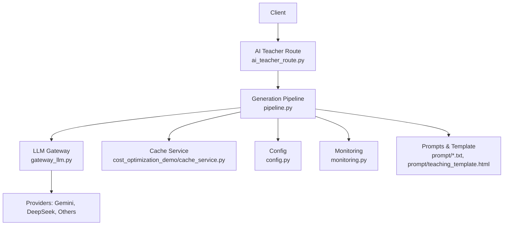
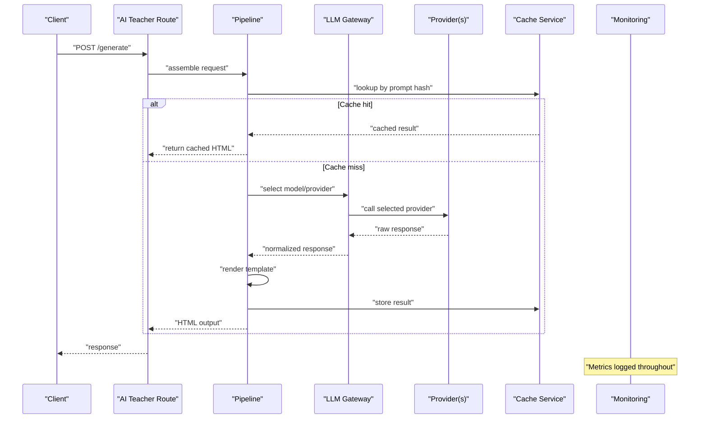
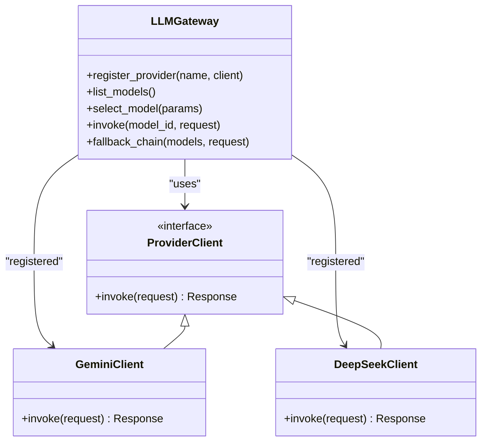
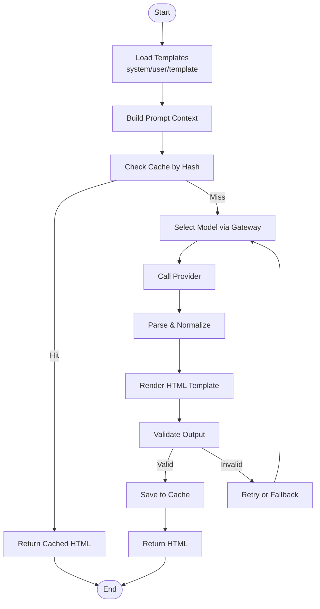
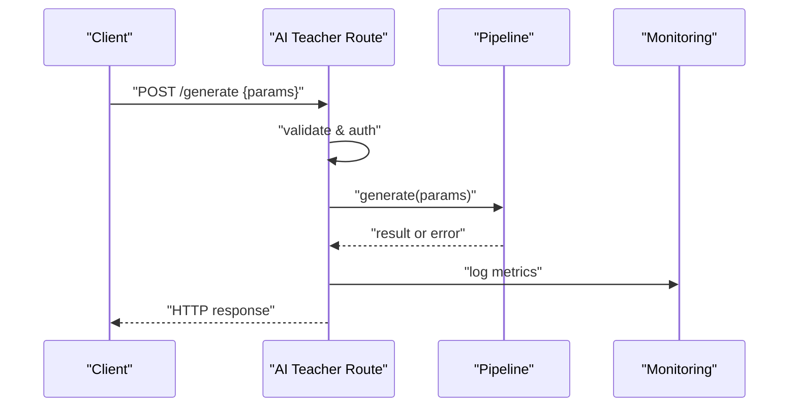
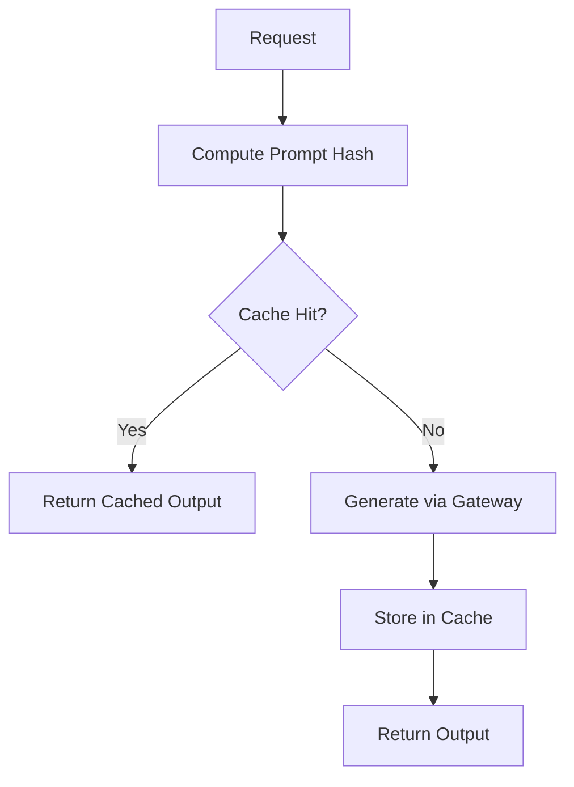
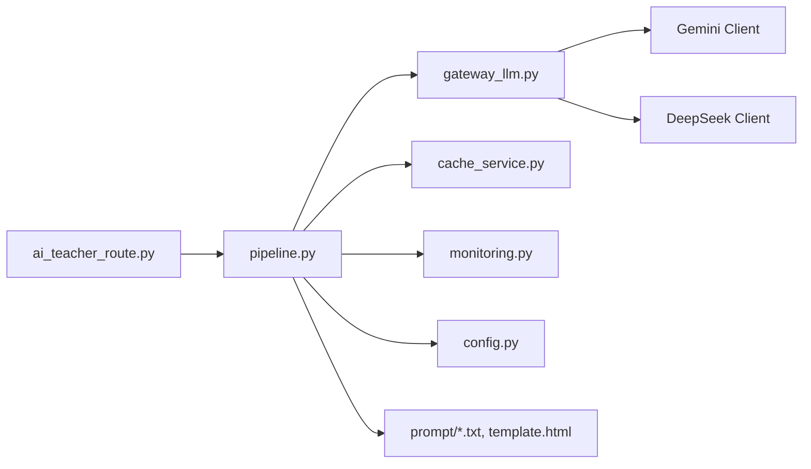

# AI Model Gateway

<cite>
**Referenced Files in This Document**
- [gateway_llm.py](file://backend/gateway_llm.py)
- [pipeline.py](file://backend/pipeline.py)
- [ai_teacher_route.py](file://backend/ai_teacher_route.py)
- [config.py](file://backend/config.py)
- [monitoring.py](file://backend/monitoring.py)
- [cost_optimization_demo/main_service.py](file://backend/cost_optimization_demo/main_service.py)
- [cost_optimization_demo/cache_service.py](file://backend/cost_optimization_demo/cache_service.py)
- [cost_optimization_demo/config.py](file://backend/cost_optimization_demo/config.py)
- [prompt/teaching_system_prompt.txt](file://backend/prompt/teaching_system_prompt.txt)
- [prompt/teaching_user_prompt.txt](file://backend/prompt/teaching_user_prompt.txt)
- [prompt/teaching_template.html](file://backend/prompt/teaching_template.html)
</cite>

## Table of Contents
1. [Introduction](#introduction)
2. [Project Structure](#project-structure)
3. [Core Components](#core-components)
4. [Architecture Overview](#architecture-overview)
5. [Detailed Component Analysis](#detailed-component-analysis)
6. [Dependency Analysis](#dependency-analysis)
7. [Performance Considerations](#performance-considerations)
8. [Troubleshooting Guide](#troubleshooting-guide)
9. [Conclusion](#conclusion)
10. [Appendices](#appendices)

## Introduction
This document describes the AI model gateway system that abstracts multiple LLM providers (Gemini, DeepSeek, and others), selects models based on cost and quality signals, and generates HTML teaching content through a structured pipeline. It covers provider abstraction, model selection algorithms, fallback strategies, caching, rate limiting, error handling, monitoring, and guidance for adding new providers and customizing workflows.

## Project Structure
The gateway spans several backend modules:
- Provider abstraction and routing: gateway_llm.py
- Generation pipeline orchestration: pipeline.py
- API route exposing generation endpoints: ai_teacher_route.py
- Configuration and environment: config.py
- Monitoring and metrics: monitoring.py
- Cost optimization demo with cache service: cost_optimization_demo/*

**Diagram sources**
- [ai_teacher_route.py](file://backend/ai_teacher_route.py)
- [pipeline.py](file://backend/pipeline.py)
- [gateway_llm.py](file://backend/gateway_llm.py)
- [cache_service.py](file://backend/cost_optimization_demo/cache_service.py)
- [config.py](file://backend/config.py)
- [monitoring.py](file://backend/monitoring.py)
- [teaching_system_prompt.txt](file://backend/prompt/teaching_system_prompt.txt)
- [teaching_user_prompt.txt](file://backend/prompt/teaching_user_prompt.txt)
- [teaching_template.html](file://backend/prompt/teaching_template.html)

**Section sources**
- [ai_teacher_route.py](file://backend/ai_teacher_route.py)
- [pipeline.py](file://backend/pipeline.py)
- [gateway_llm.py](file://backend/gateway_llm.py)
- [config.py](file://backend/config.py)
- [monitoring.py](file://backend/monitoring.py)
- [main_service.py](file://backend/cost_optimization_demo/main_service.py)
- [cache_service.py](file://backend/cost_optimization_demo/cache_service.py)
- [config.py](file://backend/cost_optimization_demo/config.py)
- [teaching_system_prompt.txt](file://backend/prompt/teaching_system_prompt.txt)
- [teaching_user_prompt.txt](file://backend/prompt/teaching_user_prompt.txt)
- [teaching_template.html](file://backend/prompt/teaching_template.html)

## Core Components
- LLM Gateway: Abstracts provider-specific clients, normalizes requests/responses, and implements selection and fallback logic.
- Generation Pipeline: Orchestrates prompt assembly, provider invocation, template rendering, caching, and output validation.
- API Route: Exposes HTTP endpoints to trigger generation, accept parameters, and return results.
- Cost Optimization Demo: Demonstrates caching strategies and configuration-driven provider behavior.
- Monitoring: Tracks usage, latency, errors, and costs for observability.

Key responsibilities:
- Multi-provider abstraction with unified interface
- Model selection algorithm balancing cost, latency, and quality
- Fallback chain across providers/models
- Prompt templating and HTML generation
- Caching of prompts and outputs
- Rate limiting and retry/backoff
- Metrics and audit logging

**Section sources**
- [gateway_llm.py](file://backend/gateway_llm.py)
- [pipeline.py](file://backend/pipeline.py)
- [ai_teacher_route.py](file://backend/ai_teacher_route.py)
- [main_service.py](file://backend/cost_optimization_demo/main_service.py)
- [cache_service.py](file://backend/cost_optimization_demo/cache_service.py)
- [config.py](file://backend/config.py)
- [monitoring.py](file://backend/monitoring.py)

## Architecture Overview
The system follows a layered architecture:
- Presentation layer: API routes handle incoming requests and responses.
- Orchestration layer: Pipeline coordinates prompt processing, caching, provider calls, and template rendering.
- Abstraction layer: Gateway provides a uniform interface over multiple LLM providers.
- Data and storage: Cache service stores prompt hashes and generated outputs; templates define final HTML structure.
- Observability: Monitoring records metrics and logs for performance and cost tracking.

**Diagram sources**
- [ai_teacher_route.py](file://backend/ai_teacher_route.py)
- [pipeline.py](file://backend/pipeline.py)
- [gateway_llm.py](file://backend/gateway_llm.py)
- [cache_service.py](file://backend/cost_optimization_demo/cache_service.py)
- [monitoring.py](file://backend/monitoring.py)

## Detailed Component Analysis

### LLM Gateway: Multi-Provider Abstraction
Responsibilities:
- Unified client interface for Gemini, DeepSeek, and other providers
- Request normalization and response parsing
- Model registry and capability metadata
- Selection strategy and fallback chain

Selection and fallback:
- Input parameters include cost sensitivity, latency targets, and quality preferences.
- Models are scored using a weighted formula combining estimated cost, expected latency, and historical quality.
- Fallback chain iterates through ranked models until success or exhaustion.

Error handling:
- Network timeouts, rate limits, and provider errors are caught and retried with exponential backoff.
- Circuit breaker patterns can be applied per provider/model to avoid cascading failures.

**Section sources**
- [gateway_llm.py](file://backend/gateway_llm.py)

### Generation Pipeline: From Prompt to HTML
Responsibilities:
- Assemble system and user prompts from templates and inputs
- Invoke gateway with selected model
- Render final HTML using template engine
- Cache prompt-output pairs and validate outputs

Prompt and template integration:
- System prompt defines role and constraints.
- User prompt includes task context and formatting instructions.
- HTML template ensures consistent structure and styling.

**Section sources**
- [pipeline.py](file://backend/pipeline.py)
- [teaching_system_prompt.txt](file://backend/prompt/teaching_system_prompt.txt)
- [teaching_user_prompt.txt](file://backend/prompt/teaching_user_prompt.txt)
- [teaching_template.html](file://backend/prompt/teaching_template.html)

### API Route: Entry Point for Generation
Responsibilities:
- Accept HTTP requests with generation parameters
- Validate inputs and authenticate if required
- Delegate to pipeline and return standardized responses
- Track usage and errors via monitoring

**Section sources**
- [ai_teacher_route.py](file://backend/ai_teacher_route.py)
- [monitoring.py](file://backend/monitoring.py)

### Cost Optimization Demo: Caching and Configuration
Highlights:
- Cache service stores prompt hashes and generated outputs to reduce redundant calls.
- Configuration drives provider selection, cost thresholds, and cache policies.
- Main service demonstrates end-to-end flow with cost-aware decisions.

**Section sources**
- [main_service.py](file://backend/cost_optimization_demo/main_service.py)
- [cache_service.py](file://backend/cost_optimization_demo/cache_service.py)
- [config.py](file://backend/cost_optimization_demo/config.py)

## Dependency Analysis
The gateway depends on:
- Provider clients for Gemini and DeepSeek
- Template engine for HTML rendering
- Cache service for prompt/output storage
- Monitoring module for metrics and logs
- Configuration module for runtime settings

**Diagram sources**
- [ai_teacher_route.py](file://backend/ai_teacher_route.py)
- [pipeline.py](file://backend/pipeline.py)
- [gateway_llm.py](file://backend/gateway_llm.py)
- [cache_service.py](file://backend/cost_optimization_demo/cache_service.py)
- [monitoring.py](file://backend/monitoring.py)
- [config.py](file://backend/config.py)
- [teaching_system_prompt.txt](file://backend/prompt/teaching_system_prompt.txt)
- [teaching_user_prompt.txt](file://backend/prompt/teaching_user_prompt.txt)
- [teaching_template.html](file://backend/prompt/teaching_template.html)

**Section sources**
- [gateway_llm.py](file://backend/gateway_llm.py)
- [pipeline.py](file://backend/pipeline.py)
- [ai_teacher_route.py](file://backend/ai_teacher_route.py)
- [cache_service.py](file://backend/cost_optimization_demo/cache_service.py)
- [monitoring.py](file://backend/monitoring.py)
- [config.py](file://backend/config.py)

## Performance Considerations
- Caching: Use prompt hashing to avoid repeated calls; configure TTL and eviction policies.
- Rate Limiting: Implement per-provider quotas and backoff strategies; respect provider limits.
- Concurrency: Parallelize independent tasks like prompt assembly and cache lookups.
- Latency: Prefer faster models for low-latency paths; use streaming where supported.
- Memory: Stream large outputs; avoid loading entire responses into memory.
- Monitoring: Track latency percentiles, error rates, and cost per request.

[No sources needed since this section provides general guidance]

## Troubleshooting Guide
Common issues and resolutions:
- Provider errors: Inspect error codes and messages; enable retries with backoff; check circuit breaker state.
- Rate limit exceeded: Reduce concurrency; implement adaptive throttling; monitor quota usage.
- Cache misses: Verify hash computation; ensure consistent prompt formatting; inspect cache storage health.
- Template rendering failures: Validate template syntax; sanitize inputs; log rendered previews.
- Monitoring gaps: Ensure metrics are emitted at each stage; verify log aggregation and alerting.

**Section sources**
- [monitoring.py](file://backend/monitoring.py)
- [cache_service.py](file://backend/cost_optimization_demo/cache_service.py)
- [pipeline.py](file://backend/pipeline.py)

## Conclusion
The AI model gateway provides a robust, extensible foundation for multi-provider LLM integration. With clear separation of concerns, strong caching and monitoring, and flexible model selection, it supports cost optimization and high availability. Adding new providers and customizing workflows is straightforward through the defined interfaces and configuration.

[No sources needed since this section summarizes without analyzing specific files]

## Appendices

### Adding a New AI Provider
Steps:
- Implement a provider client adhering to the unified interface.
- Register the client in the gateway’s provider registry.
- Add model metadata (capabilities, cost, latency estimates).
- Update selection weights and fallback order if needed.
- Test end-to-end with the pipeline and monitoring enabled.

[No sources needed since this section provides general guidance]

### Customizing the Generation Workflow
Options:
- Modify prompt templates to adjust tone, structure, or domain focus.
- Introduce additional preprocessing steps (e.g., input sanitization, enrichment).
- Extend the selection algorithm with new scoring factors (quality scores, regional compliance).
- Integrate external validators or post-processors for output assurance.

[No sources needed since this section provides general guidance]

### Usage Tracking and Quality Assurance
- Track per-request metrics: provider, model, tokens, latency, cost, status.
- Log prompt hashes and outputs for reproducibility and auditing.
- Implement automated checks for output validity and template compliance.
- Periodically review quality metrics and adjust selection weights accordingly.

[No sources needed since this section provides general guidance]