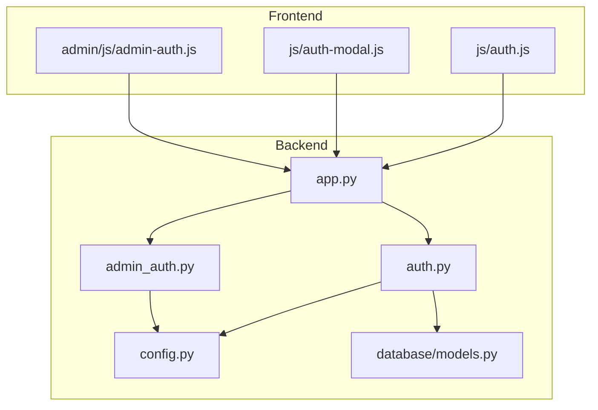
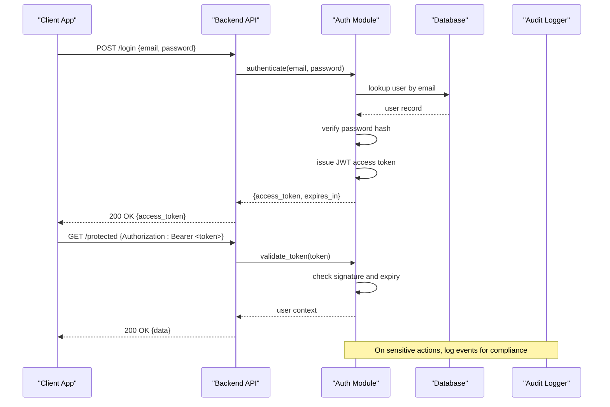
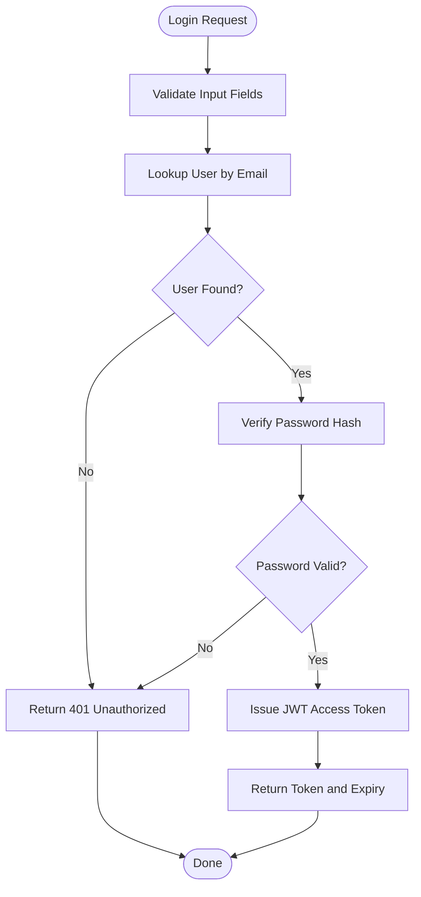
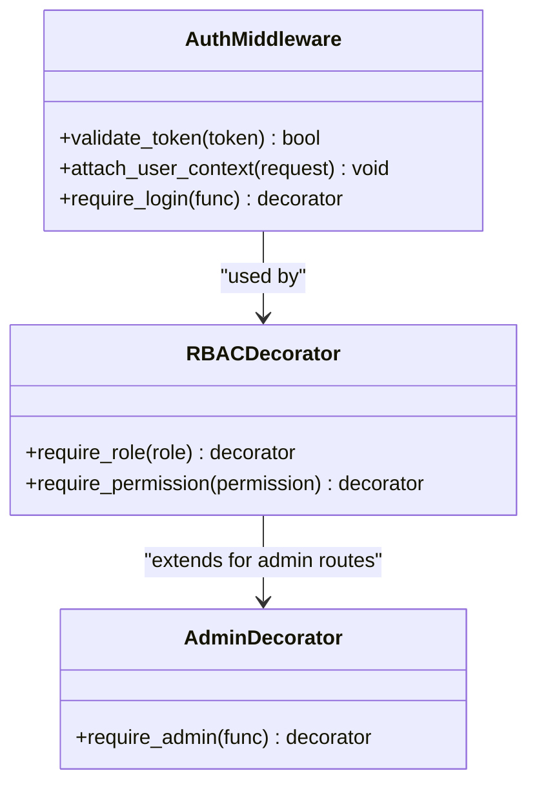
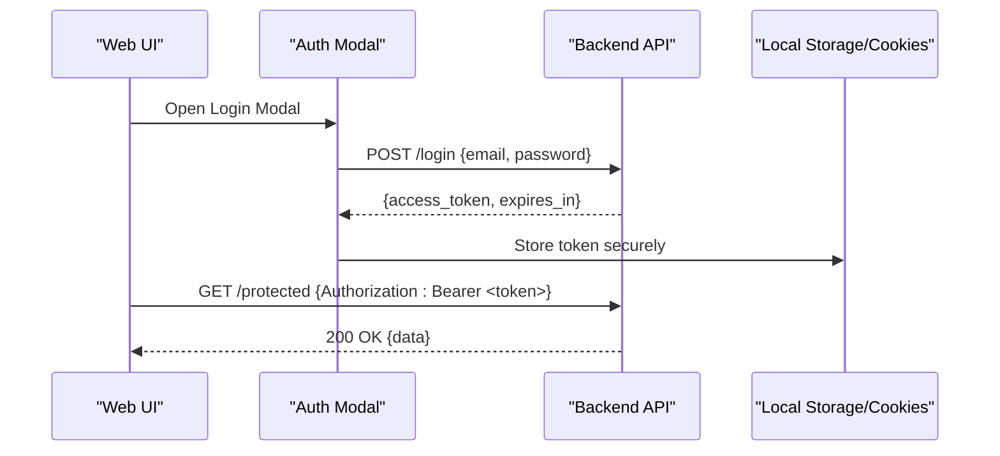
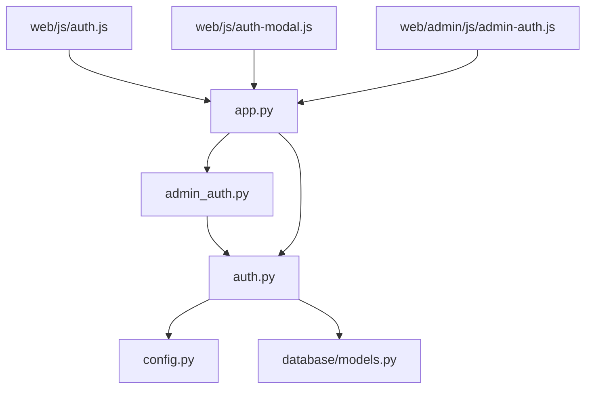

# Authentication & Authorization

<cite>
**Referenced Files in This Document**
- [auth.py](file://backend/auth.py)
- [admin_auth.py](file://backend/admin_auth.py)
- [app.py](file://backend/app.py)
- [config.py](file://backend/config.py)
- [models.py](file://backend/database/models.py)
- [test_api_auth.py](file://backend/tests/integration/test_api_auth.py)
- [auth.js](file://web/js/auth.js)
- [auth-modal.js](file://web/js/auth-modal.js)
- [admin-auth.js](file://web/admin/js/admin-auth.js)
</cite>

## Table of Contents
1. [Introduction](#introduction)
2. [Project Structure](#project-structure)
3. [Core Components](#core-components)
4. [Architecture Overview](#architecture-overview)
5. [Detailed Component Analysis](#detailed-component-analysis)
6. [Dependency Analysis](#dependency-analysis)
7. [Performance Considerations](#performance-considerations)
8. [Troubleshooting Guide](#troubleshooting-guide)
9. [Conclusion](#conclusion)
10. [Appendices](#appendices)

## Introduction
This document explains the authentication and authorization system implemented in the backend and frontend. It covers JWT-based authentication, user session management, role-based access control (RBAC), middleware decorators for protecting endpoints, admin privilege verification, permission checks, and security considerations such as token expiration, refresh tokens, brute force protection, password hashing, user validation, and audit logging. It also provides guidance on implementing custom authentication decorators and integrating with external auth providers.

## Project Structure
The authentication and authorization features are primarily implemented in the backend Python application with supporting JavaScript modules in the web frontend. Key areas include:
- Backend authentication logic and middleware
- Admin-specific authorization
- Configuration for secrets and token settings
- Database models for users and roles
- Frontend flows for login, token storage, and protected requests
- Integration tests validating authentication behavior

**Diagram sources**
- [app.py](file://backend/app.py)
- [auth.py](file://backend/auth.py)
- [admin_auth.py](file://backend/admin_auth.py)
- [config.py](file://backend/config.py)
- [models.py](file://backend/database/models.py)
- [auth.js](file://web/js/auth.js)
- [auth-modal.js](file://web/js/auth-modal.js)
- [admin-auth.js](file://web/admin/js/admin-auth.js)

**Section sources**
- [app.py](file://backend/app.py)
- [auth.py](file://backend/auth.py)
- [admin_auth.py](file://backend/admin_auth.py)
- [config.py](file://backend/config.py)
- [models.py](file://backend/database/models.py)
- [auth.js](file://web/js/auth.js)
- [auth-modal.js](file://web/js/auth-modal.js)
- [admin-auth.js](file://web/admin/js/admin-auth.js)

## Core Components
- JWT Token Issuance and Validation: Centralized functions to create signed tokens, verify signatures, decode payloads, and enforce expiration.
- Middleware Decorators: Reusable decorators that validate tokens, attach user context to requests, and enforce RBAC policies.
- Admin Privilege Verification: Additional checks ensuring only users with admin roles can access administrative endpoints.
- Permission Checking Mechanisms: Fine-grained checks based on roles or explicit permissions attached to the user context.
- Session Management: Stateless sessions using JWTs; optional server-side revocation lists for logout and rotation.
- Security Controls: Password hashing, input validation, rate limiting, and audit logging hooks.

**Section sources**
- [auth.py](file://backend/auth.py)
- [admin_auth.py](file://backend/admin_auth.py)
- [config.py](file://backend/config.py)
- [models.py](file://backend/database/models.py)

## Architecture Overview
The system follows a stateless JWT architecture:
- Clients authenticate via login endpoints and receive short-lived access tokens.
- Subsequent requests include the token in the Authorization header.
- Middleware validates the token, extracts user identity and roles, and enforces RBAC before invoking route handlers.
- Admin routes require additional privilege checks beyond standard user roles.
- Optional refresh tokens can be used to obtain new access tokens without re-authentication.

**Diagram sources**
- [auth.py](file://backend/auth.py)
- [app.py](file://backend/app.py)
- [models.py](file://backend/database/models.py)

## Detailed Component Analysis

### JWT Authentication Flow
- Login Endpoint: Accepts credentials, verifies against stored hashes, and issues an access token with a defined expiration.
- Token Payload: Contains user identifier, roles, and optional claims needed for authorization decisions.
- Token Validation: Middleware verifies signature, checks expiration, and optionally checks revocation status.
- Refresh Tokens: If implemented, clients exchange a valid refresh token for a new access token without prompting for credentials.

**Diagram sources**
- [auth.py](file://backend/auth.py)
- [models.py](file://backend/database/models.py)

**Section sources**
- [auth.py](file://backend/auth.py)
- [models.py](file://backend/database/models.py)

### Middleware Decorators for Protected Endpoints
- Authentication Decorator: Validates the Authorization header, decodes the JWT, attaches user context to the request, and rejects invalid or expired tokens.
- Role-Based Decorator: Ensures the authenticated user has required roles or permissions before allowing access.
- Admin Decorator: Enforces that only users with admin privileges can call administrative endpoints.

**Diagram sources**
- [auth.py](file://backend/auth.py)
- [admin_auth.py](file://backend/admin_auth.py)

**Section sources**
- [auth.py](file://backend/auth.py)
- [admin_auth.py](file://backend/admin_auth.py)

### Admin Privilege Verification
- Admin routes are guarded by dedicated decorators that check user roles or explicit admin flags.
- Admin operations often trigger additional audit logs and stricter validation.
- Separation of concerns ensures regular users cannot escalate privileges through misconfigured routes.

**Section sources**
- [admin_auth.py](file://backend/admin_auth.py)
- [auth.py](file://backend/auth.py)

### Permission Checking Mechanisms
- Permissions can be derived from roles or stored explicitly per user.
- Fine-grained checks allow differentiating between read-only and write operations.
- Centralized policy evaluation simplifies maintaining consistent access rules across endpoints.

**Section sources**
- [auth.py](file://backend/auth.py)
- [models.py](file://backend/database/models.py)

### Frontend Authentication Integration
- The frontend stores tokens securely (e.g., httpOnly cookies or memory) and includes them in subsequent requests.
- Login modal handles credential submission and error feedback.
- Admin-specific scripts enforce client-side checks and redirect unauthorized attempts.

**Diagram sources**
- [auth.js](file://web/js/auth.js)
- [auth-modal.js](file://web/js/auth-modal.js)
- [admin-auth.js](file://web/admin/js/admin-auth.js)

**Section sources**
- [auth.js](file://web/js/auth.js)
- [auth-modal.js](file://web/js/auth-modal.js)
- [admin-auth.js](file://web/admin/js/admin-auth.js)

### Security Considerations
- Token Expiration: Short-lived access tokens reduce risk if leaked; implement refresh tokens for seamless renewal.
- Brute Force Protection: Rate-limit login attempts and consider account lockout after repeated failures.
- Password Hashing: Use strong algorithms (e.g., bcrypt/argon2) with unique salts per user.
- Input Validation: Sanitize and validate all inputs to prevent injection and malformed payloads.
- Audit Logging: Record authentication events, privilege escalations, and sensitive operations for compliance.

**Section sources**
- [config.py](file://backend/config.py)
- [auth.py](file://backend/auth.py)

### Implementing Custom Authentication Decorators
- Define a decorator factory that accepts parameters (roles, permissions).
- Inside the decorator, validate the token and evaluate the policy against the user context.
- Raise appropriate HTTP errors for unauthorized or forbidden scenarios.
- Integrate with existing middleware to ensure consistent behavior across endpoints.

**Section sources**
- [auth.py](file://backend/auth.py)
- [admin_auth.py](file://backend/admin_auth.py)

### Integrating with External Auth Providers
- Configure provider-specific settings (client ID, secret, scopes) in configuration.
- Implement callback handling to exchange authorization codes for tokens.
- Map external identities to internal user records and roles.
- Maintain consistency in token formats and validation logic.

**Section sources**
- [config.py](file://backend/config.py)
- [auth.py](file://backend/auth.py)

## Dependency Analysis
Authentication components depend on configuration for secrets and token settings, database models for user data, and middleware for request processing. Frontend modules rely on backend endpoints and secure storage practices.

**Diagram sources**
- [auth.py](file://backend/auth.py)
- [admin_auth.py](file://backend/admin_auth.py)
- [app.py](file://backend/app.py)
- [config.py](file://backend/config.py)
- [models.py](file://backend/database/models.py)
- [auth.js](file://web/js/auth.js)
- [auth-modal.js](file://web/js/auth-modal.js)
- [admin-auth.js](file://web/admin/js/admin-auth.js)

**Section sources**
- [auth.py](file://backend/auth.py)
- [admin_auth.py](file://backend/admin_auth.py)
- [app.py](file://backend/app.py)
- [config.py](file://backend/config.py)
- [models.py](file://backend/database/models.py)
- [auth.js](file://web/js/auth.js)
- [auth-modal.js](file://web/js/auth-modal.js)
- [admin-auth.js](file://web/admin/js/admin-auth.js)

## Performance Considerations
- Keep JWT payloads minimal to reduce overhead.
- Cache frequently accessed user profiles when necessary.
- Avoid synchronous I/O in critical paths; use asynchronous operations where possible.
- Implement efficient token validation without unnecessary database calls.

[No sources needed since this section provides general guidance]

## Troubleshooting Guide
Common issues and resolutions:
- Invalid Token Errors: Check signature, expiration, and issuer configuration.
- Forbidden Responses: Verify user roles and permissions assigned to the endpoint.
- Login Failures: Ensure password hashing matches and input validation is correct.
- Rate Limiting: Review thresholds and adjust based on expected traffic patterns.

**Section sources**
- [test_api_auth.py](file://backend/tests/integration/test_api_auth.py)
- [auth.py](file://backend/auth.py)

## Conclusion
The authentication and authorization system leverages JWTs for secure, stateless access control, reinforced by middleware decorators and RBAC policies. Admin privileges are enforced separately, and security measures such as token expiration, password hashing, and audit logging support compliance. Frontend integration ensures seamless user experiences while maintaining robust security boundaries.

[No sources needed since this section summarizes without analyzing specific files]

## Appendices
- Example usage patterns for decorators and endpoints
- Configuration keys for token settings and provider integrations
- Checklist for security hardening and compliance audits

[No sources needed since this section provides general guidance]