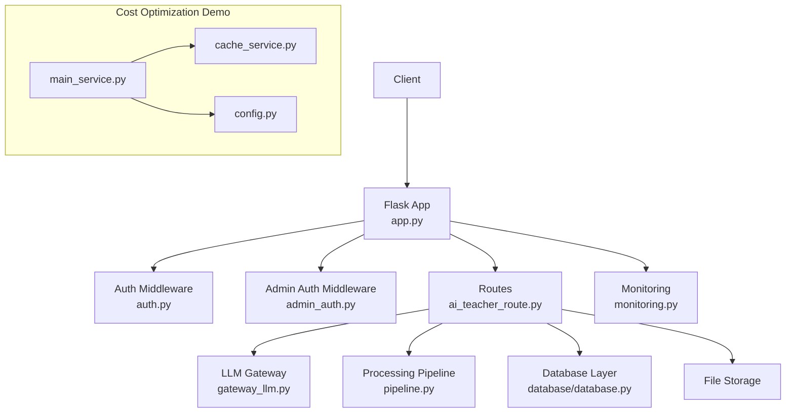
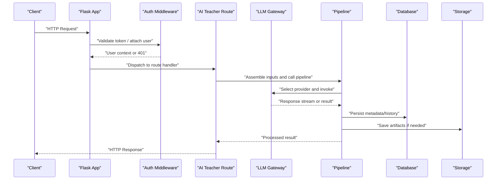
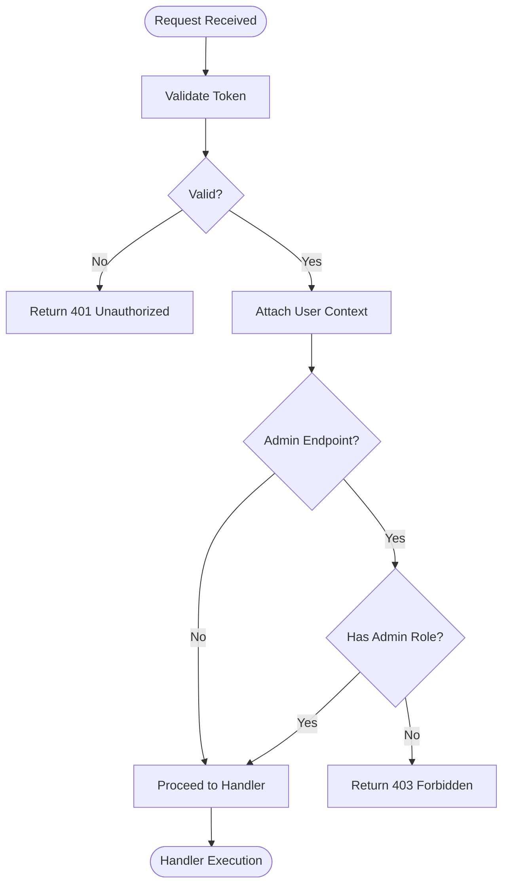
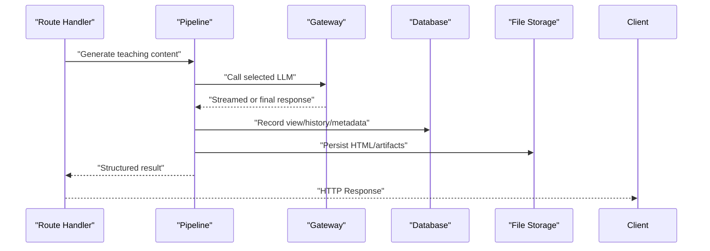
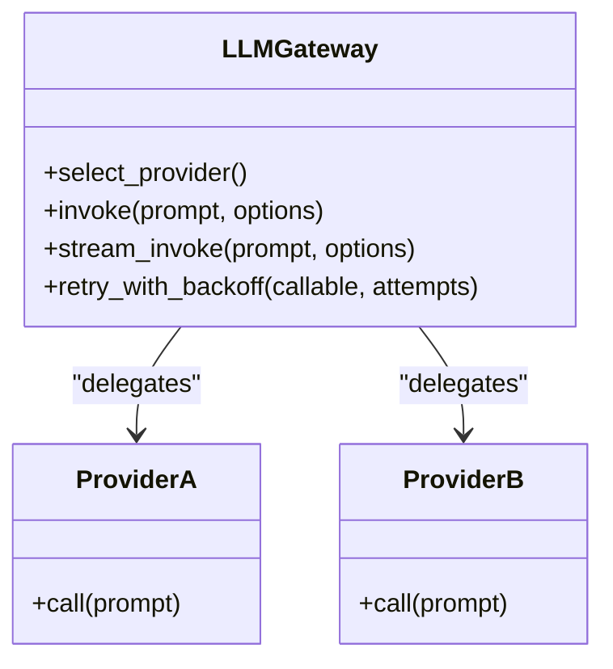
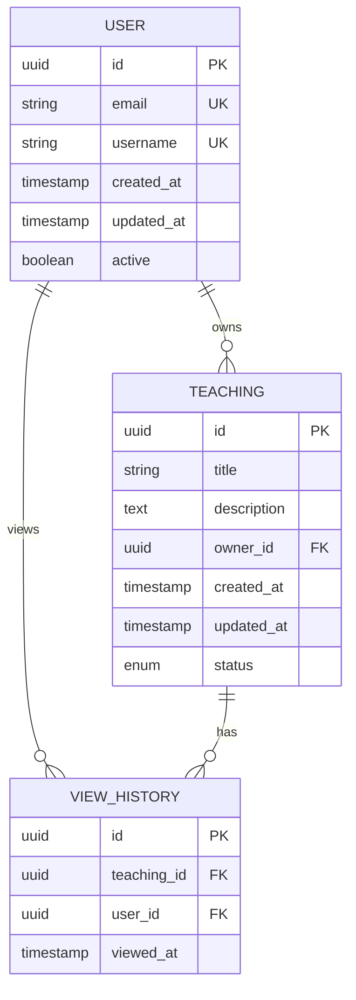
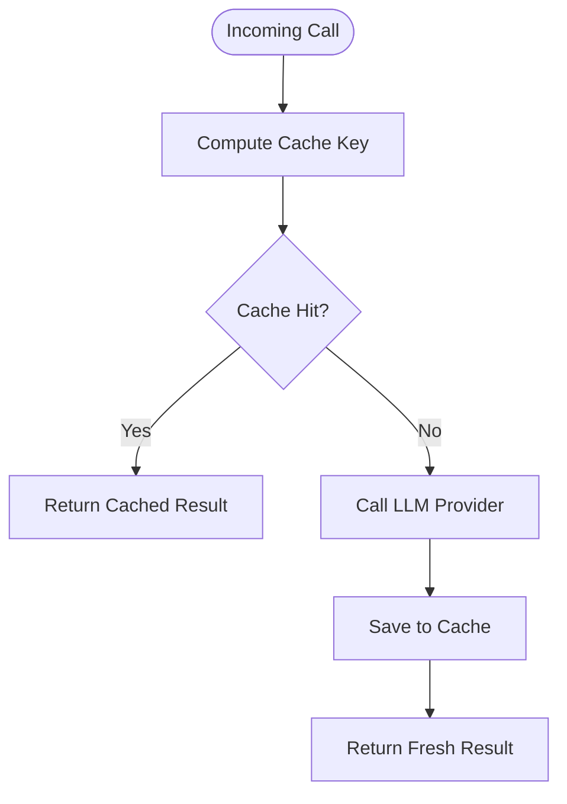
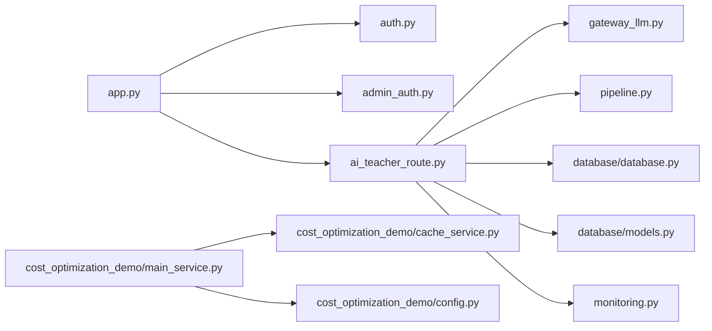

# Backend Architecture

<cite>
**Referenced Files in This Document**
- [app.py](file://backend/app.py)
- [config.py](file://backend/config.py)
- [auth.py](file://backend/auth.py)
- [admin_auth.py](file://backend/admin_auth.py)
- [ai_teacher_route.py](file://backend/ai_teacher_route.py)
- [gateway_llm.py](file://backend/gateway_llm.py)
- [pipeline.py](file://backend/pipeline.py)
- [database/database.py](file://backend/database/database.py)
- [database/models.py](file://backend/database/models.py)
- [monitoring.py](file://backend/monitoring.py)
- [cost_optimization_demo/main_service.py](file://backend/cost_optimization_demo/main_service.py)
- [cost_optimization_demo/cache_service.py](file://backend/cost_optimization_demo/cache_service.py)
- [cost_optimization_demo/config.py](file://backend/cost_optimization_demo/config.py)
- [invite_quota_api.py](file://backend/invite_quota_api.py)
</cite>

## Table of Contents
1. Introduction
2. Project Structure
3. Core Components
4. Architecture Overview
5. Detailed Component Analysis
6. Dependency Analysis
7. Performance Considerations
8. Troubleshooting Guide
9. Conclusion

## Introduction
This document describes the backend services layer of a Flask-based application with a modular, service-oriented architecture. It explains the application structure, middleware patterns, API gateway implementation for LLM routing, authentication and authorization flows, request/response processing pipeline, and integration points with database and storage. It also covers performance considerations, caching mechanisms, error handling strategies, and extensibility points for adding new features.

## Project Structure
The backend is organized into feature modules and shared infrastructure:
- Application entrypoint and configuration
- Authentication and admin authorization
- AI teacher route and LLM gateway
- Data access via database module
- Monitoring and observability
- Cost optimization demo (caching and client abstraction)
- Feature APIs (e.g., invite quota)

**Diagram sources**
- [app.py](file://backend/app.py)
- [auth.py](file://backend/auth.py)
- [admin_auth.py](file://backend/admin_auth.py)
- [ai_teacher_route.py](file://backend/ai_teacher_route.py)
- [gateway_llm.py](file://backend/gateway_llm.py)
- [pipeline.py](file://backend/pipeline.py)
- [database/database.py](file://backend/database/database.py)
- [monitoring.py](file://backend/monitoring.py)
- [cost_optimization_demo/main_service.py](file://backend/cost_optimization_demo/main_service.py)
- [cost_optimization_demo/cache_service.py](file://backend/cost_optimization_demo/cache_service.py)
- [cost_optimization_demo/config.py](file://backend/cost_optimization_demo/config.py)

**Section sources**
- [app.py](file://backend/app.py)
- [config.py](file://backend/config.py)

## Core Components
- Flask application factory and initialization: centralizes app creation, config loading, blueprints registration, and middleware wiring.
- Authentication middleware: validates tokens, attaches user context to requests, and enforces per-route permissions.
- Admin authorization: restricts administrative endpoints to privileged users.
- AI teacher route: exposes HTTP endpoints for teaching content generation and related operations.
- LLM gateway: abstracts multiple LLM providers, implements selection logic, retries, and streaming support.
- Processing pipeline: orchestrates prompt assembly, model invocation, post-processing, and persistence.
- Database layer: provides typed models and connection management for relational data.
- Monitoring: metrics collection, logging, and health checks.
- Cost optimization demo: demonstrates caching strategies and provider configuration usage.

**Section sources**
- [app.py](file://backend/app.py)
- [auth.py](file://backend/auth.py)
- [admin_auth.py](file://backend/admin_auth.py)
- [ai_teacher_route.py](file://backend/ai_teacher_route.py)
- [gateway_llm.py](file://backend/gateway_llm.py)
- [pipeline.py](file://backend/pipeline.py)
- [database/database.py](file://backend/database/database.py)
- [database/models.py](file://backend/database/models.py)
- [monitoring.py](file://backend/monitoring.py)
- [cost_optimization_demo/main_service.py](file://backend/cost_optimization_demo/main_service.py)
- [cost_optimization_demo/cache_service.py](file://backend/cost_optimization_demo/cache_service.py)
- [cost_optimization_demo/config.py](file://backend/cost_optimization_demo/config.py)

## Architecture Overview
The system follows a layered, service-oriented design:
- Presentation layer: Flask routes handle HTTP requests and responses.
- Middleware layer: authentication, admin authorization, monitoring, and optional rate limiting.
- Service layer: business logic for AI teaching, content management, and admin functions.
- Integration layer: LLM gateway, database, and file storage.
- Cross-cutting concerns: monitoring, configuration, and cost optimization utilities.

**Diagram sources**
- [app.py](file://backend/app.py)
- [auth.py](file://backend/auth.py)
- [ai_teacher_route.py](file://backend/ai_teacher_route.py)
- [gateway_llm.py](file://backend/gateway_llm.py)
- [pipeline.py](file://backend/pipeline.py)
- [database/database.py](file://backend/database/database.py)

## Detailed Component Analysis

### Flask Application and Configuration
- Centralizes app initialization, environment-driven configuration, blueprint registration, and global middleware setup.
- Exposes health and status endpoints for orchestration and monitoring.
- Integrates monitoring hooks for request lifecycle events.

**Section sources**
- [app.py](file://backend/app.py)
- [config.py](file://backend/config.py)
- [monitoring.py](file://backend/monitoring.py)

### Authentication and Authorization
- Token validation middleware inspects incoming requests, verifies credentials, and injects user context.
- Admin authorization decorator enforces role-based access on administrative endpoints.
- Error responses are standardized for unauthorized and forbidden scenarios.

**Diagram sources**
- [auth.py](file://backend/auth.py)
- [admin_auth.py](file://backend/admin_auth.py)

**Section sources**
- [auth.py](file://backend/auth.py)
- [admin_auth.py](file://backend/admin_auth.py)

### AI Teacher Route and Processing Pipeline
- The AI teacher route defines endpoints for generating teaching materials, managing topics, and retrieving results.
- The pipeline coordinates prompt templating, model invocation through the gateway, and post-processing steps such as artifact saving and history tracking.

**Diagram sources**
- [ai_teacher_route.py](file://backend/ai_teacher_route.py)
- [pipeline.py](file://backend/pipeline.py)
- [gateway_llm.py](file://backend/gateway_llm.py)
- [database/database.py](file://backend/database/database.py)

**Section sources**
- [ai_teacher_route.py](file://backend/ai_teacher_route.py)
- [pipeline.py](file://backend/pipeline.py)

### LLM Gateway
- Abstracts multiple LLM providers behind a unified interface.
- Implements provider selection, retry/backoff, timeout handling, and streaming output.
- Configurable via centralized configuration and supports dynamic model lists.

**Diagram sources**
- [gateway_llm.py](file://backend/gateway_llm.py)

**Section sources**
- [gateway_llm.py](file://backend/gateway_llm.py)

### Database Layer
- Provides typed models and connection management for relational data.
- Supports migrations and schema evolution scripts.
- Used by the pipeline to persist teaching metadata, view counts, and history.

**Diagram sources**
- [database/models.py](file://backend/database/models.py)
- [database/database.py](file://backend/database/database.py)

**Section sources**
- [database/models.py](file://backend/database/models.py)
- [database/database.py](file://backend/database/database.py)

### Monitoring and Observability
- Collects request metrics, logs structured events, and exposes health endpoints.
- Integrates with the application lifecycle to capture timing and error rates.

**Section sources**
- [monitoring.py](file://backend/monitoring.py)
- [app.py](file://backend/app.py)

### Cost Optimization Demo
- Demonstrates caching strategies around LLM calls and configurable provider settings.
- Shows how to integrate cache lookups before invoking external services.

**Diagram sources**
- [cost_optimization_demo/main_service.py](file://backend/cost_optimization_demo/main_service.py)
- [cost_optimization_demo/cache_service.py](file://backend/cost_optimization_demo/cache_service.py)
- [cost_optimization_demo/config.py](file://backend/cost_optimization_demo/config.py)

**Section sources**
- [cost_optimization_demo/main_service.py](file://backend/cost_optimization_demo/main_service.py)
- [cost_optimization_demo/cache_service.py](file://backend/cost_optimization_demo/cache_service.py)
- [cost_optimization_demo/config.py](file://backend/cost_optimization_demo/config.py)

### Administrative Functions
- Admin-only endpoints protected by admin authorization middleware.
- Includes invite quota management and other administrative operations.

**Section sources**
- [admin_auth.py](file://backend/admin_auth.py)
- [invite_quota_api.py](file://backend/invite_quota_api.py)

## Dependency Analysis
High-level dependencies between core components:

**Diagram sources**
- [app.py](file://backend/app.py)
- [auth.py](file://backend/auth.py)
- [admin_auth.py](file://backend/admin_auth.py)
- [ai_teacher_route.py](file://backend/ai_teacher_route.py)
- [gateway_llm.py](file://backend/gateway_llm.py)
- [pipeline.py](file://backend/pipeline.py)
- [database/database.py](file://backend/database/database.py)
- [database/models.py](file://backend/database/models.py)
- [monitoring.py](file://backend/monitoring.py)
- [cost_optimization_demo/main_service.py](file://backend/cost_optimization_demo/main_service.py)
- [cost_optimization_demo/cache_service.py](file://backend/cost_optimization_demo/cache_service.py)
- [cost_optimization_demo/config.py](file://backend/cost_optimization_demo/config.py)

**Section sources**
- [app.py](file://backend/app.py)
- [ai_teacher_route.py](file://backend/ai_teacher_route.py)
- [gateway_llm.py](file://backend/gateway_llm.py)
- [pipeline.py](file://backend/pipeline.py)
- [database/database.py](file://backend/database/database.py)
- [database/models.py](file://backend/database/models.py)
- [monitoring.py](file://backend/monitoring.py)
- [cost_optimization_demo/main_service.py](file://backend/cost_optimization_demo/main_service.py)
- [cost_optimization_demo/cache_service.py](file://backend/cost_optimization_demo/cache_service.py)
- [cost_optimization_demo/config.py](file://backend/cost_optimization_demo/config.py)

## Performance Considerations
- Streaming responses: Use streaming for long-running LLM calls to reduce latency and memory pressure.
- Caching: Implement key-based caching for repeated prompts and outputs; consider TTL and invalidation policies.
- Connection pooling: Ensure database connections are pooled and reused across requests.
- Retry and backoff: Apply exponential backoff for transient failures when calling external LLM providers.
- Rate limiting: Add request throttling at the gateway or middleware layer to protect downstream services.
- Artifact storage: Store large artifacts asynchronously and serve via efficient static paths or CDN.
- Metrics and tracing: Track latency percentiles, error rates, and provider-specific costs for capacity planning.

[No sources needed since this section provides general guidance]

## Troubleshooting Guide
Common issues and strategies:
- Authentication failures: Verify token format, expiration, and secret configuration; ensure middleware runs before route handlers.
- Admin access denied: Confirm user roles and admin privileges; check admin authorization decorators on endpoints.
- LLM provider errors: Inspect gateway logs for timeouts, rate limits, and provider-specific error codes; enable retries and fallback providers.
- Database connectivity: Validate connection strings, credentials, and schema migration state; use health endpoints to verify readiness.
- Storage I/O errors: Check file permissions, disk space, and path configurations; validate artifact naming and cleanup routines.
- Monitoring gaps: Ensure request hooks are registered and metrics are exported; confirm health endpoint availability.

**Section sources**
- [auth.py](file://backend/auth.py)
- [admin_auth.py](file://backend/admin_auth.py)
- [gateway_llm.py](file://backend/gateway_llm.py)
- [database/database.py](file://backend/database/database.py)
- [monitoring.py](file://backend/monitoring.py)

## Conclusion
The backend employs a clear separation of concerns with Flask routes, middleware, and service modules. The LLM gateway abstracts provider complexity, while the pipeline orchestrates processing and persistence. Authentication and admin authorization enforce security, and monitoring provides observability. Caching and streaming improve performance, and the modular layout facilitates extensibility for new features and providers.