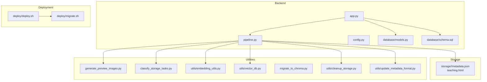
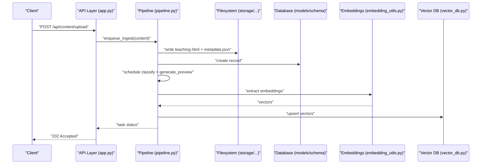
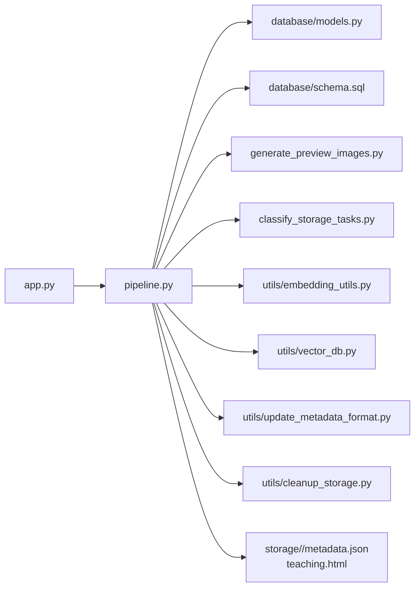

# Content Management Services

<cite>
**Referenced Files in This Document**
- [app.py](file://backend/app.py)
- [pipeline.py](file://backend/pipeline.py)
- [config.py](file://backend/config.py)
- [models.py](file://backend/database/models.py)
- [schema.sql](file://backend/database/schema.sql)
- [generate_preview_images.py](file://backend/generate_preview_images.py)
- [classify_storage_tasks.py](file://backend/classify_storage_tasks.py)
- [embedding_utils.py](file://backend/utils/embedding_utils.py)
- [vector_db.py](file://backend/utils/vector_db.py)
- [migrate_to_chroma.py](file://backend/migrate_to_chroma.py)
- [cleanup_storage.py](file://backend/utils/cleanup_storage.py)
- [update_metadata_format.py](file://backend/utils/update_metadata_format.py)
- [xsyy_backup.sql](file://backend/xsyy_backup.sql)
- [deploy.sh](file://deploy/deploy.sh)
- [migrate.sh](file://deploy/migrate.sh)
</cite>

## Table of Contents
1. [Introduction](#introduction)
2. [Project Structure](#project-structure)
3. [Core Components](#core-components)
4. [Architecture Overview](#architecture-overview)
5. [Detailed Component Analysis](#detailed-component-analysis)
6. [Dependency Analysis](#dependency-analysis)
7. [Performance Considerations](#performance-considerations)
8. [Troubleshooting Guide](#troubleshooting-guide)
9. [Conclusion](#conclusion)
10. [Appendices](#appendices)

## Introduction
This document describes the content management service architecture for handling teaching materials and generated content. It explains file storage organization, metadata management, version control, classification algorithms, preview image generation, batch processing, indexing and search, bulk operations, upload workflows, automated tasks, lifecycle management, storage optimization, backup strategies, and migration procedures. The goal is to provide a comprehensive yet accessible guide for both technical and non-technical readers.

## Project Structure
The repository organizes backend services, database schemas, utilities, deployment scripts, and static assets. Key areas relevant to content management include:
- Backend application entry points and routing
- Database models and schema definitions
- Storage layout under a top-level storage directory with per-content folders
- Utilities for preview generation, classification, embeddings, vector DB integration, cleanup, and migrations
- Deployment and migration scripts

**Diagram sources**
- [app.py](file://backend/app.py)
- [pipeline.py](file://backend/pipeline.py)
- [config.py](file://backend/config.py)
- [models.py](file://backend/database/models.py)
- [schema.sql](file://backend/database/schema.sql)
- [generate_preview_images.py](file://backend/generate_preview_images.py)
- [classify_storage_tasks.py](file://backend/classify_storage_tasks.py)
- [embedding_utils.py](file://backend/utils/embedding_utils.py)
- [vector_db.py](file://backend/utils/vector_db.py)
- [migrate_to_chroma.py](file://backend/migrate_to_chroma.py)
- [cleanup_storage.py](file://backend/utils/cleanup_storage.py)
- [update_metadata_format.py](file://backend/utils/update_metadata_format.py)
- [deploy.sh](file://deploy/deploy.sh)
- [migrate.sh](file://deploy/migrate.sh)

**Section sources**
- [app.py](file://backend/app.py)
- [pipeline.py](file://backend/pipeline.py)
- [config.py](file://backend/config.py)
- [models.py](file://backend/database/models.py)
- [schema.sql](file://backend/database/schema.sql)
- [generate_preview_images.py](file://backend/generate_preview_images.py)
- [classify_storage_tasks.py](file://backend/classify_storage_tasks.py)
- [embedding_utils.py](file://backend/utils/embedding_utils.py)
- [vector_db.py](file://backend/utils/vector_db.py)
- [migrate_to_chroma.py](file://backend/migrate_to_chroma.py)
- [cleanup_storage.py](file://backend/utils/cleanup_storage.py)
- [update_metadata_format.py](file://backend/utils/update_metadata_format.py)
- [deploy.sh](file://deploy/deploy.sh)
- [migrate.sh](file://deploy/migrate.sh)

## Core Components
- Application entry point and API surface: routes and orchestration for content operations are defined in the main application module.
- Processing pipeline: coordinates ingestion, classification, preview generation, embedding/indexing, and persistence.
- Data models and schema: define entities such as teachings, topics, view history, and related fields.
- File storage: each content item has a dedicated folder containing its HTML artifact and a metadata JSON file.
- Utilities: preview generation, classification tasks, embedding extraction, vector DB integration, cleanup, and metadata format updates.
- Migration and backup: scripts to migrate data into vector stores and perform backups.

Key responsibilities:
- Ingestion and validation of uploads
- Asynchronous processing (classification, preview, embeddings)
- Metadata synchronization between filesystem and database
- Search and retrieval via vector store
- Bulk operations and maintenance tasks

**Section sources**
- [app.py](file://backend/app.py)
- [pipeline.py](file://backend/pipeline.py)
- [models.py](file://backend/database/models.py)
- [schema.sql](file://backend/database/schema.sql)
- [generate_preview_images.py](file://backend/generate_preview_images.py)
- [classify_storage_tasks.py](file://backend/classify_storage_tasks.py)
- [embedding_utils.py](file://backend/utils/embedding_utils.py)
- [vector_db.py](file://backend/utils/vector_db.py)
- [migrate_to_chroma.py](file://backend/migrate_to_chroma.py)
- [cleanup_storage.py](file://backend/utils/cleanup_storage.py)
- [update_metadata_format.py](file://backend/utils/update_metadata_format.py)

## Architecture Overview
The system follows a modular architecture where the web layer delegates heavy work to a processing pipeline. The pipeline orchestrates classification, preview generation, embedding creation, and indexing. Persistent state is stored in a relational database and on-disk storage, while semantic search uses a vector database.

**Diagram sources**
- [app.py](file://backend/app.py)
- [pipeline.py](file://backend/pipeline.py)
- [embedding_utils.py](file://backend/utils/embedding_utils.py)
- [vector_db.py](file://backend/utils/vector_db.py)
- [models.py](file://backend/database/models.py)
- [schema.sql](file://backend/database/schema.sql)

## Detailed Component Analysis

### File Storage Organization
- Each content item resides in a unique folder under the storage root, named by a UUID-like identifier.
- Inside each folder:
  - metadata.json: structured metadata describing the content, including identifiers, timestamps, tags, and links to artifacts.
  - teaching.html: the rendered or generated HTML artifact.
- Additional directories may exist for template failure samples or temporary verification artifacts.

Operational notes:
- Atomic writes: write to a temporary location and rename to avoid partial reads.
- Idempotency: ensure duplicate uploads do not create duplicates; rely on content hashing or explicit deduplication keys.
- Cleanup: remove orphaned files when records are deleted.

**Section sources**
- [generate_preview_images.py](file://backend/generate_preview_images.py)
- [cleanup_storage.py](file://backend/utils/cleanup_storage.py)
- [update_metadata_format.py](file://backend/utils/update_metadata_format.py)

### Metadata Management
- Metadata is persisted both in the filesystem (metadata.json) and in the relational database.
- Fields typically include:
  - Unique identifiers (UUID)
  - Title and description
  - Tags and categories
  - Creation and update timestamps
  - Status flags (e.g., published, draft)
  - Links to preview images and source artifacts
- A utility exists to update metadata formats across existing items during schema evolution.

Best practices:
- Keep metadata minimal and normalized; store large blobs only when necessary.
- Enforce schema validation before writing metadata.
- Synchronize changes atomically between DB and filesystem.

**Section sources**
- [update_metadata_format.py](file://backend/utils/update_metadata_format.py)
- [models.py](file://backend/database/models.py)
- [schema.sql](file://backend/database/schema.sql)

### Version Control System
- Current structure does not implement explicit versioned directories per content item. Instead, updates overwrite artifacts and metadata.
- To introduce versioning:
  - Add a version field in metadata and database.
  - Store versions under versioned subfolders (e.g., v1/, v2/) within the content folder.
  - Maintain a manifest pointing to the latest version.
  - Implement rollback by switching the manifest pointer.

Recommendation:
- Use immutable artifacts and append-only logs for auditability.
- Integrate checksums to detect drift and support integrity checks.

[No sources needed since this section proposes enhancements beyond current implementation]

### Content Classification Algorithms
- Classification tasks are orchestrated via a dedicated script that scans storage and classifies items based on content features or external AI prompts.
- Typical steps:
  - Read content artifacts and metadata
  - Extract text or features
  - Apply classification logic (rule-based or model-driven)
  - Update metadata and database with category/tags
  - Persist results and handle errors gracefully

Integration points:
- Prompts and templates used by AI-assisted classification are located under prompt directories.
- Results feed into indexing and search.

**Section sources**
- [classify_storage_tasks.py](file://backend/classify_storage_tasks.py)
- [prompt/classification_user_prompt.txt](file://backend/prompt/classification_user_prompt.txt)
- [prompt/classi_pic_system_prompt.txt](file://backend/prompt/classi_pic_system_prompt.txt)
- [prompt/classi_pic_user_prompt.txt](file://backend/prompt/classi_pic_user_prompt.txt)

### Preview Image Generation Pipeline
- A utility generates preview images from content artifacts (e.g., HTML snapshots).
- Pipeline overview:
  - Iterate over content folders
  - Render or convert content to an image
  - Save preview alongside metadata
  - Update metadata references to new previews
  - Handle failures and retry policies

Optimization tips:
- Batch rendering with concurrency limits
- Cache intermediate renders to avoid recomputation
- Normalize image sizes and formats (e.g., WebP)

**Section sources**
- [generate_preview_images.py](file://backend/generate_preview_images.py)
- [convert_preview_to_webp.py](file://backend/convert_preview_to_webp.py)

### Batch Processing Capabilities
- Batch jobs can be scheduled to:
  - Classify all unclassified items
  - Generate missing previews
  - Rebuild embeddings and indexes
  - Clean up orphaned files
- Jobs should be idempotent and resilient to partial failures.

Implementation guidance:
- Use a task queue or cron-like scheduler.
- Track job progress and outcomes in the database.
- Provide admin endpoints to trigger and monitor batch jobs.

**Section sources**
- [classify_storage_tasks.py](file://backend/classify_storage_tasks.py)
- [generate_preview_images.py](file://backend/generate_preview_images.py)
- [cleanup_storage.py](file://backend/utils/cleanup_storage.py)

### Content Indexing and Search Functionality
- Embeddings are extracted from content using an embedding utility and stored in a vector database.
- Workflow:
  - Extract text/features from content
  - Compute embeddings
  - Upsert into vector DB with content identifiers
  - Support similarity search and retrieval
- Migration tooling supports moving data into Chroma DB.

Search patterns:
- Semantic search by query embedding
- Hybrid search combining keyword filters and vector similarity
- Pagination and result ranking

**Section sources**
- [embedding_utils.py](file://backend/utils/embedding_utils.py)
- [vector_db.py](file://backend/utils/vector_db.py)
- [migrate_to_chroma.py](file://backend/migrate_to_chroma.py)

### Bulk Operations
- Admin APIs should expose:
  - Bulk publish/unpublish
  - Bulk tag/category assignment
  - Bulk deletion with cascade cleanup
  - Bulk reprocessing triggers (re-classify, regenerate previews, rebuild index)
- Ensure transactional consistency and audit logging.

[No sources needed since this section provides operational guidance]

### Upload Workflows
- End-to-end flow:
  - Client uploads content via API
  - Server validates and persists artifact and initial metadata
  - Background tasks schedule classification, preview generation, and indexing
  - Client polls for completion or receives webhook notifications
- Error handling:
  - Validate inputs and reject invalid files
  - Retry transient failures
  - Record error details for diagnostics

**Section sources**
- [app.py](file://backend/app.py)
- [pipeline.py](file://backend/pipeline.py)

### Automated Processing Tasks
- Scheduled tasks:
  - Periodic classification sweep
  - Preview regeneration for updated content
  - Embedding rebuild after content changes
  - Storage cleanup and integrity checks
- Observability:
  - Log task runs and outcomes
  - Expose metrics and health endpoints

**Section sources**
- [classify_storage_tasks.py](file://backend/classify_storage_tasks.py)
- [generate_preview_images.py](file://backend/generate_preview_images.py)
- [embedding_utils.py](file://backend/utils/embedding_utils.py)
- [vector_db.py](file://backend/utils/vector_db.py)

### Content Lifecycle Management
- States:
  - Draft -> Classified -> Preview Ready -> Indexed -> Published
  - Any state can transition back to Draft for edits
- Enforcement:
  - Guard transitions with validations
  - Update metadata and DB atomically
  - Emit events for downstream consumers

[No sources needed since this section provides conceptual lifecycle guidance]

## Dependency Analysis
The following diagram shows key dependencies among core modules and utilities.

**Diagram sources**
- [app.py](file://backend/app.py)
- [pipeline.py](file://backend/pipeline.py)
- [models.py](file://backend/database/models.py)
- [schema.sql](file://backend/database/schema.sql)
- [generate_preview_images.py](file://backend/generate_preview_images.py)
- [classify_storage_tasks.py](file://backend/classify_storage_tasks.py)
- [embedding_utils.py](file://backend/utils/embedding_utils.py)
- [vector_db.py](file://backend/utils/vector_db.py)
- [update_metadata_format.py](file://backend/utils/update_metadata_format.py)
- [cleanup_storage.py](file://backend/utils/cleanup_storage.py)

**Section sources**
- [app.py](file://backend/app.py)
- [pipeline.py](file://backend/pipeline.py)
- [models.py](file://backend/database/models.py)
- [schema.sql](file://backend/database/schema.sql)
- [generate_preview_images.py](file://backend/generate_preview_images.py)
- [classify_storage_tasks.py](file://backend/classify_storage_tasks.py)
- [embedding_utils.py](file://backend/utils/embedding_utils.py)
- [vector_db.py](file://backend/utils/vector_db.py)
- [update_metadata_format.py](file://backend/utils/update_metadata_format.py)
- [cleanup_storage.py](file://backend/utils/cleanup_storage.py)

## Performance Considerations
- Concurrency:
  - Limit parallelism for I/O-bound tasks (preview generation, embedding computation).
  - Use connection pooling for DB and vector DB clients.
- Caching:
  - Cache embeddings and search results where appropriate.
  - Avoid recomputing previews for unchanged artifacts using content hashes.
- Storage:
  - Prefer efficient formats (e.g., WebP) for previews.
  - Archive or compress older artifacts if retention policies allow.
- Indexing:
  - Batch upserts to vector DB to reduce overhead.
  - Incremental updates instead of full rebuilds when possible.

[No sources needed since this section provides general guidance]

## Troubleshooting Guide
Common issues and resolutions:
- Missing previews:
  - Verify preview generation tasks ran successfully.
  - Check permissions and paths for output directories.
- Stale metadata:
  - Run metadata format update utility to normalize fields.
- Orphaned files:
  - Execute cleanup utility to remove files without corresponding DB records.
- Vector DB inconsistencies:
  - Rebuild embeddings and reindex using migration tools.
- Backup integrity:
  - Validate SQL dumps and restore in staging environments.

**Section sources**
- [generate_preview_images.py](file://backend/generate_preview_images.py)
- [update_metadata_format.py](file://backend/utils/update_metadata_format.py)
- [cleanup_storage.py](file://backend/utils/cleanup_storage.py)
- [migrate_to_chroma.py](file://backend/migrate_to_chroma.py)
- [xsyy_backup.sql](file://backend/xsyy_backup.sql)

## Conclusion
The content management service integrates file-based storage, relational metadata, and vector-backed search to deliver scalable handling of teaching materials and generated content. By adopting robust pipelines for classification, preview generation, and indexing, along with disciplined metadata management and maintenance utilities, the system supports reliable content lifecycles and efficient search experiences. Future improvements should emphasize explicit versioning, stronger observability, and enhanced bulk operation tooling.

[No sources needed since this section summarizes without analyzing specific files]

## Appendices

### Backup Strategy
- Regularly export database dumps using provided SQL dump.
- Snapshot storage directories to preserve artifacts and metadata.
- Test restores periodically to ensure recoverability.

**Section sources**
- [xsyy_backup.sql](file://backend/xsyy_backup.sql)

### Migration Procedures
- Use deployment scripts to run migrations and apply schema changes.
- Migrate content into vector stores using migration utilities.
- Validate post-migration integrity with consistency checks.

**Section sources**
- [deploy.sh](file://deploy/deploy.sh)
- [migrate.sh](file://deploy/migrate.sh)
- [migrate_to_chroma.py](file://backend/migrate_to_chroma.py)