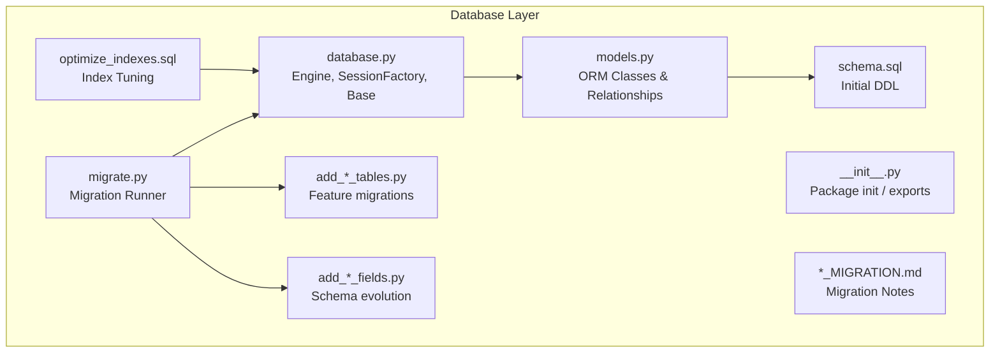
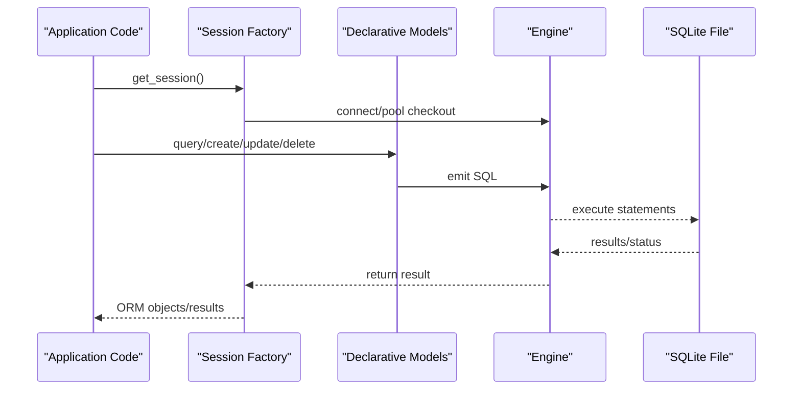
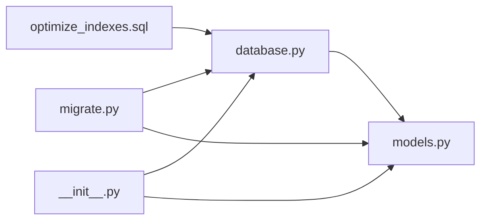
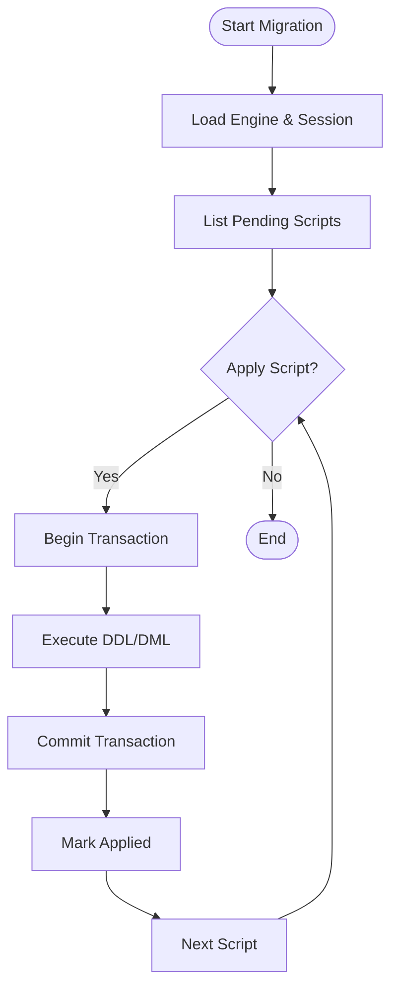

# Database Layer

<cite>
**Referenced Files in This Document**
- [database.py](file://backend/database/database.py)
- [models.py](file://backend/database/models.py)
- [migrate.py](file://backend/database/migrate.py)
- [__init__.py](file://backend/database/__init__.py)
- [schema.sql](file://backend/database/schema.sql)
- [add_ai_teaching_tables.py](file://backend/database/add_ai_teaching_tables.py)
- [add_topics_table.py](file://backend/database/add_topics_table.py)
- [add_user_profile_fields.py](file://backend/database/add_user_profile_fields.py)
- [add_view_count_field.py](file://backend/database/add_view_count_field.py)
- [add_view_history_table.py](file://backend/database/add_view_history_table.py)
- [optimize_indexes.sql](file://backend/database/optimize_indexes.sql)
- [TOPIC_SHARE_MIGRATION.md](file://backend/database/TOPIC_SHARE_MIGRATION.md)
- [VIEW_COUNT_MIGRATION.md](file://backend/database/VIEW_COUNT_MIGRATION.md)
</cite>

## Table of Contents
1. [Introduction](#introduction)
2. [Project Structure](#project-structure)
3. [Core Components](#core-components)
4. [Architecture Overview](#architecture-overview)
5. [Detailed Component Analysis](#detailed-component-analysis)
6. [Dependency Analysis](#dependency-analysis)
7. [Performance Considerations](#performance-considerations)
8. [Troubleshooting Guide](#troubleshooting-guide)
9. [Conclusion](#conclusion)
10. [Appendices](#appendices)

## Introduction
This document describes the database layer architecture, focusing on the SQLAlchemy ORM implementation, data models and relationships, migration strategy, connection pooling, query optimization, transaction management, and operational procedures such as backup and recovery. It also provides guidance for SQLite deployment considerations including performance tuning and scaling strategies.

## Project Structure
The database layer is organized under backend/database and includes:
- ORM configuration and session management
- Declarative data models and relationship mappings
- Migration scripts (Python and SQL) to evolve schema over time
- Index optimization and maintenance utilities
- Documentation for specific migrations

[No sources needed since this diagram shows conceptual workflow, not actual code structure]

## Core Components
- Engine and Session management: centralizes connection configuration, pooling parameters, and session lifecycle.
- Declarative models: define tables, columns, constraints, and relationships using SQLAlchemy ORM.
- Migration runner: applies incremental changes to the schema via Python/SQL scripts.
- Index optimization: targeted index creation and maintenance for read-heavy workloads.
- Migration documentation: records rationale, steps, and rollback notes for each change.

Key responsibilities:
- Provide a single source of truth for database connectivity and sessions.
- Keep model definitions aligned with the physical schema.
- Ensure safe, repeatable schema evolution through migrations.
- Maintain performance via indexes and query patterns.

**Section sources**
- [database.py](file://backend/database/database.py)
- [models.py](file://backend/database/models.py)
- [migrate.py](file://backend/database/migrate.py)
- [__init__.py](file://backend/database/__init__.py)
- [schema.sql](file://backend/database/schema.sql)
- [optimize_indexes.sql](file://backend/database/optimize_indexes.sql)
- [TOPIC_SHARE_MIGRATION.md](file://backend/database/TOPIC_SHARE_MIGRATION.md)
- [VIEW_COUNT_MIGRATION.md](file://backend/database/VIEW_COUNT_MIGRATION.md)

## Architecture Overview
High-level flow: application code uses the session factory to obtain scoped sessions; queries operate against declarative models; migrations are executed by the migration runner which imports model definitions and executes DDL/DML scripts.

[No sources needed since this diagram shows conceptual workflow, not actual code structure]

## Detailed Component Analysis

### Connection Management and Pooling
Responsibilities:
- Configure the engine URL and driver options.
- Set pool size, max overflow, and recycle policies appropriate for SQLite.
- Provide a session factory that returns short-lived sessions per request or task.

Recommendations for SQLite:
- Use a small pool size and enable check_same_thread if running in-process.
- Prefer thread-local sessions to avoid concurrent writes.
- Tune pragmas for WAL mode and journaling when applicable.

Operational tips:
- Close sessions promptly to release connections back to the pool.
- Avoid long-running transactions; keep them scoped to individual operations.

**Section sources**
- [database.py](file://backend/database/database.py)

### Data Models and Relationships
Responsibilities:
- Define ORM classes mapped to tables.
- Declare column types, constraints, defaults, and indexes.
- Model relationships (one-to-many, many-to-many) and configure lazy loading strategies.

Guidelines:
- Keep relationships explicit and documented.
- Use back_populates/backref consistently to maintain bidirectional links.
- Prefer eager loading only where necessary to reduce N+1 queries.

Example modeling patterns:
- One-to-many: parent has many children via foreign key.
- Many-to-many: association table with composite primary key.
- Self-referential: hierarchical structures using parent_id.

**Section sources**
- [models.py](file://backend/database/models.py)
- [schema.sql](file://backend/database/schema.sql)

### Migration System and Version Control
Responsibilities:
- Apply incremental schema changes safely.
- Track applied migrations and support rollbacks.
- Integrate with both Python and SQL migration scripts.

Workflow:
- Create a new migration script describing DDL/DML changes.
- Run the migration runner to apply changes.
- Document the migration with rationale and rollback steps.

Rollback procedure:
- Identify the target version.
- Execute reverse migration or revert DDL/DML changes.
- Validate integrity and re-run tests.

Version control:
- Store migration scripts alongside models.
- Include migration notes in markdown files for context.

**Section sources**
- [migrate.py](file://backend/database/migrate.py)
- [add_ai_teaching_tables.py](file://backend/database/add_ai_teaching_tables.py)
- [add_topics_table.py](file://backend/database/add_topics_table.py)
- [add_user_profile_fields.py](file://backend/database/add_user_profile_fields.py)
- [add_view_count_field.py](file://backend/database/add_view_count_field.py)
- [add_view_history_table.py](file://backend/database/add_view_history_table.py)
- [TOPIC_SHARE_MIGRATION.md](file://backend/database/TOPIC_SHARE_MIGRATION.md)
- [VIEW_COUNT_MIGRATION.md](file://backend/database/VIEW_COUNT_MIGRATION.md)

### Query Optimization and Indexes
Responsibilities:
- Analyze slow queries and add targeted indexes.
- Normalize hot paths and avoid unnecessary joins.
- Periodically run index maintenance.

Practical steps:
- Profile queries to identify missing indexes.
- Add composite indexes for frequent filter/sort combinations.
- Use EXPLAIN plans to validate index usage.

Maintenance:
- Schedule periodic index rebuilds if needed.
- Monitor disk growth and fragmentation.

**Section sources**
- [optimize_indexes.sql](file://backend/database/optimize_indexes.sql)

### Transaction Management
Responsibilities:
- Wrap related operations in a single transaction.
- Commit on success, rollback on failure.
- Use savepoints for nested logical units.

Best practices:
- Keep transactions short and focused.
- Avoid holding locks across user interactions.
- Handle exceptions explicitly and ensure cleanup.

**Section sources**
- [database.py](file://backend/database/database.py)

### Writing Complex Queries
Patterns:
- Subqueries and CTEs for multi-step logic.
- Aggregations with GROUP BY and HAVING.
- Conditional expressions and case logic.
- Joins with selective columns and filters.

Tips:
- Prefer ORM constructs for readability when possible.
- Fall back to text-bound SQL for complex analytics.
- Parameterize inputs to prevent injection.

**Section sources**
- [models.py](file://backend/database/models.py)

### Custom Functions and Database-Specific Features
Approach:
- Register custom scalar functions for reuse in queries.
- Leverage SQLite-specific features (e.g., JSON helpers, date/time functions).
- Encapsulate vendor-specific behavior behind adapters.

Safety:
- Validate inputs inside custom functions.
- Keep functions deterministic for caching benefits.

**Section sources**
- [database.py](file://backend/database/database.py)

### Backup and Recovery Procedures
Backup:
- For SQLite, perform consistent backups by shutting down writers or using WAL checkpointing.
- Snapshot the database file and any associated journal/WAL files.
- Schedule regular backups and store offsite.

Recovery:
- Stop services writing to the database.
- Replace the database file with the latest backup.
- Restart services and verify integrity.

Validation:
- Run smoke tests and critical queries post-recovery.
- Compare checksums if available.

**Section sources**
- [schema.sql](file://backend/database/schema.sql)

### Performance Tuning and Scaling for SQLite
Tuning:
- Enable WAL mode for better concurrency.
- Adjust page size and cache settings if needed.
- Use appropriate pragmas for durability vs. performance trade-offs.

Scaling:
- Read replicas are not supported natively; consider read-only copies for reporting.
- Partition large tables logically at the application level.
- Archive historical data to separate databases.

Monitoring:
- Track query latency and error rates.
- Monitor disk I/O and file sizes.

**Section sources**
- [optimize_indexes.sql](file://backend/database/optimize_indexes.sql)

## Dependency Analysis
Relationships between components:
- The session factory depends on engine configuration.
- Models depend on the declarative base and may reference other models.
- Migrations depend on both the engine and model metadata to ensure consistency.
- Index optimization scripts depend on the current schema state.

[No sources needed since this diagram shows conceptual workflow, not actual code structure]

## Performance Considerations
- Prefer batched inserts/updates to reduce round-trips.
- Use pagination and limit clauses for list endpoints.
- Cache frequently accessed, rarely changing data at the application layer.
- Avoid SELECT *; fetch only required columns.
- Use connection pooling wisely; tune pool size for workload characteristics.

[No sources needed since this section provides general guidance]

## Troubleshooting Guide
Common issues and resolutions:
- Lock contention: shorten transactions, avoid long-held locks, use WAL mode.
- Disk full: monitor file sizes, implement retention/archival policies.
- Slow queries: analyze execution plans, add indexes, refactor queries.
- Integrity errors: run integrity checks, restore from backup if needed.

Operational checks:
- Verify database file accessibility and permissions.
- Confirm migration status and version alignment.
- Review logs for repeated failures and resource exhaustion.

**Section sources**
- [migrate.py](file://backend/database/migrate.py)
- [optimize_indexes.sql](file://backend/database/optimize_indexes.sql)

## Conclusion
The database layer centers on a clear separation of concerns: connection/session management, declarative models, and a robust migration process. With careful attention to indexing, transaction scope, and SQLite-specific tuning, the system remains reliable and performant. Operational procedures for backup and recovery ensure resilience, while migration documentation supports safe evolution over time.

[No sources needed since this section summarizes without analyzing specific files]

## Appendices

### Example Migration Flow

[No sources needed since this diagram shows conceptual workflow, not actual code structure]