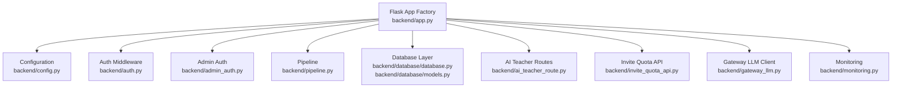
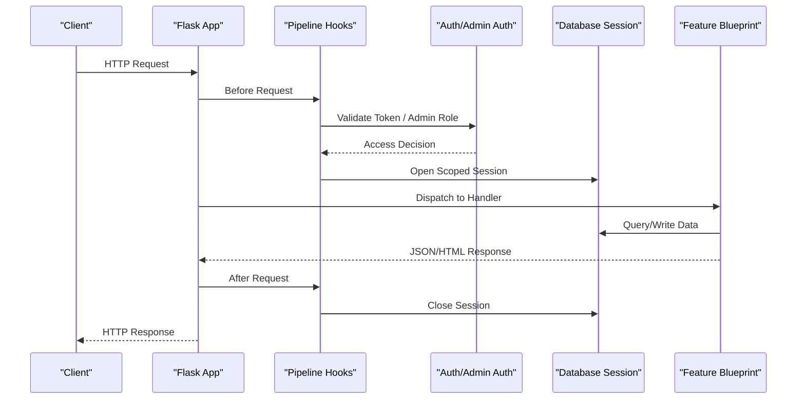
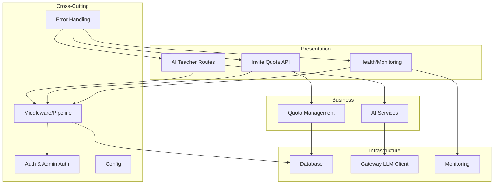
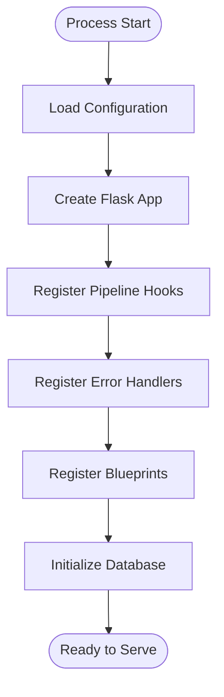
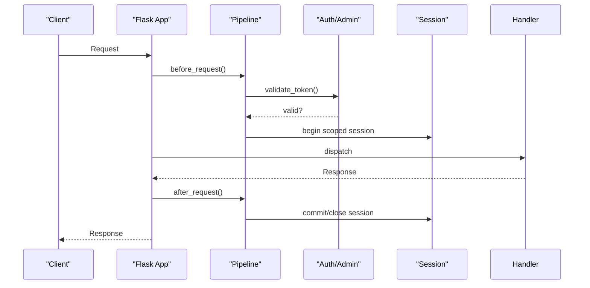
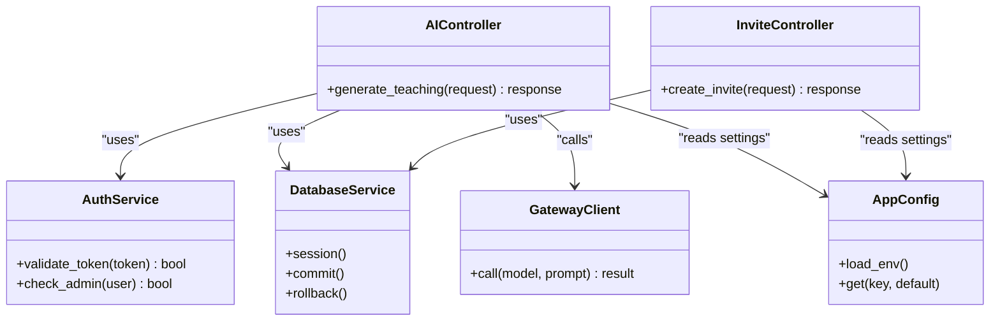
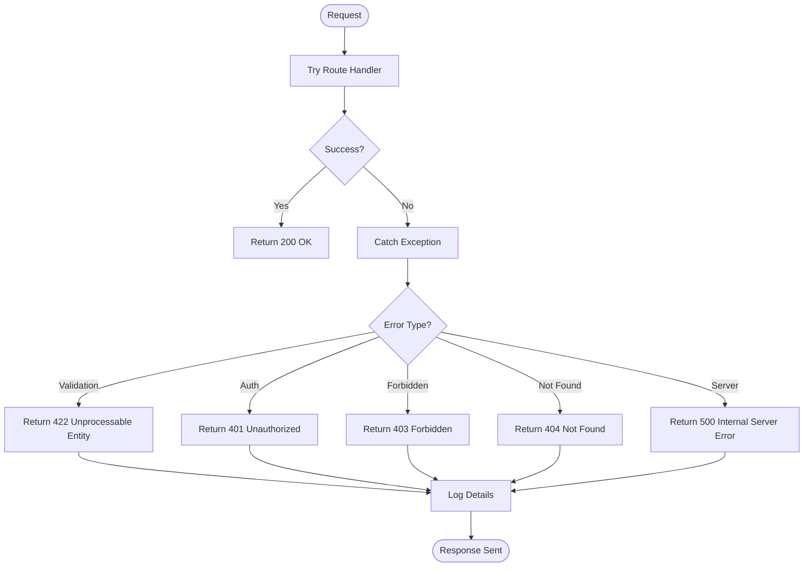
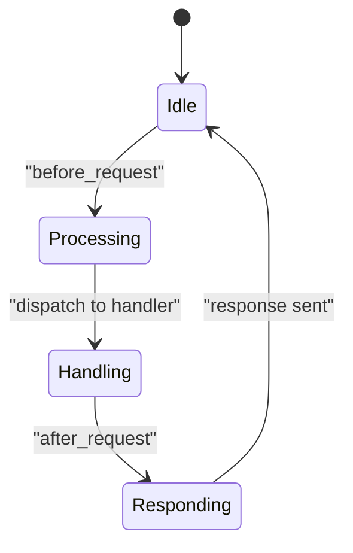
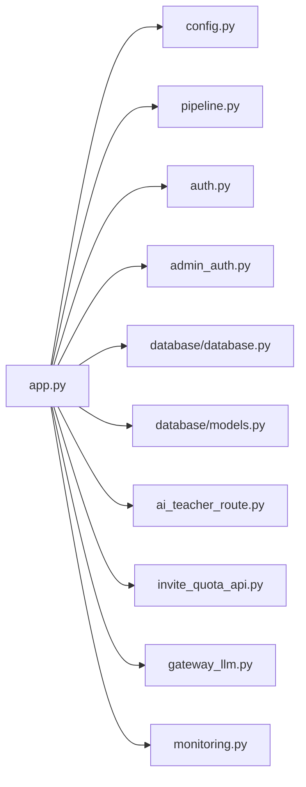

# Flask Application Core

<cite>
**Referenced Files in This Document**
- [app.py](file://backend/app.py)
- [config.py](file://backend/config.py)
- [auth.py](file://backend/auth.py)
- [admin_auth.py](file://backend/admin_auth.py)
- [pipeline.py](file://backend/pipeline.py)
- [database/database.py](file://backend/database/database.py)
- [database/models.py](file://backend/database/models.py)
- [monitoring.py](file://backend/monitoring.py)
- [gateway_llm.py](file://backend/gateway_llm.py)
- [ai_teacher_route.py](file://backend/ai_teacher_route.py)
- [invite_quota_api.py](file://backend/invite_quota_api.py)
- [PERFORMANCE_OPTIMIZATION.md](file://backend/PERFORMANCE_OPTIMIZATION.md)
</cite>

## Table of Contents
1. [Introduction](#introduction)
2. [Project Structure](#project-structure)
3. [Core Components](#core-components)
4. [Architecture Overview](#architecture-overview)
5. [Detailed Component Analysis](#detailed-component-analysis)
6. [Dependency Analysis](#dependency-analysis)
7. [Performance Considerations](#performance-considerations)
8. [Troubleshooting Guide](#troubleshooting-guide)
9. [Conclusion](#conclusion)

## Introduction
This document explains the core architecture of the Flask application, focusing on the main entry point, route registration patterns, middleware pipeline configuration, initialization and dependency injection setup, global configuration management, error handling strategies, logging configuration, request lifecycle management, and performance optimization techniques such as connection pooling and resource management. It also provides guidance for adding new routes and bootstrapping services.

## Project Structure
The backend is organized around a central Flask application with modular components:
- Entry point and app factory
- Configuration management
- Authentication and admin authorization
- Request processing pipeline
- Database layer (models and connection)
- Feature modules (AI teacher, invite quota, gateway LLM)
- Monitoring and observability

**Diagram sources**
- [app.py](file://backend/app.py)
- [config.py](file://backend/config.py)
- [auth.py](file://backend/auth.py)
- [admin_auth.py](file://backend/admin_auth.py)
- [pipeline.py](file://backend/pipeline.py)
- [database/database.py](file://backend/database/database.py)
- [database/models.py](file://backend/database/models.py)
- [ai_teacher_route.py](file://backend/ai_teacher_route.py)
- [invite_quota_api.py](file://backend/invite_quota_api.py)
- [gateway_llm.py](file://backend/gateway_llm.py)
- [monitoring.py](file://backend/monitoring.py)

**Section sources**
- [app.py](file://backend/app.py)
- [config.py](file://backend/config.py)
- [auth.py](file://backend/auth.py)
- [admin_auth.py](file://backend/admin_auth.py)
- [pipeline.py](file://backend/pipeline.py)
- [database/database.py](file://backend/database/database.py)
- [database/models.py](file://backend/database/models.py)
- [ai_teacher_route.py](file://backend/ai_teacher_route.py)
- [invite_quota_api.py](file://backend/invite_quota_api.py)
- [gateway_llm.py](file://backend/gateway_llm.py)
- [monitoring.py](file://backend/monitoring.py)

## Core Components
- Application factory and bootstrap: Centralizes app creation, extension wiring, and blueprint registration.
- Global configuration: Loads environment-based settings and exposes them to all modules.
- Authentication and authorization: Provides decorators and middleware for user and admin access control.
- Pipeline: Implements request/response hooks and cross-cutting concerns.
- Database: Manages connection lifecycle, session scoping, and ORM models.
- Feature modules: Register blueprints for domain-specific endpoints.
- Monitoring: Adds metrics, health checks, and observability hooks.

Key responsibilities and interactions are illustrated below.

**Diagram sources**
- [app.py](file://backend/app.py)
- [pipeline.py](file://backend/pipeline.py)
- [auth.py](file://backend/auth.py)
- [admin_auth.py](file://backend/admin_auth.py)
- [database/database.py](file://backend/database/database.py)
- [ai_teacher_route.py](file://backend/ai_teacher_route.py)
- [invite_quota_api.py](file://backend/invite_quota_api.py)

**Section sources**
- [app.py](file://backend/app.py)
- [pipeline.py](file://backend/pipeline.py)
- [auth.py](file://backend/auth.py)
- [admin_auth.py](file://backend/admin_auth.py)
- [database/database.py](file://backend/database/database.py)
- [ai_teacher_route.py](file://backend/ai_teacher_route.py)
- [invite_quota_api.py](file://backend/invite_quota_api.py)

## Architecture Overview
The application follows a layered architecture:
- Presentation layer: Flask routes/blueprints
- Business logic: Feature modules and services
- Infrastructure: Database, external clients (LLM gateway), monitoring
- Cross-cutting: Auth, pipeline, config, error handling

**Diagram sources**
- [ai_teacher_route.py](file://backend/ai_teacher_route.py)
- [invite_quota_api.py](file://backend/invite_quota_api.py)
- [monitoring.py](file://backend/monitoring.py)
- [pipeline.py](file://backend/pipeline.py)
- [auth.py](file://backend/auth.py)
- [admin_auth.py](file://backend/admin_auth.py)
- [config.py](file://backend/config.py)
- [database/database.py](file://backend/database/database.py)
- [gateway_llm.py](file://backend/gateway_llm.py)

## Detailed Component Analysis

### Application Entry Point and Bootstrap
- Creates the Flask application instance and registers extensions.
- Loads configuration from environment and files.
- Registers blueprints for feature modules.
- Configures error handlers and logging.
- Initializes database connections and sets up request-scoped sessions.

**Diagram sources**
- [app.py](file://backend/app.py)
- [config.py](file://backend/config.py)
- [pipeline.py](file://backend/pipeline.py)
- [database/database.py](file://backend/database/database.py)

**Section sources**
- [app.py](file://backend/app.py)
- [config.py](file://backend/config.py)
- [pipeline.py](file://backend/pipeline.py)
- [database/database.py](file://backend/database/database.py)

### Route Registration Patterns
- Feature modules define their own blueprints and register routes within them.
- The application factory imports and registers these blueprints at startup.
- Common patterns include:
  - Grouping related endpoints under a single blueprint prefix.
  - Using decorators for authentication and admin-only access.
  - Returning structured JSON responses and consistent error formats.

Examples of route modules:
- AI teacher endpoints
- Invite quota management endpoints

**Section sources**
- [ai_teacher_route.py](file://backend/ai_teacher_route.py)
- [invite_quota_api.py](file://backend/invite_quota_api.py)
- [app.py](file://backend/app.py)

### Middleware Pipeline Configuration
- Before-request hooks perform token validation, role checks, and request normalization.
- After-request hooks handle response formatting, logging, and cleanup.
- The pipeline integrates with auth and database session management.

**Diagram sources**
- [pipeline.py](file://backend/pipeline.py)
- [auth.py](file://backend/auth.py)
- [admin_auth.py](file://backend/admin_auth.py)
- [database/database.py](file://backend/database/database.py)

**Section sources**
- [pipeline.py](file://backend/pipeline.py)
- [auth.py](file://backend/auth.py)
- [admin_auth.py](file://backend/admin_auth.py)
- [database/database.py](file://backend/database/database.py)

### Dependency Injection Setup
- Shared services (e.g., database session, external clients) are provided via application context or module-level singletons.
- Feature modules import dependencies directly rather than using a DI container.
- For testability, consider passing dependencies explicitly or using Flask’s g object for request-scoped services.

**Diagram sources**
- [config.py](file://backend/config.py)
- [auth.py](file://backend/auth.py)
- [database/database.py](file://backend/database/database.py)
- [gateway_llm.py](file://backend/gateway_llm.py)
- [ai_teacher_route.py](file://backend/ai_teacher_route.py)
- [invite_quota_api.py](file://backend/invite_quota_api.py)

**Section sources**
- [config.py](file://backend/config.py)
- [auth.py](file://backend/auth.py)
- [database/database.py](file://backend/database/database.py)
- [gateway_llm.py](file://backend/gateway_llm.py)
- [ai_teacher_route.py](file://backend/ai_teacher_route.py)
- [invite_quota_api.py](file://backend/invite_quota_api.py)

### Global Configuration Management
- Configuration is loaded from environment variables and optional files.
- Keys are exposed through a centralized accessor used across modules.
- Sensitive values (e.g., database URLs, API keys) should be sourced from environment.

**Section sources**
- [config.py](file://backend/config.py)

### Error Handling Strategies
- Centralized error handlers map exceptions to standardized JSON responses.
- Validation errors return descriptive messages and appropriate status codes.
- Unexpected exceptions are logged and mapped to generic server errors.

**Diagram sources**
- [app.py](file://backend/app.py)

**Section sources**
- [app.py](file://backend/app.py)

### Logging Configuration
- Structured logging is configured at startup for requests, errors, and business events.
- Log levels can be adjusted per environment.
- Sensitive data is redacted before logging.

**Section sources**
- [app.py](file://backend/app.py)
- [monitoring.py](file://backend/monitoring.py)

### Request Lifecycle Management
- Before-request: parse headers, validate tokens, open DB session.
- During request: route handler executes business logic.
- After-request: format response, close DB session, emit metrics.

**Diagram sources**
- [pipeline.py](file://backend/pipeline.py)
- [database/database.py](file://backend/database/database.py)

**Section sources**
- [pipeline.py](file://backend/pipeline.py)
- [database/database.py](file://backend/database/database.py)

### Adding New Routes
Steps to add a new feature:
1. Create a new blueprint file under the backend root.
2. Define endpoints and handlers within the blueprint.
3. Use existing auth/admin decorators where needed.
4. Import and register the blueprint in the application factory.
5. Add tests and update documentation.

Example modules for reference:
- [ai_teacher_route.py](file://backend/ai_teacher_route.py)
- [invite_quota_api.py](file://backend/invite_quota_api.py)

**Section sources**
- [ai_teacher_route.py](file://backend/ai_teacher_route.py)
- [invite_quota_api.py](file://backend/invite_quota_api.py)
- [app.py](file://backend/app.py)

### Bootstrapping Services
- External clients (e.g., LLM gateway) are initialized once at startup.
- Database connections are pooled and scoped per request.
- Monitoring hooks are registered early to capture metrics.

**Section sources**
- [gateway_llm.py](file://backend/gateway_llm.py)
- [database/database.py](file://backend/database/database.py)
- [monitoring.py](file://backend/monitoring.py)

## Dependency Analysis
High-level dependencies between core components:

**Diagram sources**
- [app.py](file://backend/app.py)
- [config.py](file://backend/config.py)
- [pipeline.py](file://backend/pipeline.py)
- [auth.py](file://backend/auth.py)
- [admin_auth.py](file://backend/admin_auth.py)
- [database/database.py](file://backend/database/database.py)
- [database/models.py](file://backend/database/models.py)
- [ai_teacher_route.py](file://backend/ai_teacher_route.py)
- [invite_quota_api.py](file://backend/invite_quota_api.py)
- [gateway_llm.py](file://backend/gateway_llm.py)
- [monitoring.py](file://backend/monitoring.py)

**Section sources**
- [app.py](file://backend/app.py)
- [config.py](file://backend/config.py)
- [pipeline.py](file://backend/pipeline.py)
- [auth.py](file://backend/auth.py)
- [admin_auth.py](file://backend/admin_auth.py)
- [database/database.py](file://backend/database/database.py)
- [database/models.py](file://backend/database/models.py)
- [ai_teacher_route.py](file://backend/ai_teacher_route.py)
- [invite_quota_api.py](file://backend/invite_quota_api.py)
- [gateway_llm.py](file://backend/gateway_llm.py)
- [monitoring.py](file://backend/monitoring.py)

## Performance Considerations
- Connection pooling: Ensure database engine uses a pool sized for expected concurrency; reuse sessions per request.
- Resource management: Close DB sessions and release external client resources in after-request hooks.
- Caching: Cache expensive computations and frequently accessed data; invalidate on writes.
- Asynchronous tasks: Offload long-running operations to background workers.
- Monitoring: Track latency, throughput, and error rates; set alerts for anomalies.

For detailed recommendations and examples, see:
- [PERFORMANCE_OPTIMIZATION.md](file://backend/PERFORMANCE_OPTIMIZATION.md)

**Section sources**
- [PERFORMANCE_OPTIMIZATION.md](file://backend/PERFORMANCE_OPTIMIZATION.md)
- [database/database.py](file://backend/database/database.py)
- [pipeline.py](file://backend/pipeline.py)
- [monitoring.py](file://backend/monitoring.py)

## Troubleshooting Guide
Common issues and resolutions:
- Authentication failures: Verify token presence and validity; check admin role requirements.
- Database errors: Inspect connection pool exhaustion; ensure sessions are closed in after-request.
- External client timeouts: Configure retries and timeouts for gateway calls; monitor error logs.
- Logging gaps: Confirm log levels and that sensitive fields are redacted.

Operational references:
- [auth.py](file://backend/auth.py)
- [admin_auth.py](file://backend/admin_auth.py)
- [database/database.py](file://backend/database/database.py)
- [gateway_llm.py](file://backend/gateway_llm.py)
- [monitoring.py](file://backend/monitoring.py)

**Section sources**
- [auth.py](file://backend/auth.py)
- [admin_auth.py](file://backend/admin_auth.py)
- [database/database.py](file://backend/database/database.py)
- [gateway_llm.py](file://backend/gateway_llm.py)
- [monitoring.py](file://backend/monitoring.py)

## Conclusion
The Flask application is structured around a clear entry point, modular blueprints, and a robust middleware pipeline. Configuration is centralized, error handling is consistent, and the request lifecycle is managed with explicit hooks. By following the patterns outlined here—especially around dependency usage, resource management, and monitoring—you can extend the system safely and maintain high performance under load.