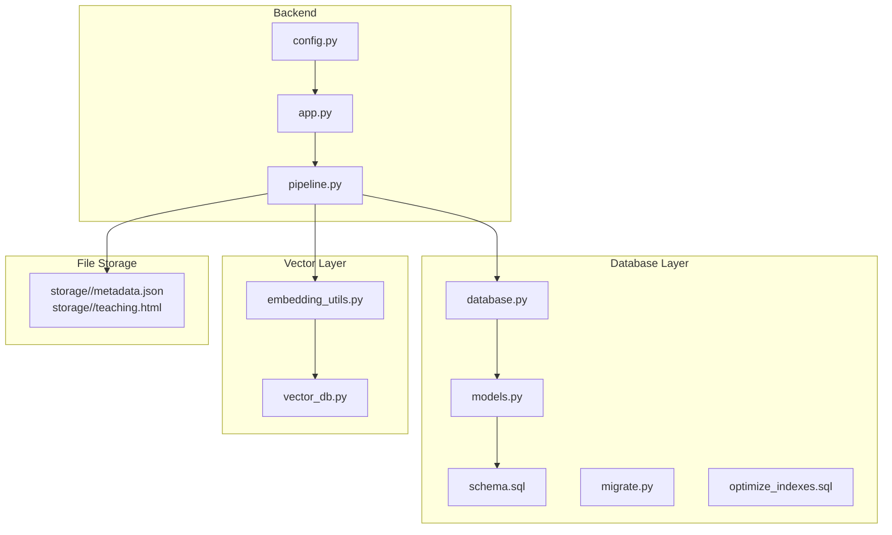
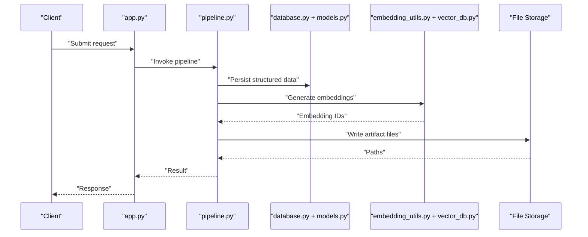
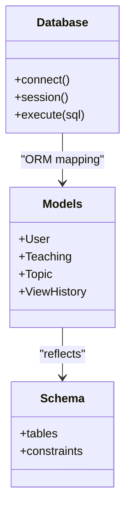
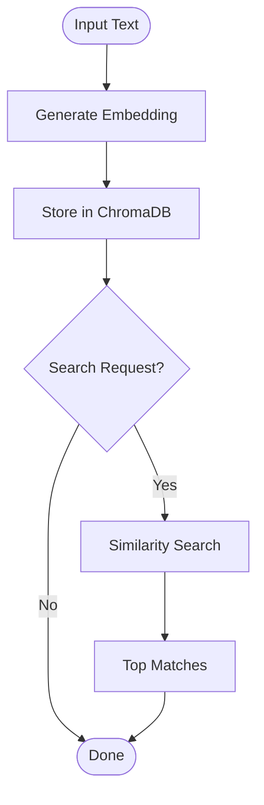
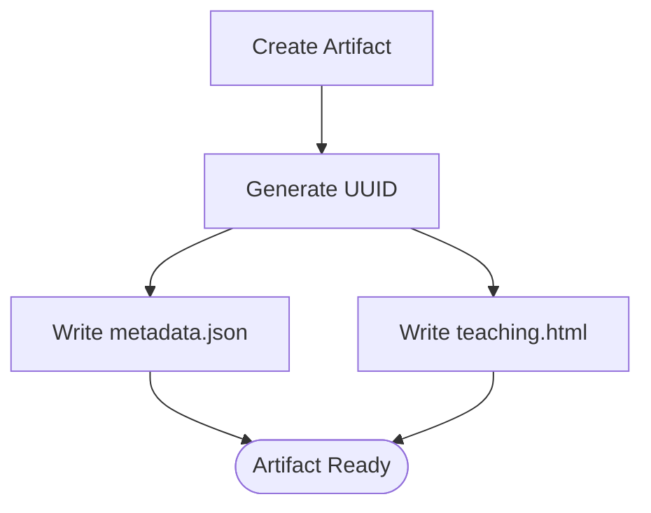
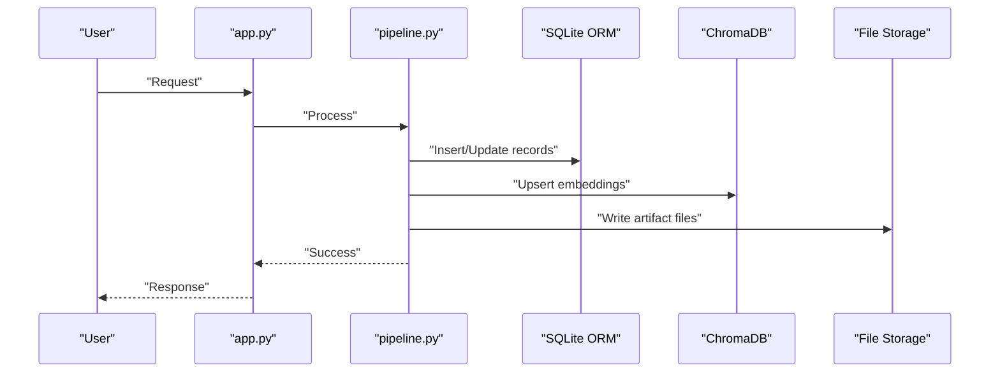
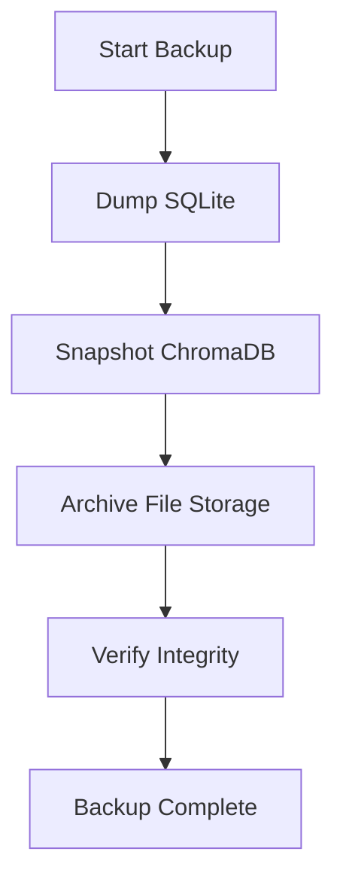
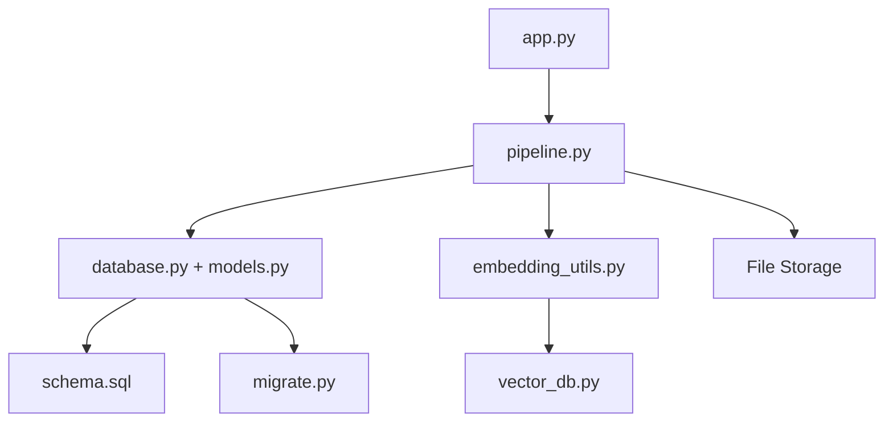

# Data Architecture

<cite>
**Referenced Files in This Document**
- [database.py](file://backend/database/database.py)
- [models.py](file://backend/database/models.py)
- [schema.sql](file://backend/database/schema.sql)
- [migrate.py](file://backend/database/migrate.py)
- [add_ai_teaching_tables.py](file://backend/database/add_ai_teaching_tables.py)
- [add_topics_table.py](file://backend/database/add_topics_table.py)
- [add_user_profile_fields.py](file://backend/database/add_user_profile_fields.py)
- [add_view_history_table.py](file://backend/database/add_view_history_table.py)
- [optimize_indexes.sql](file://backend/database/optimize_indexes.sql)
- [embedding_utils.py](file://backend/utils/embedding_utils.py)
- [vector_db.py](file://backend/utils/vector_db.py)
- [app.py](file://backend/app.py)
- [pipeline.py](file://backend/pipeline.py)
- [config.py](file://backend/config.py)
- [xsyy_backup.sql](file://backend/xsyy_backup.sql)
- [storage/02f5efec-416c-4a17-9bf2-7ebea80cf178/metadata.json](file://storage/02f5efec-416c-4a17-9bf2-7ebea80cf178/metadata.json)
- [storage/02f5efec-416c-4a17-9bf2-7ebea80cf178/teaching.html](file://storage/02f5efec-416c-4a17-9bf2-7ebea80cf178/teaching.html)
</cite>

## Table of Contents
1. [Introduction](#introduction)
2. [Project Structure](#project-structure)
3. [Core Components](#core-components)
4. [Architecture Overview](#architecture-overview)
5. [Detailed Component Analysis](#detailed-component-analysis)
6. [Dependency Analysis](#dependency-analysis)
7. [Performance Considerations](#performance-considerations)
8. [Troubleshooting Guide](#troubleshooting-guide)
9. [Conclusion](#conclusion)
10. [Appendices](#appendices)

## Introduction
This document describes the data layer architecture, focusing on a dual-database approach: SQLite for relational data and ChromaDB for vector embeddings. It explains the ORM layer built with SQLAlchemy, migration strategy, file-based storage for generated content, data flow patterns from user input to persistent storage, caching strategies, indexing for search, and backup/recovery procedures. The goal is to provide both high-level understanding and code-level traceability for developers and operators.

## Project Structure
The data layer spans several directories and files:
- Relational database (SQLite): schema definitions, models, migrations, and index optimization live under backend/database.
- Vector store (ChromaDB): embedding utilities and vector operations are implemented under backend/utils.
- File storage: generated content (e.g., teaching artifacts) is stored as files under storage, organized by UUID with metadata.
- Application entry points and pipelines orchestrate data flows across these systems.

**Diagram sources**
- [app.py](file://backend/app.py)
- [pipeline.py](file://backend/pipeline.py)
- [config.py](file://backend/config.py)
- [database.py](file://backend/database/database.py)
- [models.py](file://backend/database/models.py)
- [schema.sql](file://backend/database/schema.sql)
- [migrate.py](file://backend/database/migrate.py)
- [optimize_indexes.sql](file://backend/database/optimize_indexes.sql)
- [embedding_utils.py](file://backend/utils/embedding_utils.py)
- [vector_db.py](file://backend/utils/vector_db.py)
- [storage/02f5efec-416c-4a17-9bf2-7ebea80cf178/metadata.json](file://storage/02f5efec-416c-4a17-9bf2-7ebea80cf178/metadata.json)
- [storage/02f5efec-416c-4a17-9bf2-7ebea80cf178/teaching.html](file://storage/02f5efec-416c-4a17-9bf2-7ebea80cf178/teaching.html)

**Section sources**
- [database.py](file://backend/database/database.py)
- [models.py](file://backend/database/models.py)
- [schema.sql](file://backend/database/schema.sql)
- [migrate.py](file://backend/database/migrate.py)
- [embedding_utils.py](file://backend/utils/embedding_utils.py)
- [vector_db.py](file://backend/utils/vector_db.py)
- [app.py](file://backend/app.py)
- [pipeline.py](file://backend/pipeline.py)
- [config.py](file://backend/config.py)

## Core Components
- SQLite relational store:
  - Schema and tables defined in SQL; ORM models map to tables via SQLAlchemy.
  - Migrations add or evolve tables and fields over time.
- ChromaDB vector store:
  - Embeddings created from text and persisted for semantic search.
  - Utilities encapsulate embedding generation and query workflows.
- File-based storage:
  - Each artifact has a UUID directory containing metadata and generated content (e.g., HTML).
- Orchestration:
  - Application routes and pipeline coordinate ingestion, processing, persistence, and retrieval across stores.

**Section sources**
- [database.py](file://backend/database/database.py)
- [models.py](file://backend/database/models.py)
- [schema.sql](file://backend/database/schema.sql)
- [migrate.py](file://backend/database/migrate.py)
- [embedding_utils.py](file://backend/utils/embedding_utils.py)
- [vector_db.py](file://backend/utils/vector_db.py)
- [pipeline.py](file://backend/pipeline.py)
- [app.py](file://backend/app.py)

## Architecture Overview
The system uses a dual-store pattern:
- Structured data (users, teachings, topics, view history, quotas) is stored in SQLite with SQLAlchemy ORM.
- Unstructured semantic data (embeddings) is stored in ChromaDB for similarity search.
- Generated artifacts (HTML, previews, templates) are stored as files with JSON metadata.

**Diagram sources**
- [app.py](file://backend/app.py)
- [pipeline.py](file://backend/pipeline.py)
- [database.py](file://backend/database/database.py)
- [models.py](file://backend/database/models.py)
- [embedding_utils.py](file://backend/utils/embedding_utils.py)
- [vector_db.py](file://backend/utils/vector_db.py)
- [storage/02f5efec-416c-4a17-9bf2-7ebea80cf178/metadata.json](file://storage/02f5efec-416c-4a17-9bf2-7ebea80cf178/metadata.json)
- [storage/02f5efec-416c-4a17-9bf2-7ebea80cf178/teaching.html](file://storage/02f5efec-416c-4a17-9bf2-7ebea80cf178/teaching.html)

## Detailed Component Analysis

### Relational Data Store (SQLite + SQLAlchemy ORM)
- Schema management:
  - Initial schema defined in SQL; ORM models reflect table structures.
  - Migration scripts evolve schema incrementally.
- Indexing:
  - Optimized indexes improve query performance for frequent searches.
- Models:
  - SQLAlchemy models define entities such as users, teachings, topics, and view history.

**Diagram sources**
- [database.py](file://backend/database/database.py)
- [models.py](file://backend/database/models.py)
- [schema.sql](file://backend/database/schema.sql)

**Section sources**
- [database.py](file://backend/database/database.py)
- [models.py](file://backend/database/models.py)
- [schema.sql](file://backend/database/schema.sql)
- [migrate.py](file://backend/database/migrate.py)
- [add_ai_teaching_tables.py](file://backend/database/add_ai_teaching_tables.py)
- [add_topics_table.py](file://backend/database/add_topics_table.py)
- [add_user_profile_fields.py](file://backend/database/add_user_profile_fields.py)
- [add_view_history_table.py](file://backend/database/add_view_history_table.py)
- [optimize_indexes.sql](file://backend/database/optimize_indexes.sql)

### Vector Store (ChromaDB)
- Embedding generation:
  - Text inputs are transformed into vectors using embedding utilities.
- Persistence:
  - ChromaDB stores embeddings with associated metadata for retrieval.
- Search:
  - Similarity queries return relevant items based on vector proximity.

**Diagram sources**
- [embedding_utils.py](file://backend/utils/embedding_utils.py)
- [vector_db.py](file://backend/utils/vector_db.py)

**Section sources**
- [embedding_utils.py](file://backend/utils/embedding_utils.py)
- [vector_db.py](file://backend/utils/vector_db.py)

### File-Based Storage System
- Organization:
  - Each artifact is stored under a UUID-named directory.
  - Metadata JSON captures attributes like creation time, tags, and references.
  - Generated content (e.g., HTML) is stored alongside metadata.
- Access patterns:
  - Read paths from metadata; write new artifacts atomically when possible.

**Diagram sources**
- [storage/02f5efec-416c-4a17-9bf2-7ebea80cf178/metadata.json](file://storage/02f5efec-416c-4a17-9bf2-7ebea80cf178/metadata.json)
- [storage/02f5efec-416c-4a17-9bf2-7ebea80cf178/teaching.html](file://storage/02f5efec-416c-4a17-9bf2-7ebea80cf178/teaching.html)

**Section sources**
- [storage/02f5efec-416c-4a17-9bf2-7ebea80cf178/metadata.json](file://storage/02f5efec-416c-4a17-9bf2-7ebea80cf178/metadata.json)
- [storage/02f5efec-416c-4a17-9bf2-7ebea80cf178/teaching.html](file://storage/02f5efec-416c-4a17-9bf2-7ebea80cf178/teaching.html)

### Data Flow Patterns
End-to-end flow from user input to persistent storage:
- Ingestion:
  - User requests processed by application layer.
- Processing:
  - Pipeline orchestrates transformations and writes to stores.
- Persistence:
  - Relational data saved via ORM; embeddings persisted in ChromaDB; artifacts written to file storage.
- Retrieval:
  - Queries combine relational filters with vector similarity; results assembled and returned.

**Diagram sources**
- [app.py](file://backend/app.py)
- [pipeline.py](file://backend/pipeline.py)
- [database.py](file://backend/database/database.py)
- [models.py](file://backend/database/models.py)
- [embedding_utils.py](file://backend/utils/embedding_utils.py)
- [vector_db.py](file://backend/utils/vector_db.py)
- [storage/02f5efec-416c-4a17-9bf2-7ebea80cf178/metadata.json](file://storage/02f5efec-416c-4a17-9bf2-7ebea80cf178/metadata.json)

**Section sources**
- [app.py](file://backend/app.py)
- [pipeline.py](file://backend/pipeline.py)
- [database.py](file://backend/database/database.py)
- [models.py](file://backend/database/models.py)
- [embedding_utils.py](file://backend/utils/embedding_utils.py)
- [vector_db.py](file://backend/utils/vector_db.py)

### Caching Strategies
- Purpose:
  - Reduce repeated computation and I/O for frequently accessed data.
- Approaches:
  - In-memory caches for hot reads (e.g., configuration, small lookups).
  - Cache invalidation tied to write events to maintain consistency.
- Integration:
  - Cache layers sit between application and storage backends.

[No sources needed since this section provides general guidance]

### Backup and Recovery Procedures
- Relational backups:
  - Use SQL dumps to capture schema and data snapshots.
- Vector store backups:
  - Export or snapshot ChromaDB collections as needed.
- File storage backups:
  - Archive UUID directories preserving metadata and content.
- Recovery:
  - Restore order: files first, then vector store, then relational database to ensure referential integrity.

**Diagram sources**
- [xsyy_backup.sql](file://backend/xsyy_backup.sql)

**Section sources**
- [xsyy_backup.sql](file://backend/xsyy_backup.sql)

## Dependency Analysis
Key dependencies among components:
- Application depends on pipeline for orchestration.
- Pipeline depends on database ORM, vector utilities, and file storage.
- Vector utilities depend on embedding generation and ChromaDB client.
- Database layer depends on schema and migration scripts.

**Diagram sources**
- [app.py](file://backend/app.py)
- [pipeline.py](file://backend/pipeline.py)
- [database.py](file://backend/database/database.py)
- [models.py](file://backend/database/models.py)
- [embedding_utils.py](file://backend/utils/embedding_utils.py)
- [vector_db.py](file://backend/utils/vector_db.py)
- [schema.sql](file://backend/database/schema.sql)
- [migrate.py](file://backend/database/migrate.py)

**Section sources**
- [app.py](file://backend/app.py)
- [pipeline.py](file://backend/pipeline.py)
- [database.py](file://backend/database/database.py)
- [models.py](file://backend/database/models.py)
- [embedding_utils.py](file://backend/utils/embedding_utils.py)
- [vector_db.py](file://backend/utils/vector_db.py)
- [schema.sql](file://backend/database/schema.sql)
- [migrate.py](file://backend/database/migrate.py)

## Performance Considerations
- Database indexing:
  - Optimize queries with targeted indexes for frequent filters and joins.
- Vector search tuning:
  - Adjust top-k and distance metrics to balance recall and latency.
- File I/O:
  - Use atomic writes and avoid locking hot paths; consider streaming large artifacts.
- Concurrency:
  - Ensure thread-safe access to shared resources (DB sessions, ChromaDB clients).
- Caching:
  - Cache expensive computations and frequent reads; implement cache warming for startup.

[No sources needed since this section provides general guidance]

## Troubleshooting Guide
Common issues and resolutions:
- Database connection errors:
  - Validate SQLite path and permissions; check session lifecycle.
- Migration failures:
  - Review migration scripts; ensure idempotency and rollback plans.
- Vector store connectivity:
  - Confirm ChromaDB endpoint and collection names; handle retries.
- File storage permissions:
  - Ensure write access to storage directories; validate metadata format.
- Consistency checks:
  - Cross-validate foreign keys and embedding references after recovery.

**Section sources**
- [database.py](file://backend/database/database.py)
- [migrate.py](file://backend/database/migrate.py)
- [vector_db.py](file://backend/utils/vector_db.py)

## Conclusion
The data architecture combines SQLite for reliable relational storage, ChromaDB for semantic search, and file-based storage for rich artifacts. SQLAlchemy provides an expressive ORM layer, while migrations ensure schema evolution. Pipelines orchestrate data flows across stores, and careful indexing and caching optimize performance. Robust backup and recovery procedures protect data integrity across distributed components.

## Appendices

### Migration Strategy
- Incremental migrations:
  - Scripts add tables, fields, and constraints without breaking existing deployments.
- Idempotency:
  - Migrations should be safe to re-run; guard against duplicate changes.
- Rollback planning:
  - Maintain reverse migrations where feasible.

**Section sources**
- [migrate.py](file://backend/database/migrate.py)
- [add_ai_teaching_tables.py](file://backend/database/add_ai_teaching_tables.py)
- [add_topics_table.py](file://backend/database/add_topics_table.py)
- [add_user_profile_fields.py](file://backend/database/add_user_profile_fields.py)
- [add_view_history_table.py](file://backend/database/add_view_history_table.py)

### Indexing Strategy for Search
- Relational indexes:
  - Primary keys, unique constraints, and composite indexes for common queries.
- Vector indexes:
  - ChromaDB manages internal indexes; tune retrieval parameters at query time.

**Section sources**
- [optimize_indexes.sql](file://backend/database/optimize_indexes.sql)
- [vector_db.py](file://backend/utils/vector_db.py)

### Data Consistency Mechanisms
- Transactions:
  - Wrap multi-step writes in transactions to ensure atomicity.
- References:
  - Maintain consistent IDs across relational, vector, and file stores.
- Validation:
  - Validate payloads before persisting; enforce constraints at ORM and schema levels.

**Section sources**
- [database.py](file://backend/database/database.py)
- [models.py](file://backend/database/models.py)
- [pipeline.py](file://backend/pipeline.py)