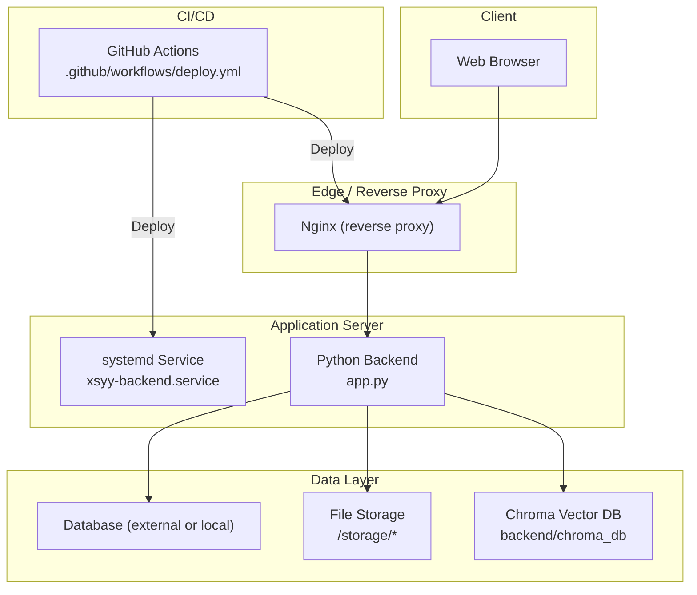
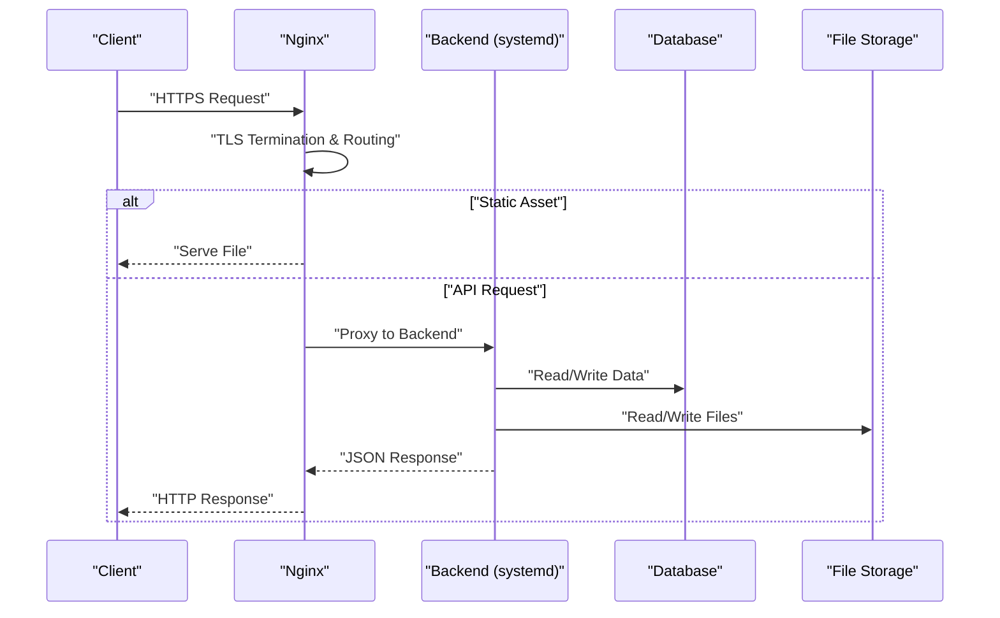
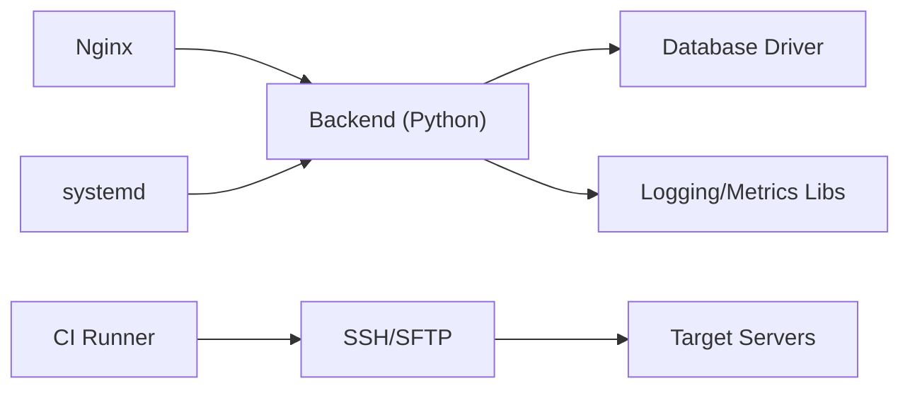

# Deployment Architecture

<cite>
**Referenced Files in This Document**
- [deploy.yml](file://.github/workflows/deploy.yml)
- [nginx.conf](file://deploy/nginx.conf)
- [xsyy-backend.service](file://deploy/xsyy-backend.service)
- [deploy.sh](file://deploy/deploy.sh)
- [deploy-prod.sh](file://deploy/deploy-prod.sh)
- [deploy-dev.sh](file://deploy/deploy-dev.sh)
- [migrate.sh](file://deploy/migrate.sh)
- [rollback.sh](file://deploy/rollback.sh)
- [version.sh](file://deploy/version.sh)
- [DEPLOYMENT.md](file://deploy/DEPLOYMENT.md)
- [app.py](file://backend/app.py)
- [config.py](file://backend/config.py)
- [monitoring.py](file://backend/monitoring.py)
- [requirements.txt](file://backend/requirements.txt)
- [env.example](file://backend/env.example)
- [schema.sql](file://backend/database/schema.sql)
- [migrate.py](file://backend/database/migrate.py)
</cite>

## Table of Contents
1. [Introduction](#introduction)
2. [Project Structure](#project-structure)
3. [Core Components](#core-components)
4. [Architecture Overview](#architecture-overview)
5. [Detailed Component Analysis](#detailed-component-analysis)
6. [Dependency Analysis](#dependency-analysis)
7. [Performance Considerations](#performance-considerations)
8. [Troubleshooting Guide](#troubleshooting-guide)
9. [Conclusion](#conclusion)
10. [Appendices](#appendices)

## Introduction
This document describes the production deployment and infrastructure design for the application, focusing on:
- Nginx as a reverse proxy
- systemd service management for the backend
- Automated CI/CD pipeline with GitHub Actions
- Environment configuration management
- Scaling considerations and load balancing approaches
- Monitoring setup and logging aggregation
- Containerization strategy
- Disaster recovery procedures
- Security considerations for production environments

The goal is to provide a clear, actionable guide for deploying, operating, and scaling the system reliably in production.

## Project Structure
The repository includes deployment artifacts under deploy/, CI workflow under .github/workflows/, and backend runtime components under backend/. The web frontend resides under web/ and is served statically by Nginx.

**Diagram sources**
- [nginx.conf](file://deploy/nginx.conf)
- [xsyy-backend.service](file://deploy/xsyy-backend.service)
- [app.py](file://backend/app.py)
- [deploy.yml](file://.github/workflows/deploy.yml)

**Section sources**
- [DEPLOYMENT.md](file://deploy/DEPLOYMENT.md)
- [nginx.conf](file://deploy/nginx.conf)
- [xsyy-backend.service](file://deploy/xsyy-backend.service)
- [deploy.yml](file://.github/workflows/deploy.yml)

## Core Components
- Nginx reverse proxy: Terminates TLS, routes HTTP(S) traffic to the backend, serves static assets, and can enforce security headers and rate limiting.
- systemd service: Manages the Python backend process lifecycle, restart policies, resource limits, and log capture via journald.
- CI/CD pipeline: GitHub Actions workflow that builds, tests, migrates, and deploys artifacts to target servers.
- Environment configuration: Centralized environment variables and secrets managed via env files and secure secret stores.
- Data persistence: Relational database schema and migrations; file storage for generated content; optional vector store for embeddings.

Key responsibilities:
- Nginx: request routing, caching, compression, SSL termination, access control.
- systemd: process supervision, auto-restart, resource constraints, integration with OS logging.
- CI/CD: automated build/test/deploy, rollback support, version tagging.
- Configuration: separation of dev/prod settings, sensitive values out of code.
- Data layer: schema evolution, backups, and integrity checks.

**Section sources**
- [nginx.conf](file://deploy/nginx.conf)
- [xsyy-backend.service](file://deploy/xsyy-backend.service)
- [deploy.yml](file://.github/workflows/deploy.yml)
- [env.example](file://backend/env.example)
- [schema.sql](file://backend/database/schema.sql)
- [migrate.py](file://backend/database/migrate.py)

## Architecture Overview
Production topology overview:
- Clients connect over HTTPS to Nginx.
- Nginx proxies API requests to the backend process managed by systemd.
- Static assets are served directly by Nginx from the web build output.
- The backend persists data to a relational database and writes files to persistent storage.
- Optional vector embeddings are stored in a dedicated directory or external service.
- CI/CD automates deployments and rollbacks.

**Diagram sources**
- [nginx.conf](file://deploy/nginx.conf)
- [xsyy-backend.service](file://deploy/xsyy-backend.service)
- [app.py](file://backend/app.py)

## Detailed Component Analysis

### Nginx Reverse Proxy
Responsibilities:
- TLS termination and certificate management
- Reverse proxy to backend application
- Static asset serving and caching
- Security headers, CORS, and rate limiting
- Access logs and error logs for observability

Configuration highlights:
- Upstream definition pointing to the backend service port
- Location blocks for API and static assets
- Security headers and compression directives
- Logging paths aligned with journald or log rotation

Operational notes:
- Validate configuration before reload
- Use zero-downtime reloads
- Monitor upstream health and response times

**Section sources**
- [nginx.conf](file://deploy/nginx.conf)

### systemd Service Management
Responsibilities:
- Start, stop, restart, and enable the backend at boot
- Auto-restart on failure
- Resource limits (CPU, memory)
- Environment variable injection
- Log capture via journald

Service unit highlights:
- ExecStart path to the backend entrypoint
- WorkingDirectory set to project root
- User/Group for least privilege
- Restart=always and RestartSec for resilience
- EnvironmentFile for non-sensitive config
- StandardOutput/StandardError for journald integration

Operational notes:
- Reload daemon after changes
- Inspect logs with journalctl
- Tune resource limits based on workload

**Section sources**
- [xsyy-backend.service](file://deploy/xsyy-backend.service)

### CI/CD Pipeline (GitHub Actions)
Responsibilities:
- Build and test the application
- Run database migrations safely
- Deploy artifacts to target servers
- Support rollback and versioning

Workflow highlights:
- Trigger on push/merge to main or tags
- Matrix jobs for lint, test, build
- Secrets for SSH access and environment variables
- Staging and production deployment steps
- Rollback job using previous release artifacts

Operational notes:
- Pin base images and dependencies
- Cache dependencies to speed up builds
- Store deployment artifacts with semantic versions

**Section sources**
- [deploy.yml](file://.github/workflows/deploy.yml)

### Environment Configuration Management
Responsibilities:
- Separate configuration per environment (dev/staging/prod)
- Sensitive values (secrets) managed securely
- Validation of required variables at startup

Approach:
- Use env files for non-sensitive settings
- Inject secrets via CI/CD or host secret managers
- Provide an example template for new environments

Operational notes:
- Never commit secrets to source control
- Validate configuration early in the startup sequence
- Document all required variables

**Section sources**
- [env.example](file://backend/env.example)
- [config.py](file://backend/config.py)

### Database and Data Persistence
Responsibilities:
- Schema definitions and migrations
- Backup and restore procedures
- Connection pooling and performance tuning

Implementation:
- SQL schema and migration scripts
- Migration runner executed during deployment
- Persistent volume mounts for file storage and vector DB

Operational notes:
- Back up databases regularly
- Test migrations on staging first
- Use read replicas if needed for scale-out reads

**Section sources**
- [schema.sql](file://backend/database/schema.sql)
- [migrate.py](file://backend/database/migrate.py)
- [migrate.sh](file://deploy/migrate.sh)

### Monitoring and Observability
Responsibilities:
- Health check endpoints
- Metrics exposure for CPU, memory, request rates, errors
- Structured logging and centralized collection

Implementation:
- Health endpoint for readiness/liveness probes
- Metrics module for key KPIs
- Integration with journald and log aggregation systems

Operational notes:
- Expose metrics on a restricted internal port
- Configure alerting thresholds
- Ensure log retention policies comply with compliance requirements

**Section sources**
- [monitoring.py](file://backend/monitoring.py)
- [nginx.conf](file://deploy/nginx.conf)

### Load Balancing and Scaling
Approaches:
- Horizontal scaling: run multiple backend instances behind Nginx upstream
- Vertical scaling: increase resources per instance
- Stateless design: externalize sessions and caches
- Caching: use Nginx cache for static assets and short-lived responses

Considerations:
- Sticky sessions only if necessary
- Shared storage for uploads and templates
- Database connection limits and pool sizing

**Section sources**
- [nginx.conf](file://deploy/nginx.conf)
- [xsyy-backend.service](file://deploy/xsyy-backend.service)

### Containerization Strategy
Options:
- Docker containers for consistent environments
- Orchestration with Kubernetes or Docker Compose
- Multi-stage builds to minimize image size

Best practices:
- Non-root user inside container
- Read-only filesystem where possible
- Externalize secrets via environment or secret mounts
- Health checks and graceful shutdown

**Section sources**
- [requirements.txt](file://backend/requirements.txt)
- [app.py](file://backend/app.py)

### Disaster Recovery Procedures
Procedures:
- Regular database backups and offsite replication
- Snapshot-based backups for file storage
- Versioned deployments with quick rollback
- Runbook for incident response and failover

Recovery steps:
- Restore database from latest backup
- Rehydrate file storage from snapshots
- Redeploy known-good version
- Verify health and smoke tests

**Section sources**
- [rollback.sh](file://deploy/rollback.sh)
- [migrate.sh](file://deploy/migrate.sh)

## Dependency Analysis
Runtime dependencies:
- Python packages defined in requirements
- Nginx for reverse proxy and static serving
- systemd for process management
- Database driver and ORM libraries used by the backend

Build-time dependencies:
- Node.js toolchain for frontend build (if applicable)
- CI runners with SSH clients and deployment tools

**Diagram sources**
- [requirements.txt](file://backend/requirements.txt)
- [nginx.conf](file://deploy/nginx.conf)
- [xsyy-backend.service](file://deploy/xsyy-backend.service)
- [deploy.yml](file://.github/workflows/deploy.yml)

**Section sources**
- [requirements.txt](file://backend/requirements.txt)
- [deploy.yml](file://.github/workflows/deploy.yml)

## Performance Considerations
- Enable gzip/brotli compression in Nginx for text assets
- Tune worker processes and connections in Nginx
- Use keepalive connections between Nginx and backend
- Set appropriate timeouts for long-running operations
- Implement caching strategies for repeated queries
- Profile backend hot paths and optimize I/O
- Use connection pooling for database access
- Monitor and right-size CPU/memory limits in systemd

[No sources needed since this section provides general guidance]

## Troubleshooting Guide
Common issues and resolutions:
- Nginx configuration errors: validate config and reload gracefully
- Backend crashes: inspect journald logs and core dumps
- Database connectivity: verify credentials, network ACLs, and firewall rules
- Disk space exhaustion: monitor storage usage and rotate logs
- High latency: analyze Nginx upstream metrics and backend profiling

Operational commands:
- Check service status and recent logs
- Validate Nginx configuration syntax
- Review CI/CD job logs for failures
- Perform health checks against endpoints

**Section sources**
- [xsyy-backend.service](file://deploy/xsyy-backend.service)
- [nginx.conf](file://deploy/nginx.conf)
- [deploy.yml](file://.github/workflows/deploy.yml)

## Conclusion
This architecture leverages Nginx for robust reverse proxying, systemd for resilient process management, and GitHub Actions for automated CI/CD. With proper environment configuration, monitoring, and disaster recovery procedures, the system can be scaled horizontally and operated securely in production. Adopt containerization and orchestration as the platform grows to improve consistency and operational efficiency.

[No sources needed since this section summarizes without analyzing specific files]

## Appendices

### Deployment Scripts Reference
- deploy.sh: General deployment automation
- deploy-prod.sh: Production-specific deployment steps
- deploy-dev.sh: Development environment deployment
- migrate.sh: Database migration execution
- rollback.sh: Rollback to previous version
- version.sh: Version reporting and tagging

**Section sources**
- [deploy.sh](file://deploy/deploy.sh)
- [deploy-prod.sh](file://deploy/deploy-prod.sh)
- [deploy-dev.sh](file://deploy/deploy-dev.sh)
- [migrate.sh](file://deploy/migrate.sh)
- [rollback.sh](file://deploy/rollback.sh)
- [version.sh](file://deploy/version.sh)

### Security Checklist
- Enforce HTTPS and strong ciphers in Nginx
- Restrict access to admin endpoints
- Rotate secrets regularly and avoid committing them
- Apply least privilege to service accounts
- Harden OS and container images
- Enable audit logging and integrate with SIEM

[No sources needed since this section provides general guidance]