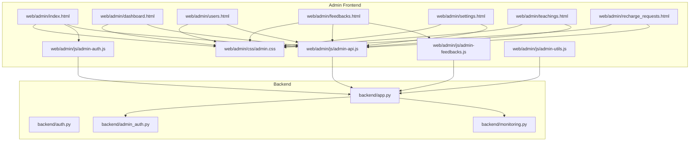
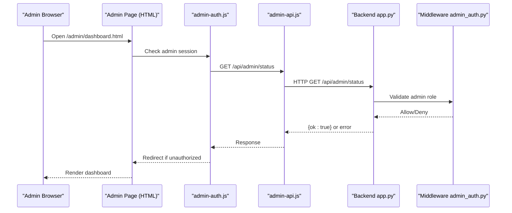
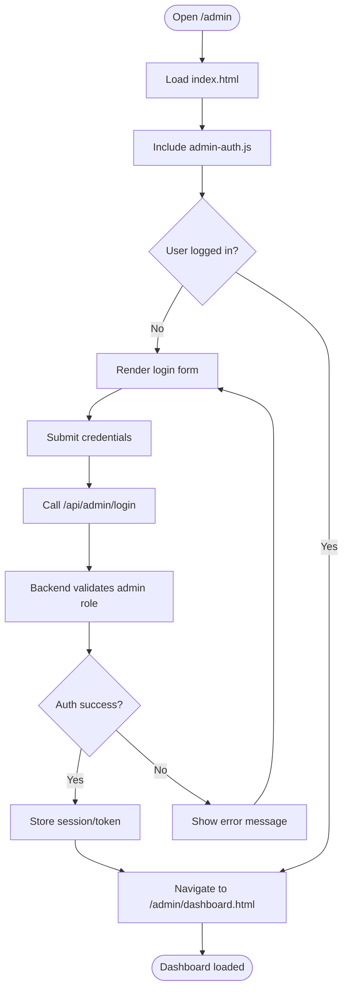
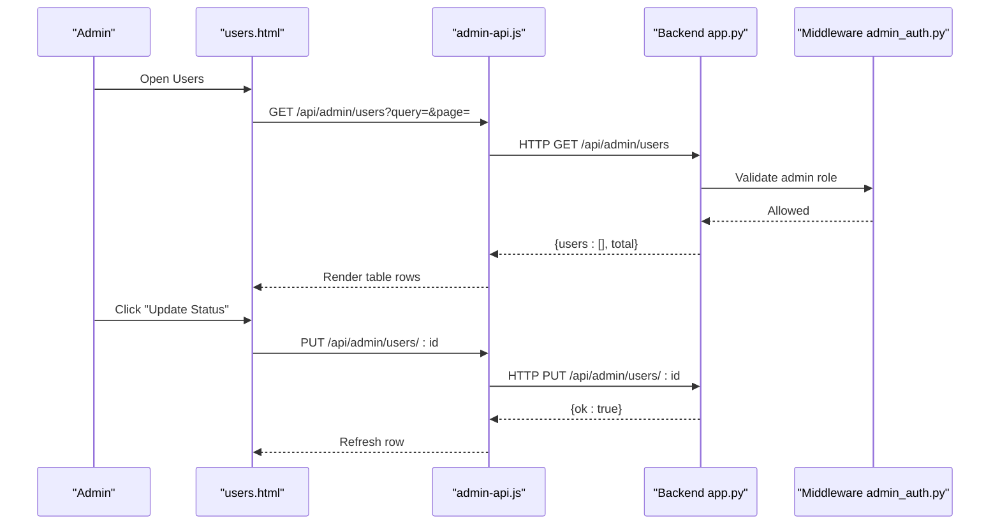
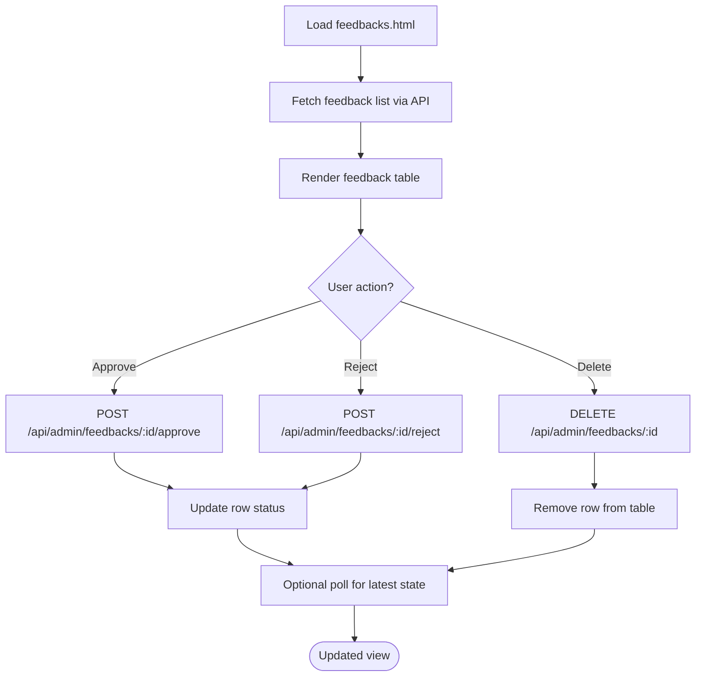
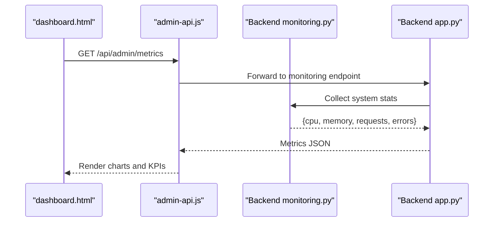
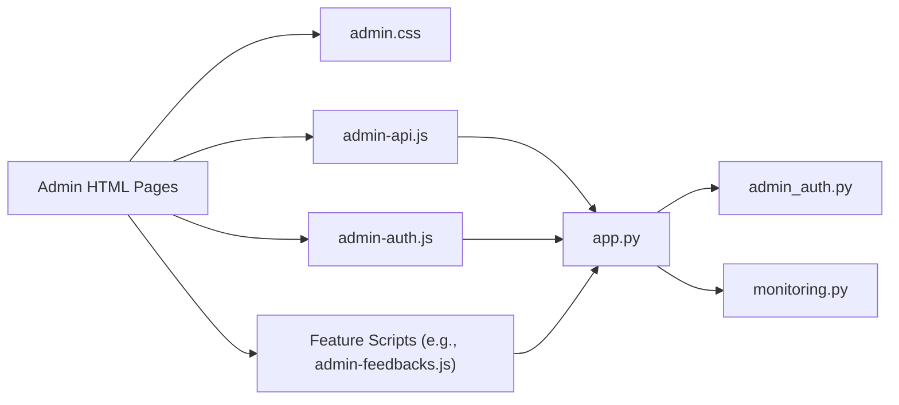

# Admin Dashboard Interface

<cite>
**Referenced Files in This Document**
- [dashboard.html](file://web/admin/dashboard.html)
- [users.html](file://web/admin/users.html)
- [feedbacks.html](file://web/admin/feedbacks.html)
- [settings.html](file://web/admin/settings.html)
- [teachings.html](file://web/admin/teachings.html)
- [recharge_requests.html](file://web/admin/recharge_requests.html)
- [index.html](file://web/admin/index.html)
- [admin.css](file://web/admin/css/admin.css)
- [admin-api.js](file://web/admin/js/admin-api.js)
- [admin-auth.js](file://web/admin/js/admin-auth.js)
- [admin-feedbacks.js](file://web/admin/js/admin-feedbacks.js)
- [admin-utils.js](file://web/admin/js/admin-utils.js)
- [app.py](file://backend/app.py)
- [auth.py](file://backend/auth.py)
- [admin_auth.py](file://backend/admin_auth.py)
- [monitoring.py](file://backend/monitoring.py)
</cite>

## Table of Contents
1. [Introduction](#introduction)
2. [Project Structure](#project-structure)
3. [Core Components](#core-components)
4. [Architecture Overview](#architecture-overview)
5. [Detailed Component Analysis](#detailed-component-analysis)
6. [Dependency Analysis](#dependency-analysis)
7. [Performance Considerations](#performance-considerations)
8. [Troubleshooting Guide](#troubleshooting-guide)
9. [Conclusion](#conclusion)

## Introduction
This document describes the administrative dashboard interface, including its HTML structure, JavaScript functionality for user management, content moderation, and system monitoring. It explains the admin authentication flow, API integration patterns, real-time data updates, layout and navigation, interactive features (feedback management, user administration, system settings), examples of admin-specific API calls, data visualization patterns, and security considerations for administrative functions.

## Project Structure
The admin panel is implemented as a set of static HTML pages under web/admin with shared CSS and JavaScript modules. The backend exposes REST endpoints for admin operations and provides middleware to enforce admin-only access.

**Diagram sources**
- [dashboard.html](file://web/admin/dashboard.html)
- [users.html](file://web/admin/users.html)
- [feedbacks.html](file://web/admin/feedbacks.html)
- [settings.html](file://web/admin/settings.html)
- [teachings.html](file://web/admin/teachings.html)
- [recharge_requests.html](file://web/admin/recharge_requests.html)
- [index.html](file://web/admin/index.html)
- [admin.css](file://web/admin/css/admin.css)
- [admin-api.js](file://web/admin/js/admin-api.js)
- [admin-auth.js](file://web/admin/js/admin-auth.js)
- [admin-feedbacks.js](file://web/admin/js/admin-feedbacks.js)
- [admin-utils.js](file://web/admin/js/admin-utils.js)
- [app.py](file://backend/app.py)
- [auth.py](file://backend/auth.py)
- [admin_auth.py](file://backend/admin_auth.py)
- [monitoring.py](file://backend/monitoring.py)

**Section sources**
- [dashboard.html](file://web/admin/dashboard.html)
- [users.html](file://web/admin/users.html)
- [feedbacks.html](file://web/admin/feedbacks.html)
- [settings.html](file://web/admin/settings.html)
- [teachings.html](file://web/admin/teachings.html)
- [recharge_requests.html](file://web/admin/recharge_requests.html)
- [index.html](file://web/admin/index.html)
- [admin.css](file://web/admin/css/admin.css)
- [admin-api.js](file://web/admin/js/admin-api.js)
- [admin-auth.js](file://web/admin/js/admin-auth.js)
- [admin-feedbacks.js](file://web/admin/js/admin-feedbacks.js)
- [admin-utils.js](file://web/admin/js/admin-utils.js)
- [app.py](file://backend/app.py)
- [auth.py](file://backend/auth.py)
- [admin_auth.py](file://backend/admin_auth.py)
- [monitoring.py](file://backend/monitoring.py)

## Core Components
- Authentication module: Handles admin login, session validation, and redirects.
- API client: Centralized HTTP client for admin endpoints, request/response handling, error normalization, and token/session management.
- Feedback manager: Loads feedback items, supports filtering/pagination, and actions like approve/reject/delete.
- Utilities: Shared helpers for DOM manipulation, formatting, and UI state.
- Styles: Admin-specific CSS for layout, tables, modals, and responsive behavior.

Key responsibilities:
- Enforce admin-only routes on the frontend by checking auth state before rendering protected pages.
- Provide consistent API call patterns with retries and error display.
- Render dynamic lists and charts using server responses.
- Manage modal dialogs and form submissions for admin actions.

**Section sources**
- [admin-auth.js](file://web/admin/js/admin-auth.js)
- [admin-api.js](file://web/admin/js/admin-api.js)
- [admin-feedbacks.js](file://web/admin/js/admin-feedbacks.js)
- [admin-utils.js](file://web/admin/js/admin-utils.js)
- [admin.css](file://web/admin/css/admin.css)

## Architecture Overview
The admin dashboard follows a classic client-server architecture:
- Static HTML pages load shared JS/CSS.
- JS modules call backend REST endpoints via the API client.
- Backend validates admin privileges using middleware and returns JSON payloads.
- Real-time updates are achieved through periodic polling or event-driven refreshes within the frontend.

**Diagram sources**
- [dashboard.html](file://web/admin/dashboard.html)
- [admin-auth.js](file://web/admin/js/admin-auth.js)
- [admin-api.js](file://web/admin/js/admin-api.js)
- [app.py](file://backend/app.py)
- [admin_auth.py](file://backend/admin_auth.py)

## Detailed Component Analysis

### Authentication Flow
- Login page entry point loads index.html which includes admin-auth.js.
- On successful credentials submission, the client stores session info and navigates to the dashboard.
- Protected pages check auth state on load; unauthenticated users are redirected to login.
- Session validation occurs against backend endpoints that require admin roles.

**Diagram sources**
- [index.html](file://web/admin/index.html)
- [admin-auth.js](file://web/admin/js/admin-auth.js)
- [app.py](file://backend/app.py)
- [admin_auth.py](file://backend/admin_auth.py)

**Section sources**
- [index.html](file://web/admin/index.html)
- [admin-auth.js](file://web/admin/js/admin-auth.js)
- [app.py](file://backend/app.py)
- [admin_auth.py](file://backend/admin_auth.py)

### API Integration Patterns
- Centralized client in admin-api.js handles base URL configuration, headers, and common error handling.
- Methods encapsulate CRUD operations for admin resources (users, feedbacks, teachings, settings).
- Requests include admin authorization headers or cookies as required by backend middleware.
- Responses are normalized into consistent structures for UI consumption.

Typical patterns:
- GET list endpoints with query parameters for pagination/filtering.
- POST/PUT for create/update actions with payload validation.
- DELETE for removal operations with confirmation prompts.
- Error mapping to user-friendly messages and retry logic where appropriate.

**Section sources**
- [admin-api.js](file://web/admin/js/admin-api.js)
- [app.py](file://backend/app.py)

### User Management
- users.html renders a table of users with search, filter, and pagination controls.
- Actions include view details, update status, and delete accounts.
- Data is fetched via admin-api.js methods calling backend user endpoints guarded by admin middleware.

**Diagram sources**
- [users.html](file://web/admin/users.html)
- [admin-api.js](file://web/admin/js/admin-api.js)
- [app.py](file://backend/app.py)
- [admin_auth.py](file://backend/admin_auth.py)

**Section sources**
- [users.html](file://web/admin/users.html)
- [admin-api.js](file://web/admin/js/admin-api.js)
- [app.py](file://backend/app.py)
- [admin_auth.py](file://backend/admin_auth.py)

### Content Moderation (Feedbacks)
- feedbacks.html displays feedback entries with filters (status, date range) and bulk actions.
- admin-feedbacks.js manages listing, approval/rejection workflows, and deletion.
- Real-time updates are achieved by refreshing the list after actions or polling at intervals.

**Diagram sources**
- [feedbacks.html](file://web/admin/feedbacks.html)
- [admin-feedbacks.js](file://web/admin/js/admin-feedbacks.js)
- [admin-api.js](file://web/admin/js/admin-api.js)
- [app.py](file://backend/app.py)

**Section sources**
- [feedbacks.html](file://web/admin/feedbacks.html)
- [admin-feedbacks.js](file://web/admin/js/admin-feedbacks.js)
- [admin-api.js](file://web/admin/js/admin-api.js)
- [app.py](file://backend/app.py)

### System Monitoring
- dashboard.html aggregates key metrics such as active users, requests per minute, and error rates.
- Data is sourced from backend monitoring endpoints and rendered using lightweight charting components.
- Updates occur periodically via polling or when triggered by user interactions.

**Diagram sources**
- [dashboard.html](file://web/admin/dashboard.html)
- [admin-api.js](file://web/admin/js/admin-api.js)
- [monitoring.py](file://backend/monitoring.py)
- [app.py](file://backend/app.py)

**Section sources**
- [dashboard.html](file://web/admin/dashboard.html)
- [admin-api.js](file://web/admin/js/admin-api.js)
- [monitoring.py](file://backend/monitoring.py)
- [app.py](file://backend/app.py)

### Teachings and Recharge Requests
- teachings.html lists teaching materials with filters and moderation actions.
- recharge_requests.html shows pending recharge requests with approve/deny workflows.
- Both pages use admin-api.js to interact with backend endpoints and render results dynamically.

**Section sources**
- [teachings.html](file://web/admin/teachings.html)
- [recharge_requests.html](file://web/admin/recharge_requests.html)
- [admin-api.js](file://web/admin/js/admin-api.js)
- [app.py](file://backend/app.py)

### Settings
- settings.html provides configuration toggles and save operations.
- Changes are persisted via backend settings endpoints guarded by admin middleware.

**Section sources**
- [settings.html](file://web/admin/settings.html)
- [admin-api.js](file://web/admin/js/admin-api.js)
- [app.py](file://backend/app.py)
- [admin_auth.py](file://backend/admin_auth.py)

## Dependency Analysis
Frontend dependencies:
- HTML pages depend on admin.css for styling and JS modules for behavior.
- admin-api.js centralizes HTTP communication and is reused across pages.
- admin-auth.js enforces access control and redirects.
- Feature-specific scripts (e.g., admin-feedbacks.js) build on top of admin-api.js.

Backend dependencies:
- app.py registers admin routes and applies admin_auth middleware.
- admin_auth.py validates admin sessions/tokens.
- monitoring.py supplies system metrics used by the dashboard.

**Diagram sources**
- [dashboard.html](file://web/admin/dashboard.html)
- [users.html](file://web/admin/users.html)
- [feedbacks.html](file://web/admin/feedbacks.html)
- [settings.html](file://web/admin/settings.html)
- [teachings.html](file://web/admin/teachings.html)
- [recharge_requests.html](file://web/admin/recharge_requests.html)
- [admin.css](file://web/admin/css/admin.css)
- [admin-api.js](file://web/admin/js/admin-api.js)
- [admin-auth.js](file://web/admin/js/admin-auth.js)
- [admin-feedbacks.js](file://web/admin/js/admin-feedbacks.js)
- [app.py](file://backend/app.py)
- [admin_auth.py](file://backend/admin_auth.py)
- [monitoring.py](file://backend/monitoring.py)

**Section sources**
- [admin-api.js](file://web/admin/js/admin-api.js)
- [admin-auth.js](file://web/admin/js/admin-auth.js)
- [admin-feedbacks.js](file://web/admin/js/admin-feedbacks.js)
- [admin.css](file://web/admin/css/admin.css)
- [app.py](file://backend/app.py)
- [admin_auth.py](file://backend/admin_auth.py)
- [monitoring.py](file://backend/monitoring.py)

## Performance Considerations
- Use pagination and server-side filtering to reduce payload sizes for large datasets.
- Debounce search inputs and implement virtual scrolling for long lists.
- Cache frequently accessed read-only data in-memory on the client with invalidation strategies.
- Prefer incremental updates over full re-renders for tables and charts.
- Limit polling frequency for metrics and switch to event-driven updates when possible.

[No sources needed since this section provides general guidance]

## Troubleshooting Guide
Common issues and resolutions:
- Unauthorized access: Ensure admin session is valid and not expired; verify backend admin_auth middleware allows the route.
- API failures: Check network tab for HTTP status codes; normalize error messages using admin-api.js handlers.
- Missing data: Confirm pagination parameters and filters; validate backend response schema.
- Real-time lag: Adjust polling interval; consider switching to WebSocket or server-sent events if supported.

Security considerations:
- Always enforce admin role checks on the backend; do not rely solely on frontend guards.
- Validate and sanitize all inputs before processing.
- Use HTTPS and secure cookies for admin sessions.
- Implement rate limiting and audit logging for sensitive admin operations.

**Section sources**
- [admin-auth.js](file://web/admin/js/admin-auth.js)
- [admin-api.js](file://web/admin/js/admin-api.js)
- [admin_auth.py](file://backend/admin_auth.py)
- [app.py](file://backend/app.py)

## Conclusion
The admin dashboard provides a cohesive interface for managing users, moderating content, and monitoring system health. Its modular frontend design, centralized API client, and strict backend authorization ensure maintainability and security. By following the recommended performance and troubleshooting practices, administrators can operate efficiently and reliably.