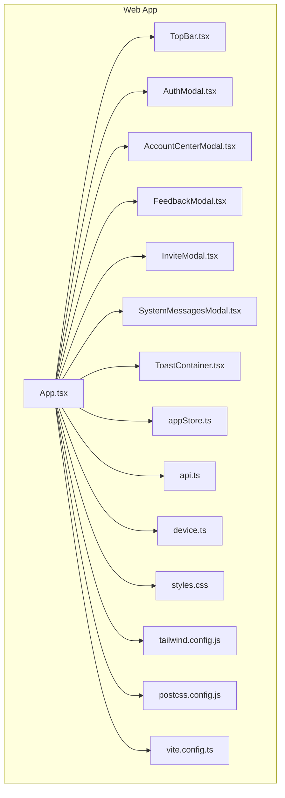
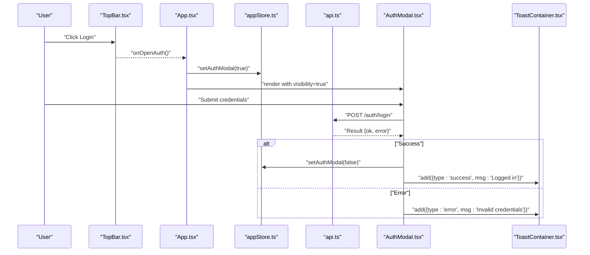
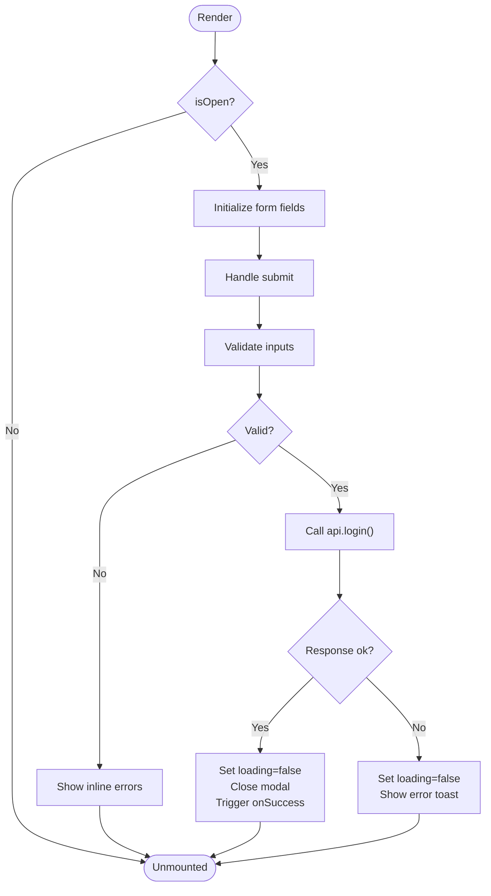
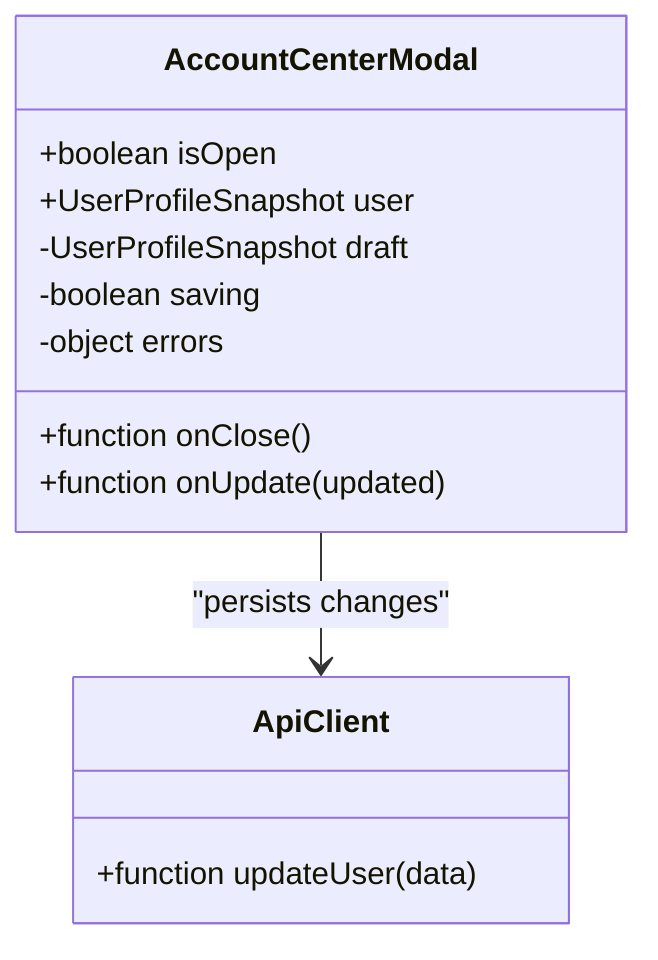
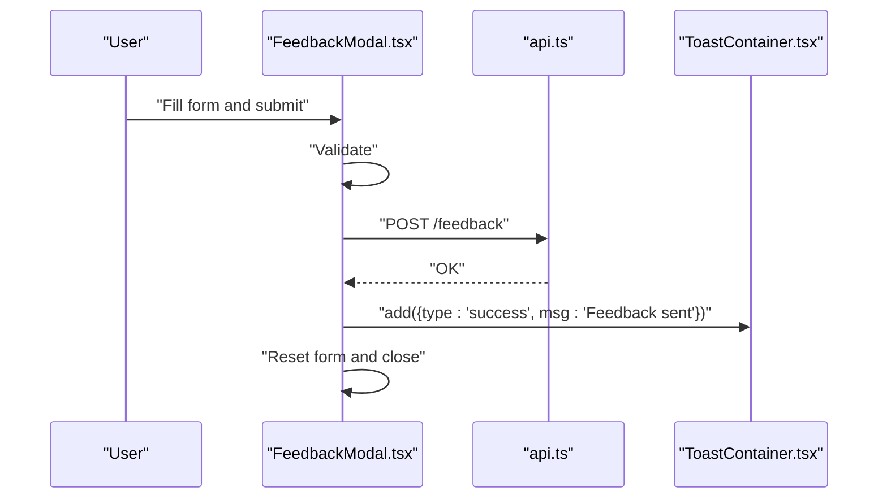
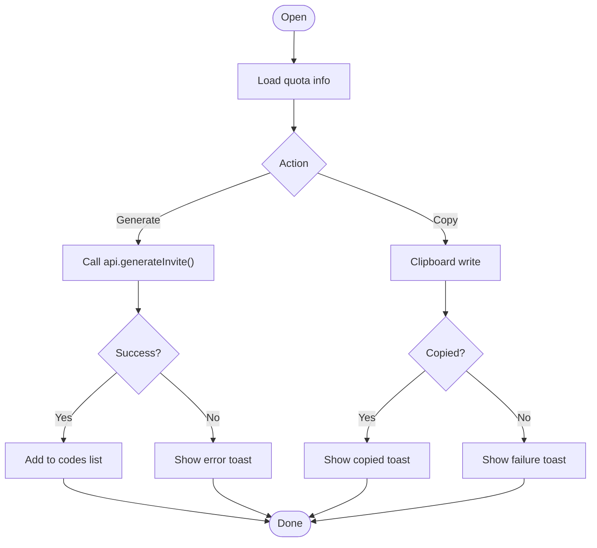
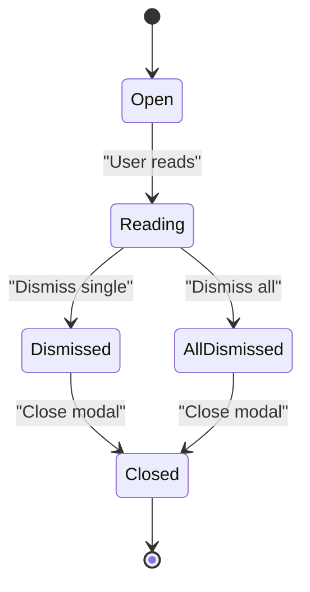
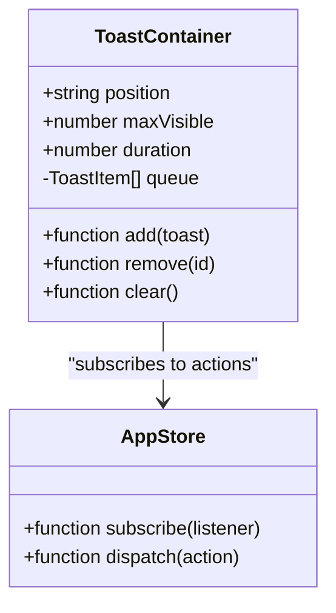
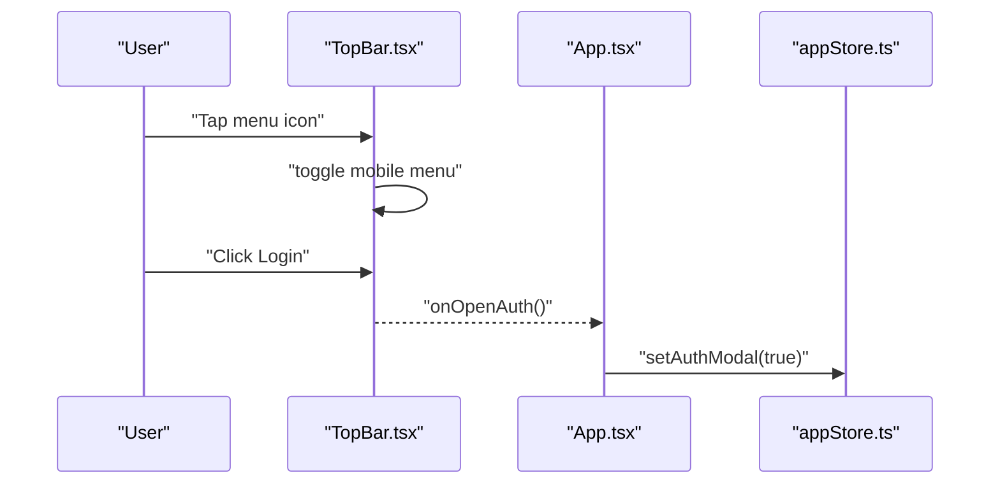
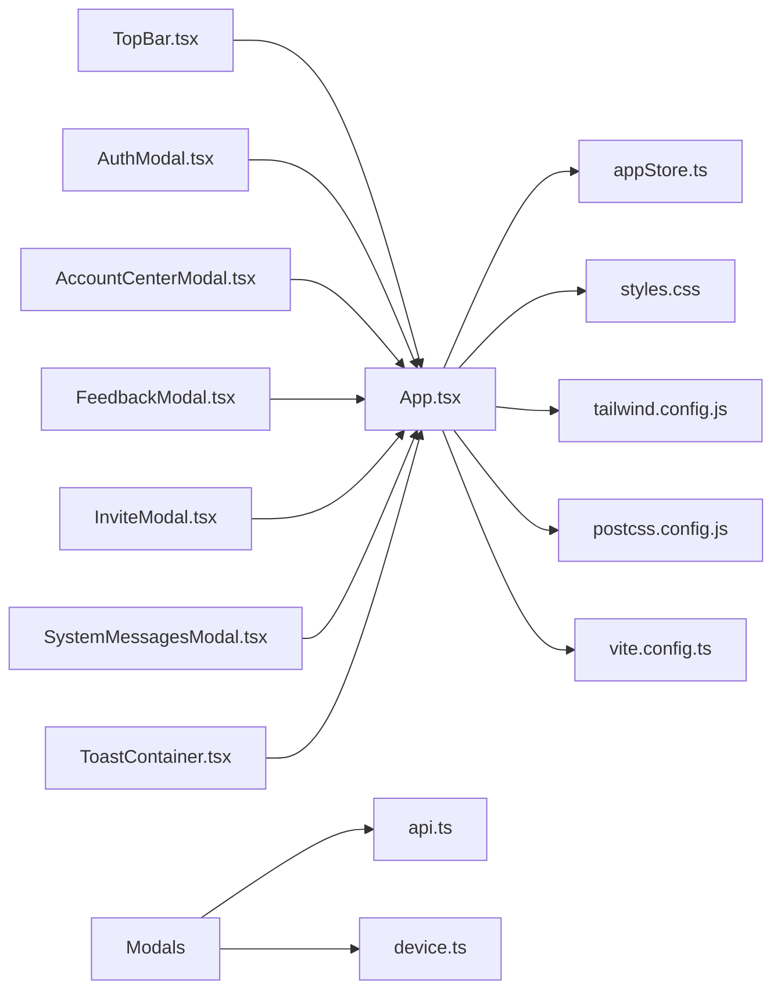

# Component Library & Architecture

<cite>
**Referenced Files in This Document**
- [App.tsx](file://web/src/App.tsx)
- [main.tsx](file://web/src/main.tsx)
- [AuthModal.tsx](file://web/src/components/AuthModal.tsx)
- [AccountCenterModal.tsx](file://web/src/components/AccountCenterModal.tsx)
- [FeedbackModal.tsx](file://web/src/components/FeedbackModal.tsx)
- [InviteModal.tsx](file://web/src/components/InviteModal.tsx)
- [SystemMessagesModal.tsx](file://web/src/components/SystemMessagesModal.tsx)
- [ToastContainer.tsx](file://web/src/components/ToastContainer.tsx)
- [TopBar.tsx](file://web/src/components/TopBar.tsx)
- [appStore.ts](file://web/src/store/appStore.ts)
- [api.ts](file://web/src/lib/api.ts)
- [device.ts](file://web/src/lib/device.ts)
- [styles.css](file://web/src/styles.css)
- [tailwind.config.js](file://web/tailwind.config.js)
- [postcss.config.js](file://web/postcss.config.js)
- [vite.config.ts](file://web/vite.config.ts)
</cite>

## Table of Contents
1. [Introduction](#introduction)
2. [Project Structure](#project-structure)
3. [Core Components](#core-components)
4. [Architecture Overview](#architecture-overview)
5. [Detailed Component Analysis](#detailed-component-analysis)
6. [Dependency Analysis](#dependency-analysis)
7. [Performance Considerations](#performance-considerations)
8. [Troubleshooting Guide](#troubleshooting-guide)
9. [Conclusion](#conclusion)
10. [Appendices](#appendices)

## Introduction
This document explains the React component library and architectural patterns used in the web application. It focuses on the modular structure of key UI components, including AuthModal, AccountCenterModal, FeedbackModal, InviteModal, SystemMessagesModal, ToastContainer, and TopBar. The guide covers composition patterns, prop interfaces, event handling, state management, styling with CSS modules and Tailwind CSS, accessibility considerations, and responsive design across screen sizes.

## Project Structure
The frontend is organized under web/src with a clear separation between components, shared libraries, store, and styles:
- Components: Modal dialogs, top navigation bar, and toast notifications
- Store: Centralized application state using a lightweight store
- Lib: API client and device utilities
- Styles: Global styles and Tailwind configuration

**Diagram sources**
- [App.tsx](file://web/src/App.tsx)
- [TopBar.tsx](file://web/src/components/TopBar.tsx)
- [AuthModal.tsx](file://web/src/components/AuthModal.tsx)
- [AccountCenterModal.tsx](file://web/src/components/AccountCenterModal.tsx)
- [FeedbackModal.tsx](file://web/src/components/FeedbackModal.tsx)
- [InviteModal.tsx](file://web/src/components/InviteModal.tsx)
- [SystemMessagesModal.tsx](file://web/src/components/SystemMessagesModal.tsx)
- [ToastContainer.tsx](file://web/src/components/ToastContainer.tsx)
- [appStore.ts](file://web/src/store/appStore.ts)
- [api.ts](file://web/src/lib/api.ts)
- [device.ts](file://web/src/lib/device.ts)
- [styles.css](file://web/src/styles.css)
- [tailwind.config.js](file://web/tailwind.config.js)
- [postcss.config.js](file://web/postcss.config.js)
- [vite.config.ts](file://web/vite.config.ts)

**Section sources**
- [App.tsx](file://web/src/App.tsx)
- [main.tsx](file://web/src/main.tsx)
- [tailwind.config.js](file://web/tailwind.config.js)
- [postcss.config.js](file://web/postcss.config.js)
- [vite.config.ts](file://web/vite.config.ts)

## Core Components
This section summarizes each core component’s purpose, typical props, events, and internal state patterns.

- AuthModal
  - Purpose: Handles user authentication flows (login/register), form validation, and error feedback.
  - Typical props: visibility flag, close handler, optional redirect callback, theme tokens.
  - Events: onSubmit, onClose, onSwitchMode (e.g., login to register).
  - State: local form fields, loading/error states, mode toggles.
  - Composition: Uses shared input/button primitives and integrates with api.ts for requests.

- AccountCenterModal
  - Purpose: Displays and edits user profile information and account settings.
  - Typical props: user data snapshot, update callback, visibility flag, close handler.
  - Events: onUpdate, onClose.
  - State: local draft values, validation errors, save status.
  - Composition: Reuses form inputs and confirmation prompts; calls api.ts for persistence.

- FeedbackModal
  - Purpose: Collects user feedback or reports issues.
  - Typical props: visibility flag, close handler, submit callback.
  - Events: onSubmit, onClose.
  - State: message content, category selection, attachment state, submission progress.
  - Composition: Integrates with api.ts and shows success via ToastContainer.

- InviteModal
  - Purpose: Manages invite code generation and distribution.
  - Typical props: visibility flag, close handler, quota info, submit callback.
  - Events: onGenerate, onClose.
  - State: generated codes list, copy-to-clipboard feedback, error messages.
  - Composition: Calls api.ts for generation and uses clipboard utilities where applicable.

- SystemMessagesModal
  - Purpose: Presents system announcements or maintenance notices.
  - Typical props: messages array, visibility flag, close handler.
  - Events: onClose, onDismissAll.
  - State: dismissed IDs, auto-dismiss timers.
  - Composition: Renders rich text safely and supports keyboard dismissal.

- ToastContainer
  - Purpose: Global notification center for success, warning, and error toasts.
  - Typical props: position, max visible, transition duration.
  - Events: onDismiss (per toast).
  - State: queue of toasts with unique IDs and lifetimes.
  - Composition: Consumes appStore actions to add/remove toasts; renders stacked notifications.

- TopBar
  - Purpose: Application header with navigation, auth triggers, and responsive menu.
  - Typical props: brand/logo, links, auth state, onOpenAuth, onOpenAccountCenter.
  - Events: onMenuToggle, onLinkClick.
  - State: mobile menu open/close, active link highlight.
  - Composition: Uses Tailwind utility classes for layout and responsiveness; delegates modals to parent.

**Section sources**
- [AuthModal.tsx](file://web/src/components/AuthModal.tsx)
- [AccountCenterModal.tsx](file://web/src/components/AccountCenterModal.tsx)
- [FeedbackModal.tsx](file://web/src/components/FeedbackModal.tsx)
- [InviteModal.tsx](file://web/src/components/InviteModal.tsx)
- [SystemMessagesModal.tsx](file://web/src/components/SystemMessagesModal.tsx)
- [ToastContainer.tsx](file://web/src/components/ToastContainer.tsx)
- [TopBar.tsx](file://web/src/components/TopBar.tsx)

## Architecture Overview
The application follows a unidirectional data flow pattern:
- Parent orchestrates modal visibility and global state via appStore.
- Components receive props and emit events back up to the parent.
- Side effects (API calls) are handled through lib/api.ts.
- Styling combines Tailwind CSS utilities with scoped CSS modules when needed.

**Diagram sources**
- [TopBar.tsx](file://web/src/components/TopBar.tsx)
- [App.tsx](file://web/src/App.tsx)
- [appStore.ts](file://web/src/store/appStore.ts)
- [AuthModal.tsx](file://web/src/components/AuthModal.tsx)
- [api.ts](file://web/src/lib/api.ts)
- [ToastContainer.tsx](file://web/src/components/ToastContainer.tsx)

## Detailed Component Analysis

### AuthModal
- Responsibilities:
  - Manage login/register modes and form lifecycle.
  - Validate inputs and display inline errors.
  - Trigger API calls and propagate results via events.
- Prop interface highlights:
  - isOpen: boolean
  - onClose: () => void
  - onSuccess?: () => void
  - initialMode?: 'login' | 'register'
- Event handling:
  - Form submit triggers async request; updates local loading state.
  - Close handlers dismiss modal and reset local state.
- State management:
  - Local form state and submission flags.
  - Optional integration with appStore for cross-modal awareness.
- Accessibility:
  - Focus trap within modal, aria-modal, role="dialog", and Escape key support.
- Responsive behavior:
  - Full-screen on small devices, centered card on larger screens.

**Diagram sources**
- [AuthModal.tsx](file://web/src/components/AuthModal.tsx)
- [api.ts](file://web/src/lib/api.ts)
- [ToastContainer.tsx](file://web/src/components/ToastContainer.tsx)

**Section sources**
- [AuthModal.tsx](file://web/src/components/AuthModal.tsx)
- [api.ts](file://web/src/lib/api.ts)
- [ToastContainer.tsx](file://web/src/components/ToastContainer.tsx)

### AccountCenterModal
- Responsibilities:
  - Display current user profile and allow edits.
  - Persist changes via API and show feedback.
- Prop interface highlights:
  - isOpen: boolean
  - user: UserProfileSnapshot
  - onClose: () => void
  - onUpdate?: (updated: UserProfileSnapshot) => void
- Event handling:
  - Save triggers update call; success updates local draft and notifies parent.
- State management:
  - Draft state derived from user prop; tracks dirty state and validation.
- Accessibility:
  - Proper labels, required indicators, and focus management.
- Responsive behavior:
  - Stacked fields on narrow screens; two-column grid on wider screens.

**Diagram sources**
- [AccountCenterModal.tsx](file://web/src/components/AccountCenterModal.tsx)
- [api.ts](file://web/src/lib/api.ts)

**Section sources**
- [AccountCenterModal.tsx](file://web/src/components/AccountCenterModal.tsx)
- [api.ts](file://web/src/lib/api.ts)

### FeedbackModal
- Responsibilities:
  - Capture feedback details and submit to server.
  - Provide immediate feedback via toasts.
- Prop interface highlights:
  - isOpen: boolean
  - onClose: () => void
  - onSubmit?: (payload: FeedbackPayload) => void
- Event handling:
  - Submit validates and posts feedback; clears form on success.
- State management:
  - Local payload, attachment preview, submission progress.
- Accessibility:
  - Descriptive labels, helper text, and keyboard navigation.
- Responsive behavior:
  - Single column layout; large touch targets on mobile.

**Diagram sources**
- [FeedbackModal.tsx](file://web/src/components/FeedbackModal.tsx)
- [api.ts](file://web/src/lib/api.ts)
- [ToastContainer.tsx](file://web/src/components/ToastContainer.tsx)

**Section sources**
- [FeedbackModal.tsx](file://web/src/components/FeedbackModal.tsx)
- [api.ts](file://web/src/lib/api.ts)
- [ToastContainer.tsx](file://web/src/components/ToastContainer.tsx)

### InviteModal
- Responsibilities:
  - Generate invite codes and manage clipboard operations.
  - Display quotas and usage limits.
- Prop interface highlights:
  - isOpen: boolean
  - onClose: () => void
  - quotaInfo: InviteQuotaInfo
  - onGenerate?: () => Promise<void>
- Event handling:
  - Generate action calls API; copies result to clipboard; shows toasts.
- State management:
  - Generated codes list, copy feedback, error states.
- Accessibility:
  - Live region for clipboard feedback; clear status messages.
- Responsive behavior:
  - Scrollable list on small screens; grid view on larger screens.

**Diagram sources**
- [InviteModal.tsx](file://web/src/components/InviteModal.tsx)
- [api.ts](file://web/src/lib/api.ts)
- [ToastContainer.tsx](file://web/src/components/ToastContainer.tsx)

**Section sources**
- [InviteModal.tsx](file://web/src/components/InviteModal.tsx)
- [api.ts](file://web/src/lib/api.ts)
- [ToastContainer.tsx](file://web/src/components/ToastContainer.tsx)

### SystemMessagesModal
- Responsibilities:
  - Render system announcements and allow dismissal.
  - Persist user preferences for dismissed items.
- Prop interface highlights:
  - isOpen: boolean
  - messages: SystemMessage[]
  - onClose: () => void
  - onDismiss?: (id: string) => void
- Event handling:
  - Dismiss individual or all messages; auto-dismiss after timeout if configured.
- State management:
  - Local dismissed set; timer management for auto-dismiss.
- Accessibility:
  - Semantic headings, roles, and keyboard controls.
- Responsive behavior:
  - Compact banners on mobile; richer cards on desktop.

**Diagram sources**
- [SystemMessagesModal.tsx](file://web/src/components/SystemMessagesModal.tsx)

**Section sources**
- [SystemMessagesModal.tsx](file://web/src/components/SystemMessagesModal.tsx)

### ToastContainer
- Responsibilities:
  - Manage a queue of toasts with types (success, warning, error, info).
  - Auto-dismiss after configurable durations.
- Prop interface highlights:
  - position?: 'top-right' | 'bottom-center'
  - maxVisible?: number
  - duration?: number
- Event handling:
  - Dismiss per toast; batch dismiss actions.
- State management:
  - Queue with unique IDs; timers for auto-dismiss.
- Integration:
  - Subscribes to appStore actions to add/remove toasts.
- Accessibility:
  - aria-live regions and focus management.

**Diagram sources**
- [ToastContainer.tsx](file://web/src/components/ToastContainer.tsx)
- [appStore.ts](file://web/src/store/appStore.ts)

**Section sources**
- [ToastContainer.tsx](file://web/src/components/ToastContainer.tsx)
- [appStore.ts](file://web/src/store/appStore.ts)

### TopBar
- Responsibilities:
  - Provide navigation, branding, and entry points to modals.
  - Handle responsive menu toggle and active link highlighting.
- Prop interface highlights:
  - brand: string
  - links: NavLink[]
  - authState: AuthState
  - onOpenAuth: () => void
  - onOpenAccountCenter: () => void
- Event handling:
  - Menu toggle, link clicks, and auth triggers.
- State management:
  - Local mobile menu state; no side effects.
- Styling:
  - Tailwind utilities for layout, spacing, and transitions.
- Accessibility:
  - Semantic nav, aria-expanded for menu, proper focus order.

**Diagram sources**
- [TopBar.tsx](file://web/src/components/TopBar.tsx)
- [App.tsx](file://web/src/App.tsx)
- [appStore.ts](file://web/src/store/appStore.ts)

**Section sources**
- [TopBar.tsx](file://web/src/components/TopBar.tsx)
- [App.tsx](file://web/src/App.tsx)
- [appStore.ts](file://web/src/store/appStore.ts)

## Dependency Analysis
Components depend on shared libraries and store for consistent behavior.

**Diagram sources**
- [TopBar.tsx](file://web/src/components/TopBar.tsx)
- [AuthModal.tsx](file://web/src/components/AuthModal.tsx)
- [AccountCenterModal.tsx](file://web/src/components/AccountCenterModal.tsx)
- [FeedbackModal.tsx](file://web/src/components/FeedbackModal.tsx)
- [InviteModal.tsx](file://web/src/components/InviteModal.tsx)
- [SystemMessagesModal.tsx](file://web/src/components/SystemMessagesModal.tsx)
- [ToastContainer.tsx](file://web/src/components/ToastContainer.tsx)
- [App.tsx](file://web/src/App.tsx)
- [appStore.ts](file://web/src/store/appStore.ts)
- [api.ts](file://web/src/lib/api.ts)
- [device.ts](file://web/src/lib/device.ts)
- [styles.css](file://web/src/styles.css)
- [tailwind.config.js](file://web/tailwind.config.js)
- [postcss.config.js](file://web/postcss.config.js)
- [vite.config.ts](file://web/vite.config.ts)

**Section sources**
- [App.tsx](file://web/src/App.tsx)
- [api.ts](file://web/src/lib/api.ts)
- [device.ts](file://web/src/lib/device.ts)
- [appStore.ts](file://web/src/store/appStore.ts)
- [tailwind.config.js](file://web/tailwind.config.js)
- [postcss.config.js](file://web/postcss.config.js)
- [vite.config.ts](file://web/vite.config.ts)

## Performance Considerations
- Keep modal state minimal and co-locate related state to reduce re-renders.
- Use memoization for expensive computations inside modals.
- Debounce input handlers in forms to avoid excessive API calls.
- Lazy-load heavy resources (images, icons) within modals.
- Prefer Tailwind utilities for layout to minimize custom CSS overhead.
- Limit concurrent toasts and implement batching for rapid updates.

[No sources needed since this section provides general guidance]

## Troubleshooting Guide
Common issues and resolutions:
- Modal not closing: Ensure onClose is wired and parent state updates correctly.
- API failures: Verify endpoint paths and error mapping in api.ts; surface errors via toasts.
- Focus trapping broken: Confirm focus management logic and that modal container has correct ARIA attributes.
- Mobile menu not toggling: Check event binding and state synchronization in TopBar.
- Toast overflow: Adjust maxVisible and positioning props; ensure stacking context is correct.

**Section sources**
- [AuthModal.tsx](file://web/src/components/AuthModal.tsx)
- [TopBar.tsx](file://web/src/components/TopBar.tsx)
- [ToastContainer.tsx](file://web/src/components/ToastContainer.tsx)
- [api.ts](file://web/src/lib/api.ts)

## Conclusion
The component library emphasizes modularity, clear prop/event contracts, and centralized state management. Tailwind CSS and CSS modules provide flexible styling, while accessibility and responsive design are integrated throughout. Following the patterns outlined here will help maintain consistency, scalability, and usability across the application.

[No sources needed since this section summarizes without analyzing specific files]

## Appendices

### Styling Approach
- Tailwind CSS: Utility-first classes for layout, spacing, typography, and responsive breakpoints.
- CSS Modules: Scoped styles for complex components when necessary.
- Global styles: Base resets and theme tokens defined in styles.css.

**Section sources**
- [styles.css](file://web/src/styles.css)
- [tailwind.config.js](file://web/tailwind.config.js)
- [postcss.config.js](file://web/postcss.config.js)

### Build and Configuration
- Vite: Development server, bundling, and plugin configuration.
- TypeScript: Type checking and build pipeline.
- PostCSS: Tailwind processing and autoprefixing.

**Section sources**
- [vite.config.ts](file://web/vite.config.ts)
- [postcss.config.js](file://web/postcss.config.js)
- [tailwind.config.js](file://web/tailwind.config.js)