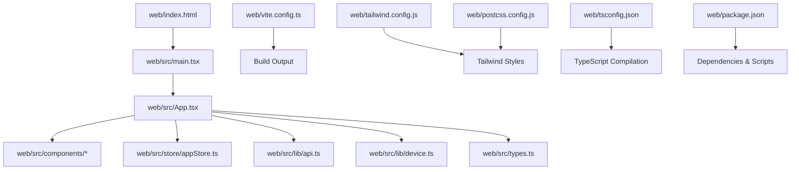
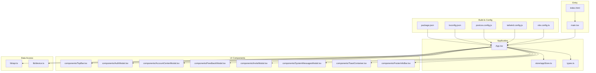
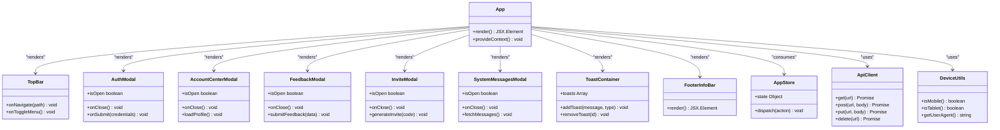
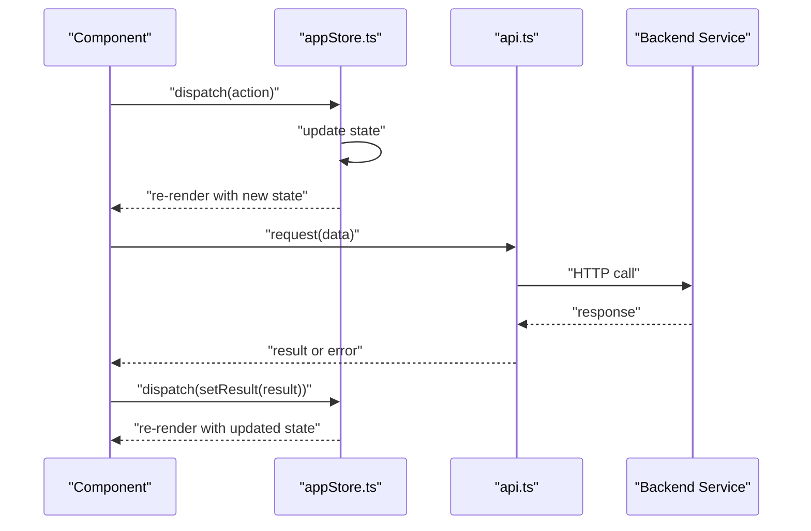
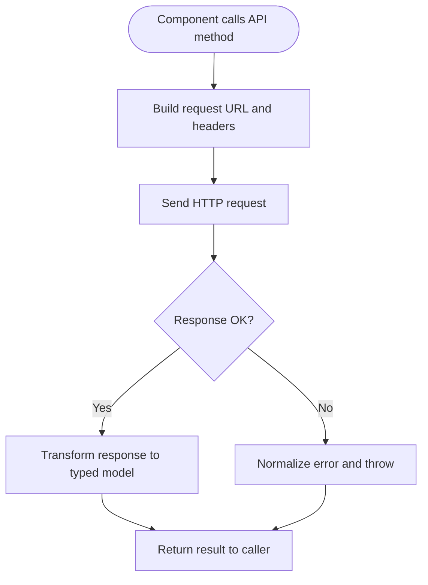
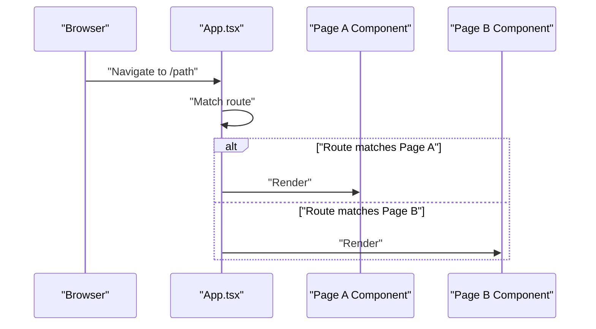
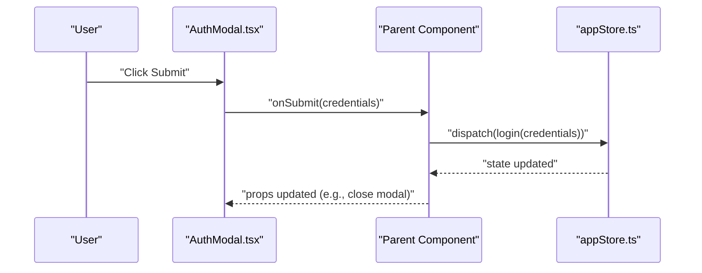
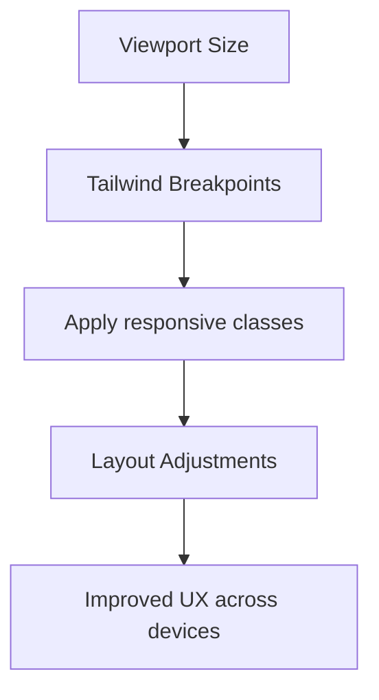
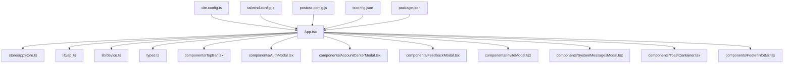

# Frontend Architecture

<cite>
**Referenced Files in This Document**
- [package.json](file://web/package.json)
- [vite.config.ts](file://web/vite.config.ts)
- [tsconfig.json](file://web/tsconfig.json)
- [tailwind.config.js](file://web/tailwind.config.js)
- [postcss.config.js](file://web/postcss.config.js)
- [index.html](file://web/index.html)
- [main.tsx](file://web/src/main.tsx)
- [App.tsx](file://web/src/App.tsx)
- [types.ts](file://web/src/types.ts)
- [api.ts](file://web/src/lib/api.ts)
- [device.ts](file://web/src/lib/device.ts)
- [appStore.ts](file://web/src/store/appStore.ts)
- [TopBar.tsx](file://web/src/components/TopBar.tsx)
- [AuthModal.tsx](file://web/src/components/AuthModal.tsx)
- [AccountCenterModal.tsx](file://web/src/components/AccountCenterModal.tsx)
- [FeedbackModal.tsx](file://web/src/components/FeedbackModal.tsx)
- [InviteModal.tsx](file://web/src/components/InviteModal.tsx)
- [SystemMessagesModal.tsx](file://web/src/components/SystemMessagesModal.tsx)
- [ToastContainer.tsx](file://web/src/components/ToastContainer.tsx)
- [FooterInfoBar.tsx](file://web/src/components/FooterInfoBar.tsx)
</cite>

## Table of Contents
1. [Introduction](#introduction)
2. [Project Structure](#project-structure)
3. [Core Components](#core-components)
4. [Architecture Overview](#architecture-overview)
5. [Detailed Component Analysis](#detailed-component-analysis)
6. [Dependency Analysis](#dependency-analysis)
7. [Performance Considerations](#performance-considerations)
8. [Troubleshooting Guide](#troubleshooting-guide)
9. [Conclusion](#conclusion)

## Introduction
This document describes the React frontend architecture for the application located under web/. It focuses on:
- Component-based architecture using React with TypeScript
- State management via React Context API
- API client abstraction layer
- Modular component structure and routing strategy
- Build configuration with Vite, Tailwind CSS, and PostCSS
- Separation between UI components, business logic, and data access layers
- Component hierarchy, state flow patterns, and event handling mechanisms
- Responsive design considerations, performance optimization techniques, and cross-browser compatibility strategies

## Project Structure
The frontend is organized into a clear separation of concerns:
- src/: Source code for the React application
  - components/: Reusable UI components (modals, top bar, footer, toast container)
  - lib/: Shared utilities and API client abstraction
  - store/: Global state via Context API
  - App.tsx: Root component and layout/routing entry point
  - main.tsx: Application bootstrap and root rendering
  - types.ts: Shared TypeScript type definitions
  - styles.css: Global styles
- Configuration files at web/:
  - vite.config.ts: Vite build configuration
  - tailwind.config.js: Tailwind CSS configuration
  - postcss.config.js: PostCSS configuration
  - tsconfig.json: TypeScript configuration
  - package.json: Dependencies and scripts
  - index.html: HTML entry point

**Diagram sources**
- [index.html](file://web/index.html)
- [main.tsx](file://web/src/main.tsx)
- [App.tsx](file://web/src/App.tsx)
- [api.ts](file://web/src/lib/api.ts)
- [device.ts](file://web/src/lib/device.ts)
- [appStore.ts](file://web/src/store/appStore.ts)
- [types.ts](file://web/src/types.ts)
- [vite.config.ts](file://web/vite.config.ts)
- [tailwind.config.js](file://web/tailwind.config.js)
- [postcss.config.js](file://web/postcss.config.js)
- [tsconfig.json](file://web/tsconfig.json)
- [package.json](file://web/package.json)

**Section sources**
- [package.json](file://web/package.json)
- [vite.config.ts](file://web/vite.config.ts)
- [tsconfig.json](file://web/tsconfig.json)
- [tailwind.config.js](file://web/tailwind.config.js)
- [postcss.config.js](file://web/postcss.config.js)
- [index.html](file://web/index.html)
- [main.tsx](file://web/src/main.tsx)
- [App.tsx](file://web/src/App.tsx)
- [types.ts](file://web/src/types.ts)
- [api.ts](file://web/src/lib/api.ts)
- [device.ts](file://web/src/lib/device.ts)
- [appStore.ts](file://web/src/store/appStore.ts)

## Core Components
Key UI components include:
- TopBar: Navigation and header controls
- AuthModal: Authentication modal dialog
- AccountCenterModal: User account center modal
- FeedbackModal: Feedback submission modal
- InviteModal: Invitation management modal
- SystemMessagesModal: System messages display modal
- ToastContainer: Global toast notifications
- FooterInfoBar: Footer information bar

These components are designed to be reusable, composable, and typed with TypeScript. They consume global state from appStore.ts and interact with backend services through the api.ts client.

**Section sources**
- [TopBar.tsx](file://web/src/components/TopBar.tsx)
- [AuthModal.tsx](file://web/src/components/AuthModal.tsx)
- [AccountCenterModal.tsx](file://web/src/components/AccountCenterModal.tsx)
- [FeedbackModal.tsx](file://web/src/components/FeedbackModal.tsx)
- [InviteModal.tsx](file://web/src/components/InviteModal.tsx)
- [SystemMessagesModal.tsx](file://web/src/components/SystemMessagesModal.tsx)
- [ToastContainer.tsx](file://web/src/components/ToastContainer.tsx)
- [FooterInfoBar.tsx](file://web/src/components/FooterInfoBar.tsx)

## Architecture Overview
High-level architecture:
- Entry point: index.html loads the compiled bundle; main.tsx bootstraps React and renders App.tsx
- Root component: App.tsx orchestrates layout, routing, and context providers
- State management: appStore.ts provides global state via React Context API
- Data access: api.ts abstracts HTTP requests to the backend
- Utilities: device.ts provides device detection helpers
- Styling: Tailwind CSS configured via tailwind.config.js and processed by PostCSS
- Build tooling: Vite compiles TypeScript, bundles assets, and optimizes output

**Diagram sources**
- [index.html](file://web/index.html)
- [main.tsx](file://web/src/main.tsx)
- [App.tsx](file://web/src/App.tsx)
- [appStore.ts](file://web/src/store/appStore.ts)
- [types.ts](file://web/src/types.ts)
- [TopBar.tsx](file://web/src/components/TopBar.tsx)
- [AuthModal.tsx](file://web/src/components/AuthModal.tsx)
- [AccountCenterModal.tsx](file://web/src/components/AccountCenterModal.tsx)
- [FeedbackModal.tsx](file://web/src/components/FeedbackModal.tsx)
- [InviteModal.tsx](file://web/src/components/InviteModal.tsx)
- [SystemMessagesModal.tsx](file://web/src/components/SystemMessagesModal.tsx)
- [ToastContainer.tsx](file://web/src/components/ToastContainer.tsx)
- [FooterInfoBar.tsx](file://web/src/components/FooterInfoBar.tsx)
- [api.ts](file://web/src/lib/api.ts)
- [device.ts](file://web/src/lib/device.ts)
- [vite.config.ts](file://web/vite.config.ts)
- [tailwind.config.js](file://web/tailwind.config.js)
- [postcss.config.js](file://web/postcss.config.js)
- [tsconfig.json](file://web/tsconfig.json)
- [package.json](file://web/package.json)

## Detailed Component Analysis

### Component Hierarchy and Relationships
The root component App.tsx composes the primary UI components and wires them together. The following class diagram shows representative relationships among key components and shared modules.

**Diagram sources**
- [App.tsx](file://web/src/App.tsx)
- [TopBar.tsx](file://web/src/components/TopBar.tsx)
- [AuthModal.tsx](file://web/src/components/AuthModal.tsx)
- [AccountCenterModal.tsx](file://web/src/components/AccountCenterModal.tsx)
- [FeedbackModal.tsx](file://web/src/components/FeedbackModal.tsx)
- [InviteModal.tsx](file://web/src/components/InviteModal.tsx)
- [SystemMessagesModal.tsx](file://web/src/components/SystemMessagesModal.tsx)
- [ToastContainer.tsx](file://web/src/components/ToastContainer.tsx)
- [FooterInfoBar.tsx](file://web/src/components/FooterInfoBar.tsx)
- [appStore.ts](file://web/src/store/appStore.ts)
- [api.ts](file://web/src/lib/api.ts)
- [device.ts](file://web/src/lib/device.ts)

**Section sources**
- [App.tsx](file://web/src/App.tsx)
- [TopBar.tsx](file://web/src/components/TopBar.tsx)
- [AuthModal.tsx](file://web/src/components/AuthModal.tsx)
- [AccountCenterModal.tsx](file://web/src/components/AccountCenterModal.tsx)
- [FeedbackModal.tsx](file://web/src/components/FeedbackModal.tsx)
- [InviteModal.tsx](file://web/src/components/InviteModal.tsx)
- [SystemMessagesModal.tsx](file://web/src/components/SystemMessagesModal.tsx)
- [ToastContainer.tsx](file://web/src/components/ToastContainer.tsx)
- [FooterInfoBar.tsx](file://web/src/components/FooterInfoBar.tsx)
- [appStore.ts](file://web/src/store/appStore.ts)
- [api.ts](file://web/src/lib/api.ts)
- [device.ts](file://web/src/lib/device.ts)

### State Management with Context API
Global state is centralized in appStore.ts and provided to the component tree via React Context. Components subscribe to relevant slices of state and dispatch actions to update it. This approach avoids prop drilling and keeps UI behavior predictable.

**Diagram sources**
- [appStore.ts](file://web/src/store/appStore.ts)
- [api.ts](file://web/src/lib/api.ts)

**Section sources**
- [appStore.ts](file://web/src/store/appStore.ts)
- [api.ts](file://web/src/lib/api.ts)

### API Client Abstraction Layer
The API client in api.ts encapsulates HTTP operations, request/response transformations, and error handling. Components should not call fetch directly; instead, they use typed methods exposed by the client.

**Diagram sources**
- [api.ts](file://web/src/lib/api.ts)

**Section sources**
- [api.ts](file://web/src/lib/api.ts)

### Routing Strategy
Routing is managed within App.tsx. Depending on implementation, this may involve conditional rendering based on URL path or integration with a router library. The root component composes page-level components and navigational elements like TopBar.

**Diagram sources**
- [App.tsx](file://web/src/App.tsx)

**Section sources**
- [App.tsx](file://web/src/App.tsx)

### Event Handling Mechanisms
Components handle user interactions (clicks, form submissions, toggles) and propagate events upward to parent components or dispatch actions to the global store. Modal components typically expose open/close callbacks and submit handlers.

**Diagram sources**
- [AuthModal.tsx](file://web/src/components/AuthModal.tsx)
- [appStore.ts](file://web/src/store/appStore.ts)

**Section sources**
- [AuthModal.tsx](file://web/src/components/AuthModal.tsx)
- [appStore.ts](file://web/src/store/appStore.ts)

### Responsive Design Considerations
Responsive behavior is implemented using Tailwind CSS utility classes configured via tailwind.config.js. Breakpoints and custom themes can be extended to support mobile-first layouts. Device detection utilities in device.ts can inform conditional rendering or feature toggles.

**Diagram sources**
- [tailwind.config.js](file://web/tailwind.config.js)
- [device.ts](file://web/src/lib/device.ts)

**Section sources**
- [tailwind.config.js](file://web/tailwind.config.js)
- [device.ts](file://web/src/lib/device.ts)

### Cross-Browser Compatibility Strategies
Compatibility is ensured by:
- Using modern browser APIs with appropriate fallbacks
- Leveraging Vite’s built-in polyfills and transpilation via tsconfig.json
- Testing across major browsers during development and CI
- Avoiding experimental features without fallbacks

[No sources needed since this section provides general guidance]

## Dependency Analysis
The following dependency graph highlights core module relationships and external tooling.

**Diagram sources**
- [App.tsx](file://web/src/App.tsx)
- [appStore.ts](file://web/src/store/appStore.ts)
- [api.ts](file://web/src/lib/api.ts)
- [device.ts](file://web/src/lib/device.ts)
- [types.ts](file://web/src/types.ts)
- [TopBar.tsx](file://web/src/components/TopBar.tsx)
- [AuthModal.tsx](file://web/src/components/AuthModal.tsx)
- [AccountCenterModal.tsx](file://web/src/components/AccountCenterModal.tsx)
- [FeedbackModal.tsx](file://web/src/components/FeedbackModal.tsx)
- [InviteModal.tsx](file://web/src/components/InviteModal.tsx)
- [SystemMessagesModal.tsx](file://web/src/components/SystemMessagesModal.tsx)
- [ToastContainer.tsx](file://web/src/components/ToastContainer.tsx)
- [FooterInfoBar.tsx](file://web/src/components/FooterInfoBar.tsx)
- [vite.config.ts](file://web/vite.config.ts)
- [tailwind.config.js](file://web/tailwind.config.js)
- [postcss.config.js](file://web/postcss.config.js)
- [tsconfig.json](file://web/tsconfig.json)
- [package.json](file://web/package.json)

**Section sources**
- [App.tsx](file://web/src/App.tsx)
- [appStore.ts](file://web/src/store/appStore.ts)
- [api.ts](file://web/src/lib/api.ts)
- [device.ts](file://web/src/lib/device.ts)
- [types.ts](file://web/src/types.ts)
- [TopBar.tsx](file://web/src/components/TopBar.tsx)
- [AuthModal.tsx](file://web/src/components/AuthModal.tsx)
- [AccountCenterModal.tsx](file://web/src/components/AccountCenterModal.tsx)
- [FeedbackModal.tsx](file://web/src/components/FeedbackModal.tsx)
- [InviteModal.tsx](file://web/src/components/InviteModal.tsx)
- [SystemMessagesModal.tsx](file://web/src/components/SystemMessagesModal.tsx)
- [ToastContainer.tsx](file://web/src/components/ToastContainer.tsx)
- [FooterInfoBar.tsx](file://web/src/components/FooterInfoBar.tsx)
- [vite.config.ts](file://web/vite.config.ts)
- [tailwind.config.js](file://web/tailwind.config.js)
- [postcss.config.js](file://web/postcss.config.js)
- [tsconfig.json](file://web/tsconfig.json)
- [package.json](file://web/package.json)

## Performance Considerations
- Code splitting and lazy loading for routes and heavy components
- Memoization with React.memo and useMemo where appropriate
- Efficient state updates via minimal re-renders and selective subscriptions
- Asset optimization via Vite’s bundling and caching strategies
- Debouncing/throttling for frequent user interactions (e.g., search inputs)
- Minimizing network payloads and leveraging caching headers

[No sources needed since this section provides general guidance]

## Troubleshooting Guide
Common issues and resolutions:
- Build errors: Verify TypeScript configuration and import paths; ensure dependencies match package.json
- Runtime errors: Check API client error normalization and network connectivity
- State inconsistencies: Ensure actions are dispatched correctly and reducers update state immutably
- Styling conflicts: Validate Tailwind directives and purge unused styles in production builds
- Modal visibility: Confirm open/close props and event handlers are wired properly

**Section sources**
- [api.ts](file://web/src/lib/api.ts)
- [appStore.ts](file://web/src/store/appStore.ts)
- [AuthModal.tsx](file://web/src/components/AuthModal.tsx)
- [tailwind.config.js](file://web/tailwind.config.js)
- [tsconfig.json](file://web/tsconfig.json)
- [package.json](file://web/package.json)

## Conclusion
The frontend follows a clean, modular architecture centered around React and TypeScript. Global state is managed via Context API, while the API client abstracts data access. Vite powers fast builds and development, and Tailwind CSS enables responsive design. The component hierarchy promotes reusability and maintainability, with clear separation between UI, business logic, and data layers. Adhering to the outlined best practices ensures scalability, performance, and cross-browser compatibility.