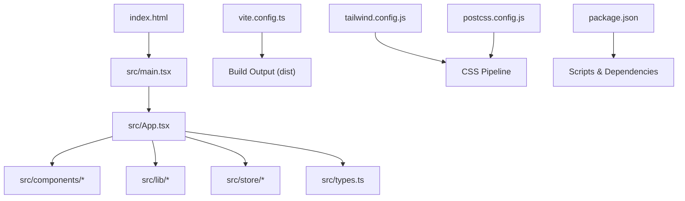
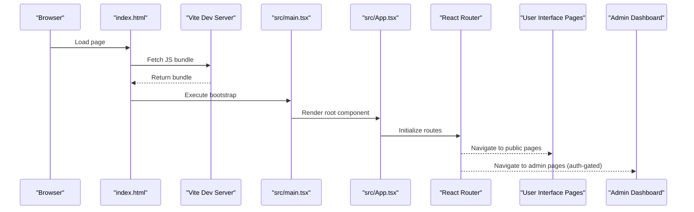
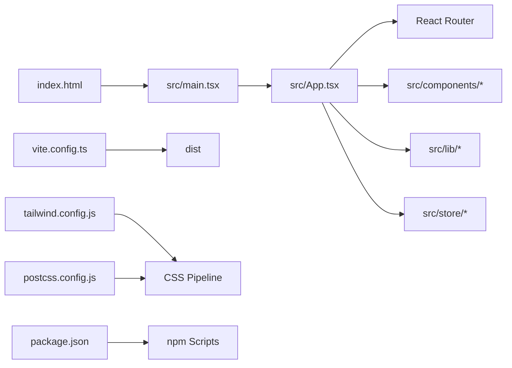

# React Application Structure

<cite>
**Referenced Files in This Document**
- [main.tsx](file://web/src/main.tsx)
- [App.tsx](file://web/src/App.tsx)
- [package.json](file://web/package.json)
- [vite.config.ts](file://web/vite.config.ts)
- [tsconfig.json](file://web/tsconfig.json)
- [tsconfig.app.json](file://web/tsconfig.app.json)
- [tsconfig.node.json](file://web/tsconfig.node.json)
- [index.html](file://web/index.html)
- [tailwind.config.js](file://web/tailwind.config.js)
- [postcss.config.js](file://web/postcss.config.js)
</cite>

## Table of Contents
1. [Introduction](#introduction)
2. [Project Structure](#project-structure)
3. [Core Components](#core-components)
4. [Architecture Overview](#architecture-overview)
5. [Detailed Component Analysis](#detailed-component-analysis)
6. [Dependency Analysis](#dependency-analysis)
7. [Performance Considerations](#performance-considerations)
8. [Troubleshooting Guide](#troubleshooting-guide)
9. [Conclusion](#conclusion)

## Introduction
This document explains the React application structure and entry points for the web client. It covers how the app is bootstrapped, the root App component architecture, Vite build configuration, TypeScript setup, module resolution, asset handling, and how the project supports both user interface and admin dashboard functionality. It also documents project initialization and development server setup via package.json scripts.

## Project Structure
The React application lives under the web directory and follows a standard Vite + React + TypeScript layout:
- Entry HTML: index.html
- Application bootstrap: src/main.tsx
- Root component: src/App.tsx
- UI components: src/components/*
- Shared logic and types: src/lib/*, src/types.ts
- Build and tooling: vite.config.ts, tailwind.config.js, postcss.config.js
- TypeScript configs: tsconfig.json, tsconfig.app.json, tsconfig.node.json
- Dependencies and scripts: package.json

**Diagram sources**
- [index.html](file://web/index.html)
- [main.tsx](file://web/src/main.tsx)
- [App.tsx](file://web/src/App.tsx)
- [vite.config.ts](file://web/vite.config.ts)
- [tailwind.config.js](file://web/tailwind.config.js)
- [postcss.config.js](file://web/postcss.config.js)
- [package.json](file://web/package.json)

**Section sources**
- [index.html](file://web/index.html)
- [main.tsx](file://web/src/main.tsx)
- [App.tsx](file://web/src/App.tsx)
- [vite.config.ts](file://web/vite.config.ts)
- [package.json](file://web/package.json)

## Core Components
- Bootstrap entry (src/main.tsx): Initializes the React application, mounts the root component into the DOM, and configures global providers or plugins if needed.
- Root component (src/App.tsx): Defines the top-level routing, layout, and feature modules for both user-facing pages and admin dashboard sections.
- UI components (src/components/*): Reusable React components such as modals, toasts, and navigation elements used across the app.
- Shared utilities (src/lib/*): API clients, device helpers, and other cross-cutting logic.
- Store (src/store/*): State management for application-wide data.
- Types (src/types.ts): Shared TypeScript interfaces and types.

Key responsibilities:
- main.tsx ensures the React tree is created and attached to the DOM once.
- App.tsx composes routes and layouts, integrating authentication, navigation, and feature modules.
- Components encapsulate UI behavior and are reused throughout the app.
- lib and store provide centralized services and state.

**Section sources**
- [main.tsx](file://web/src/main.tsx)
- [App.tsx](file://web/src/App.tsx)
- [package.json](file://web/package.json)

## Architecture Overview
At runtime, the browser loads index.html, which includes the Vite dev server or built assets. The bootstrap script imports src/main.tsx, which renders the React tree rooted at src/App.tsx. Routing within App.tsx directs users to either the public UI or the admin dashboard based on authentication and route configuration.

**Diagram sources**
- [index.html](file://web/index.html)
- [main.tsx](file://web/src/main.tsx)
- [App.tsx](file://web/src/App.tsx)

## Detailed Component Analysis

### Bootstrap Process (src/main.tsx)
Responsibilities:
- Import React and ReactDOM.
- Create the React root and mount it into the DOM element defined in index.html.
- Optionally configure global providers (e.g., theme, i18n, auth context).
- Handle initial error boundaries or logging.

Development vs production:
- In development, Vite injects hot module replacement and dev-only utilities.
- In production, the optimized bundle is served from dist.

**Section sources**
- [main.tsx](file://web/src/main.tsx)
- [index.html](file://web/index.html)

### Root App Component (src/App.tsx)
Responsibilities:
- Define top-level layout and global styles.
- Configure routes for user interface and admin dashboard.
- Integrate authentication guards for protected routes.
- Compose feature modules (e.g., home, topics, teachings, feedback, admin panels).

Routing strategy:
- Public routes accessible without login.
- Protected routes requiring authentication.
- Admin routes restricted to admin roles.

State and services:
- Centralized state via store modules.
- API calls through shared client utilities.

**Section sources**
- [App.tsx](file://web/src/App.tsx)

### Vite Configuration (vite.config.ts)
Responsibilities:
- Set up the development server and build pipeline.
- Configure plugin chain (React, TypeScript, Tailwind/PostCSS integration).
- Define base path, proxy settings for backend APIs, and environment variables.
- Optimize builds with code splitting and minification.

Asset handling:
- Static assets under public or imported via import statements.
- Image optimization and caching strategies.

Environment configuration:
- .env files for local/dev/prod variables.
- Access via import.meta.env in source code.

**Section sources**
- [vite.config.ts](file://web/vite.config.ts)
- [tailwind.config.js](file://web/tailwind.config.js)
- [postcss.config.js](file://web/postcss.config.js)

### TypeScript Configuration
Files:
- tsconfig.json: Base configuration and project references.
- tsconfig.app.json: Compiler options for the app code.
- tsconfig.node.json: Options for Node-side tooling and Vite config.

Key aspects:
- Module resolution set to support modern ES modules and JSX transforms.
- Strict type checking enabled for reliability.
- Path aliases configured for cleaner imports.
- Separate configurations for app and Node environments.

**Section sources**
- [tsconfig.json](file://web/tsconfig.json)
- [tsconfig.app.json](file://web/tsconfig.app.json)
- [tsconfig.node.json](file://web/tsconfig.node.json)

### Dependency Management and Scripts (package.json)
Responsibilities:
- Declare runtime dependencies (React, ReactDOM, router, etc.).
- Declare dev dependencies (Vite, TypeScript, PostCSS, Tailwind, testing tools).
- Provide npm scripts for development, building, linting, and testing.

Common scripts:
- Development server: starts Vite with hot reload.
- Build: produces optimized static assets in dist.
- Type-check: runs TypeScript checks.
- Lint/test: enforces code quality and validates behavior.

Environment variables:
- Define default values for API endpoints and feature flags.

**Section sources**
- [package.json](file://web/package.json)

### Asset Handling and Styling
Styling stack:
- Tailwind CSS for utility-first styling.
- PostCSS for processing CSS pipelines.
- Global styles and component-specific styles.

Assets:
- Images and icons can be imported directly or placed under public.
- Optimized delivery via Vite’s asset pipeline.

**Section sources**
- [tailwind.config.js](file://web/tailwind.config.js)
- [postcss.config.js](file://web/postcss.config.js)

### User Interface and Admin Dashboard Structure
User interface:
- Public routes for landing, topics, teachings, and interactive features.
- Authentication modal and account center components.

Admin dashboard:
- Protected routes for managing users, teachings, feedback, and settings.
- Role-based access control enforced by route guards.

Navigation:
- Top bar and footer components provide consistent navigation.
- Modals handle overlays like authentication, feedback, and invites.

**Section sources**
- [App.tsx](file://web/src/App.tsx)
- [main.tsx](file://web/src/main.tsx)

## Dependency Analysis
High-level relationships:
- index.html loads the Vite-injected bootstrap script.
- main.tsx initializes React and mounts App.tsx.
- App.tsx orchestrates routing and composes feature modules.
- Components depend on shared libraries and store modules.
- Vite config ties together plugins, proxies, and environment variables.

**Diagram sources**
- [index.html](file://web/index.html)
- [main.tsx](file://web/src/main.tsx)
- [App.tsx](file://web/src/App.tsx)
- [vite.config.ts](file://web/vite.config.ts)
- [tailwind.config.js](file://web/tailwind.config.js)
- [postcss.config.js](file://web/postcss.config.js)
- [package.json](file://web/package.json)

**Section sources**
- [package.json](file://web/package.json)
- [vite.config.ts](file://web/vite.config.ts)

## Performance Considerations
- Code splitting: Ensure routes and heavy components are lazy-loaded to reduce initial bundle size.
- Asset optimization: Use Vite’s built-in optimizations for images and static assets.
- Environment variables: Avoid bundling secrets; use runtime env variables where appropriate.
- Caching: Configure cache headers for static assets and leverage service workers if needed.
- Monitoring: Add performance metrics and error tracking in production builds.

[No sources needed since this section provides general guidance]

## Troubleshooting Guide
Common issues and resolutions:
- Development server not starting: Check Node version compatibility and ensure dependencies are installed. Verify port conflicts and firewall settings.
- TypeScript errors: Run type checks using provided scripts and fix strict mode violations.
- Route not found: Confirm route definitions in App.tsx and ensure correct path prefixes.
- API requests failing: Validate proxy configuration in vite.config.ts and environment variables.
- Assets not loading: Ensure paths are correct and assets are either imported or placed under public.

**Section sources**
- [vite.config.ts](file://web/vite.config.ts)
- [package.json](file://web/package.json)
- [tsconfig.json](file://web/tsconfig.json)

## Conclusion
The React application is structured around a clear bootstrap process in main.tsx and a modular root component in App.tsx that manages routing and feature composition. Vite provides a fast development experience and efficient builds, while TypeScript ensures type safety. Tailwind CSS and PostCSS streamline styling, and package.json centralizes dependency and script management. This structure supports both user interface and admin dashboard functionality with robust separation of concerns and scalable architecture.

[No sources needed since this section summarizes without analyzing specific files]