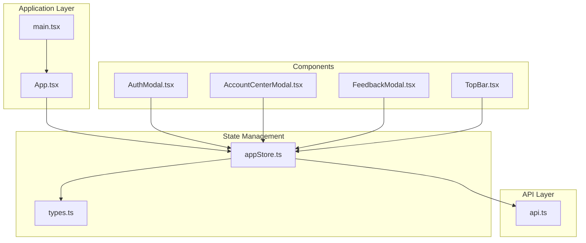
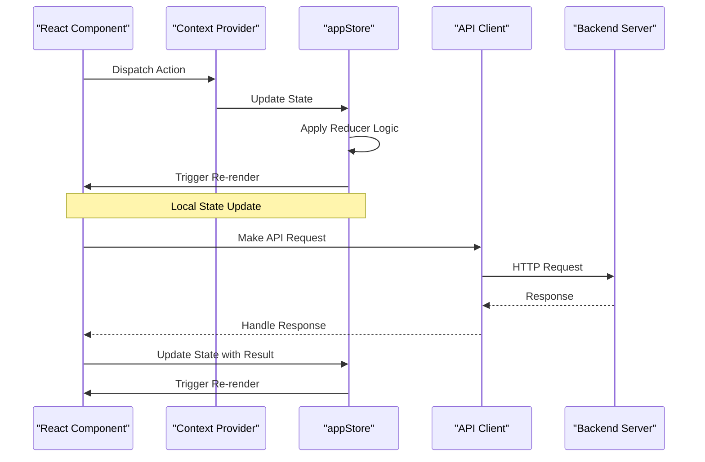
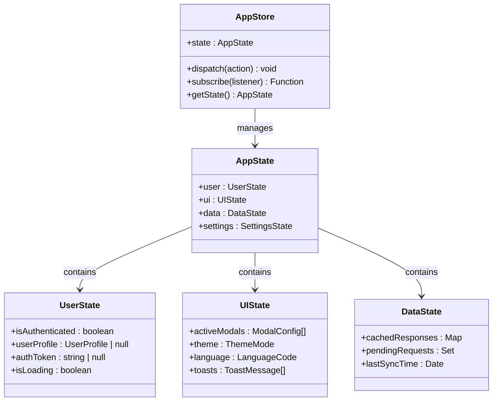
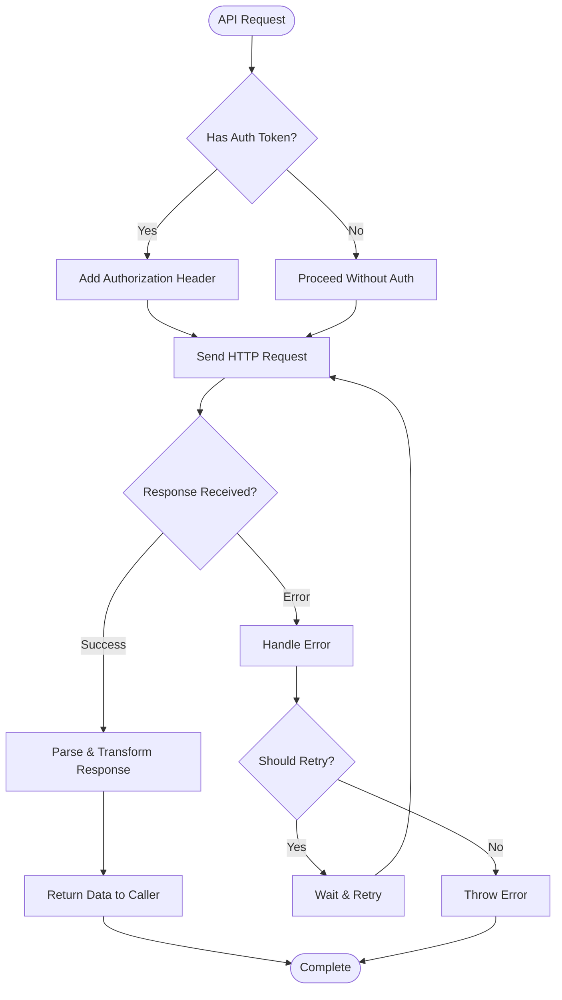
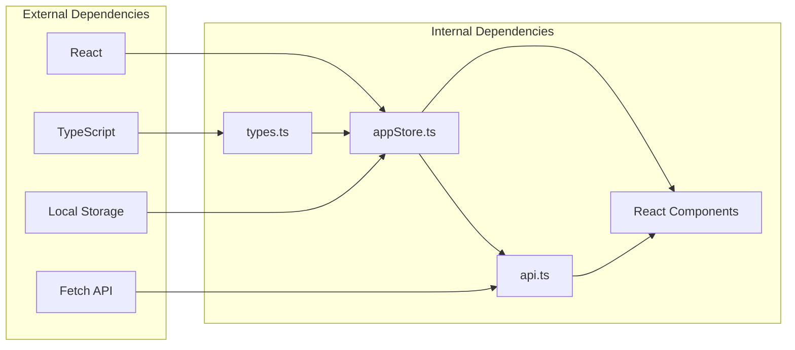

# State Management with Context API

<cite>
**Referenced Files in This Document**
- [appStore.ts](file://web/src/store/appStore.ts)
- [api.ts](file://web/src/lib/api.ts)
- [App.tsx](file://web/src/App.tsx)
- [main.tsx](file://web/src/main.tsx)
- [types.ts](file://web/src/types.ts)
</cite>

## Table of Contents
1. [Introduction](#introduction)
2. [Project Structure](#project-structure)
3. [Core Components](#core-components)
4. [Architecture Overview](#architecture-overview)
5. [Detailed Component Analysis](#detailed-component-analysis)
6. [Dependency Analysis](#dependency-analysis)
7. [Performance Considerations](#performance-considerations)
8. [Troubleshooting Guide](#troubleshooting-guide)
9. [Conclusion](#conclusion)
10. [Appendices](#appendices)

## Introduction

This document provides comprehensive documentation for implementing a robust state management system using React's Context API. The system is designed to handle complex application state without prop drilling, featuring a centralized store pattern with proper TypeScript support, API client abstraction, and performance optimization techniques.

The implementation focuses on creating a scalable architecture that separates concerns between state management, API communication, and component logic while maintaining type safety and developer experience.

## Project Structure

The state management system follows a modular architecture with clear separation of responsibilities:

**Diagram sources**
- [App.tsx](file://web/src/App.tsx)
- [main.tsx](file://web/src/main.tsx)
- [appStore.ts](file://web/src/store/appStore.ts)
- [api.ts](file://web/src/lib/api.ts)
- [types.ts](file://web/src/types.ts)

**Section sources**
- [appStore.ts](file://web/src/store/appStore.ts)
- [api.ts](file://web/src/lib/api.ts)
- [App.tsx](file://web/src/App.tsx)
- [main.tsx](file://web/src/main.tsx)
- [types.ts](file://web/src/types.ts)

## Core Components

### Global State Structure

The global state is organized into logical domains to maintain clarity and prevent unnecessary re-renders:

#### User Authentication State
- **User Profile**: Current user information and authentication status
- **Session Management**: Token handling and session persistence
- **Permissions**: Role-based access control data

#### Application UI State
- **Modal Management**: Active modal states and configurations
- **Theme Settings**: Dark/light mode preferences
- **Language Preferences**: Internationalization settings
- **Toast Notifications**: Message queue for user feedback

#### Data State
- **Cached API Responses**: Optimistic updates and offline support
- **Form States**: Temporary form data and validation results
- **Feature Flags**: Runtime feature toggles

### State Update Patterns

The system implements several patterns for efficient state updates:

#### Immutable Updates
All state updates follow immutable patterns to ensure predictable behavior and enable React's reconciliation optimizations.

#### Batched Updates
Multiple related state changes are batched together to minimize re-renders and improve performance.

#### Optimistic Updates
UI updates are applied immediately before server confirmation, providing instant feedback to users.

**Section sources**
- [appStore.ts](file://web/src/store/appStore.ts)
- [types.ts](file://web/src/types.ts)

## Architecture Overview

The state management architecture follows a unidirectional data flow pattern with clear separation of concerns:

**Diagram sources**
- [appStore.ts](file://web/src/store/appStore.ts)
- [api.ts](file://web/src/lib/api.ts)
- [App.tsx](file://web/src/App.tsx)

## Detailed Component Analysis

### App Store Implementation

The appStore serves as the central state management hub, implementing a provider-consumer pattern with TypeScript support:

#### Store Structure
- **State Definition**: Comprehensive TypeScript interfaces for all state properties
- **Reducer Functions**: Pure functions for state transitions
- **Action Creators**: Type-safe functions for dispatching state changes
- **Provider Component**: Context wrapper for state distribution

#### Key Features
- **Type Safety**: Full TypeScript integration with generic types
- **DevTools Support**: Integration with React DevTools for debugging
- **Persistence**: Local storage synchronization for critical state
- **Error Boundaries**: Graceful error handling and recovery

**Diagram sources**
- [appStore.ts](file://web/src/store/appStore.ts)
- [types.ts](file://web/src/types.ts)

### API Client Abstraction Layer

The API client provides a unified interface for all backend communication with built-in error handling and authentication:

#### Request/Response Handling
- **Request Interceptors**: Automatic token injection and request formatting
- **Response Interceptors**: Standardized response parsing and error transformation
- **Retry Logic**: Configurable retry mechanisms for failed requests
- **Timeout Management**: Request timeout configuration and cancellation

#### Error Management
- **Network Errors**: Connection failures and timeout handling
- **HTTP Errors**: Status code interpretation and user-friendly messages
- **Validation Errors**: Backend validation error processing
- **Custom Errors**: Application-specific error types and handling

#### Authentication Token Handling
- **Token Storage**: Secure token persistence in memory and localStorage
- **Token Refresh**: Automatic token refresh before expiration
- **Token Injection**: Automatic header attachment for authenticated requests
- **Logout Cleanup**: Token removal and session cleanup

**Diagram sources**
- [api.ts](file://web/src/lib/api.ts)

**Section sources**
- [appStore.ts](file://web/src/store/appStore.ts)
- [api.ts](file://web/src/lib/api.ts)
- [types.ts](file://web/src/types.ts)

### Context Provider Implementation

The Context Provider wraps the application and provides state access to all components:

#### Provider Setup
- **Initial State**: Predefined default values and environment detection
- **State Persistence**: Load saved state from local storage on initialization
- **Cleanup Handlers**: Proper resource cleanup on component unmount
- **Error Boundaries**: Wrap context consumption with error boundaries

#### Consumer Pattern
- **Selective Subscriptions**: Components subscribe only to relevant state slices
- **Memoized Selectors**: Performance optimization through memoized state selectors
- **Batched Updates**: Multiple state updates are batched to prevent excessive re-renders

**Section sources**
- [App.tsx](file://web/src/App.tsx)
- [main.tsx](file://web/src/main.tsx)

## Dependency Analysis

The state management system maintains clear dependency relationships:

**Diagram sources**
- [appStore.ts](file://web/src/store/appStore.ts)
- [api.ts](file://web/src/lib/api.ts)
- [types.ts](file://web/src/types.ts)

**Section sources**
- [appStore.ts](file://web/src/store/appStore.ts)
- [api.ts](file://web/src/lib/api.ts)
- [types.ts](file://web/src/types.ts)

## Performance Considerations

### Optimization Techniques

#### Memoization Strategies
- **useMemo Hooks**: Expensive computations are memoized to prevent recalculation
- **useCallback Hooks**: Function references are stabilized to prevent unnecessary re-renders
- **React.memo**: Components are wrapped to prevent re-renders when props haven't changed
- **Selector Functions**: State selectors are memoized for efficient state subscriptions

#### State Normalization
- **Flat State Structure**: Related entities are stored in normalized forms
- **Reference-Based Updates**: Complex objects use reference equality for efficient updates
- **Partial Updates**: Only necessary state portions are updated to minimize re-renders

#### Rendering Optimization
- **Lazy Loading**: Heavy components are lazy-loaded when needed
- **Virtual Scrolling**: Large lists use virtual scrolling for performance
- **Debounced Updates**: Frequent updates are debounced to reduce render frequency

### Memory Management
- **Event Listener Cleanup**: All event listeners are properly cleaned up
- **Timer Cleanup**: Intervals and timeouts are cleared on component unmount
- **Large Object Disposal**: Large data structures are disposed when no longer needed

## Troubleshooting Guide

### Common Issues and Solutions

#### State Not Updating
- **Verify Immutability**: Ensure state updates create new object references
- **Check Action Dispatch**: Confirm actions are being dispatched correctly
- **Validate Reducers**: Ensure reducers return new state objects

#### Performance Issues
- **Identify Re-renders**: Use React DevTools Profiler to identify unnecessary re-renders
- **Optimize Selectors**: Implement memoized selectors for expensive state computations
- **Reduce State Scope**: Keep state as localized as possible within components

#### API Communication Problems
- **Check Network Requests**: Use browser devtools to inspect network requests
- **Verify Authentication**: Ensure tokens are properly attached to requests
- **Handle Errors**: Implement comprehensive error handling and logging

### Debugging Tools
- **React DevTools**: Inspect component tree and state changes
- **Redux DevTools**: Monitor state transitions and action history
- **Console Logging**: Strategic logging for state and API call tracking

**Section sources**
- [appStore.ts](file://web/src/store/appStore.ts)
- [api.ts](file://web/src/lib/api.ts)

## Conclusion

The React Context API state management system provides a robust foundation for managing complex application state without prop drilling. By implementing proper TypeScript support, API client abstraction, and performance optimization techniques, the system ensures maintainable, scalable, and high-performance applications.

Key benefits include:
- **Centralized State Management**: Single source of truth for application state
- **Type Safety**: Full TypeScript integration for better developer experience
- **Performance Optimization**: Memoization and selective subscriptions for optimal rendering
- **Scalable Architecture**: Modular design that supports growing application complexity
- **Error Handling**: Comprehensive error management and recovery mechanisms

This implementation serves as a solid foundation for building production-ready React applications with sophisticated state management requirements.

## Appendices

### Best Practices Checklist

#### State Management
- [ ] Keep state minimal and focused
- [ ] Use immutable update patterns
- [ ] Normalize complex data structures
- [ ] Implement proper error boundaries
- [ ] Add comprehensive logging for debugging

#### API Integration
- [ ] Centralize API calls in dedicated services
- [ ] Implement proper error handling and retry logic
- [ ] Cache responses appropriately
- [ ] Handle authentication token lifecycle
- [ ] Add request/response interceptors

#### Performance Optimization
- [ ] Use memoization for expensive computations
- [ ] Implement selective state subscriptions
- [ ] Lazy load heavy components
- [ ] Debounce frequent user interactions
- [ ] Monitor and optimize re-renders

#### Code Quality
- [ ] Maintain consistent naming conventions
- [ ] Write comprehensive TypeScript interfaces
- [ ] Add meaningful comments and documentation
- [ ] Implement proper testing strategies
- [ ] Follow established architectural patterns